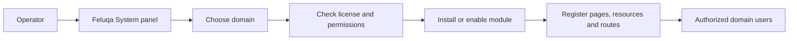

# Feluqa platform overview

## What Feluqa is

Feluqa is a server platform developed by NUMERIMONDES. An operator installs it
on a server. It provides the runtime, a built-in System panel, identity and
access control, data connections, panel infrastructure, shared components, and
hosting services for installable modules.

A Feluqa module adds a business product or capability: for example HRM, CRM,
inventory, or the Numerimondes platform. Modules use Feluqa's panel and
security APIs. They do not install a separate Feluqa server for each business
function.

## How an operator is intended to use it

The platform's System panel is the control point for a Feluqa installation.
The intended workflow is to select a domain, install or enable a compatible
module, configure it, assign permitted capabilities, and let its pages and
resources appear in the domain's panels. Module capabilities are limited by
the license and grants that apply to that domain.

## What is available now

| Capability | Current state |
|---|---|
| Feluqa framework and System panel crates | Present in the monorepo; the panel is a first implementation. |
| Numerimondes `/system` identity and operations | A working vertical slice with users, roles, tenants, migrations and audit operations. |
| Numerimondes CRM | Initial CRUD with tenant/record ownership and field-level checks. |
| Install a packaged module dynamically from System | Not implemented. Current module registration is static and compiled. |
| Domain-scoped license enforcement and capability gating | Required platform design; not implemented end to end. |
| Full Filament-compatible theme and component system | Not imported. Selected browser assets and partial Rust components exist. |

For this reason, the current Numerimondes website development command is not a
demonstration of the future module-installation workflow. The runtime lifecycle
and business workflows remain in progress.

## When to use Feluqa

Feluqa is aimed at organizations that want control over business software,
hosting and data. Deployment requirements such as high availability, backups,
restore, support, and a particular license must be agreed and verified for the
specific deployment. This page describes the product model; it is not a claim
that every enterprise operation is already available.

Next: [modules, domains and licensing](modules-domains-and-licensing.en.md).
