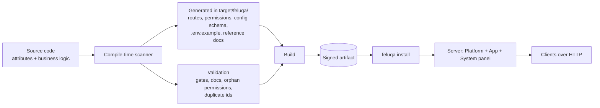
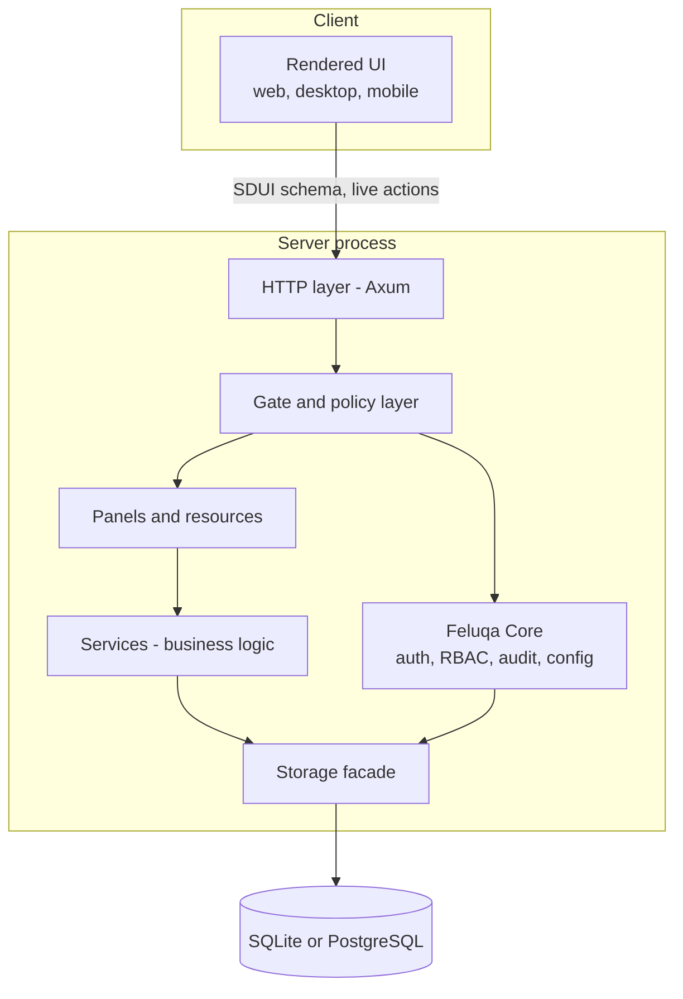

# Architecture Overview

## Principles

1. **Write only business logic.** Routes, permissions, sidebar, SDUI schemas, manifests and configuration files are generated at compile time.
2. **No manual registry, no magic strings.** Everything is declared with attributes (`#[panel]`, `#[resource]`, `#[permissions]`, `#[gate]`, ...) and collected by the compile-time scanner.
3. **Context is implicit.** The scanner knows the current module, so you write `Refund`, not `sales.refund`. The full path is still accepted.
4. **Secure by default.** A write handler without `#[gate]` does not compile.
5. **One file, one responsibility.** One resource per file. No catch-all `mod.rs` or `admin.rs`.
6. **One namespace.** `feluqa::ui`, `feluqa::panel`, `feluqa::auth`, `feluqa::resource`. No `feluqa_*` crates imported by application code.
7. **Server is the source of truth.** Hiding something in the client is never protection.

## End-to-end flow

## Runtime layers

The SDUI schema sent to the client is **already filtered server-side**: an entry the user may not see is never serialized.

## What is generated and never edited

Generated into `target/feluqa/`, never edited and never committed:

- module manifests and the route table;
- the permission table (consumed by the System panel);
- configuration schemas and `.env.example`;
- reference documentation.

`feluqa.toml` (product) and `module.toml` (module) remain valid contexts but are now simple markers written once by `feluqa new` or `feluqa make:module`. Their content is derived from attributes and `Cargo.toml`.

## Target profiles

| Profile | Typical use | Storage | Status |
| --- | --- | --- | --- |
| `server` | Hosted backend, multi-user web app | PostgreSQL, or SQLite for small single-server installs | Partial |
| `workstation` | Standalone local app on a desktop | SQLite in the user data directory | Target |
| `embedded` (`no_std`) | Telemetry, sensor ingestion | Minimal or none | Exploring |

See [web and workstation modules](../08-roadmap/01-delivery-tracks.en.md) (track F9) for how one module serves both server and workstation products.
