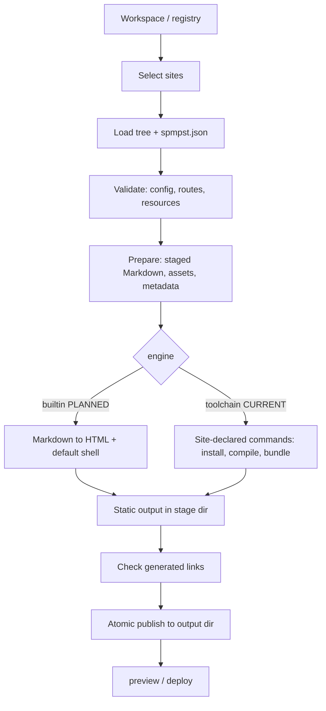

# SPMPST — Standard Portable Markdown Pre-SSG Tree

**Status:** Draft, implementation in progress
**Version:** 0.1.0-draft.2
**Date:** 31 October 2026

## 0. Preface

### 0.1 What SPMPST is

SPMPST is two things, specified **separately** on purpose:

1. **A filesystem standard (the tree).** A portable directory convention and configuration model for documentation and static sites: Markdown sources, per-language files side by side, configuration, logical resources, routes. It is a user-owned, renderer-neutral input.
2. **A tool (the tooling).** A small, fast, self-contained CLI that discovers sites in a workspace, builds one or several of them, serves a local HTTP preview, and produces ordinary static files that can be published to GitHub Pages or any static host.

The tree outlives any tool. The tool can be replaced (today a Node/VitePress pipeline, tomorrow a native Rust binary) without touching a single authored file.

### 0.2 Product goals

1. **Create a static site at lightning speed:** sensible defaults, a minimal JSON configuration (editable by hand or through a future UI).
2. **Compile very fast:** target millisecond-range preparation for hundreds of Markdown pages with a native engine (see §B9 for precise, scenario-based targets).
3. **Self-contained execution:** a local HTTP engine for testing, and no dependency on neighbouring implementation directories such as `docs/vitepress-site/`.
4. **All-in-one build:** SPMPST runs whatever the site declares in order to turn sources into static HTML, CSS, JS, SVG, images and fonts, including dependency installation and compilation, so that a project's documentation and its neighbouring website share one workflow.
5. **Publish anywhere static:** the output is plain static files.

The target workflow:

```sh
cd /path/to/docs
spmpst list
spmpst preview site-1
spmpst preview site-1 site-2
spmpst build site-1
spmpst deploy site-1
```

### 0.3 Non-goals

- **No frontend-framework standardization.** React, Vue, Svelte, Astro and others each have their own paradigms, imports and tooling. SPMPST does not define a component model, lifecycle, or cross-framework compiler. Each site chooses its libraries and declares how to build them (§B3). Mixing frameworks is allowed wherever the site's own build can handle it.
- **No guarantee that Markdown containing components is readable without the framework runtime.** Fallback content for framework-specific tags is the site's responsibility, not SPMPST's. (Ordinary Markdown is always converted to meaningful HTML.)
- **No WebAssembly requirement.** WASM brings no benefit for a local CLI and is out of scope.
- **No dynamic hosting.** SPMPST does not provide personalized or server-side behaviour from static hosting.
- **Not a Markdown dialect, not a runtime.**

### 0.4 Document map

| Part | Identifier | Subject | Status |
|---|---|---|---|
| A | SPMPST-0001 | **Tree standard**: layout, files, routes, locales, config, resources | v0.1 baseline + proposals |
| B | SPMPST-0002 | **Tooling standard**: `spmpst.json`, CLI, build, preview, incremental updates, performance | mostly PROPOSED |
| C | (informative) | **Current implementation**: VitePress host (Node) | CURRENT |
| D | (informative) | **Future native implementation** (Rust) | PLANNED |
| E | SPMPST-0003..0006 | Companion specifications (SEO, offline, agent, reproducible builds), outlines only | PLANNED |

Each companion specification is defined on its own later; Part E records only the constraints already agreed so nothing is lost.

### 0.5 Conventions

**MUST, MUST NOT, REQUIRED, SHALL, SHALL NOT, SHOULD, SHOULD NOT, RECOMMENDED, MAY, OPTIONAL** are interpreted as in RFC 2119 and RFC 8174 only when in capitals.

Status labels:

- **CURRENT**: behaviour observed in the existing JavaScript/VitePress implementation.
- **PROPOSED**: a contract in this document not yet implemented.
- **PLANNED**: intended, with no assured design or schedule.
- **EXPERIMENTAL**: syntax or behaviour that MUST NOT be relied on for interoperability.

If a PROPOSED requirement conflicts with observed CURRENT behaviour, that is an **unimplemented requirement**, not evidence that the implementation conforms. Source references of the form `path#symbol` come from a reference inventory that has not been revalidated against a live repository for this edition.

---

# Part A: SPMPST-0001 Tree Standard

## A1. Scope

The tree standard defines authored sources and configuration **before** site generation: directory layout, file naming, frontmatter, routes, languages and fallbacks, collections, concern-based configuration, layouts, logical resources, and public files. It does not define rendering, components, bundling, serving, or deployment (those are Part B).

## A2. Terminology

- **Workspace**: a directory (or registry file) from which one or more sites are discovered.
- **Site**: one tree root plus its declaration (`spmpst.json`, §B3); has a unique `id`.
- **Tree root**: the directory containing `.site/` (currently `docs/site-1/`).
- **Guide**: an independently routed documentation collection under `src/guides/`.
- **Subguide**: a guide registered in the `subguides` configuration array.
- **Section**: a directory of pages within a guide.
- **Page**: a Markdown source file that is not metadata or ignored content.
- **Collection**: a registry entry whose Markdown files are prepared as a list or article feed.
- **Category**: localized metadata from a collection's `category.json`.
- **Locale / Bundle**: a language code (`en`, `fr`) / a `.locale.json` file with language-specific UI and SEO copy.
- **Concern file**: one `*.site.config.json` file with exactly one owner for each key.
- **Layout**: a named page template selected for a page (§A12).
- **Target / Adapter**: a renderer-specific configuration and resource set / code mapping the shared model to it.
- **Staged tree**: portable Markdown plus staged assets produced before rendering.

## A3. Workspace, site identity, and discovery

### A3.1 Site declaration

Every site has a declaration file stored with its owner at `<tree-root>/.site/spmpst.json` (**PROPOSED** name; **CURRENT** legacy name `vitepress-site.json`). It carries identity, paths and the build contract (the build part is Part B, §B3). Identity and path fields:

| Field | Meaning |
|---|---|
| `id` | Stable, unique identifier. Used for caches, scratch space, and output namespacing. |
| `name` | Human-readable label. |
| `paths.source` | Tree root (contains `.site/`, `src/`, `resources/`). |
| `paths.resources` | Site-owned resources (components, hooks, diagrams, assets). Default: `<source>/resources`. |
| `paths.sharedResources` | Optional shared adapter catalogues (icons, flags). Default: tool-provided. |
| `paths.output` | Final static output directory. Default: outside the source tree. |

All paths are relative to the directory containing the declaration (never to the process working directory), use `/`, and MUST NOT escape their approved roots.

### A3.2 Workspace registry and discovery

A workspace lists its sites in a registry file whose entries point to site declarations:

```json
{
  "sitesPaths": [
    "../site-1/.site/spmpst.json",
    "../site-2/.site/spmpst.json"
  ]
}
```

**CURRENT** registry: `docs/vitepress-site/vitepress-site.json` with entries pointing to `docs/site-N/.site/vitepress-site.json`. The environment variable `VITEPRESS_SITE_MANIFEST` can point to another registry. Relative entries resolve from the registry's directory.

**PROPOSED:** the registry becomes a workspace file (`spmpst.workspace.json`, found by walking up from the current directory). The registry is the authority. When it is absent, a tool MAY fall back to scanning immediate child directories for `*/.site/spmpst.json`. A tool MUST NOT require an implementation checkout path as a user argument.

### A3.3 Site selection and aliases

A command selects sites by any of these aliases (**CURRENT** in `serve.sh --sites`):

1. the site `id` (e.g. `feluqa-docs`),
2. the `name`,
3. the basename of the source directory (e.g. `site-1`),
4. a one-based index as shown by `list`.

An alias that matches more than one site MUST be a blocking diagnostic. Internally a tool resolves every selection to the `id`.

### A3.4 Isolation

A selected site's output, lock state, cache namespace, generated sources, resource catalogue, canonical URL, secrets and environment MUST NOT be inherited from another site's previous run. Distinct sites MUST have distinct `id`s within a workspace.

## A4. Directory layout

```text
<tree-root>/
├── .site/
│   ├── spmpst.json                    # declaration + build contract (Part B)
│   ├── *.site.config.json             # concern files (§A11)
│   ├── locales/*.locale.json
│   ├── public/*                       # public text files passed through
│   ├── schema/*.schema.json
│   └── targets/*.target.config.json   # adapter-owned, opaque to the core
├── src/
│   ├── guides/
│   └── collections/
└── resources/
    ├── components/  hooks/  diagrams/  assets/   # site-owned
```

Source roots MUST use these fixed conventions. The tree root MUST be the directory containing `.site/`; the environment variable `SPMPST_ROOT` MAY override it for tooling. Shared adapter catalogues (`icons/`, `flags/`) MAY live beside the adapter instead of inside the tree. **CURRENT:** the VitePress host keeps them in `docs/vitepress-site/resources/`; Feluqa-owned `components/`, `hooks/`, `diagrams/` stay in `docs/site-1/resources/`.

Language variants live **together** in the same directory (`page.en.md`, `page.fr.md`). A separate directory tree per language MUST NOT be required.

## A5. Paths and safety

- Paths in `.site/` MUST be relative to the tree root, use `/`, and MUST NOT escape the root via `..`, absolute paths, or symlinks. A symlink MAY be followed only if its canonical target remains within an approved root.
- Collection `dir` is relative to `src/collections` and defaults to its `id`. Guide config paths are relative to that guide. Markdown relative links are relative to their page.
- Assets referenced from Markdown MAY come from `src/guides`, `src/collections`, or the source tree's `resources/`; adapter resources are referenced by logical resource identifiers (§A13). Any other path is rejected.

## A6. Source file conventions

- **Ordering prefixes.** `010-` and `020.` style numeric prefixes control navigation order and are removed from staged names and routes.
- **Language suffix.** `name.<lang>.md` with `<lang>` matching `[a-z]{2,3}(-[A-Z]{2})?`. A file without suffix belongs to the fallback language.
- **Ignored.** Names beginning with `.` and files named `README.md` MUST NOT be published. `sidebar.json`, `guide.config.json` and collection `category.json` are metadata, not pages.
- **Directory index.** `index.<lang>.md` provides a localized directory index; a prefixed form such as `000-index.en.md` MAY be used and emits the normal `index.md` route. The root fallback index is `src/guides/index.<fallbackLanguage>.md`.
- **Recommended naming.** A guide SHOULD use a stable, site- or product-qualified directory name (`feluqa.rs/`, `numerimondes.com/`). Sections and pages SHOULD use three-digit prefixes (`000-prologue/`, `010-release-notes.en.md`). This is a recommendation, not a restriction.

## A7. Frontmatter

- Unknown frontmatter MUST be preserved for the target, except fields rewritten by preparation.
- **v0.1 baseline rule (CURRENT):** every published page MUST define `icon` and `sidebarTitle`; `title` and `description` are recommended; collection articles MAY include `date` and `category`. These two required fields are renderer-shaped vocabulary and are candidates for relaxation in v0.2 (defaults derived from `title` and the file name).
- Preparation MAY add: `requestedLanguage`, `contentLanguage`, `languageFallbackNotice`, `prev`, `next`, `search`, `collection`, `wordCount`, `readingTime`, `collectionIndex`.
- A page MAY select a layout with `layout` (§A12).

## A8. Routing

- Guide routes are configured with `uri.base` and optional `uri.index`; locale prefixes depend on `fallbackLanguage` and `selector.prefixDefaultLanguage`.
- Route segments are cleaned by removing numeric ordering prefixes. Directory indexes and collection pages are emitted from their source locations.
- **Collision policy (PROPOSED):** when two sources emit the same destination (including public files versus generated routes, localized aliases, or assets), the tool MUST emit a blocking diagnostic; silent overwrites are prohibited. **CURRENT:** only specific generators detect conflicts; there is no general route-conflict validator.
- **Identity (PROPOSED):** a stable page identity is the normalized source-relative path plus effective locale (or an explicit unique `id` in frontmatter), distinct from the mutable public route.

## A9. Languages and fallbacks

- `lang.site.config.json` owns `languages`, `fallbackLanguage` and `selector`. Each configured language MUST have exactly one `.site/locales/<language>.locale.json`; extra bundles produce a warning.
- Locale bundles MUST contain language, UI, search, outline, footer, notice and SEO sections.
- Localized inline objects resolve: requested language, then fallback language, then the first string value. Missing translations warn, and fail under strict i18n.
- When a non-default translation is absent, a fallback page is generated from the default-language page and marked with `requestedLanguage`, `contentLanguage` and `languageFallbackNotice`. Notice templates use `{requested}` and `{fallback}` placeholders (the reference implementation currently validates `{requested}`).

## A10. Collections

- Layout is `article` or `doc`; index layout is `list` or `spotlight`.
- `category.json` provides localized category names and IDs.
- Word count counts whitespace-separated words; reading time rounds up at 200 words per minute.
- Category-specific routes and route-conflict checks are **PLANNED**.

## A11. Configuration

### A11.1 Concern files

| Concern | File | Main keys |
|---|---|---|
| Definitions | `definitions.site.config.json` | `site`, `guidesPath`, `indexPath`, `project`, `subguides`, `iconFallback` |
| Languages | `lang.site.config.json` | `languages`, `fallbackLanguage`, `selector` |
| Navigation | `topbar.site.config.json` | `items`, `theme` |
| Collections | `collections.site.config.json` | `collections` |
| Appearance | `appearance.site.config.json` | `fonts`, `logo`, `ogImages`, `mermaid` |
| Links | `links.site.config.json` | `socialLinks` |
| SEO | `seo.site.config.json` | `siteUrl`, `path`, `icon` |
| Layouts (**PROPOSED**) | `layouts.site.config.json` | `layouts`, `rules` (§A12) |

The loader MUST reject unknown concerns, unknown keys, duplicate ownership, malformed JSON, missing required files, and missing locale bundles, and SHOULD suggest a likely owner or spelling. `$schema` is ignored. Target files (`targets/*.target.config.json`) are returned as **opaque data**; validation belongs to the consuming adapter.

### A11.2 Forward compatibility

Configuration is a versioned, closed schema: unknown keys are rejected unless they live in a declared extension namespace. By contrast, HTML, unknown frontmatter, and ordinary public files MUST be preserved wherever the consumer can represent them.

```json
{ "extensions": { "org.example.structured-data": { "enabled": true } } }
```

Namespaced extensions MUST NOT silently redefine core keys.

### A11.3 Minimal configuration

A basic site SHOULD need very little: `definitions`, `lang` and one locale bundle, with all other concerns defaulted by the tool. `spmpst new` (§B5) generates exactly that.

## A12. Layout registry (PROPOSED)

**CURRENT:** layouts and page shells are selected through site hooks and renderer-shaped frontmatter (`layout`, `sidebar: false`, `aside: false`). **PROPOSED:** a declarative registry in configuration, so no code is needed for common cases:

```json
{
  "layouts": {
    "doc":     { "component": "DocLayout" },
    "article": { "component": "ArticleLayout", "features": { "toc": true, "pager": true } },
    "landing": { "component": "LandingLayout", "features": { "sidebar": false, "toc": false } }
  },
  "rules": [
    { "match": "src/collections/articles/**", "layout": "article" },
    { "match": "src/guides/*/index.*.md",     "layout": "landing" }
  ]
}
```

- `component` is an opaque string interpreted by the adapter/toolchain; the core only validates references and layout names.
- Resolution order: page frontmatter `layout`, then first matching `rules` entry, then the guide default, then `doc`.
- Neutral `features` keys replace renderer flags (`sidebar: false`, `aside: false`). Adapters translate them.
- Hooks remain available as an escape hatch; configuration wins when both are present and the conflict is reported.

## A13. Resources, assets, and public files

### A13.1 Logical resource references

Grammar, whole-string form only:

```text
@spmpst::resources::<kind>::<id>
```

- `kind` is `icon` or `flag`.
- `<id>` is a slash-separated Unicode path of letters, numbers, `.`, `_`, `-`, `/`; it MUST start with a letter or number, MUST NOT contain empty or `.`/`..` segments, and is normalized to NFC.
- The core parses the reference into a typed record `{ namespace, kind, id }`. It does **not** touch the filesystem. The adapter resolves it against its selected catalogue and emits a target-ready path or URL. An unknown or escaping resource is a build error; resolution MUST NOT fetch from the network.

```text
@spmpst::resources::icon::lucide/book-open
@spmpst::resources::flag::language/fr
@spmpst::resources::flag::catalog/countries/fr
```

Resolution applies at explicit points (configuration values, page `icon` frontmatter, sidebar icons, language flags). It is **not** a general text-substitution mechanism in Markdown prose.

### A13.2 Assets

Local assets referenced from Markdown or frontmatter are copied to content-addressed names (`__docs-assets/<sha256><ext>`), written only if bytes changed. Identical bytes deduplicate.

### A13.3 Public files

Files in `.site/public/*` are published as site-owned text files without changes to SPMPST: `llms.txt`, `robots.txt`, `humans.txt`, `security.txt`, verification files, and future discovery documents. SPMPST assigns no semantics to them. **CURRENT:** one trailing newline is removed on emission.

## A14. HTML and Markdown passthrough

- The core MUST NOT keep a restrictive allowlist of HTML elements: unknown valid element names, `data-*`, ARIA attributes and new `<meta>` forms MUST pass through to an HTML-capable adapter.
- Sanitization is a separate, explicit, versioned security policy for untrusted input. Unknown markup MUST NOT bypass it.
- Markdown MUST NOT treat arbitrary inline text as an executable directive. `@spmpst::` is recognized only in documented contexts.

## A15. Structured references (EXPERIMENTAL)

Candidates, **not implemented** and MUST NOT be relied upon:

```text
@spmpst::self::frontmatter::title
@spmpst::self::frontmatter::author.name
@spmpst::page::handbook/intro::frontmatter::description
```

If standardized: references resolve against a typed context (never by code execution); `self` is always the page being processed; cycles fail deterministically; missing keys yield a diagnostic; output is escaped per context; cross-page references participate in dependency tracking. A future revision decides whether this syntax is metadata-only, a directive, or a component prop. Implementations SHOULD NOT parse it in prose until then.

## A16. Versioning and naming debt

- A breaking tree, metadata or model change SHOULD increment the major version; additive optional fields the minor version. A manifest enforcing this is **PLANNED**.
- Existing v0.1 trees MUST remain consumable. A breaking change needs a migration plan and a before/after fixture.
- **v0.2 candidates (discussion only):** `subguides` → `guides`; drop `subguides[].label`; `sidebarTitle` → neutral navigation title; `topbar` → `header`; clarify `uri.entry`; `documentationNotices` → `notices`; replace renderer-shaped flags with neutral layout features (§A12); add `layouts.site.config.json`.

---

# Part B: SPMPST-0002 Tooling Standard

## B1. Delivery shape and principles

The primary product is a **standalone CLI** (`spmpst`). A desktop GUI MAY wrap the same engine; host integrations (such as the VitePress pipeline) remain adapters. No integration may be required for the CLI to discover, build or preview a registered site. All surfaces SHOULD share validators and produce semantically equivalent output for the same inputs.

Principles:

1. **Simple by default.** Small commands, minimal config, defaults from presets.
2. **Self-contained.** After installation, execution depends only on the workspace, the declared site inputs, and spmpst-managed caches/toolchains, never on a neighbouring implementation checkout.
3. **Per-site isolation.** One site per build context; caches, output and locks namespaced by `id`.
4. **Static output.** Authored Markdown becomes HTML at build time. Site components MAY need JavaScript; they are the site's concern.
5. **Site-owned frontend.** The site declares how its frontend is built (§B3, §B10).
6. **Honest performance claims.** Targets are scenario-based and measured (§B9).

## B2. Pipeline model



Every stage MUST emit machine-readable diagnostics for blocking failures. The prepared model SHOULD be JSON-serializable and free of framework runtime objects.

## B3. `spmpst.json`: declaration and build contract

`spmpst.json` (in `.site/`) holds everything the tool needs to build the site, including the commands to execute for bundling. This is how SPMPST stays agnostic of frontend frameworks: the site says **what to run**, SPMPST orchestrates it. Minimal form:

```json
{ "specVersion": "0.1", "id": "site-1", "name": "My docs" }
```

Full form (**PROPOSED**; the current VitePress host realizes the same data through its registry, declaration and `site.mjs`):

```json
{
  "$schema": "./schema/spmpst.schema.json",
  "specVersion": "0.1",
  "id": "feluqa-docs",
  "name": "Feluqa documentation",
  "paths": {
    "source": "..",
    "resources": "../resources",
    "sharedResources": "../../vitepress-site/resources",
    "output": "../../../docs-output/site-1"
  },
  "engine": "toolchain",
  "toolchain": {
    "preset": "vitepress",
    "cwd": "../../vitepress-site",
    "install": { "command": "npm ci", "when": "missing" },
    "build":   { "command": "vitepress build app" },
    "dev":     { "command": "vitepress dev app --host {host} --port {port} --strictPort" },
    "network": "install-only"
  }
}
```

### B3.1 Fields

| Field | Meaning |
|---|---|
| `engine` | `builtin` (PLANNED native Markdown to HTML with a default shell, no JS toolchain) or `toolchain` (run site-declared commands). |
| `toolchain.preset` | Named preset supplying defaults for `install`, `build`, `dev` (e.g. `vitepress`). Explicit fields override the preset. |
| `toolchain.cwd` | Working directory for the commands, relative to the declaration. |
| `toolchain.install` | Command to provision dependencies; `when`: `missing`, `always`, or `never`. |
| `toolchain.build` | Command(s) that read the prepared inputs and write static files to `{stageDir}`. |
| `toolchain.dev` | Command for the interactive development server (OPTIONAL). |
| `toolchain.network` | `none`, `install-only`, or `full`; informs controls and reports. |
| `toolchain.env` | Extra environment variables (secrets MUST NOT be copied into artifacts). |

### B3.2 Placeholders and environment

Commands MAY use `{siteId}`, `{sourceDir}`, `{generatedDir}`, `{stageDir}`, `{outDir}`, `{cacheDir}`, `{host}`, `{port}`. The tool also exports `SPMPST_SITE_ID`, `SPMPST_ROOT`, `SPMPST_GENERATED_DIR`, `SPMPST_STAGE_DIR`, `SPMPST_OUT_DIR`, `SPMPST_CACHE_DIR`, `SPMPST_MODE` (`build`, `dev`, `preview`).

**CURRENT** equivalents set by `site.mjs`: `SPMPST_ROOT`, `DOCS_OUTPUT_DIR`, `VITEPRESS_SITE_ID`, `VITEPRESS_SITE_DECLARATION`, `VITEPRESS_SITE_ROOT`, `VITEPRESS_TRASH_DIR`, `VITEPRESS_RESOURCES_DIR`, `VITEPRESS_SITE_RESOURCES_DIR`, `HOST`, `PORT`.

### B3.3 Contract with the output

After `build` succeeds, `{stageDir}` MUST contain a deployable static site. The tool then validates links and publishes atomically. The destination host needs neither the tool nor the toolchain.

### B3.4 Trust

`install` and `build` commands execute project and package code. The CLI MUST state this clearly, MUST print the commands it runs, MUST allow inspection (`--dry-run`) and disabling installs (`--no-install`), and SHOULD offer network restriction where practical.

## B4. Engines

| Engine | Status | Description |
|---|---|---|
| `toolchain` + preset `vitepress` | **CURRENT** | Node host prepares generated Markdown and metadata, VitePress/Vite render. Chosen for design, reactivity and search bar. |
| `toolchain` + custom commands | PROPOSED | Any site-declared commands (Vite, Astro, esbuild, plain scripts). |
| `builtin` | **PLANNED** | Native Rust Markdown to HTML with a default shell and prebuilt components; no Node needed. |

The tree standard (Part A) is identical for all engines. A site MAY start on `toolchain` and move to `builtin` without changing content.

## B5. CLI contract

### B5.1 Commands

| Command | Purpose |
|---|---|
| `spmpst list` | Report registered sites: index, `id`, name, source root, output directory. |
| `spmpst new <dir>` / `init` | Create a minimal tree and `spmpst.json` with defaults (PROPOSED). |
| `spmpst check [sites]` | Validate configuration, frontmatter, routes, resources (CURRENT: `docs:check`). |
| `spmpst prepare [sites]` | Run preparation only. |
| `spmpst build [sites]` | Prepare, build, validate, publish atomically; report each output directory. |
| `spmpst preview [sites]` | Build as needed, serve built output over local HTTP, rebuild on change by default. |
| `spmpst dev [sites]` | Interactive development server with in-place updates, when the engine offers it. |
| `spmpst clean [sites]` | Remove generated files and caches of the selected sites only. |
| `spmpst deploy [sites]` | Publish static output (§B11). |
| `spmpst capabilities` | Report version, engines, profiles (`--format json`). |

### B5.2 Selection syntax

All of these are equivalent and MUST be accepted:

```sh
spmpst preview site-1 site-2          # canonical: positional
spmpst preview --sites=site-1,site-2  # conventional flag
spmpst preview sites=site-1,site-2    # key=value form
```

Without a selection: an interactive terminal prompts; a non-interactive process selects all sites for `list`/`build`, and fails for commands that start servers unless `--all` is given. (**CURRENT** `serve.sh`: selects all in non-interactive mode.)

### B5.3 Options

`--root <dir>` (workspace), `--out <dir>` (single site only), `--host`, `--port` (first of a sequence; each selected site gets the next free port, **CURRENT** default `127.0.0.1:4173`), `--watch` / `--no-watch`, `--no-install`, `--dry-run`, `--strict-i18n`, `--json` (machine-readable diagnostics), `--timing` (per-stage timings).

### B5.4 Behaviour

- The CLI discovers the workspace from the current directory or `--root`.
- `preview` MUST serve built output over HTTP itself; no separate server command, report served URLs, stop cleanly on interruption (children terminated on `SIGINT`/`SIGTERM`).
- Default output is predictable (`dist/<site-id>/`) and outside source trees.
- Exit codes: `0` success, `1` build/validation failure, `2` usage error, `3` toolchain unavailable.
- The simple workflow MUST NOT expose an implementation path such as `docs/vitepress-site/` as a user argument.

## B6. Build semantics

1. **Isolation.** One build binds one site identity, resolved config snapshot, engine and dependency graph. Changing site A's sources MUST NOT change site B's output unless a declared shared dependency changed.
2. **Staging.** Builds write to `<output-parent>/tmp/<output-basename>.stage-<pid>` with a separate generated-source and cache namespace, so a concurrent dev server is unaffected.
3. **Atomic publication.** Rename existing output to a backup, rename stage to output, delete backup; on failure delete the stage and restore the backup. Cleanup MUST be limited to the selected output directory.
4. **Link check.** Local links in generated HTML are validated after the build. This is not an external link check.
5. **Collisions.** Duplicate destinations are blocking (§A8).
6. **Diagnostics.** Each has `code`, `severity`, source file, location when available, `siteId`, explanation and optional suggested fix. Distinct codes for: unknown keys, duplicate routes, invalid references, unavailable toolchain, unsafe paths.
7. **Locking.** Concurrent preparations for one site serialize through a per-site lock with stale-lock detection and a bounded wait (**CURRENT**: `prepare.lock`, 30 s).

## B7. Preview and development

- **preview** (production-like): serves the already built static output; on source change (debounced) rebuilds only the changed site and swaps output atomically; the server process keeps running. The browser MAY need a refresh. (**CURRENT**: `./serve.sh --preview`.)
- **dev** (authoring): serves with in-place updates (§B8). Availability depends on the engine.
- Starting a build MUST NOT make a running dev server reload, delete files it serves, or replace another site's caches.

## B8. Incremental updates (generic requirements)

These are engine-neutral; the engine-specific realizations are in Parts C and D.

1. **Minimal invalidation.** Editing one page body MUST invalidate only that page and pages that declare a dependency on it (including referenced assets). It MUST NOT delete and recreate the whole generated tree.
2. **Retention.** Unchanged generated files keep their bytes and modification times.
3. **Classification.** Page-body edits, navigation/structure edits and site-configuration edits are distinct classes. Only structure/navigation/configuration changes MAY restart or reconfigure the dev server.
4. **Debounce and batching.** Source events are debounced and consecutive events batched into one preparation.
5. **No document reload for body edits (dev).** A content-only edit updates the affected route in place: other open routes and the application shell stay live; scroll position and shell state SHOULD be preserved.
6. **Resilience.** A failed incremental preparation is logged; the watcher stays alive for the next edit.
7. **Acceptance test.** Keep two routes open in two tabs; edit one page body; only the tab showing that route updates, without a document navigation; a simultaneous build of that site leaves the dev server unchanged. Then edit a referenced asset and verify only dependent pages are invalidated.

## B9. Performance targets and benchmarking

Performance claims MUST name the **scenario**, the **stage**, the **machine**, the **cache state** and the **fixture**. The following are **design targets for the native engine**, not measurements. The current Node implementation does not claim them.

### B9.1 Scenarios

| Scenario | Definition |
|---|---|
| **cold** | Fresh process, no caches, full source tree processed. |
| **warm** | Caches present, nothing changed; the tool verifies inputs (stat/size/mtime, content hash when needed) and does no rendering. |
| **one-page edit** | One page body changed; incremental preparation and re-render of that page only. |

### B9.2 Stages (reported separately)

`discovery`, `validation`, `preparation` (staged Markdown, routes, metadata), `markdown→HTML`, `toolchain/bundle` (not controlled by SPMPST), `publish`. A **full build** that includes a JavaScript bundler is a separate figure from native preparation; a preparation target MUST NOT be presented as a full-build target unless a measured full build meets it.

### B9.3 Reference fixture and indicative targets

Fixture: 900 Markdown pages (about 1,500 words each, two locales co-located, ordinary Markdown, no components), on a stated mid-range laptop, local SSD.

| Scenario | Stage | Target (to be refined by measurement) |
|---|---|---|
| warm | discovery + validation + cache check | ≤ 10 ms |
| one-page edit | preparation + Markdown→HTML for that page | ≤ 20 ms |
| cold | preparation + Markdown→HTML, parallel | low hundreds of ms |

An earlier ambition of preparing 900 pages in 5 ms is **retained only for the warm "nothing changed" scenario**, where it is plausible; it is not a cold-render target.

### B9.4 Implementation notes

A native engine can use a fast CommonMark/GFM parser such as `comrak` or `pulldown-cmark`, bounded parallelism across files, async I/O, and a persistent content-hash cache. Output MUST NOT depend on scheduling order.

## B10. Components and frontend toolchains

SPMPST does not define components. A site adds components with its framework's ordinary files, imports and dependencies, and declares in `spmpst.json` how they are built. The tool's job: provision the declared toolchain (§B3), run it, collect the static outputs (HTML, CSS, JS, SVG, images, fonts), report failures, and serve the result.

- A site MAY mix frameworks if its own build handles the composition.
- A site MAY use prebuilt components supplied by SPMPST, a framework ecosystem, or any package source. SPMPST SHOULD offer maintained presets and prebuilt components for common needs so a basic site does not require assembling a frontend stack.
- Whether Markdown containing framework tags has meaningful output without the framework runtime is the site's concern; authors decide whether components need fallback content.
- Production output MUST NOT inadvertently include dev tooling (dev middleware, debug endpoints, source maps leaking secrets). Framework runtime code bundled for a declared interactive component is a legitimate production dependency.

**CURRENT:** only Vue SFCs below `project.components` are auto-registered (PascalCase names from file names, collisions rejected, registered globally in the theme). A host Vite config can add plugins, but other frameworks' compilation and registration are the site's setup.

## B11. Deploy

`spmpst deploy` is deliberately thin (**PROPOSED**):

- `spmpst deploy site-1 --target github-pages` pushes the static output to the configured publishing branch, or
- `spmpst new workflow github-pages` generates a CI workflow that runs `spmpst build` and publishes the output directory.

Other targets (`rsync`, generic upload) MAY be added as providers. Deploy MUST publish only the selected site's output and MUST NOT require the tool on the destination. **CURRENT:** the normal build does not deploy anywhere; deployment is a separate operation.

## B12. Security of the tooling

- Writes outside the approved output root MUST be prevented; archive extraction paths validated (when archives are produced).
- Secrets from the environment, `.env` files or private config MUST NOT be copied into public artifacts without explicit intent.
- Build dependencies and scripts MUST be inspectable; network use and generated runtime dependencies SHOULD be reported; lockfiles/integrity pinning SHOULD be supported.
- Telemetry and trackers MUST be opt-in for generated sites; the builder MUST NOT add analytics, remote fonts or session replay just because a renderer enables them by default.
- Deeper requirements (CSP, supply chain, threat model) belong to the security companion material in Part E.

## B13. Conformance fixtures (PROPOSED)

At minimum: co-located multilingual routes; numeric prefixes; unknown frontmatter; arbitrary new HTML elements and metadata; `llms.txt` passthrough; asset deduplication; duplicate routes; symlink escape attempt; missing-toolchain diagnostic; static output independent of the build tool; multi-site isolation; incremental single-page update; concurrent build and dev isolation; layout resolution order; alias ambiguity. Current gates: `docs:check` (config + frontmatter) and `docs:verify` (snapshot comparison with canonical object-key order, preserving array order). A portable cross-adapter fixture directory is **PLANNED**.

---

# Part C: Current implementation (informative, CURRENT)

This part describes `docs/vitepress-site/` as observed. It is not a specification.

## C1. What the host owns

The shared Node/VitePress host owns the CLI wrappers, preparation pipeline, VitePress adapter, Vite configuration, theme, shared icon/flag catalogues, dependencies and caches. It does not own authored pages. Each site owns `.site/`, `src/`, `resources/`. The host prepares a generated VitePress source tree in `.trash/<site-id>/` and asks VitePress to render or serve it. Output defaults to `docs-output/`.


## C2. Entry points

There is no `docs/vitepress-site/server.sh`; the entry point is `serve.sh`. Smaller scripts under `app/bin/` delegate to `app/scripts/site.mjs`. npm commands: `docs:prepare`, `docs:build`, `docs:serve`, `docs:preview`, `docs:clean`, `docs:check`, `docs:new`, `docs:verify`, each calling `node app/scripts/site.mjs <command>`, selecting a site with `--site <id>` or `VITEPRESS_SITE_ID` (prompt if interactive, failure otherwise).

| Invocation | Behaviour |
|---|---|
| `./serve.sh --list` | Print each site's ID, name, source and output directories; start nothing. Cannot combine with other modes. |
| `./serve.sh --sites=site-1 --build` | Verify the VitePress executable exists, then `site.mjs build --site <id>` per site, sequentially. |
| `./serve.sh --sites=site-1` | Per site: `site.mjs serve`: full preparation, `vitepress dev`, plus a separate watcher. |
| `./serve.sh --sites=site-1 --preview` | Build each site, then `site.mjs serve-build` (VitePress `serve()` on built output) plus `site.mjs watch` with `DOCS_WATCH_BUILD=1` (rebuild on change). |
| `node app/scripts/site.mjs preview --site <id>` | Build once and serve; no rebuild watcher. |

Ports start at `PORT` (default `4173`), `HOST` defaults to `127.0.0.1`. `--build` and `--preview` cannot be combined. Without `--sites`: prompt when interactive, all sites otherwise.

## C3. Registry and declaration

Registry `docs/vitepress-site/vitepress-site.json`:

```json
{ "sitesPaths": ["../site-1/.site/vitepress-site.json", "../site-2/.site/vitepress-site.json"] }
```

Declaration (`docs/site-1/.site/vitepress-site.json`):

```json
{
  "id": "feluqa-docs",
  "name": "Feluqa documentation",
  "sourcePath": "..",
  "resourcesPath": "../../vitepress-site/resources",
  "siteResourcesPath": "../resources",
  "outputPath": "../../../docs-output/site-1"
}
```

Paths resolve from the declaration's directory. `resourcesPath` and `siteResourcesPath` are optional (defaults: host `resources/`, site-root `resources/`). The shell's lightweight reader uses ID, name, source and output; `site-registry.mjs` validates all fields. The target config also contains an `outputDir`, but normal commands set `DOCS_OUTPUT_DIR` from the declaration, which is authoritative (temporarily replaced by a staging path during builds).

**Mapping to the target model:** `sourcePath` → `paths.source`; `resourcesPath` → `paths.sharedResources`; `siteResourcesPath` → `paths.resources`; `outputPath` → `paths.output`; the toolchain is implicit (VitePress preset hard-wired in `site.mjs`).

## C4. Dependencies and delegation

Dependencies are installed once for the host (`npm install` in `docs/vitepress-site/`); the wrapper does not install them and stops with a hint when the VitePress executable is missing.

| Tool | Delegated work |
|---|---|
| Node.js | Registry helper, app CLI, config loader, preparation, watcher. |
| VitePress | `dev`, `build`, static `serve`; Markdown→HTML, bundles, route rendering, local search. |
| Vite + Vue toolchain | Dev server/HMR, SFC compilation, resolution, CSS, bundling, chunking. |
| `@mermaid-js/mermaid-cli` (`mmdc`) | Mermaid fences to cached SVG during preparation. |
| Shiki, Tailwind, PostCSS, `ogl` | Highlighting, styles, WebGL effects in site-owned components. |

## C5. Static build lifecycle

1. Shell validates options and resolves registry entries; no port in build mode.
2. Check host dependencies (VitePress binary; `mmdc` for uncached Mermaid).
3. `node app/scripts/site.mjs build --site <id>`; the app registry re-resolves and validates the declaration.
4. Derive site, shared-resource, site-resource, output and per-site trash roots; working directory is the host app directory.
5. Create staging: `<output-parent>/tmp/<output-basename>.stage-<pid>` and a backup path. Preparation receives the stage as `DOCS_OUTPUT_DIR` and `<site-trash>/build` as `VITEPRESS_TRASH_DIR`.
6. `prepareSources`: load and validate config, target settings, languages, guide/collection paths, project directories and theme slots; scan guides and collections; normalize prefixes and locale suffixes; map routes; collect frontmatter and sidebar records; verify labels and icons; copy assets; stage public files and optional flags.
7. `prepareContent`: resolve logos, fonts, OG images; read guide configs; derive collection indexes and article metadata; register Vue SFCs; validate theme slots; emit generated JSON/TS modules (colors, fonts, collections, components, theme, hooks, styles, navigation, sidebar, SEO helpers).
8. Ordered stages (§C7).
9. VitePress loads `app/.vitepress/config.ts`, which builds navigation, sidebars, locales, head transforms; `app/config/vite.config.ts` aliases `@docs` (generated tree) and `@generated` (metadata), resolves site-component imports from host dependencies, serves generated public assets, provides generated-Markdown HMR in dev. A configured `project.viteConfig` or host-root Vite config is merged.
10. `vitepress build` writes static HTML/assets to the stage (Vite chunk-size warnings are not suppressed).
11. `.spmpst/build-timestamp` is added; `check-file-links.mjs` validates the stage.
12. Atomic publish with backup and restore on failure.

## C6. Development server lifecycle

1. Full (non-incremental) preparation; the generated Markdown root is cleaned and recreated.
2. Spawn `vitepress dev --host <host> --port <port> --strictPort` and a separate `scripts/dev/watch.mjs`.
3. The theme extends `vitepress/theme`, registers generated project components, applies per-route colors/fonts/logo/favicon and page enhancements.
4. The watcher debounces events for **60 ms**, batches paths, and runs incremental preparation (`DOCS_PREPARE_INCREMENTAL=1`): unchanged staged files keep bytes and mtime; stale files are removed at cleanup.
5. **Page-body edits** stay on the generated-Markdown HMR path: the Vite post-HMR hook maps the changed generated path to its public URL and returns that module, so the active route receives a `js-update` without document navigation. The MiniSearch entry for the page is discarded before re-adding, avoiding duplicate-ID errors.
6. **Structural changes** (directory/file structure, route-affecting metadata such as `sidebarTitle`, any `.site` change) alter the structural signature; the watcher touches the VitePress config file to request a restart. The signature hashes source paths/directories and sidebar titles, all `.site` config contents and source-file metadata; page bodies and asset bytes are excluded.
7. Failed preparation is logged; the watcher keeps running. It covers `src/`, `.site/`, shared and site resources. On termination both children receive SIGTERM.

**Mapping to §B8:** minimal invalidation = incremental prepare; classification = structural signature; debounce = 60 ms watcher; no reload = `js-update` via the HMR hook; isolation = separate build trash namespace.

## C7. Preparation pipeline

`app/scripts/preparation/pipeline.mjs` takes a per-site lock (`prepare.lock`, stale detection, 30 s wait) and runs:

| # | Operation | Role |
|---|---|---|
| 1 | `prepareSources` | Site tree/config → staged records, route map, navigation order, copied inputs. |
| 2 | `prepareContent` | Collections, style imports, component registry, hook modules, colors/fonts/SEO/sidebar/theme metadata. |
| 3 | `runTransformMarkdown` | Normalize links, stage local assets, render Mermaid, collection frontmatter. |
| 4 | `runLanguageFallbacks` | Create localized copies for absent translations. |
| 5 | `runSeoPages` | Localized SEO/FAQ pages from locale config. |
| 6 | `runDirectoryIndexes` | Missing index pages and no-slash aliases (excluded from search). |
| 7 | `runPager` | `prev`/`next` frontmatter, avoiding self-links via aliases. |
| 8 | `runCleanup` | Remove stale files (incremental only); print counts. |

`DOCS_PREPARE_TIMING=1` prints per-stage timings; `DOCS_PREPARE_NO_LOCK=1` disables the lock. Writers preserve unchanged bytes and the pager-owned frontmatter block. Output is deterministic for unchanged sources; incremental-cache portability is not guaranteed.

## C8. Resources in practice

- `resolveResourceReferences` walks strings, arrays and objects; `resolveVitepressResource` resolves against the shared host catalogue (`lucide`, `custom`, `heroicons`, `simple-icons`; flags under `flags/language/` and `flags/catalog/`). `icon::book-open` without family tries `lucide/`, `custom/`, `heroicons/`, `simple-icons/` in that order; `flag::fr` is shorthand for `flag::language/fr`.
- Resolution points: `toVitepressRuntime()` (config), page `icon` frontmatter (fallback `iconFallback`, default `circle-help`, with a warning; a missing fallback is fatal), `sidebar.json` icons, language flags (`generated-guides/public/flags/language/<locale>.svg`), topbar icons (plain names or `INHERIT`).
- `copyAsset()` confines sources to allowed roots, names by SHA-256 plus extension, writes only on change.
- Mermaid: palette-colored, rendered by `mmdc` with the site's JSON config, cached by hash of config and diagram text, emitted as light and dark SVG; the browser theme adds zoom/open and light/dark switching.

## C9. Components, hooks, styles

- Vue SFCs below `project.components` are discovered recursively and registered globally in generated `components.ts`; theme slots (target config and `guide.config.json`) are validated against them.
- Hooks by convention under `project.hooks`: `documentation-hooks` (+ optional `.css`) exports `DocumentationNotice`, `DocumentationLastModified` (no-op components when absent); `documentation-seo` exports `transformDocumentationHead` (no-op when absent).
- Configured styles are emitted as imports in a generated TypeScript module.

## C10. Current limits

- Requires Node, host `node_modules`, VitePress, and Mermaid CLI for uncached diagrams; not yet the self-contained `spmpst` binary.
- VitePress/Vue-specific; automatic multi-framework compilation is not implemented.
- `@spmpst::resources` is not a general Markdown expression system.
- No deployment step; no general route-conflict validator.
- No claim of 900 pages in 5 ms; renderer build and asset processing are separate costs.
- `docs/vitepress-site/` is a neighbouring host today.

## C11. Code map

| Responsibility | Implementation |
|---|---|
| Shell, mode selection, ports, child lifecycle | `docs/vitepress-site/serve.sh` |
| Registry, site selection, environment, dispatch, atomic build, serve/watch/clean | `app/scripts/site-registry.mjs`, `app/scripts/site.mjs` |
| Path resolution | `app/scripts/paths.mjs`, `app/scripts/spmpst/layout.mjs` |
| Config discovery/ownership/validation, resource references | `app/scripts/spmpst/config/`, `app/scripts/spmpst/resources.mjs` |
| Runtime conversion and resource lookup | `app/scripts/preparation/runtime.mjs`, `resolve-resource.mjs` |
| Source scan, routes, icons, flags, assets | `app/scripts/preparation/source-stage.mjs` |
| Collections, generated modules, components, hooks | `app/scripts/preparation/content-stage.mjs` |
| Pipeline ordering, lock, timing | `app/scripts/preparation/pipeline.mjs` |
| Markdown transform | `app/scripts/preparation/stages/transform-markdown.mjs` |
| Fallbacks, SEO pages, indexes, pager, cleanup | `app/scripts/preparation/stages/` |
| VitePress config composition | `app/.vitepress/config/` |
| Browser theme | `app/.vitepress/theme/index.ts` |
| Vite aliases, asset serving, Markdown HMR | `app/config/vite.config.ts` |
| Watchers and preview server | `app/scripts/dev/watch.mjs`, `preview-server.mjs` |
| Validation | `app/scripts/dev/docs-check.mjs`, `verify.mjs` |

## C12. VitePress-specific surface (not shared SPMPST guarantees)

| Surface | Location / output |
|---|---|
| Theme slots | `.site/targets/vitepress.target.config.json` |
| Site registry / declaration | `vitepress-site.json` (host) / `.site/vitepress-site.json` |
| Site resources | `docs/site-1/resources/{components,hooks,diagrams}/` |
| Shared resources | `docs/vitepress-site/resources/{icons,flags}/` |
| Styles, search, Markdown options | Target config and generated theme files |
| Emitted frontmatter | `layout`, `sidebar`, `aside`, `search`, `prev`, `next`, `lang` |
| Embedded component tags | Vue syntax, e.g. `<CollectionSpotlightCards />` |
| Generated modules | `docs/vitepress-site/.trash/<site>/vitepress-generated/` |
| CSS classes | Target components and styles |

## C13. Staged example

For the minimal tree in Appendix 1 with `fallbackLanguage: "en"` and default-language prefixing disabled, `src/guides/handbook/index.en.md` stages at `.trash/<site>/generated-guides/handbook/index.md` and its French translation at `.../generated-guides/fr/handbook/index.md`. Collection pages stage below their collection route, relative links are rewritten, referenced assets land under `__docs-assets/`.

---

# Part D: Future native implementation (informative, PLANNED)

## D1. Intent

A single Rust binary `spmpst` implementing Part A and Part B without Node for the `builtin` engine, and orchestrating Node-based toolchains (via `spmpst.json`) for sites that need frontend frameworks. VitePress remains a supported preset for sites that want its design, reactivity and search bar.

## D2. Proposed structure

- `spmpst-core`: tree loader, concern-file validation, routing, locales, resource references, diagnostics, JSON-serializable site model (target-neutral).
- `spmpst-md`: Markdown→HTML (e.g. `comrak`), parallel per-page rendering, content-hash cache.
- `spmpst-engine-builtin`: default shell, prebuilt components, layouts from the registry (§A12), client-side search index.
- `spmpst-toolchain`: runs site-declared commands, provisions toolchains, enforces network/trust controls.
- `spmpst-serve`: embedded HTTP server for preview and dev (no external server process).
- `spmpst-cli`: command surface of §B5.

## D3. Realizing §B8 natively

| Requirement | Native approach |
|---|---|
| Minimal invalidation | Per-page dependency graph (links, assets, includes, layout); content-hash keys; only dirty nodes re-render. |
| Retention | Write-if-changed with byte comparison; mtime untouched on equal bytes. |
| Classification | Page-body vs structure vs config computed from the graph, not from restart heuristics. |
| Debounce | Native file watcher with debounce and batching. |
| No document reload | Dev server pushes a per-route update over WebSocket/SSE; the injected client swaps the affected route's content region; other routes and the shell untouched. |
| Isolation | Per-site cache directory and stage directory; builds never touch the dev server's state. |
| Atomic publish | Rename-based swap as in §B6. |

## D4. Migration path

1. Freeze current fixtures (`docs:check`, `docs:verify` pass).
2. Introduce the `spmpst` CLI as a thin front over the existing Node host (commands of §B5, `spmpst.json` read, host path hidden).
3. Move preparation to Rust, keep VitePress as `toolchain` preset.
4. Ship the `builtin` engine for plain documentation sites.
5. Add companion capabilities (Part E) as separate specifications.

---

# Part E: Companion specifications (outlines)

These are **not** part of SPMPST-0001/0002 and are specified later, each on its own. Constraints already agreed are recorded so they are not lost.

## E1. SPMPST-0003: SEO audit (`seo-audit`)

Analyzes, from local source and build output (no network by default): internal link graph (orphans, unreachable, broken links, redirect chains, click depth), external links, page metadata (title, description, canonical, robots, sitemap, Open Graph, duplicates), content structure (headings, anchors, link text, alt text), localization (`hreflang`, reciprocity), assets. Findings carry `id`, `severity`, `rule`, `siteId`, `affectedRoutes`, `evidence`, `recommendation`, `basis` (`measured` or `inferred`) and a class (**fix now**, **investigate**, **opportunity**). Deterministic findings are distinguished from heuristics; no ranking claims; live URL checks only as an explicit, rate-limited online phase, and a network failure is never proof of a broken site.

## E2. SPMPST-0004: Offline-complete (`offline-complete`)

Distinguishes self-contained output, network-independent operation, and offline browser availability. An offline-complete build includes all required assets locally, has no mandatory external requests, provides a cache/service-worker or bundle strategy, an offline fallback route, declares unsupported functions, and passes a test with the network blocked after install/cache. `file://` support must be declared and tested, never assumed. External analytics, embeds, CDNs and hosted fonts are opt-in and listed in a dependency manifest.

## E3. SPMPST-0005: Agent interface (`agent`)

Structured JSON inputs/outputs, stable identifiers, machine-readable diagnostics, dry-run diffs. Logical operations (not a frozen API): `listSites`, `inspectSite`, `readPage`, `listRoutes`, `validate`, `proposeEdit`, `applyApprovedEdit`, `build`, `getDiagnostics`, `auditSeo`, `auditOffline`, `capabilities`. Writes require authorization; workspace boundaries enforced; secrets denied by default; authored content treated as untrusted (prompt injection). The protocol ("ACP") is whichever agent communication protocol the implementation selects and versions; this must be pinned before interoperability claims.

## E4. SPMPST-0006: Reproducible builds, manifests and archives

Stable bytes and a documented input closure; canonical manifest (hashes over emitted bytes), stable file order/timestamps/permissions; one archive per site with normalized relative paths and no escaping symlinks; wall-clock fields excluded or sourced reproducibly. Illustrative manifest: `{ specVersion, siteId, profile, engine, entrypoints, externalDependencies, files: [{ path, sha256 }] }`. Public versus out-of-webroot placement of metadata is an open decision.

## E5. Security and supply chain

Threat model: malicious dependencies, remote scripts, build-plugin execution, untrusted HTML, path traversal, symlink attacks, secret leakage, malicious archives, unexpected network connections. Controls: output-root confinement, declared sanitization policy, inventory of external origins, lockfile/integrity pinning, strict CSP support, opt-in telemetry. Hook phases (`beforeDiscover`, `afterLoad`, `beforeRoutes`, `afterRoutes`, `beforeRender`, `afterRender`, `beforePackage`, `afterAudit`) are **candidate identifiers** requiring a registry with ordering and data contracts before interoperability is claimed.

---

# Appendix 1: Minimal tree

```text
docs/
├── .site/
│   ├── spmpst.json
│   ├── definitions.site.config.json
│   ├── lang.site.config.json
│   ├── locales/en.locale.json
│   └── locales/fr.locale.json
├── resources/
│   └── icons/lucide/book-open.svg
└── src/
    ├── guides/index.en.md
    ├── guides/index.fr.md
    ├── guides/handbook/guide.config.json
    ├── guides/handbook/index.en.md
    ├── guides/handbook/index.fr.md
    └── collections/articles/
        ├── category.json
        ├── first.en.md
        └── first.fr.md
```

With `fallbackLanguage: "en"`, the output contains `index.md`, `handbook/index.md`, `fr/index.md`, `fr/handbook/index.md`, the collection article route and referenced assets under `__docs-assets/`. Exact prefixes depend on the guide URI and selector configuration. A complete runnable sample requires the mandatory fields of each concern file and locale schema.

# Appendix 2: Open decisions

1. **Workspace file name and discovery:** confirm `spmpst.workspace.json` plus optional scan fallback, and `.site/spmpst.json` as the new declaration name (with a legacy alias for `vitepress-site.json`).
2. **`spmpst.json` build schema:** finalize `toolchain` fields, placeholders and the preset mechanism.
3. **Layout registry schema** (§A12): matching syntax, feature keys, adapter translation.
4. **Required frontmatter** (`icon`, `sidebarTitle`): relax in v0.2 or keep.
5. **Structured references** (`@spmpst::self::...`): metadata-only, directive, or component prop.
6. **Built-in engine scope:** default shell design, search, which prebuilt components ship.
7. **Deploy providers:** GitHub Pages first; which others.
8. **ACP:** which protocol and version (Part E3).

# Appendix 3: Change log

- **0.1.0-draft.2 (2026-10-31):** split into tree standard (A) and tooling standard (B); framework handling moved to site-declared `spmpst.json` build contract; VitePress behaviour moved to informative Part C and native plan to Part D; scenario-based performance targets; CLI syntax unified (positional, `--sites`, `key=value`); layout registry, `new`, `deploy` added; companions (SEO, offline, agent, reproducible, security) reduced to outlines; duplicate appendices removed.
- **0.1.0-draft (historical):** JavaScript/VitePress baseline inventory.
