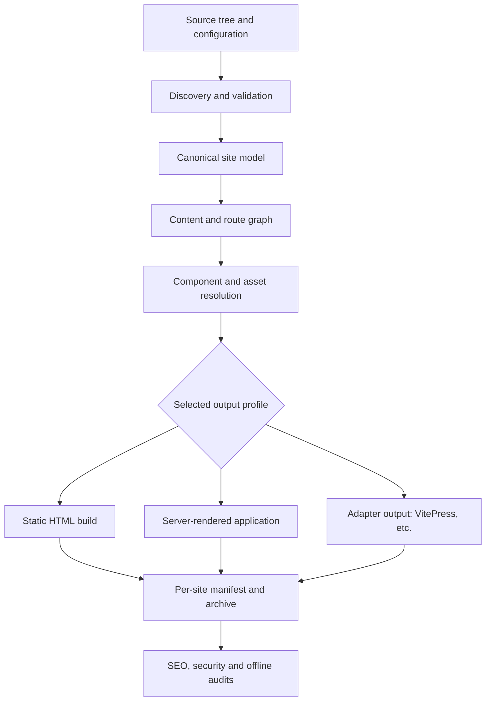

# RFC SPMPST-0001: Standard Portable Markdown Pre-SSG Tree

**Status:** Draft — Implementation in Progress
**Version:** 0.1.0-draft
**Date:** 30 October 2026
**Category:** Proposed Standards Track
**Intended audience:** implementers of source-tree tools, site generators, adapters, build systems, editor integrations, and deployment tooling

## Abstract

SPMPST (Standard Portable Markdown Pre-SSG Tree) specifies a portable, target-neutral authoring tree, its metadata and resource contracts, and a preparation interface for publishing sites. It permits implementation by a command-line tool, a desktop application, or a compatible site-generator host. A working JavaScript reference preparation pipeline presently targets VitePress. Native Rust generation, generic framework-component integration, a complete portable build profile, diagnostic SEO reports, offline-first output guarantees, and agent interfaces are proposed extensions, **not assertions about the existing implementation**.

This RFC is divided into **Part I — Specifications**, defining the normative architecture and intended standard, and **Part II — Existing v0.1 Baseline**, documenting the actual current implementation and its source contracts. If an aspirational Part I requirement conflicts with observed Part II behavior, that conflict is an **unimplemented requirement**, not evidence that the existing implementation already conforms.

## Status of This Memo

This document is a technical draft for implementation and review, not an IETF publication. It uses RFC 2119 / RFC 8174 requirement terminology. The protocol, schema, command, and diagnostics examples expressly labeled **PROPOSED** are design contracts awaiting implementation and conformance testing. Paths, functions, and behavior labeled **CURRENT** are derived from the supplied reference inventory and have not been independently revalidated against a live repository for this edition.

## Conventions and Requirements Language

The key words **MUST**, **MUST NOT**, **REQUIRED**, **SHALL**, **SHALL NOT**, **SHOULD**, **SHOULD NOT**, **RECOMMENDED**, **NOT RECOMMENDED**, **MAY**, and **OPTIONAL** are to be interpreted as in RFC 2119 and RFC 8174 **only when shown in all capitals**. They apply to a declared conformance profile, not indiscriminately to optional capabilities.

**CURRENT** = behavior documented in the existing JavaScript baseline. **PROPOSED** = contract in this RFC not demonstrated by that baseline. **PLANNED** = proposal with no assured implementation. **OPTIONAL** = feature a conforming implementation may omit unless its declared profile requires it. **EXPERIMENTAL** = syntax or behavior requiring an extension identifier before interoperable use.

---

# Part I — Specifications

## 1. Goals, design principles, and scope

### 1.1 Primary objective

SPMPST defines a durable authoring-and-distribution contract so that one source tree can be prepared for multiple rendering targets, packaged independently per site, and maintained without adopting the lifetime or internal APIs of a particular frontend framework. The portable site tree is the primary artifact. Renderers and interactive components are interchangeable extensions.

### 1.2 Design principles

1. **Portability by construction.** Content, configuration, and logical resources are not required to embed a specific machine path, build host, or renderer API.
2. **HTML-first, with progressive interactivity.** A page's primary authored content MUST be available as meaningful HTML without requiring client-side JavaScript. Interactive features such as search, filtering, sorting, and menus MAY require JavaScript; the HTML-first rule does not require full feature parity with scripts disabled. Dynamic server rendering is an OPTIONAL deployment profile (§5), not a condition for static-site correctness.
3. **Offline-first delivery.** A build claiming the Offline-Complete profile MUST function without external network access, as defined precisely in §6; an ordinary static deployment need not claim offline browsing before installation or caching.
4. **Per-site isolation.** Distinct sites MUST have separate resolved configuration, build graphs, output destinations, manifests, and packaged assets.
5. **Standards-forward extensibility.** Unknown valid HTML and future standard elements MUST pass through without an SPMPST core release, subject to explicit sanitization policy.
6. **Determinism.** Repeated builds from identical declared inputs SHOULD produce byte-identical outputs; the Reproducible profile makes this mandatory.
7. **Small, inspectable deliverables.** Production bundles MUST NOT implicitly require development tools, build-time package managers, or source code.
8. **Composition, not framework lock-in.** HTML, CSS, JavaScript, and declared framework components MAY coexist, but a renderer MUST identify each component's execution and deployment constraints.
9. **Tool and agent accessibility.** Machine-readable inspection, validation, and controlled modification are first-class interfaces; autonomous edits MUST preserve explicit authorization boundaries.
10. **Security and ownership.** Builds do not silently depend on third-party origins; scripts, plugins, and runtime capabilities MUST be declared and auditable.

### 1.3 Scope

The core specifies discovery, ownership, metadata preservation, canonical model, logical resources, routing, localization, preparation, diagnostics, and output manifests. Companion profiles specify static publication, dynamic server rendering, offline caching, component bridging, packaging, SEO analysis, and agent interoperability. SPMPST core is **not** itself a new HTML dialect, a browser engine, or a universal runtime capable of executing every framework on every target.

### 1.4 Non-goals

SPMPST does not guarantee that arbitrary remote APIs work offline; that a web page is fully interactive with JavaScript disabled; that every Vue/React/Svelte/Astro component can be run without its renderer; that static hosting can supply dynamic personalized server responses; that an SEO score predicts ranking; or that arbitrary third-party components can be executed safely merely by packaging them locally.

## 2. Conformance model

### 2.1 Roles

A **Tree Producer** writes conforming sources. A **Core Loader** validates the tree and yields a target-neutral model. A **Target Adapter** maps that model to a renderer. A **Builder** emits deployable artifacts. A **Site Host** serves them. An **Inspector** audits content or bundles. An **Agent Interface** exposes constrained read/write operations. One application MAY implement multiple roles.

### 2.2 Capability profiles (PROPOSED)

| Profile | Required capabilities | Deployment implication |
|---|---|---|
| `core` | tree loading, config ownership, page model, route and resource resolution, diagnostics | no generated site required |
| `static-html` | HTML for each route, local assets, no dev-runtime dependency | static web host or local browser |
| `offline-complete` | `static-html` plus closed dependency graph and offline navigation support under declared conditions | browser service worker/installed cache or packaged local files |
| `server-rendered` | request-time server HTML and declared runtime contract | compatible server process required |
| `components` | explicit component declarations, adapters, rendering/asset policy | runtime depends on chosen component mode |
| `reproducible` | stable bytes and documented input closure | deterministic build verification |
| `seo-audit` | report schema, page/link analysis and actionable findings | no SEO guarantee |
| `agent` | machine-readable capabilities and safe operations | local IPC or authenticated transport |

A tool MUST declare which profiles it implements; documentation MUST NOT imply that supporting `core` entails supporting `server-rendered` or `offline-complete`. `SPMPST v0.1 draft` refers to the baseline format, not certification under all proposed profiles.

### 2.3 Feature discovery (PROPOSED)

A CLI SHOULD support `spmpst capabilities --format json`. Its response SHOULD expose `specVersion`, `implementation`, `profiles`, `extensions`, `renderers`, `componentModes`, and `outputFormats`. Unknown capability IDs MUST be treated as unsupported, not assumed.

## 3. Source tree, identity, and configuration

### 3.1 Authoritative tree

The `.site/`, `src/`, and `resources/` conventions in Part II remain the v0.1 baseline. The root MUST be explicitly selected, or discovered by walking to the nearest ancestor containing `.site/`. Tools MUST NOT allow a path to escape the root through `..`, absolute paths, or symlink traversal. An implementation MAY resolve symlinks only if the final canonical path remains within an approved root.

### 3.2 Site identity and multi-site workspaces (PROPOSED)

A workspace MAY register several source roots. A site MUST have one unique `site.id` within that workspace. An invocation MUST select exactly one site or explicitly request a multi-site batch. A selected site's output, lock state, cache namespace, resource catalogue, canonical URL, secrets, and environment settings MUST NOT be inherited from another site's last build.

Suggested source topology:

```text
workspace/
├── sites/
│   ├── feluqa/
│   │   ├── .site/
│   │   ├── src/
│   │   └── resources/
│   └── numerimondes/
│       ├── .site/
│       ├── src/
│       └── resources/
└── dist/
    ├── feluqa/
    └── numerimondes/
```

`dist/<site-id>/` is an illustrative default, not a new compulsory source-tree directory. User-supplied output paths MUST be checked for overlap with other site roots and outputs; destructive cleanup MUST be limited to the selected output directory.

### 3.3 Configuration ownership and forward compatibility

The v0.1 concern-file ownership table (§II.11) remains normative **for the v0.1 loader**. Core loaders MUST reject unknown configuration keys under a versioned, closed schema unless the key is in a declared extension namespace. By contrast, HTML attributes, Markdown frontmatter unknown to core, and ordinary copied public files MUST be preserved wherever the consumer can represent them. These separate rules prevent accidental breaking changes while permitting new web standards.

Proposed extension namespace:

```json
{
  "extensions": {
    "org.example.structured-data": { "enabled": true }
  }
}
```

No implementation is required to recognize the example extension. Namespaced extensions MUST NOT silently redefine core keys.

## 4. Canonical preparation model (PROPOSED)

### 4.1 Stages



Every stage MUST emit a machine-readable diagnostic for a blocking failure. The core model SHOULD be JSON-serializable and free of adapter-specific runtime objects. Adapters MAY enrich an independent copy, but MUST NOT mutate the shared model in a way that changes another adapter's output.

### 4.2 Minimum page record

A proposed page model includes: `sourcePath`, `route`, `locale`, `contentLocale`, `frontmatter`, `content` or an AST, `links`, `assets`, and `provenance`. Route and locale resolution MUST be completed before renderer-specific transformations. Frontmatter fields not consumed by core MUST remain available to adapters.

### 4.3 Stable identifiers

If a stable page identifier is provided, it MUST be unique within the selected site. Otherwise the identity is the normalized source-relative path plus effective locale. The page model MUST distinguish a stable identity from the mutable public route so reports survive route changes.

### 4.4 Parsing and escaping

Parsing of Markdown MUST NOT treat arbitrary inline text as an executable directive. Reserved `@spmpst::` references are recognized only in documented metadata fields, directive contexts, or explicitly enabled Markdown extensions. Unrecognized directive forms MUST yield a diagnostic or remain literal text according to a declared policy; they MUST NOT execute code.

## 5. HTML rendering and dynamic server rendering

### 5.1 Universal HTML contract

Every published page in the `static-html` and `server-rendered` profiles MUST deliver its primary readable content as HTML from the host without relying on browser-side JavaScript execution. The HTML output MUST preserve document semantics, accessible text, headings, links, forms, and media fallbacks to the extent supported by the source. This requirement concerns reading and navigating authored content; it does not require interactive features to work with JavaScript disabled.

Search, filtering, sorting, and similar controls MAY be implemented as client-side features, including on static sites. Their scripts MUST be declared under the script policy in §10.3. If a feature cannot run because JavaScript is disabled or unavailable, its controls MUST expose an accessible explanation or fallback, while the page's primary content remains readable. A static site is not required to provide a second, script-free implementation of client-side search.

### 5.2 Rendering modes (PROPOSED)

| Mode | When HTML is produced | Deploys on static host | Usable with JavaScript disabled |
|---|---|---|---|
| `prerender` | at build time | yes | primary content yes |
| `ssr` | per incoming request | no, needs server | primary content yes |
| `island` | prerender/SSR HTML then selective hydration | yes if prerendered | initial content yes; enhanced interactions may not work |
| `client-only` | browser execution | yes | not necessarily; forbidden for required core content in HTML-first profiles |

**Requirement clarification:** “Always provide real-time server rendering” is interpreted as **always support the ability to select a request-time SSR target when an SSR-capable adapter and host are present**, while **always providing valid prerendered HTML for a static target**. A static ZIP cannot independently perform request-time SSR on a static hosting service. The runtime selection MUST be explicit, not simulated or implied.

The JavaScript-disabled column describes access to primary page content, not complete feature parity. For example, a static documentation site MAY use a bundled local search index and JavaScript search interface without requiring a server-side search endpoint.

### 5.3 Freshness and cache policy

SSR and content freshness are independent. Server-rendered output MAY use a cache and MUST document its freshness guarantees. Offline mode MUST use a declared cache/fallback strategy and cannot promise access to remote live updates while disconnected.

### 5.4 HTML extensibility

The core MUST NOT maintain a restrictive allowlist of known HTML elements that requires a SPMPST release each time HTML gains an element or attribute. It MUST preserve unknown valid element names, `data-*` attributes, ARIA attributes, new `<meta>` forms, and ordinary head/body markup in an HTML-capable adapter. Sanitization MUST be a separate explicit, versioned security policy for untrusted input. Unknown markup MUST NOT bypass that policy. Adapters MAY warn where a target renderer cannot preserve an element faithfully.

### 5.5 Public files and emerging conventions

A site MUST be able to publish arbitrary site-owned text files under public paths without changes to SPMPST core, including prospective conventions such as `llms.txt`, `robots.txt`, `security.txt`, verification files, manifests, and new standards-defined discovery documents. This does not make SPMPST responsible for assigning semantics to those files. The current `.site/public/*` mechanism is the baseline; output-path collision handling is specified in §8.

## 6. Zero-network and offline operation

### 6.1 Distinct guarantees

**Self-contained output** means all required application assets and code are local to the deployable package. **Network-independent operation** means no required application function fetches remote resources. **Offline browser availability** additionally requires that pages be available on the device, normally through prior installation/caching or an application bundle. These MUST NOT be conflated.

### 6.2 Offline-Complete profile (PROPOSED)

A build declaring `offline-complete` MUST:

- Include all resources required for initial rendering and documented offline features within the per-site package, including fonts, scripts, stylesheets, images, and component runtime assets.
- Have no mandatory runtime request to an external origin for those features; an OPTIONAL outbound link does not violate this rule if the user is clearly informed that following it requires connectivity.
- Provide a strategy for repeat visits without a network, typically an offline-capable service worker and install/cache manifest on HTTPS or localhost, or an explicitly supported local application/file bundle.
- Expose an offline fallback route or error experience for intentionally uncached or dynamic pages.
- Declare unsupported functions (e.g., authentication against a remote identity provider, payments, third-party APIs, live analytics, remote search).
- Pass tests with external network blocked after the prescribed cache/install step.

A static HTML package opened as `file://` MAY have browser restrictions on fetch, modules, paths, and service workers. A builder MUST declare whether it supports `file://`, local HTTP, HTTPS hosting, or desktop wrapping; it MUST NOT promise universal `file://` compatibility without testing it.

### 6.3 Optional online enhancements

External analytics, embeds, CDNs, live data, remote APIs, and hosted fonts MUST be opt-in, discoverable in a dependency manifest, and disabled or replaced by safe local fallbacks when the selected profile forbids external requests. Optional third-party resources MAY be used in non-offline profiles with a documented threat model.

### 6.4 Offline conformance test

A conforming offline test MUST install or cache the site using a supported context, disconnect all network connectivity, navigate representative internal routes, reload them, and assert that all required assets load locally. It MUST also inspect network initiators for undeclared remote requests. A screenshot or Lighthouse score alone is insufficient proof.

## 7. Cross-framework components and content transclusion

### 7.1 Problem statement

A site author may wish to reference **HTML, Vue, Svelte, React, Astro, Web Components, or later frameworks** from portable Markdown. Framework component syntax and lifecycle are not interoperable by default. SPMPST SHOULD offer a *component descriptor* and target-specific bridge instead of pretending that the HTML tags of arbitrary frameworks are equivalent.

### 7.2 Component interoperability modes (PROPOSED)

| Mode | Contract | Cross-target expectation |
|---|---|---|
| `html` | trusted HTML fragment or template | strongest portability |
| `web-component` | standards-based custom element with local module | portable to browsers supporting required APIs; SSR fallback needed |
| `server-rendered` | adapter renders component to HTML during build or request | portable output; toolchain may differ |
| `island` | component renders HTML then hydrates locally | needs framework runtime bundled for that island |
| `client-only` | mounts after page load | optional progressive enhancement only |
| `target-native` | renderer-specific component or directive | no cross-target guarantee |

A descriptor MUST declare `id`, `source`, `framework`, `mode`, `propsSchema` where props exist, and `targets` or an explicit fallback policy. Adapters MUST reject unsupported components before publication or apply a declared accessible fallback. Undeclared runtime dependency discovery MUST NOT be considered successful portability.

### 7.3 Illustrative component descriptor (EXPERIMENTAL)

```json
{
  "id": "example.counter",
  "source": "resources/components/counter/Counter.svelte",
  "framework": "svelte",
  "mode": "island",
  "propsSchema": {
    "type": "object",
    "properties": { "start": { "type": "integer" } },
    "additionalProperties": false
  },
  "fallback": "resources/components/counter/fallback.html",
  "network": "none"
}
```

This is a schema proposal, **not implemented v0.1 input syntax**. When a component has no server renderer, its fallback MUST supply meaningful accessible content if used on an HTML-first page.

### 7.4 Content reference candidates (EXPERIMENTAL)

The suggested form `@spmpst::self::frontmatter::<dataid>` is valuable as a *structured reference*, not as a general-purpose source code evaluator. For future standardization, candidate forms are:

```text
@spmpst::self::frontmatter::title
@spmpst::self::frontmatter::author.name
@spmpst::page::handbook/intro::frontmatter::description
@spmpst::resources::icon::lucide/book-open
```

Only the final resources form has an existing v0.1 grammar, described in Part II. The other forms are **EXPERIMENTAL** and MUST NOT be interpreted as implemented or portable until a future grammar is ratified.

### 7.5 Proposed structured-reference rules

- A reference MUST be resolved against a typed context (site, page, frontmatter, or resource), never through dynamic code execution.
- A `frontmatter` path SHOULD follow restricted dotted JSON-property notation with escaped or indexed forms specified before standardization; `dataid` MUST NOT be treated as an arbitrary filesystem path.
- Circular references MUST fail deterministically with a cycle diagnostic.
- Missing keys MUST generate a diagnostic; a fallback syntax MAY be introduced in a later version.
- Substitution MUST be escaped for its output context (HTML text, HTML attribute, URL, JSON, or CSS); raw HTML injection MUST require an explicit trusted-content capability.
- `self` MUST refer to the page being processed, never to an ambient global page.
- Cross-page references MUST participate in dependency tracking and incremental rebuild invalidation.

### 7.6 Authoring syntax decision

A future RFC MUST choose whether reference syntax is only for metadata values, fenced directives, Markdown inline transclusion, or component props. Until then, implementers SHOULD NOT silently parse `@spmpst::self::...` everywhere in prose. Marking the syntax experimental prevents collisions with ordinary Markdown, email-like strings, and future directives.

## 8. Per-site build artifacts, ZIP, and deployment

### 8.1 Independent build boundary (PROPOSED)

Each build MUST bind one site identity, one resolved config snapshot, one adapter, one output profile, and one dependency graph. With two sites `A` and `B`, modifying only sources of `A` MUST NOT change `B`'s output unless the shared, explicitly declared dependency is modified. Caches MUST be namespaced using site identity plus relevant build inputs.

### 8.2 Standard distribution structure

A proposed `static-html` artifact is:

```text
build/feluqa/
├── index.html
├── fr/index.html
├── handbook/index.html
├── assets/
├── robots.txt
├── llms.txt                      # only if authored
├── sitemap.xml                   # if configured
└── .spmpst/
    ├── manifest.json
    ├── dependencies.json
    └── reports/
        ├── seo.json
        └── security.json
```

The `.spmpst/` directory layout and report names are **PROPOSED**. An adapter MAY place metadata outside a public document root to avoid publishing internal information; output manifest semantics, not this physical location, are the interoperability contract. Sensitive configuration or secrets MUST NOT appear in artifacts served publicly.

### 8.3 ZIP portability requirements

An implementation claiming portable ZIP output MUST produce one archive **per selected site**, with only relative normalized `/` paths, no directory traversal, no symlink that escapes the extraction root, and no undeclared network-required runtime dependency. File order, timestamps, and permission bits SHOULD be stable; they MUST be stable in the `reproducible` profile. The archive MUST contain deployable files, not build-only dependencies, unless a profile explicitly requests a full source export.

### 8.4 Manifest example (PROPOSED)

```json
{
  "specVersion": "0.1.0-draft",
  "siteId": "feluqa",
  "profile": "static-html",
  "adapter": { "name": "vitepress", "version": "declared-by-builder" },
  "entrypoints": ["index.html"],
  "offline": { "level": "self-contained", "tested": false },
  "externalDependencies": [],
  "files": [
    { "path": "index.html", "sha256": "<64 lowercase hex digits>" }
  ]
}
```

Hashes in a real manifest MUST be calculated over emitted file bytes. `<...>` above denotes a placeholder, not a valid canonical manifest value.

### 8.5 File and route collision policy

The builder MUST detect when two sources emit the same destination path, including collisions between static public files and generated routes, localized aliases, or asset paths. Default behavior MUST be a blocking diagnostic; an explicit conflict-resolution policy MAY be specified by an adapter. Silent overwrites are prohibited.

## 9. Package forms and operational interfaces

### 9.1 Delivery shapes

SPMPST SHOULD be usable as (a) a standalone CLI, (b) a desktop GUI wrapping the same engine, and/or (c) an installable package for a host such as `vitepress-site`. CLI and desktop are preferred product surfaces; the VitePress integration is a compatible adapter, not the definition of the standard. All surfaces SHOULD use identical validators and produce semantically equivalent manifests for the same declared target.

### 9.2 CLI sketch (PROPOSED; not commands guaranteed to exist)

```sh
spmpst init --site my-site
spmpst inspect --site my-site --format json
spmpst check --site my-site --strict
spmpst build --site my-site --target static --out dist/my-site
spmpst build --site my-site --target server --out dist/my-site-server
spmpst pack --site my-site --format zip --out dist/my-site.zip
spmpst audit seo --site my-site --format json
spmpst audit offline --site my-site --profile offline-complete
spmpst capabilities --format json
```

Commands MUST emit meaningful exit codes and structured errors once standardized. At minimum: success (`0`), validation failure, unsupported capability, build failure, and unsafe output path SHOULD be distinguishable. A production CLI MUST define the numeric codes in its reference manual rather than infer them from these examples.

### 9.3 Desktop application

A GUI MAY provide editing, source browsing, per-site builds, previews, local serving, diagnostics, dependency graphs, and archive export. It SHOULD invoke the same core services as the CLI; it MUST NOT silently introduce online dependencies or write outside the user's approved workspace.

### 9.4 Existing host compatibility

The existing `docs/vitepress-site/` pipeline remains the current reference adapter. Introducing a standalone CLI MUST NOT require moving site-owned content into a host-specific directory. A host package MAY consume the source tree in place or via a model serialization interface.

## 10. CSS, JavaScript, hooks, and build extensibility

### 10.1 Out-of-the-box support

Adapters SHOULD support site-scoped stylesheets, scripts, themes, hooks, components, and public assets, while preserving portable core semantics. Hooks MUST declare lifecycle phase, inputs, outputs, and required permissions. A hook MUST NOT silently mutate content outside the active site or access the network in a network-disallowed build.

### 10.2 Proposed hook phases

`beforeDiscover`, `afterLoad`, `beforeRoutes`, `afterRoutes`, `beforeRender`, `afterRender`, `beforePackage`, and `afterAudit` are **candidate identifiers**. A future extension registry MUST define their ordering, data contracts, error handling, and cache invalidation before interoperability is claimed.

### 10.3 Script policy

Scripts MUST be classified as `required`, `enhancement`, `analytics`, `third-party`, or another documented category. Security-relevant capabilities such as network access, filesystem reads during build, process execution, and environment-variable access MUST be declared. Build-time plugins are trusted code and SHOULD run in an isolated execution context where practical.

### 10.4 Production cleanliness

The runtime output MUST NOT inadvertently import Vite, VitePress, npm, development middleware, compiler toolchains, local source maps containing secrets, or debug endpoints. Framework runtime code may be bundled **when needed for a declared interactive component**; that is a production runtime dependency, not a forbidden development dependency.

## 11. SEO reporting and decision support

### 11.1 Purpose

SPMPST SHOULD provide an `seo-audit` profile that analyzes internal linking (**maillage interne**), outbound linking (**maillage externe**), indexability signals, metadata, semantics, structured data, and locale relationships. Its output MUST distinguish deterministic findings from heuristics and recommendations. It MUST NOT claim to predict search-engine ranking.

### 11.2 Required analysis for `seo-audit` (PROPOSED)

An SEO report MUST analyze, to the extent inputs allow:

- **Internal link graph:** inbound/outbound counts, orphaned pages, unreachable pages from designated navigation roots, broken local links, redirect chains, anchor targets, excessive click depth, and pages with weak discoverability.
- **External link graph:** external destinations, protocol, origin, optional `rel` attributes, links requiring network access, duplicate destinations, and optionally status checks only when network probing is explicitly authorized.
- **Page metadata:** effective title, description, canonical, robots directives, robots.txt interactions, sitemap presence, Open Graph metadata, and duplicate/missing metadata.
- **Content structure:** heading hierarchy, internal anchor validity, descriptive link text, image alt text, and opportunities for relevant cross-links.
- **Localization:** `hreflang`, fallback pages, canonical consistency, and alternate-route reciprocity.
- **Assets and delivery:** oversized assets, rendering-dependent core content, accidental third-party requests, and other performance/security-adjacent risks when measurable.

### 11.3 Actionable recommendations

Each finding MUST contain `id`, `severity`, `rule`, `siteId`, `affectedRoutes`, `evidence`, `recommendation`, and whether it was measured or inferred. Reports SHOULD distinguish **fix now**, **investigate**, and **opportunity**. Recommendations MAY identify candidate internal links using topical similarity, but MUST clearly label those as suggestions, not facts.

### 11.4 SEO report example (PROPOSED)

```json
{
  "schemaVersion": "0.1-draft",
  "siteId": "feluqa",
  "generatedAt": "2026-10-30T00:00:00Z",
  "scope": "local-build",
  "findings": [
    {
      "id": "SEO-INT-001",
      "severity": "warning",
      "rule": "orphan-page",
      "siteId": "feluqa",
      "affectedRoutes": ["/handbook/advanced/"],
      "evidence": { "inboundInternalLinks": 0 },
      "recommendation": "Add a relevant internal link from a discoverable handbook page.",
      "basis": "measured"
    }
  ]
}
```

### 11.5 Optional network inspection

Without explicit permission, SEO analysis MUST work entirely from the local source and build output. Live URL checks MAY be requested as a separate online phase with rate limits, caching, privacy controls, timeouts, and uncertainty recording. Network failure MUST NOT be reported as proof that a site is broken.

## 12. LLM and ACP integration

### 12.1 Agent-friendly design

SPMPST SHOULD be operable by LLM-assisted tooling through structured JSON inputs/outputs, stable document identifiers, complete schemas, machine-readable diagnostics, reproducible plans, and dry-run changes. Human-readable prose MUST NOT be the only way to discover a tool's capabilities or validation errors.

### 12.2 ACP terminology

**ACP is ambiguous across ecosystems**. For this RFC, `ACP` denotes an **agent communication protocol integration selected and versioned by the implementation**, not an invented universal standard wire format. A future extension MUST identify the exact protocol specification and version before making interoperability claims. ACP support is RECOMMENDED for agent-capable distributions, not part of the minimal `core` profile.

### 12.3 Recommended operations (PROPOSED)

`listSites`, `inspectSite`, `readPage`, `listRoutes`, `validate`, `proposeEdit`, `applyApprovedEdit`, `build`, `getDiagnostics`, `auditSeo`, `auditOffline`, and `capabilities` are logical operations, not a frozen protocol API. Read-only functionality SHOULD work without write authority. Every proposed write SHOULD support a diff and a dry-run. `applyApprovedEdit` MUST require authorization from the controlling user or application.

### 12.4 Agent safety

Agent integrations MUST enforce workspace path boundaries, deny access to secrets by default, distinguish source and generated files, protect against prompt injection in authored content, and log sensitive operations. Arbitrary code execution and network use MUST require explicit authority. Tool output from a site MUST be treated as untrusted content, not control instructions.

## 13. Security and supply-chain requirements

### 13.1 Threat model

Relevant threats include malicious dependencies, compromised remotely loaded JavaScript, build-plugin code execution, untrusted Markdown HTML, XSS in component props, leaked secrets, path traversal, symlink attacks, external-resource exfiltration, malicious archives, and unexpected outbound network connections. A self-hosted script is not inherently safe; its source and integrity still matter.

### 13.2 Required controls

- Build tools MUST prevent writes outside the approved output root and MUST validate archive extraction paths.
- Untrusted HTML MUST be escaped or sanitized under a declared policy; trusted HTML MUST be explicitly distinguished.
- External script and stylesheet origins MUST be inventoried. The offline-complete profile MUST reject required remote runtime resources.
- Secrets MUST NOT be copied from environment variables, local `.env` files, or private configuration into public artifacts without explicit user intent.
- Component adapters MUST declare whether they execute arbitrary build code or client JavaScript.
- The emitted asset manifest SHOULD include content hashes; production deployments SHOULD support strict Content Security Policy and other appropriate security headers.
- A build SHOULD support integrity pinning or lockfiles for upstream packages; a version string alone is not proof of immutability.

### 13.3 Privacy

Telemetry and tracking MUST be opt-in for the generated site. A builder MUST NOT add analytics scripts, trackers, remote fonts, or session replay solely because a renderer enables them by default.

## 14. Deterministic builds, diagnostics, and testing

### 14.1 Reproducibility

A `reproducible` build MUST canonicalize or consistently serialize its own manifests, avoid embedding non-deterministic timestamps in hashed outputs, enforce stable traversal and sorting, and specify the influence of locale, toolchain, dependency versions, and environment variables. If a report includes a wall-clock `generatedAt`, that report MUST either be excluded from deterministic byte comparison or use a declared reproducible timestamp source.

### 14.2 Diagnostics

Diagnostics MUST identify code, severity, source file, location when available, affected site, human explanation, and optional suggested fix. Unknown configuration keys, duplicate routes, invalid references, unsupported components, unsafe paths, and offline violations MUST produce distinct codes.

### 14.3 Development updates and build isolation (PROPOSED)

A development server MUST update only the affected page when an author changes one page's body. It MUST NOT issue a browser-wide `location.reload`, Vite `full-reload`, or equivalent navigation for a content-only edit. The active route MAY replace its page component in place; an inactive route MUST remain untouched and show the new content when next opened. Scroll position and the running application shell SHOULD be preserved.

Incremental preparation MUST retain unchanged generated files and their modification times. It MUST track the changed source page and its declared dependencies, then update only affected generated routes and assets. A change to a single page MUST NOT delete and recreate the complete generated source tree. Navigation or site-configuration changes MAY refresh the navigation configuration, but MUST NOT be misclassified as an ordinary page-body edit.

An explicit production build MUST use generated-source and cache locations isolated from a concurrently running development server and from every other site. Starting a build MUST NOT cause dev-server reloads, remove files being served, or replace another site's caches. Build output publication MUST remain atomic within the selected site's output directory.

Acceptance MUST be demonstrated by keeping two browser routes open, editing one page body, and confirming that only the tab displaying that route updates without a document navigation; the other tab and application shell remain live. A simultaneous build of that site MUST leave the dev server unchanged. The test SHOULD also edit a referenced asset and verify that only pages depending on it are invalidated.

### 14.4 Conformance fixtures (PROPOSED)

A reference suite SHOULD contain at least: multilingual routes; numeric prefixes; unknown frontmatter; arbitrary new HTML elements and metadata; `llms.txt` passthrough; asset deduplication; external URL auditing; duplicate routes; symlink escape attempt; unsupported framework component; component fallback; offline rerender/reload; no-dev-dependency static output; ZIP traversal checks; multi-site isolation; incremental single-page HMR without document reload; concurrent build/dev isolation; and canonical manifest comparisons.

### 14.5 Validation layers

| Layer | Required questions |
|---|---|
| Source validation | Are required configurations and page fields valid? |
| Model validation | Is ownership unambiguous? Are routes and references resolvable? |
| Adapter validation | Does the target support required content and components? |
| Artifact validation | Are outputs complete, isolated, and free of forbidden dependencies? |
| Runtime validation | Do SSR and offline behaviors pass their declared deployment profiles? |
| Audit validation | Are SEO and security findings reproducible from their evidence? |

## 15. Implementation roadmap and decision log

### 15.1 Existing baseline (CURRENT)

The supplied reference inventory shows a JavaScript model loader, VitePress preparation pipeline, resource-reference parser, localized guide/collection stages, and validation/verification commands. It does **not** show a universal SSR runtime, a Rust SSG, ZIP packaging, arbitrary framework bridging, a formal SEO audit engine, or an ACP implementation.

### 15.2 Implementation order (PROPOSED)

| Phase | Deliverable | Acceptance gate |
|---|---|---|
| 0 — Baseline stabilization | characterize and freeze existing v0.1 fixtures | current `docs:check` and `docs:verify` pass |
| 1 — Canonical model | schema, route conflict detection, model serialization | fixtures round-trip across isolated sites |
| 2 — Static distribution | local HTML output, asset closure, per-site manifest, ZIP | static site serves without dev dependencies |
| 3 — Offline profile | network audit, cache/service worker strategy, explicit fallback | works after install/cache with network disabled |
| 4 — Components | portable HTML/web-component path, target-native bridge, SSR fallback | representative Vue/React/Svelte/Astro examples handled or rejected clearly |
| 5 — SEO audit | link graph and structured recommendations | findings backed by local evidence |
| 6 — Agent interface | structured introspection, safe changes, protocol-specific bridge | read-only/approved-write tests pass |
| 7 — Independent target | Rust/Feluqa adapter or equivalent | common conformance fixtures pass |
| 8 — SSR deployment | request-time renderer plus deployment manifest | server runtime and cache semantics documented and tested |

The sequence is a recommendation, not a promised release schedule. Independent phases MAY be developed concurrently if core contracts remain stable.

### 15.3 Open architectural decisions

1. Should the first independent non-VitePress renderer be Rust-native or a minimal standards-only HTML renderer?
2. Which precise ACP specification and version should the agent bridge implement?
3. What syntax, escaping, and expression grammar should structured `frontmatter` references adopt?
4. Should components be declared in a dedicated concern file, a resource catalogue, or frontmatter?
5. Should the portable artifact metadata be served publicly, or remain an out-of-webroot sidecar?
6. Which browser contexts must `offline-complete` certify: HTTPS, localhost, file URL, or desktop shell?
7. Which adapter capabilities are mandatory for accepting `server-rendered` sites?
8. Which HTML sanitization policies are appropriate for trusted authoring versus untrusted contributed content?

These are deliberately unresolved and MUST NOT be converted into implied implementation facts.

## 16. Compatibility and migration

The existing v0.1 tree MUST continue to be consumable by the documented VitePress baseline without adopting the proposed directives or manifests. New features SHOULD be additively gated behind versioned capabilities or extension namespaces. A breaking change to field meaning, routing, or resource grammar MUST have a versioned migration plan and fixture demonstrating before-and-after behavior. The duplicate Appendix A/B material in the supplied historical draft is preserved in Part II as reference history; implementers SHOULD prefer the more detailed first occurrence where the two overlap, and MUST treat actual loader behavior as authoritative until tests are in place.

## 17. Normative and informative references

- **[RFC2119]** S. Bradner, *Key words for use in RFCs to Indicate Requirement Levels*, RFC 2119, March 1997.
- **[RFC8174]** B. Leiba, *Ambiguity of Uppercase vs Lowercase in RFC 2119 Key Words*, RFC 8174, May 2017.
- **[RFC8785]** A. Rundgren, B. Jordan, S. Erdtman, *JSON Canonicalization Scheme (JCS)*, RFC 8785, June 2020. Relevant as an example for canonical JSON and precise specification style; SPMPST does not automatically adopt JCS for all files.
- **[HTML]** WHATWG HTML Living Standard. Informative reference for extensible HTML semantics.
- **[SW]** Service Workers / associated browser platform specifications. Informative for offline support.
- **[BASELINE]** Supplied `SPMPST v0.1 (draft)` implementation inventory, reproduced in Part II.

---

# Part II — Existing v0.1 Baseline (historical implementation inventory)

> **Preservation note:** The following is the supplied v0.1 document, retained as an implementation baseline. It describes the JavaScript/VitePress state and distinguishes planned Rust work. Its duplicated Appendix A/B sections are retained intentionally rather than silently discarded. Requirements in this historical part apply to the **existing v0.1 baseline**, not automatically to the proposed extended profiles in Part I.

# SPMPST v0.1 (draft)

SPMPST means Standard Portable Markdown Pre-SSG Tree. This draft describes the
source tree consumed by the current preparation pipeline and the boundary where
an SSG adapter can consume its model. It records observed behavior; it does not
claim that a Feluqa Rust SSG exists.

The words **MUST**, **MUST NOT**, **SHOULD**, **SHOULD NOT**, and **MAY** express
requirements for this draft.

## 1. Purpose and scope

SPMPST is a portable directory convention and configuration model for human
documentation authors and static-site adapters. It defines authored Markdown,
metadata, configuration, and referenced resources before site generation.
SPMPST is not an SSG, a Markdown dialect, or a runtime component system.

SPMPST provides the source-tree contract, configuration ownership and loading
rules, portable routing and locale conventions, and logical resource-reference
syntax. It does not ship an icon or flag catalogue, choose a renderer, bundle
site-specific components, or dictate where an adapter is installed. An adapter
resolves logical resource references against its selected site's resource
catalogue and emits target-ready paths or URLs.

The current implementation is the JavaScript reference loader and preparation
pipeline. A Feluqa Rust SSG adapter is **PLANNED**.

## 2. Status and versioning

This document specifies **v0.1 (draft)**. A breaking tree, metadata, or model
change SHOULD increment the major version; additive optional fields SHOULD
increment the minor version. These versioning rules are **PLANNED** and are not
currently enforced by a manifest.

## 3. Terminology

- **Tree root**: directory containing `.site/`; the Feluqa site is currently
  `docs/site-1/`.
- **Guide**: independently routed documentation collection under `src/guides/`.
- **Subguide**: a guide registered in the `subguides` configuration array.
- **Section**: a directory of pages within a guide.
- **Page**: a Markdown source file that is not metadata or ignored content.
- **Collection**: a registry entry whose Markdown files are prepared as a list
  or article feed.
- **Category**: localized metadata from a collection's `category.json`.
- **Locale**: a language code such as `en` or `fr`.
- **Bundle**: a locale JSON file containing language-specific UI and SEO copy.
- **Concern file**: one `.site.config.json` file with one owner for each key.
- **Target**: a renderer-specific configuration and resource set.
- **Adapter**: code that maps the shared model to one target renderer.
- **Staged tree**: portable Markdown and staged assets produced before SSG
  rendering.

## 4. Layers

```text
Human-authored tree       docs/site-1/{.site,src,resources}
           │
           ▼
Shared site model          docs/vitepress-site/app/scripts/spmpst/ (target-neutral model)
           │
           ▼
Target adapter             docs/vitepress-site/app/scripts/preparation/ + target resources
           │
           ▼
Rendered site              static pages and browser assets
```

The source tree SHOULD remain usable by more than one adapter. Target code and
target-owned resources MAY be packaged with the adapter, outside that tree.
Source: `docs/vitepress-site/README.md`

The configuration loader MUST return target files as opaque data; target
validation belongs to the consuming adapter. Source: `docs/vitepress-site/app/scripts/spmpst/config/assemble.mjs#assembleConfig`

## 5. Directory layout and paths

```text
docs/site-1/
├── .site/
│   ├── *.site.config.json
│   ├── locales/*.locale.json
│   ├── public/*
│   ├── schema/*.schema.json
│   └── targets/*.target.config.json
├── src/
│   ├── guides/
│   └── collections/
└── resources/
    └── assets/
```

An adapter MAY keep shared target catalogues beside its application rather
than inside the source tree. The current VitePress host keeps shared `icons/`
and `flags/` in `docs/vitepress-site/resources/`; Feluqa-owned `components/`,
`hooks/`, and `diagrams/` stay in `docs/site-1/resources/`.

The tree root MUST be the directory containing `.site/`; `SPMPST_ROOT` MAY
override it for tooling. Source roots MUST use the fixed conventions shown
above. Source: `docs/vitepress-site/app/scripts/spmpst/layout.mjs#resolveLayout`

Paths in `.site/` MUST be relative to the tree root, use `/`, and MUST NOT
escape the root. Collection `dir` is relative to `src/collections` and defaults
to its `id`. Guide config paths are relative to that guide. Markdown relative
links are relative to their page. Source: `docs/vitepress-site/app/scripts/preparation/source-stage.mjs#prepareSources`

Assets referenced from Markdown MAY come from `src/guides`, `src/collections`,
or source-tree `resources/`; adapter resources are referenced by logical
SPMPST resource identifiers. Other paths are rejected. Source:
`docs/vitepress-site/app/scripts/preparation/source-stage.mjs#copyAsset`

## 6. Source file conventions

Numeric prefixes such as `010-` and `020.` control navigation order and are
removed from staged names. Language suffixes use `name.<lang>.md`, where the
current language pattern is `[a-z]{2,3}(-[A-Z]{2})?`; a missing suffix is
treated as the fallback language. Source: `docs/vitepress-site/app/scripts/preparation/source-stage.mjs#cleanDir`

Names beginning with `.` and files named `README.md` MUST NOT be published.
`sidebar.json`, `guide.config.json`, and collection `category.json` are
metadata, not pages. Source: `docs/vitepress-site/app/scripts/preparation/source-stage.mjs#scan`

`index.<language>.md` files provide localized directory indexes. The root
fallback index is derived as `src/guides/index.<fallbackLanguage>.md`.
Source: `docs/vitepress-site/app/scripts/preparation/runtime.mjs#toVitepressRuntime`

## 7. Frontmatter

Every published page MUST define `icon` and `sidebarTitle`; `title` and
`description` are recommended. Collection article pages may include `date` and
`category`. Unknown frontmatter is preserved for the target, except fields
rewritten by preparation. Source: `docs/vitepress-site/app/scripts/preparation/source-stage.mjs#scan`

Preparation may add `requestedLanguage`, `contentLanguage`,
`languageFallbackNotice`, `prev`, `next`, `search`, `collection`, `wordCount`,
`readingTime`, and `collectionIndex`. Source: `docs/vitepress-site/app/scripts/preparation/pipeline.mjs#frontmatter preparation`

## 8. Routing

Guide routes are configured with `uri.base` and optional `uri.index`; locale
prefixes depend on `fallbackLanguage` and `selector.prefixDefaultLanguage`.
Route segments are cleaned by removing numeric ordering prefixes. Directory
indexes and collection pages are emitted from their source locations. The
current source does not implement a general route-conflict validator; that
check is **PLANNED**. Source: `docs/vitepress-site/app/scripts/preparation/source-stage.mjs#stagedPath`

**Recommended site namespace.** When several sites or product documentation
sets may share a hostname, a guide's canonical `uri.base` SHOULD begin with
the owning site's stable public slug (for example, `/numerimondes/docs/`).
The configured base is the route source of truth; navigation and internal links
SHOULD point to it rather than maintaining duplicate aliases. This is a
recommendation for portable route ownership, not a requirement that every
single-site deployment add a redundant path segment.

## 9. Languages and fallbacks

`lang.site.config.json` owns the configured languages, fallback language, and
selector policy. Each configured language MUST have one
`.site/locales/<language>.locale.json` bundle. Extra bundle files produce a
warning. Source: `docs/vitepress-site/app/scripts/spmpst/config/assemble.mjs#assembleConfig`

Localized inline objects are resolved using the requested language, then the
fallback language, then the first string value. Missing inline translations
warn normally and fail with `--strict-i18n`. Source: `docs/vitepress-site/app/scripts/preparation/source-stage.mjs#localizedValue`

Fallback notice text uses `{requested}` and `{fallback}` placeholders where
provided. The reference implementation currently validates `{requested}` for
the notice string. Source: `docs/vitepress-site/app/scripts/preparation/source-stage.mjs#prepareSources`

## 10. Collections

Collection layout is `article` or `doc`; index layout is `list` or `spotlight`.
`category.json` provides localized category names and IDs. Article word counts
use whitespace-separated words and reading time rounds up at 200 words per
minute. Source: `docs/vitepress-site/app/scripts/preparation/content-stage.mjs#readingMetrics`

Category-specific routes are **PLANNED**. Current collection indexes and
article metadata are generated by preparation. Source: `docs/vitepress-site/app/scripts/preparation/content-stage.mjs#collection compilation`

## 11. Site configuration

| Concern | File | Main keys |
|---|---|---|
| Definitions | `definitions.site.config.json` | `site`, `subguides`, `iconFallback` |
| Languages | `lang.site.config.json` | `languages`, `fallbackLanguage`, `selector` |
| Navigation | `topbar.site.config.json` | `items`, `theme` |
| Collections | `collections.site.config.json` | `collections` |
| Appearance | `appearance.site.config.json` | `fonts`, `logo`, `ogImages`, `mermaid` |
| Links | `links.site.config.json` | `socialLinks` |
| SEO | `seo.site.config.json` | `siteUrl`, `path`, `icon` |

The loader MUST reject unknown concerns, unknown keys, and duplicate ownership;
it MUST report a likely owner or spelling suggestion when available. `$schema`
is ignored by the loader. Source: `docs/vitepress-site/app/scripts/spmpst/config/assemble.mjs#assembleConfig`

Locale bundles MUST contain language, UI, search, outline, footer, notice, and
SEO sections. Target files are opaque to the shared loader. Source: `docs/vitepress-site/app/scripts/spmpst/config/assemble.mjs#assembleConfig`

`public/*` files are emitted with one trailing newline removed. Source: `docs/vitepress-site/app/scripts/preparation/runtime.mjs#toVitepressRuntime`

## 12. Assets and resources

Assets are copied to `__docs-assets/<sha256><extension>`; the current digest is
SHA-256 of file bytes. Source: `docs/vitepress-site/app/scripts/preparation/source-stage.mjs#copyAsset`

Icon IDs resolve against the selected adapter's icon catalogue; the current
VitePress catalogue has `lucide`, `custom`, `heroicons`, and `simple-icons`
families. An unrecognized icon uses the configured fallback. Sidebar icons may
also be local SVG paths. Source:
`docs/vitepress-site/app/scripts/preparation/source-stage.mjs#findIcon`

Portable JSON and frontmatter may use logical resource references:

```text
@spmpst::resources::icon::lucide/book-open
@spmpst::resources::flag::language/fr
@spmpst::resources::flag::catalog/countries/fr
```

The grammar is `@spmpst::resources::<kind>::<id>`. In v0.1, `kind` is `icon`
or `flag`; `<id>` is a slash-separated Unicode path without `..`, normalized
to NFC. SPMPST parses the reference and lets an adapter resolve it. The reference does not
embed a machine path or require one global icon catalogue. The VitePress
adapter replaces references with validated file paths before rendering. Source:
`docs/vitepress-site/app/scripts/spmpst/resources.mjs#parseResourceReference`
and `docs/vitepress-site/app/scripts/preparation/resolve-resource.mjs#resolveVitepressResource`.

Language flags are provided by the VitePress host under
`docs/vitepress-site/resources/flags/`. Mermaid settings are Feluqa-site-owned
at `docs/site-1/resources/diagrams/`; another registered site can provide its own
settings and diagrams with its source tree.
Mermaid rendering may generate light and dark variants. Source:
`docs/vitepress-site/app/scripts/preparation/stages/transform-markdown.mjs#renderDiagram`

## 13. Pre-SSG pipeline

The VitePress pipeline orders source discovery, guide and collection compilation,
theme metadata emission, Markdown transforms, language fallback pages, SEO
pages, directory indexes, pagination, and cleanup. Source: `docs/vitepress-site/app/scripts/preparation/pipeline.mjs#preparation entrypoint`

Incremental preparation is enabled by `DOCS_PREPARE_INCREMENTAL=1`. Concurrent
prepare processes serialize through `flock`. Source:
`docs/vitepress-site/app/scripts/preparation/pipeline.mjs#lock handling`

The output is deterministic for unchanged sources in the current baseline;
incremental-cache portability is not separately guaranteed.

## 14. Output contract

The portable output is staged Markdown plus content-addressed assets. Generated
navigation, component registration, hook registration, styles, and theme files
are adapter-specific. Source: `docs/vitepress-site/app/scripts/preparation/pipeline.mjs#preparation entrypoint`

## 15. Target adapters

An adapter maps the shared model and its own target config to renderer inputs.
The current target is VitePress; its components, hooks, and catalogues are
under `docs/vitepress-site/resources/`. The Feluqa Rust SSG adapter is
**PLANNED**.

## 16. Conformance

Run `npm --prefix docs/vitepress-site run docs:check` to validate
configuration and source frontmatter. Run
`npm --prefix docs/vitepress-site run docs:verify` to compare generated
snapshots using canonical JSON object-key order while preserving array order.
A portable cross-adapter conformance fixture directory is **PLANNED**.
Source: `docs/vitepress-site/app/scripts/dev/docs-check.mjs#validation` and
`docs/vitepress-site/app/scripts/dev/verify.mjs#collect`

## 17. Planned features

- **PLANNED**: collection category pages and category route conflict checks.
- **PLANNED**: localized concept files and hover definitions.
- **PLANNED**: footer link groups.
- **PLANNED**: the Feluqa Rust SSG and target-neutral conformance fixtures.

## 18. Naming debt candidates for v0.2

Candidates include `subguides` → `guides`, removing `subguides[].label`,
`sidebarTitle` → a neutral navigation title, `topbar` → `header`, clarifying
`uri.entry`, `documentationNotices` → `notices`, and replacing renderer-shaped
frontmatter flags such as `sidebar: false` and `aside: false` with neutral
layout keys. These are discussion candidates, not current requirements.

## Appendix A — VitePress-specific surface

The following items belong to the current renderer adapter or emitted renderer
contract. They are not promises of the shared SPMPST model:

| Surface | Current location or output | Coupling |
|---|---|---|
| Theme slots | `.site/targets/vitepress.target.config.json` | Renderer slot names and theme component registration |
| Site registry | `docs/vitepress-site/vitepress-site.json` | Lists site declarations; paths are resolved relative to the registry |
| Site declaration | `docs/site-1/.site/vitepress-site.json` | Points the host registry to the Feluqa source tree |
| Site resources | `docs/site-1/resources/{components,hooks,diagrams}/` | Feluqa-owned components, hooks, diagrams |
| Shared resources | `docs/vitepress-site/resources/{icons,flags}/` | Host-level icon and flag catalogues |
| Styles and renderer config | Target config and generated theme files | CSS, renderer theme API, Vite config |
| Search and Markdown options | Target config | Renderer local search and Markdown plugin settings |
| Emitted frontmatter | Staged Markdown | `layout`, `sidebar`, `aside`, `search`, `prev`, `next`, `lang` |
| Embedded component tags | Authored Markdown | Vue component syntax such as `<CollectionSpotlightCards />` |
| Generated modules | `docs/vitepress-site/.trash/feluqa-docs/vitepress-generated/` | Component, hook, style, theme and collection imports |
| CSS classes | Target components and styles | Renderer DOM and theme class names |

This inventory describes current coupling, not a recommendation for other
adapters. Source:
`docs/vitepress-site/app/scripts/preparation/runtime.mjs#toVitepressRuntime`
and `docs/vitepress-site/app/scripts/preparation/content-stage.mjs#prepareContent`.

## Appendix B — Minimal tree and staged result

```text
docs/
├── .site/
│   ├── definitions.site.config.json
│   ├── lang.site.config.json
│   ├── locales/en.locale.json
│   └── locales/fr.locale.json
├── resources/
│   └── icons/lucide/book-open.svg
└── src/
    ├── guides/index.en.md
    ├── guides/index.fr.md
    ├── guides/handbook/guide.config.json
    ├── guides/handbook/index.en.md
    ├── guides/handbook/index.fr.md
    └── collections/articles/
        ├── category.json
        ├── first.en.md
        └── first.fr.md
```

The guide config declares the route base `handbook`; the collection registry
uses `id: "articles"` and its conventional source directory. With English as
the fallback language and default-language prefixing disabled, the source page
`src/guides/handbook/index.en.md` stages at
`docs/vitepress-site/.trash/feluqa-docs/generated-guides/handbook/index.md`, while its French translation stages at
`docs/vitepress-site/.trash/feluqa-docs/generated-guides/fr/handbook/index.md`. The collection pages are staged below
their configured collection route. Content files retain their frontmatter and
relative links are rewritten to staged locations. Exact collection pagination
and target-generated modules depend on the renderer configuration.

The example is illustrative; a complete runnable sample requires the
mandatory fields in each concern file and locale bundle schema. Source:
`docs/vitepress-site/app/scripts/spmpst/config/assemble.mjs#assembleConfig` and
`docs/vitepress-site/app/scripts/preparation/source-stage.mjs#stagedPath`.

## Appendix A — VitePress-specific fields and behavior

The target configuration owns theme slots, Vue component and hook locations,
Vite configuration, CSS imports, Markdown options, local search, outline level,
and build output directory. Staged output currently includes renderer-shaped
frontmatter (`layout`, `sidebar`, `aside`, `search`, `lang`, pager fields),
generated Vue component tags, and local-search metadata. These fields are
adapter behavior, not neutral SPMPST guarantees.

## Appendix B — Minimal example

```text
docs/
├── .site/
│   ├── definitions.site.config.json
│   ├── lang.site.config.json
│   ├── locales/en.locale.json
│   └── locales/fr.locale.json
├── src/
│   ├── guides/index.en.md
│   ├── guides/index.fr.md
│   ├── guides/handbook/guide.config.json
│   ├── guides/handbook/index.en.md
│   ├── guides/handbook/index.fr.md
│   └── collections/articles/first.en.md
└── resources/
    └── icons/lucide/book-open.svg
```

With `fallbackLanguage: "en"`, the staged tree contains `index.md`,
`handbook/index.md`, `fr/index.md`, `fr/handbook/index.md`, the collection
article route, and any referenced assets under `__docs-assets/`. Exact route
prefixes depend on the guide URI and language selector configuration.
