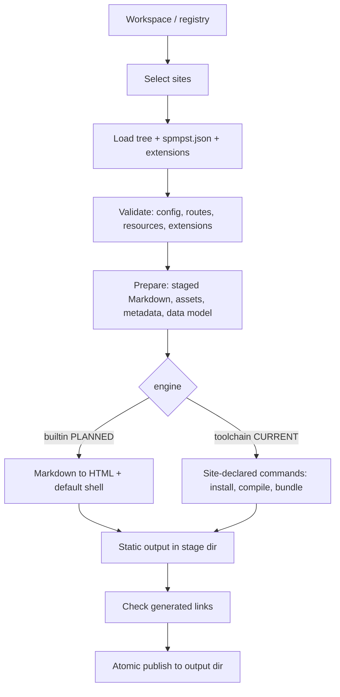
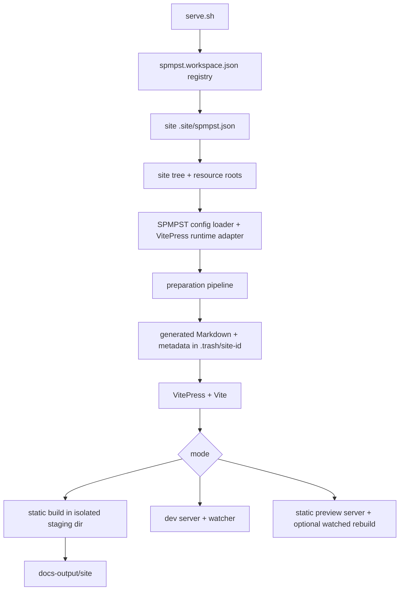

# SPMPST — Standard Portable Markdown Pre-SSG Tree

**Status:** Draft, implementation in progress
**Version:** 0.1.0-draft.6
**Date:** 31 October 2026

## 0. Preface

### 0.1 What SPMPST is

SPMPST is a **standard**, defined independently of any program. It has two parts, specified separately on purpose:

1. **The tree (SPMPST-0001).** A portable directory convention and configuration model for documentation and static sites: Markdown sources, per-language files side by side, configuration, logical resources, routes, and an extension mechanism. It is a user-owned, renderer-neutral input.
2. **The tooling contract (SPMPST-0002).** What a *conforming tool* must do with a valid tree: discover sites, build each one in isolation, and produce ordinary static files publishable to GitHub Pages or any static host.

The standard never names a specific program. It speaks of "a conforming tool". Programs that implement it are listed in Part C (historical) and Part D (planned reference implementation, **Kiln**).

### 0.2 Product goals (of the standard and its reference implementation)

1. **Create a static site at lightning speed:** sensible defaults, a minimal JSON configuration (editable by hand or through a future UI).
2. **Compile very fast:** millisecond-range preparation for hundreds of Markdown pages with a native engine (scenario-based targets in Part D).
3. **Self-contained execution:** a local HTTP engine for testing; no dependency on neighbouring implementation directories such as `docs/vitepress-site/`.
4. **All-in-one build:** the tool runs whatever the site declares to turn sources into static HTML, CSS, JS, SVG, images and fonts, including dependency installation and compilation, so a project's documentation and its neighbouring website share one workflow.
5. **Publish anywhere static:** the output is plain static files.

### 0.3 Non-goals

- **No frontend-framework standardization.** React, Vue, Svelte, Astro and others each have their own paradigms, imports and tooling. SPMPST defines no component model, lifecycle, or cross-framework compiler. Each site chooses its libraries and declares how to build them (§B3). Mixing frameworks is allowed wherever the site's own build can handle it.
- **No guarantee that Markdown containing components is readable without the framework runtime.** Fallback content for framework-specific tags is the site's responsibility. (Ordinary Markdown is always converted to meaningful HTML.)
- **No template language in the core** (§A16, §E5).
- **No WebAssembly requirement.**
- **No dynamic hosting.**
- **Not a Markdown dialect, not a runtime.**

### 0.4 Document map

| Part | Identifier | Subject | Status |
|---|---|---|---|
| A | SPMPST-0001 | **Tree standard**: layout, files, routes, locales, config, layouts, resources, extensions | v0.1 baseline + proposals |
| B | SPMPST-0002 | **Tooling contract**: `spmpst.json`, build, isolation, incremental updates | mostly PROPOSED |
| C | informative | **Historical implementation**: Node/VitePress host | CURRENT |
| D | informative | **Kiln**: planned reference implementation | PLANNED |
| E | extension specs | `spmpst.seo-audit`, `spmpst.offline`, `spmpst.agent`, `spmpst.reproducible`, `spmpst.templating` (outlines) | PLANNED |

### 0.5 Conventions

**MUST, MUST NOT, REQUIRED, SHALL, SHALL NOT, SHOULD, SHOULD NOT, RECOMMENDED, MAY, OPTIONAL** are interpreted as in RFC 2119 and RFC 8174 only when in capitals.

- **CURRENT**: behaviour observed in the existing JavaScript/VitePress implementation.
- **PROPOSED**: a contract not yet implemented.
- **PLANNED**: intended, with no assured design or schedule.
- **EXPERIMENTAL**: MUST NOT be relied on for interoperability.

If a PROPOSED requirement conflicts with observed CURRENT behaviour, that is an **unimplemented requirement**, not evidence of conformance. Source references of the form `path#symbol` come from a reference inventory not revalidated against a live repository for this edition.

### 0.6 Naming rule

The identifier **`spmpst`** is used for everything that belongs to the standard: files in the tree, the reference syntax `@spmpst::...`, the declaration file `spmpst.json`, the variables `SPMPST_*` that a tool gives to site commands, and extension ids with the `spmpst.` prefix. **No implementation name ever appears in a tree, a standard file, or an adapter's configuration.** A tool's own settings live outside the tree (§B12).

---

# Part A: SPMPST-0001 Tree Standard

## A1. Scope

The tree standard defines authored sources and configuration **before** site generation: layout, file naming, frontmatter, routes, languages and fallbacks, collections, concern-based configuration, extensions, layouts, logical resources, and public files. It does not define rendering, components, bundling, serving or deployment.

## A2. Terminology

- **Workspace**: a directory (or registry file) from which one or more sites are discovered.
- **Site**: one tree root plus its declaration (`spmpst.json`, §B3); has a unique `id`.
- **Tree root**: the directory containing `.site/` (currently `docs/site-1/`).
- **Guide**: an independently routed documentation collection under `src/guides/`.
- **Subguide**: a guide registered in the `subguides` configuration array.
- **Section**: a directory of pages within a guide.
- **Page**: a Markdown source file that is not metadata or ignored content.
- **Collection**: a registry entry whose Markdown files are prepared as a list or article feed.
- **Category**: localized metadata from a collection's category file.
- **Locale / Bundle**: a language code (`en`, `fr`) / a locale JSON file with language-specific copy.
- **Concern file**: one configuration file with exactly one owner for each key.
- **Extension**: an optional capability declared by an identifier (§A12).
- **Layout**: a named page template selected for a page (§A13).
- **Conforming tool**: a program that satisfies Part B.
- **Target / Adapter**: a renderer-specific configuration and resource set / code mapping the shared model to it.
- **Staged tree**: portable Markdown plus staged assets produced before rendering.

## A3. Workspace, site identity, and discovery

### A3.1 Site declaration

Every site has a declaration file stored with its owner at `<tree-root>/.site/spmpst.json`. The current VitePress adapter uses the earlier host-specific declaration fields; the standardized `paths`, build contract (§B3), and extension declarations (§A12) remain proposed. Identity and path fields:

| Field | Meaning |
|---|---|
| `id` | Stable, unique identifier; namespaces caches, scratch space and output. |
| `name` | Human-readable label. |
| `paths.source` | Tree root (contains `.site/`, `src/`, `resources/`). |
| `paths.resources` | Site-owned resources (components, hooks, diagrams, assets). Default: `<source>/resources`. |
| `paths.sharedResources` | Optional shared adapter catalogues (icons, flags). Default: tool-provided. |
| `paths.output` | Final static output directory. Default: outside the source tree. |

All paths are relative to the directory containing the declaration (never the process working directory), use `/`, and MUST NOT escape their approved roots.

### A3.2 Workspace registry and discovery

```json
{
  "sitesPaths": [
    "../site-1/.site/spmpst.json",
    "../site-2/.site/spmpst.json"
  ]
}
```

**CURRENT:** `docs/vitepress-site/spmpst.workspace.json` points to `docs/site-N/.site/spmpst.json`; `VITEPRESS_SITE_MANIFEST` selects another registry; relative entries resolve from the registry directory. The current adapter requires this explicit workspace file and does not scan for sites.

**PROPOSED:** a conforming tool finds `spmpst.workspace.json` by walking up from the current directory. The registry is the authority. When absent, a tool MAY scan immediate child directories for `*/.site/spmpst.json`. A tool MUST NOT require an implementation checkout path as a user argument.

### A3.3 Site selection and aliases

A selection matches any of these aliases (**CURRENT** in `serve.sh --sites`): the site `id` (e.g. `feluqa-docs`), the `name`, the basename of the source directory (`site-1`), or a one-based index as shown by the tool's listing. An alias matching more than one site MUST be a blocking diagnostic. Internally a tool resolves every selection to the `id`.

### A3.4 Isolation

A selected site's output, lock state, cache namespace, generated sources, resource catalogue, canonical URL, secrets and environment MUST NOT be inherited from another site's previous run. Distinct sites MUST have distinct `id`s within a workspace.

## A4. Directory layout and file naming

```text
<tree-root>/
├── .site/
│   ├── spmpst.json                    # declaration + build contract + extensions
│   ├── spmpst.<concern>.json          # concern files
│   ├── spmpst.<extension>.json      # configuration of a declared extension (§A12)
│   ├── locales/*.locale.json
│   ├── public/*                       # public text files passed through
│   ├── schema/*.schema.json
│   └── targets/*.target.config.json   # adapter-owned, opaque to the core
├── src/
│   ├── guides/
│   └── collections/
└── resources/
    └── components/  hooks/  diagrams/  assets/   # site-owned
```

Source roots MUST use these fixed conventions. The tree root MUST be the directory containing `.site/`; `SPMPST_ROOT` MAY override it for tooling. Shared adapter catalogues (`icons/`, `flags/`) MAY live beside the adapter. **CURRENT:** the VitePress host keeps them in `docs/vitepress-site/resources/`; site-owned `components/`, `hooks/`, `diagrams/` stay in `docs/site-1/resources/`.

Language variants live **together** in the same directory (`page.en.md`, `page.fr.md`). A separate directory tree per language MUST NOT be required.

### A4.1 Ownership prefix rule

SPMPST-owned data files carry the `spmpst.` prefix, so a file's name says who owns it and so that a metadata file mixed among authored content cannot be mistaken for an author's file. Current SPMPST-owned names:

| Previous name | Current name | Location |
|---|---|---|
| `vitepress-site.json` | `spmpst.json` | `.site/` |
| `<concern>.site.config.json` | `spmpst.<concern>.json` | `.site/` |
| `sidebar.json` | `spmpst.sidebar.json` | `src/**` (mixed with content) |
| `guide.config.json` | `spmpst.guide.json` | `src/guides/**` |
| `category.json` | `spmpst.category.json` | `src/collections/**` |
| (new) extension config | `spmpst.<name>.json` for standard extensions; `<reverse-domain-id>.json` otherwise | `.site/` |

Files that must keep an exact public name (`robots.txt`, `llms.txt`, `humans.txt`, `security.txt`) are never prefixed. Locale bundles (`en.locale.json`) live in their own folder and are not prefixed. The VitePress host and both checked-in sites use these names. The migration is intentionally breaking; loaders reject the previous filenames.

## A5. Paths and safety

- Paths in `.site/` MUST be relative to the tree root, use `/`, and MUST NOT escape the root via `..`, absolute paths, or symlinks. A symlink MAY be followed only if its canonical target stays within an approved root.
- Collection `dir` is relative to `src/collections` and defaults to its `id`. Guide config paths are relative to that guide. Markdown relative links are relative to their page.
- Assets referenced from Markdown MAY come from `src/guides`, `src/collections`, or the source tree's `resources/`; adapter resources are referenced by logical identifiers (§A14). Any other path is rejected.

## A6. Source file conventions

- **Ordering prefixes.** `010-` and `020.` style numeric prefixes control navigation order and are removed from staged names and routes.
- **Language suffix.** `name.<lang>.md` with `<lang>` matching `[a-z]{2,3}(-[A-Z]{2})?`. A file without suffix belongs to the fallback language.
- **Ignored.** Names beginning with `.` and files named `README.md` MUST NOT be published. Metadata files (`sidebar`, `guide`, `category`) are not pages.
- **Directory index.** `index.<lang>.md` provides a localized directory index; a prefixed form such as `000-index.en.md` MAY be used and emits the normal `index.md` route. The root fallback index is `src/guides/index.<fallbackLanguage>.md`.
- **Recommended naming.** A guide SHOULD use a stable, site- or product-qualified directory name (`feluqa.rs/`, `numerimondes.com/`); sections and pages SHOULD use three-digit prefixes (`000-prologue/`, `010-release-notes.en.md`). A recommendation, not a restriction.

## A7. Frontmatter

- Unknown frontmatter MUST be preserved for the target, except fields rewritten by preparation.
- **v0.1 baseline rule (CURRENT):** every published page MUST define `icon` and `sidebarTitle`; `title` and `description` are recommended; collection articles MAY include `date` and `category`. These two required fields are renderer-shaped vocabulary and are candidates for relaxation in v0.2 (defaults derived from `title` and the file name).
- Preparation MAY add: `requestedLanguage`, `contentLanguage`, `languageFallbackNotice`, `prev`, `next`, `search`, `collection`, `wordCount`, `readingTime`, `collectionIndex`.
- A page MAY select a layout with `layout` (§A13).
- An extension's page-level fields live under one top-level key equal to the extension id (§A12.3).

## A8. Routing

- Guide routes are configured with `uri.base` and optional `uri.index`; locale prefixes depend on `fallbackLanguage` and `selector.prefixDefaultLanguage`.
- Route segments are cleaned by removing numeric ordering prefixes. Directory indexes and collection pages are emitted from their source locations.
- **Collision policy (PROPOSED):** two sources emitting the same destination (including public files versus generated routes, localized aliases, assets) MUST yield a blocking diagnostic; silent overwrites are prohibited. **CURRENT:** only specific generators detect conflicts; there is no general route-conflict validator.
- **Identity (PROPOSED):** a stable page identity is the normalized source-relative path plus effective locale (or an explicit unique `id` in frontmatter), distinct from the mutable public route.

## A9. Languages and fallbacks

- `lang` owns `languages`, `fallbackLanguage`, `selector`. Each configured language MUST have exactly one locale bundle; extra bundles produce a warning.
- Locale bundles MUST contain language, UI, search, outline, footer, notice and SEO sections.
- Localized inline objects resolve: requested language, then fallback language, then first string value. Missing translations warn, and fail under strict i18n.
- When a non-default translation is absent, a fallback page is generated from the default-language page and marked with `requestedLanguage`, `contentLanguage`, `languageFallbackNotice`. Notice templates use `{requested}` and `{fallback}` (the reference implementation currently validates `{requested}`).

## A10. Collections

- Layout is `article` or `doc`; index layout is `list` or `spotlight`.
- The category file provides localized category names and IDs.
- Word count counts whitespace-separated words; reading time rounds up at 200 words per minute.
- Category-specific routes and route-conflict checks are **PLANNED**.

## A11. Configuration

### A11.1 Core concerns

| Concern | Current file | Main keys |
|---|---|---|
| Definitions | `spmpst.definitions.json` | `site`, `guidesPath`, `indexPath`, `project`, `subguides`, `iconFallback` |
| Languages | `spmpst.lang.json` | `languages`, `fallbackLanguage`, `selector` |
| Navigation | `spmpst.topbar.json` | `items`, `theme` |
| Collections | `spmpst.collections.json` | `collections` |
| Appearance | `spmpst.appearance.json` | `fonts`, `logo`, `ogImages`, `mermaid` |
| Links | `spmpst.links.json` | `socialLinks` |
| SEO metadata | `spmpst.seo.json` | `siteUrl`, `path`, `icon` |
| Layouts (**PROPOSED**) | `spmpst.layouts.json` | `layouts`, `rules` (§A13) |

The loader MUST reject unknown concerns, unknown keys, duplicate ownership, malformed JSON, missing required files and missing locale bundles, and SHOULD suggest a likely owner or spelling. `$schema` is ignored. Target files are returned as **opaque data**; validation belongs to the consuming adapter.

### A11.2 Closed versus open

Core configuration is a versioned, **closed** schema: unknown keys are rejected. Extensibility is provided only by declared extensions (§A12). By contrast, HTML, unknown frontmatter and ordinary public files are **preserved** wherever the consumer can represent them. This prevents accidental breaking changes while permitting new web standards.

### A11.3 Minimal configuration

A basic site SHOULD need very little: a declaration, `definitions`, `lang` and one locale bundle, with all other concerns defaulted by the tool.

## A12. Extensions

### A12.1 Principle

An extension is an **optional capability**, declared by an identifier, that adds things to the tree **without changing the meaning of the core**. Any conforming tool MAY implement or ignore it according to fixed rules. The conformance suites, companion capabilities and ecosystem growth are built on this mechanism, which keeps the core small.

### A12.2 What an extension may add

- configuration keys, in its own configuration file;
- resource kinds, written `@spmpst::<extension-id>.<kind>::<id>`;
- layouts and layout rules (§A13);
- page-level frontmatter fields, under one key equal to its id;
- diagnostic codes, prefixed with its id;
- build steps, through the contract of `spmpst.json` (§B3).

An extension MUST NOT redefine a core key or change the behaviour of an existing one.

### A12.3 Declaration

In `.site/spmpst.json`:

```json
{
  "specVersion": "0.1",
  "id": "site-1",
  "extensions": {
    "spmpst.seo-audit": { "version": "0.1", "required": false },
    "org.acme.math":    { "version": "1",   "required": true }
  }
}
```

Configuration lives in the extension's own file in `.site/` named after its id: `spmpst.seo-audit.json`, `org.acme.math.json`. The declaration holds only `version` and `required`, so configuration has exactly one location. A configuration file for an undeclared extension is a blocking diagnostic.

Frontmatter example:

```yaml
---
title: Intro
org.acme.math:
  katex: true
---
```

### A12.4 Behaviour when unknown

| Declared | Tool knows it | Behaviour |
|---|---|---|
| any | yes | Validate configuration against the extension's schema; apply. |
| `required: false` | no | Ignore; preserve its files, keys and frontmatter untouched; report an informational diagnostic. |
| `required: true` | no | **Blocking diagnostic.** Otherwise two tools would silently produce two different sites. |

A tree whose optional extensions are all removed MUST remain valid.

### A12.5 Identifiers

- The prefix **`spmpst.`** is reserved for extensions maintained with the standard. Their names MUST NOT collide with core concern names (hence `spmpst.seo-audit`, not `spmpst.seo`, since `seo` is a core concern).
- All other extensions use a reverse-domain identifier (`org.acme.math`), avoiding collisions without a central registry.
- An extension provides a JSON schema for its configuration, validated like core configuration. A manifest file (`extension.json`: id, version, schema, declared keys, kinds, diagnostics) is **reserved** for a future revision; the first real extension decides its shape.

### A12.6 Code and trust

In v0.1 extensions are **declarative only**: they ship no executable code. An extension that needs code uses the toolchain declared in `spmpst.json` (§B3), whose commands are trusted project code (§B3.4). Hook phases are candidates in §E6, not part of this version.

### A12.7 Tool-specific settings are not extensions

A port, cache directory or parallelism level is a preference of a machine or a user, not part of the tree (§B12). If a setting really affects the resulting site, it deserves a **generic** extension, not an implementation-specific one.

## A13. Layout registry (PROPOSED)

**CURRENT:** layouts and page shells are selected through site hooks and renderer-shaped frontmatter (`layout`, `sidebar: false`, `aside: false`). **PROPOSED:** a declarative registry in configuration, so common cases need no code:

```json
{
  "layouts": {
    "doc":     { "component": "DocLayout" },
    "article": { "component": "ArticleLayout", "features": { "toc": true, "pager": true } },
    "landing": { "component": "LandingLayout", "features": { "sidebar": false, "toc": false } }
  },
  "rules": [
    { "match": "src/collections/articles/**", "layout": "article" },
    { "match": "src/guides/*/index.*.md",     "layout": "landing" }
  ]
}
```

- `component` is an opaque string interpreted by the adapter or toolchain; the core validates only the layout names and references.
- Resolution order: page frontmatter `layout`, first matching `rules` entry, guide default, then `doc`.
- Neutral `features` keys replace renderer flags (`sidebar: false`, `aside: false`); adapters translate them.
- Hooks remain an escape hatch; configuration wins when both are present and the conflict is reported.

## A14. Resources, assets, and public files

### A14.1 Logical resource references

Core references use short whole-string forms:

```text
@spmpst::icon::<name>
@spmpst::icon::<family>/<name>
@spmpst::flag::<code>
@spmpst::media::<name>
```

Examples:

```text
@spmpst::icon::book-open
@spmpst::icon::lucide/book-open
@spmpst::flag::fr
@spmpst::media::icons/prologue-book
```

`name` and `code` are stable logical identifiers, not collection paths or filenames. They MUST begin with a Unicode letter or number, may contain letters, numbers, `.`, `_`, `-`, and `/`, MUST NOT contain empty or `.`/`..` segments, and are normalized to NFC. Icons and flags resolve from the conforming tool's standard registries. Qualified icon IDs select a tool-provided family; unqualified IDs use the tool's documented deterministic family order. Site media resolves from the selected site's own `resources/media/` tree. The logical name is the relative SVG filename without `.svg`.

A conforming tool owns the standard icon and flag catalogues and exposes their logical names through a build-time registry. Standard icons may be addressed by unqualified name; `family/name` MAY select a specific tool-provided family where needed. Sites MUST NOT configure paths into the tool installation or duplicate its standard registries. Site-owned images and SVGs live under `resources/media/` and use `@spmpst::media::<name>` (including nested names such as `icons/prologue-book`). The adapter resolves media only inside the selected site tree. The core parses these references into typed records and does not touch the filesystem. Unknown names and escaping/symlink paths are build errors.

Resolution applies at documented explicit points (configuration values, page `icon` frontmatter, sidebar icons, and language flags). It is **not** general text substitution in Markdown prose.

### A14.2 Assets

Local assets referenced from Markdown or frontmatter are copied to content-addressed names (`__docs-assets/<sha256><ext>`), written only if bytes changed. Identical bytes deduplicate.

### A14.3 Public files

Files in `.site/public/*` are published as site-owned text files without any SPMPST change: `llms.txt`, `robots.txt`, `humans.txt`, `security.txt`, verification files, future discovery documents. SPMPST assigns them no semantics. **CURRENT:** one trailing newline is removed on emission.

## A15. HTML and Markdown passthrough

- The core MUST NOT keep a restrictive allowlist of HTML elements: unknown valid element names, `data-*`, ARIA attributes and new `<meta>` forms MUST pass through to an HTML-capable adapter.
- Sanitization is a separate, explicit, versioned security policy for untrusted input. Unknown markup MUST NOT bypass it.
- Markdown MUST NOT treat arbitrary inline text as an executable directive. `@spmpst::` is recognized only in documented contexts.

## A16. Site data model and references

### A16.1 Principle

SPMPST is a **data standard, not a language.** The core defines typed, inert references and a JSON-serializable data model, and no evaluation: no loops, no variables, no function calls in Markdown.

### A16.2 Site data model (PROPOSED)

A conforming tool exposes the prepared model (collections, pages, frontmatter, routes, locales) as JSON to the site's build, for instance as an importable generated module or a file at a known path in `{generatedDir}`. Components, owned by the site, query it with their own framework. Example: a `<ProjectVideos collection="projects" field="video_link" />` component receives or imports the model and renders cards. This needs **no new Markdown syntax** and keeps the Markdown valid for every other tool.

### A16.3 Structured references (EXPERIMENTAL)

Candidate typed references, not implemented, MUST NOT be relied on:

```text
@spmpst::self::frontmatter::title
@spmpst::self::frontmatter::author.name
@spmpst::page::handbook/intro::frontmatter::description
```

If standardized: references resolve against a typed context (never by code execution); `self` is always the page being processed; cycles fail deterministically; missing keys yield a diagnostic; output is escaped for its context (HTML text, attribute, URL, JSON, CSS); cross-page references participate in dependency tracking. Implementations SHOULD NOT parse them in prose until a future revision fixes the syntax.

### A16.4 Rejected: inline programming syntax

A proposal of the form

```text
::: spmpst.foreach((@spmpst::collection::query('projects')::frontmatter('video_link'))) ::setvar(current_video)
  
:::
```

is **not adopted** in the core, for these reasons: Markdown containing it is no longer valid Markdown elsewhere; it contradicts "no evaluation" (it needs mutable state, scopes, nested calls); `:::` is already used by markdown-it and VitePress containers; it breaks fine-grained dependency tracking, since a collection query depends on every page of the collection; `setvar` is unnecessary where a loop binding suffices; and each injection context needs separate escaping. The legitimate need is served by §A16.2 first, and if still insufficient by the restricted, declarative, optional extension `spmpst.templating` (§E5).

## A17. Versioning and naming debt

- A breaking tree, metadata or model change SHOULD increment the major version; additive optional fields the minor version. A manifest enforcing this is **PLANNED**; `specVersion` in the declaration is the proposed carrier.
- Existing v0.1 trees MUST remain consumable. A breaking change needs a migration plan and a before/after fixture.
- **v0.2 candidates (discussion only):** the `spmpst.` file prefix (§A4.1); `subguides` → `guides`; drop `subguides[].label`; `sidebarTitle` → neutral navigation title; `topbar` → `header`; clarify `uri.entry`; `documentationNotices` → `notices`; neutral layout features replacing renderer flags (§A13); the `layouts` concern.

---

# Part B: SPMPST-0002 Tooling Contract

## B1. Nature of this part

This part specifies what a **conforming tool** does with a valid tree. It standardizes **behaviour and guarantees**, not a command-line experience: command names, options, ports and watch modes belong to each tool's own documentation (the planned reference implementation's CLI is in Part D). What is standardized is the minimum that makes tools interchangeable on a tree: a way to list the sites, a way to build them, and the isolation, safety and output guarantees.

Principles:

1. **Simple by default.** Minimal config; defaults come from presets.
2. **Self-contained.** After installation, execution depends only on the workspace, the declared site inputs, and tool-managed caches or toolchains, never on a neighbouring implementation checkout.
3. **Per-site isolation.** One site per build context; caches, output and locks namespaced by `id`.
4. **Static output.** Authored Markdown becomes HTML at build time. Site components MAY need JavaScript; they are the site's concern.
5. **Site-owned frontend.** The site declares how its frontend is built (§B3, §B10).
6. **Honest performance claims** (§B9).

## B2. Pipeline model



Every stage MUST emit machine-readable diagnostics for blocking failures. The prepared model SHOULD be JSON-serializable and free of framework runtime objects.

## B3. `spmpst.json`: declaration and build contract

`.site/spmpst.json` holds everything a conforming tool needs to build the site, including the commands to execute for bundling. This keeps SPMPST agnostic of frontend frameworks: the site says **what to run**, the tool orchestrates it. Minimal form:

```json
{ "specVersion": "0.1", "id": "site-1", "name": "My docs" }
```

Full form (**PROPOSED**; the current VitePress host realizes the same data through its registry, declaration and `site.mjs`):

```json
{
  "$schema": "./schema/spmpst.schema.json",
  "specVersion": "0.1",
  "id": "feluqa-docs",
  "name": "Feluqa documentation",
  "paths": {
    "source": "..",
    "resources": "../resources",
    "sharedResources": "../../vitepress-site/resources",
    "output": "../../../docs-output/site-1"
  },
  "extensions": {
    "spmpst.seo-audit": { "version": "0.1", "required": false }
  },
  "engine": "toolchain",
  "toolchain": {
    "preset": "vitepress",
    "cwd": "../../vitepress-site",
    "install": { "command": "npm ci", "when": "missing" },
    "build":   { "command": "vitepress build app" },
    "dev":     { "command": "vitepress dev app --host {host} --port {port} --strictPort" },
    "network": "install-only"
  }
}
```

### B3.1 Fields

| Field | Meaning |
|---|---|
| `engine` | `builtin` (PLANNED: native Markdown to HTML with a default shell, no JS toolchain) or `toolchain` (run site-declared commands). |
| `extensions` | Declarations per §A12.3. |
| `toolchain.preset` | Named preset supplying defaults for `install`, `build`, `dev` (e.g. `vitepress`). Explicit fields override the preset. |
| `toolchain.cwd` | Working directory for the commands, relative to the declaration. |
| `toolchain.install` | Command to provision dependencies; `when`: `missing`, `always`, `never`. |
| `toolchain.build` | Command(s) that read the prepared inputs and write static files to `{stageDir}`. |
| `toolchain.dev` | Command for an interactive development server (OPTIONAL). |
| `toolchain.network` | `none`, `install-only`, `full`; informs controls and reports. |
| `toolchain.env` | Extra environment variables (secrets MUST NOT be copied into artifacts). |

### B3.2 Placeholders and environment

Commands MAY use `{siteId}`, `{sourceDir}`, `{generatedDir}`, `{stageDir}`, `{outDir}`, `{cacheDir}`, `{host}`, `{port}`. A conforming tool exports to those commands `SPMPST_SITE_ID`, `SPMPST_ROOT`, `SPMPST_GENERATED_DIR`, `SPMPST_STAGE_DIR`, `SPMPST_OUT_DIR`, `SPMPST_CACHE_DIR`, `SPMPST_MODE` (`build`, `dev`, `preview`). These are the only variables the standard guarantees; adapters and sites MUST NOT depend on a tool-specific variable.

**CURRENT** equivalents set by `site.mjs`: `SPMPST_ROOT`, `DOCS_OUTPUT_DIR`, `VITEPRESS_SITE_ID`, `VITEPRESS_SITE_DECLARATION`, `VITEPRESS_SITE_ROOT`, `VITEPRESS_TRASH_DIR`, `VITEPRESS_RESOURCES_DIR`, `VITEPRESS_SITE_RESOURCES_DIR`, `HOST`, `PORT`.

### B3.3 Contract with the output

After `build` succeeds, `{stageDir}` MUST contain a deployable static site. The tool then validates links and publishes atomically. The destination host needs neither the tool nor the toolchain.

### B3.4 Trust

`install` and `build` commands execute project and package code. A conforming tool MUST state this clearly, MUST show the commands it runs, MUST allow inspection without execution and disabling installs, and SHOULD offer network restriction where practical.

## B4. Engines

| Engine | Status | Description |
|---|---|---|
| `toolchain` + preset `vitepress` | **CURRENT** | Node host prepares generated Markdown and metadata; VitePress/Vite render. Chosen for design, reactivity and search. |
| `toolchain` + custom commands | PROPOSED | Any site-declared commands (Vite, Astro, esbuild, plain scripts). |
| `builtin` | **PLANNED** | Native Markdown to HTML with a default shell and prebuilt components; no Node needed. |

Part A is identical for all engines. A site MAY start on `toolchain` and move to `builtin` without changing content.

## B5. Minimal tool surface

A conforming tool MUST provide:

1. **List**: report the discoverable sites (alias index, `id`, name, source root, output directory) and accept a selection by the aliases of §A3.3.
2. **Build**: for each selected site, validate, prepare, build per §B6, and report each output directory.
3. **Diagnostics**: machine-readable, with meaningful exit status (zero only on success).
4. **Capability report** (§B13).

A conforming tool MAY additionally provide **preview** and **dev** (§B7), validation-only, cleaning, scaffolding and deployment. How these are invoked is the tool's own business. The simple workflow MUST NOT make an implementation checkout path a required user argument.

## B6. Build semantics

1. **Isolation.** A build binds one site identity, one resolved config snapshot, one engine, one dependency graph. Changing site A's sources MUST NOT change site B's output unless a declared shared dependency changed.
2. **Staging.** Builds write to a stage directory next to the output (**CURRENT**: `<output-parent>/tmp/<output-basename>.stage-<pid>`), with generated-source and cache namespaces separate from any running dev server.
3. **Atomic publication.** Move existing output to a backup, move stage to output, delete the backup; on failure delete the stage and restore the backup. Destructive cleanup MUST be limited to the selected output directory.
4. **Link check.** Local links in generated HTML are validated after the build. This is not an external link check.
5. **Collisions.** Duplicate destinations are blocking (§A8).
6. **Diagnostics.** Each has `code`, `severity`, source file, location when available, `siteId`, explanation and optional suggested fix. Distinct codes for: unknown keys, duplicate routes, invalid references, unavailable toolchain, unsafe paths, unsupported required extension.
7. **Extensions.** Required unknown extensions block the build (§A12.4).
8. **Locking.** Concurrent preparations of one site serialize through a per-site lock with stale-lock detection and a bounded wait (**CURRENT**: `prepare.lock`, 30 s).

## B7. Preview and development (OPTIONAL capabilities)

- **preview** (production-like): serves the already built static output over local HTTP; on source change (debounced) rebuilds only the changed site and swaps output atomically; the server keeps running; a browser refresh MAY be needed. A tool offering preview MUST NOT require a separate user-managed server command. (**CURRENT**: `./serve.sh --preview`.)
- **dev** (authoring): serves with in-place updates (§B8). Availability depends on the engine.
- Starting a build MUST NOT make a running dev server reload, delete files it serves, or replace another site's caches.

## B8. Incremental updates (engine-neutral requirements)

Engine-specific realizations: VitePress in §C6, native in §D6.

1. **Minimal invalidation.** Editing one page body MUST invalidate only that page and pages declaring a dependency on it (including referenced assets). It MUST NOT delete and recreate the whole generated tree.
2. **Retention.** Unchanged generated files keep their bytes and modification times.
3. **Classification.** Page-body edits, navigation/structure edits and site-configuration edits are distinct classes. Only structure, navigation or configuration changes MAY restart or reconfigure a dev server.
4. **Debounce and batching.** Source events are debounced and consecutive events batched into one preparation.
5. **No document reload for body edits (dev).** A content-only edit updates the affected route in place; other open routes and the application shell stay live; scroll position and shell state SHOULD be preserved.
6. **Resilience.** A failed incremental preparation is logged; the watcher stays alive for the next edit.
7. **Acceptance test.** Keep two routes open in two tabs; edit one page body; only the tab showing that route updates, without a document navigation; a simultaneous build of that site leaves the dev server unchanged. Then edit a referenced asset and verify only dependent pages are invalidated.

## B9. Performance claims

A performance claim MUST name the **scenario**, the **stage**, the **machine**, the **cache state** and the **fixture**.

| Scenario | Definition |
|---|---|
| **cold** | Fresh process, no caches, full source tree processed. |
| **warm** | Caches present, nothing changed; inputs verified (stat/size/mtime, content hash when needed), no rendering. |
| **one-page edit** | One page body changed; incremental preparation and re-render of that page only. |

Stages are reported separately: `discovery`, `validation`, `preparation`, `markdown→HTML`, `toolchain/bundle` (not controlled by the tool), `publish`. A preparation figure MUST NOT be presented as a full-build figure unless a measured full build meets it. Targets of the planned reference implementation are in §D5.

## B10. Components and frontend toolchains

SPMPST does not define components. A site adds components with its framework's ordinary files, imports and dependencies, and declares in `spmpst.json` how they are built. The tool provisions the declared toolchain, runs it, collects the static outputs (HTML, CSS, JS, SVG, images, fonts), reports failures, and serves the result.

- A site MAY mix frameworks if its own build handles the composition.
- A site MAY use prebuilt components supplied by a tool, a framework ecosystem or any package source. A tool SHOULD offer maintained presets and prebuilt components for common needs so a basic site does not require assembling a frontend stack.
- Whether Markdown containing framework tags has meaningful output without the framework runtime is the site's concern.
- Production output MUST NOT inadvertently include dev tooling (dev middleware, debug endpoints, source maps leaking secrets). Framework runtime bundled for a declared interactive component is a legitimate production dependency.

**CURRENT:** only Vue SFCs below `project.components` are auto-registered (PascalCase names from file names, collisions rejected, registered globally in the theme). A host Vite config can add plugins; other frameworks' compilation and registration are the site's setup.

## B11. Security of the tooling

- Writes outside the approved output root MUST be prevented; archive extraction paths validated (when archives are produced).
- Secrets from the environment, `.env` files or private config MUST NOT be copied into public artifacts without explicit intent.
- Build dependencies and scripts MUST be inspectable; network use and generated runtime dependencies SHOULD be reported; lockfiles or integrity pinning SHOULD be supported.
- Telemetry and trackers MUST be opt-in for generated sites; a tool MUST NOT add analytics, remote fonts or session replay just because a renderer enables them by default.
- Deeper requirements (CSP, supply chain, threat model) belong to §E6.

## B12. Tool-specific settings

Settings that belong to a tool, machine or user (port, host, cache directory, parallelism, watch mode, colour output) MUST NOT live in the tree. They are expressed as command-line options, environment variables, or a user-level configuration file outside any site. The tree therefore stays identical across tools. A tool MUST NOT require a key carrying its own name in a tree file.

## B13. Capability discovery

A conforming tool MUST be able to report, as JSON, at least: `specVersion`, tool name and version, supported **extension ids** with versions, available engines and optional capabilities (preview, dev). Unknown capability ids are unsupported, never assumed. (This replaces the "profile" notion of the first RFC draft.)

## B14. Conformance fixtures (PROPOSED)

At minimum: co-located multilingual routes; numeric prefixes; unknown frontmatter; arbitrary new HTML elements and metadata; `llms.txt` passthrough; asset deduplication; duplicate routes; symlink escape attempt; missing-toolchain diagnostic; static output independent of the build tool; multi-site isolation; incremental single-page update; concurrent build and dev isolation; layout resolution order; alias ambiguity; unknown optional extension ignored; unknown required extension blocking; undeclared extension file rejected. Current gates: `docs:check` (config + frontmatter) and `docs:verify` (snapshot comparison with canonical object-key order, preserving array order). A portable cross-adapter fixture directory is **PLANNED**.

---

# Part C: Historical implementation (informative, CURRENT)

This part describes `docs/vitepress-site/` as observed: a Node/VitePress host that predates the tool-neutral contract. It is not a specification, and it is the implementation that Kiln (Part D) is planned to supersede.

## C1. What the host owns

The shared Node/VitePress host owns the CLI wrappers, preparation pipeline, VitePress adapter, Vite configuration, theme, shared icon/flag catalogues, dependencies and caches. It does not own authored pages. Each site owns `.site/`, `src/`, `resources/`. The host prepares a generated VitePress source tree in `.trash/<site-id>/` and asks VitePress to render or serve it. Output defaults to `docs-output/`.



## C2. Entry points

There is no `docs/vitepress-site/server.sh`; the entry point is `serve.sh`. Smaller scripts under `app/bin/` delegate to `app/scripts/site.mjs`. npm commands: `docs:prepare`, `docs:build`, `docs:serve`, `docs:preview`, `docs:clean`, `docs:check`, `docs:new`, `docs:verify`, each calling `node app/scripts/site.mjs <command>`, selecting a site with `--site <id>` or `VITEPRESS_SITE_ID` (prompt if interactive, failure otherwise).

| Invocation | Behaviour |
|---|---|
| `./serve.sh --list` | Print each site's ID, name, source and output directories; start nothing. Cannot combine with other modes. |
| `./serve.sh --sites=site-1 --build` | Verify the VitePress executable exists, then `site.mjs build --site <id>` per site, sequentially. |
| `./serve.sh --sites=site-1` | Per site: `site.mjs serve`: full preparation, `vitepress dev`, plus a separate watcher. |
| `./serve.sh --sites=site-1 --preview` | Build each site, then `site.mjs serve-build` (VitePress `serve()` on built output) plus `site.mjs watch` with `DOCS_WATCH_BUILD=1`. |
| `node app/scripts/site.mjs preview --site <id>` | Build once and serve; no rebuild watcher. |

Ports start at `PORT` (default `4173`), `HOST` defaults to `127.0.0.1`. `--build` and `--preview` cannot be combined. Without `--sites`: prompt when interactive, all sites otherwise.

## C3. Registry and declaration

Workspace registry `docs/vitepress-site/spmpst.workspace.json`:

```json
{ "sitesPaths": ["../site-1/.site/spmpst.json", "../site-2/.site/spmpst.json"] }
```

Declaration (`docs/site-1/.site/spmpst.json`):

```json
{
  "id": "feluqa-docs",
  "name": "Feluqa documentation",
  "sourcePath": "..",
  "resourcesPath": "../../vitepress-site/resources",
  "siteResourcesPath": "../resources",
  "outputPath": "../../../docs-output/site-1"
}
```

Paths resolve from the declaration's directory. `resourcesPath` and `siteResourcesPath` are optional (defaults: host `resources/`, site-root `resources/`). The shell's lightweight reader uses ID, name, source and output; `site-registry.mjs` validates all fields. The target config also contains an `outputDir`, but normal commands set `DOCS_OUTPUT_DIR` from the declaration, which is authoritative (temporarily replaced by a staging path during builds).

**Mapping to the tool-neutral model:** `sourcePath` → `paths.source`; `resourcesPath` → `paths.sharedResources`; `siteResourcesPath` → `paths.resources`; `outputPath` → `paths.output`; the toolchain is implicit (VitePress preset hard-wired in `site.mjs`).

## C4. Dependencies and delegation

Dependencies are installed once for the host (`npm install` in `docs/vitepress-site/`); the wrapper does not install them and stops with a hint when the VitePress executable is missing.

| Tool | Delegated work |
|---|---|
| Node.js | Registry helper, app CLI, config loader, preparation, watcher. |
| VitePress | `dev`, `build`, static `serve`; Markdown→HTML, bundles, route rendering, local search. |
| Vite + Vue toolchain | Dev server/HMR, SFC compilation, resolution, CSS, bundling, chunking. |
| `@mermaid-js/mermaid-cli` (`mmdc`) | Mermaid fences to cached SVG during preparation. |
| Shiki, Tailwind, PostCSS, `ogl` | Highlighting, styles, WebGL effects in site-owned components. |

## C5. Static build lifecycle

1. Shell validates options and resolves registry entries; no port in build mode.
2. Check host dependencies (VitePress binary; `mmdc` for uncached Mermaid).
3. `node app/scripts/site.mjs build --site <id>`; the app registry re-resolves and validates the declaration.
4. Derive site, shared-resource, site-resource, output and per-site trash roots; working directory is the host app directory.
5. Create staging: `<output-parent>/tmp/<output-basename>.stage-<pid>` and a backup path. Preparation receives the stage as `DOCS_OUTPUT_DIR` and `<site-trash>/build` as `VITEPRESS_TRASH_DIR`.
6. `prepareSources`: load and validate config, target settings, languages, guide/collection paths, project directories and theme slots; scan guides and collections; normalize prefixes and locale suffixes; map routes; collect frontmatter and sidebar records; verify labels and icons; copy assets; stage public files and optional flags.
7. `prepareContent`: resolve logos, fonts, OG images; read guide configs; derive collection indexes and article metadata; register Vue SFCs; validate theme slots; emit generated JSON/TS modules (colors, fonts, collections, components, theme, hooks, styles, navigation, sidebar, SEO helpers).
8. Ordered stages (§C7).
9. VitePress loads `app/.vitepress/config.ts`, which builds navigation, sidebars, locales, head transforms; `app/config/vite.config.ts` aliases `@docs` (generated tree) and `@generated` (metadata), resolves site-component imports from host dependencies, serves generated public assets, provides generated-Markdown HMR in dev. A configured `project.viteConfig` or host-root Vite config is merged.
10. `vitepress build` writes static HTML/assets to the stage (Vite chunk-size warnings are not suppressed).
11. `.spmpst/build-timestamp` is added; `check-file-links.mjs` validates the stage.
12. Atomic publish with backup and restore on failure.

## C6. Development server lifecycle

1. Full (non-incremental) preparation; the generated Markdown root is cleaned and recreated.
2. Spawn `vitepress dev --host <host> --port <port> --strictPort` and a separate `scripts/dev/watch.mjs`.
3. The theme extends `vitepress/theme`, registers generated project components, applies per-route colors/fonts/logo/favicon and page enhancements.
4. The watcher debounces events for **60 ms**, batches paths, and runs incremental preparation (`DOCS_PREPARE_INCREMENTAL=1`): unchanged staged files keep bytes and mtime; stale files are removed at cleanup.
5. **Page-body edits** stay on the generated-Markdown HMR path: the Vite post-HMR hook maps the changed generated path to its public URL and returns that module, so the active route receives a `js-update` without document navigation. The MiniSearch entry for the page is discarded before re-adding, avoiding duplicate-ID errors.
6. **Structural changes** (directory/file structure, route-affecting metadata such as `sidebarTitle`, any `.site` change) alter the structural signature; the watcher touches the VitePress config file to request a restart. The signature hashes source paths/directories and sidebar titles, all `.site` config contents and source-file metadata; page bodies and asset bytes are excluded.
7. Failed preparation is logged; the watcher keeps running. It covers `src/`, `.site/`, shared and site resources. On termination both children receive SIGTERM.

**Mapping to §B8:** minimal invalidation = incremental prepare; classification = structural signature; debounce = 60 ms watcher; no reload = `js-update` via the HMR hook; isolation = separate build trash namespace.

## C7. Preparation pipeline

`app/scripts/preparation/pipeline.mjs` takes a per-site lock (`prepare.lock`, stale detection, 30 s wait) and runs:

| # | Operation | Role |
|---|---|---|
| 1 | `prepareSources` | Site tree/config → staged records, route map, navigation order, copied inputs. |
| 2 | `prepareContent` | Collections, style imports, component registry, hook modules, colors/fonts/SEO/sidebar/theme metadata. |
| 3 | `runTransformMarkdown` | Normalize links, stage local assets, render Mermaid, collection frontmatter. |
| 4 | `runLanguageFallbacks` | Create localized copies for absent translations. |
| 5 | `runSeoPages` | Localized SEO/FAQ pages from locale config. |
| 6 | `runDirectoryIndexes` | Missing index pages and no-slash aliases (excluded from search). |
| 7 | `runPager` | `prev`/`next` frontmatter, avoiding self-links via aliases. |
| 8 | `runCleanup` | Remove stale files (incremental only); print counts. |

`DOCS_PREPARE_TIMING=1` prints per-stage timings; `DOCS_PREPARE_NO_LOCK=1` disables the lock. Writers preserve unchanged bytes and the pager-owned frontmatter block. Output is deterministic for unchanged sources; incremental-cache portability is not guaranteed.

## C8. Resources in practice

- The conforming tool owns standard icon and flag catalogues. `@spmpst::icon::<name>` and `@spmpst::flag::<code>` resolve from those catalogues; `@spmpst::media::<name>` resolves under the selected site's `resources/media/` directory. Sites do not declare paths to shared tool resources.
- Resolution points: `toVitepressRuntime()` (config), page `icon` frontmatter (fallback `iconFallback`, default `circle-help`, with a warning; a missing fallback is fatal), `spmpst.sidebar.json` icons, language flags (`generated-guides/public/flags/language/<locale>.svg`), and topbar icons.
- `copyAsset()` confines sources to allowed roots, names by SHA-256 plus extension, writes only on change.
- Mermaid: palette-colored, rendered by `mmdc` with the site's JSON config, cached by hash of config and diagram text, emitted as light and dark SVG; the browser theme adds zoom/open and light/dark switching.

## C9. Components, hooks, styles

- Vue SFCs below `project.components` are discovered recursively and registered globally in generated `components.ts`; theme slots (target config and guide config) are validated against them.
- Hooks by convention under `project.hooks`: `documentation-hooks` (+ optional `.css`) exports `DocumentationNotice`, `DocumentationLastModified` (no-op components when absent); `documentation-seo` exports `transformDocumentationHead` (no-op when absent).
- Configured styles are emitted as imports in a generated TypeScript module.

## C10. Current limits and remaining work in this stage

The current stage is the Node/VitePress adapter described in this part. The direct filename migration and short logical icon, flag, and media references are implemented. Standard icons and flags resolve from the tool-owned catalogues; site media resolves only from the selected site tree. Sites no longer declare resource source paths. The adapter currently resolves local files; remote catalogue acquisition and richer conforming-tool registry diagnostics remain unfinished.

The following work remains before this stage can claim the broader SPMPST tooling contract:

1. **Standard declaration and workspace model.** Replace the adapter-specific declaration fields (`sourcePath`, `resourcesPath`, `siteResourcesPath`, `outputPath`) with the standardized `paths` model, and define/validate the workspace registry shape. The adapter currently requires an explicit registry and does not search parent directories or discover sites.
2. **Declared build contract.** Read `engine`, `toolchain`, install/build/dev commands, placeholders, and environment from `.site/spmpst.json`. Today `site.mjs` hard-codes the VitePress workflow and depends on host `node_modules`; a site cannot independently declare its toolchain.
3. **Config schema enforcement.** Validate all concern, declaration, locale, target, and extension data against versioned schemas. The current loader has manual checks for core fields and passes target data to the VitePress adapter; it does not yet implement a complete versioned closed-schema contract.
4. **Route and filesystem safety.** Add whole-output route collision detection across authored pages, generated aliases/indexes, public files, localized fallbacks, and assets. Add conformance coverage for traversal and symlink escapes.
5. **Extensions and layout registry.** Implement extension declaration/config validation and required/optional unknown-extension behavior, followed by the proposed renderer-neutral layout registry and adapter translation. Neither capability is implemented by the current host.
6. **Portable conformance fixtures.** Build the shared cross-adapter fixture suite in §B14. `docs:check` and `docs:verify` remain VitePress-host checks rather than proof of conformance by another implementation.
7. **Build concurrency and isolation.** Development and production builds now use separate VitePress project roots, so VitePress's internally fixed `.temp` directory and configured cache are isolated per invocation. A Feluqa production build completed while the dev server was running (209 HTML pages; all local links resolve). Static preview clients may need a refresh after output replacement; preserving old hashed assets for already-open pages and testing incremental rebuilds remain open.

These are stage backlog items, not completed behavior. The present implementation remains useful as the VitePress adapter and does not yet satisfy all of Part B.

### Existing limits

- Requires Node, host `node_modules`, VitePress, and Mermaid CLI for uncached diagrams; not yet a self-contained binary.
- VitePress/Vue-specific; automatic multi-framework compilation is not implemented.
- `@spmpst::icon::...` and `@spmpst::flag::...` resolve only at documented resource points; they are not a general Markdown expression system.
- No extension mechanism, no layout registry, no deployment step, no general route-conflict validator.
- No claim of 900 pages in 5 ms; renderer build and asset processing are separate costs.
- `docs/vitepress-site/` is a neighbouring host today.

## C11. Code map

| Responsibility | Implementation |
|---|---|
| Shell, mode selection, ports, child lifecycle | `docs/vitepress-site/serve.sh` |
| Registry, site selection, environment, dispatch, atomic build, serve/watch/clean | `app/scripts/site-registry.mjs`, `app/scripts/site.mjs` |
| Path resolution | `app/scripts/paths.mjs`, `app/scripts/spmpst/layout.mjs` |
| Config discovery/ownership/validation, resource references | `app/scripts/spmpst/config/`, `app/scripts/spmpst/resources.mjs` |
| Runtime conversion and resource lookup | `app/scripts/preparation/runtime.mjs`, `resolve-resource.mjs` |
| Source scan, routes, icons, flags, assets | `app/scripts/preparation/source-stage.mjs` |
| Collections, generated modules, components, hooks | `app/scripts/preparation/content-stage.mjs` |
| Pipeline ordering, lock, timing | `app/scripts/preparation/pipeline.mjs` |
| Markdown transform | `app/scripts/preparation/stages/transform-markdown.mjs` |
| Fallbacks, SEO pages, indexes, pager, cleanup | `app/scripts/preparation/stages/` |
| VitePress config composition | `app/.vitepress/config/` |
| Browser theme | `app/.vitepress/theme/index.ts` |
| Vite aliases, asset serving, Markdown HMR | `app/config/vite.config.ts` |
| Watchers and preview server | `app/scripts/dev/watch.mjs`, `preview-server.mjs` |
| Validation | `app/scripts/dev/docs-check.mjs`, `verify.mjs` |

## C12. VitePress-specific surface (not shared SPMPST guarantees)

| Surface | Location / output |
|---|---|
| Theme slots | `.site/targets/vitepress.target.config.json` |
| Site registry / declaration | `spmpst.workspace.json` (host) / `.site/spmpst.json` |
| Site resources | `docs/site-1/resources/{components,hooks,diagrams}/` |
| Shared resources | `docs/vitepress-site/resources/{icons,flags}/` |
| Styles, search, Markdown options | Target config and generated theme files |
| Emitted frontmatter | `layout`, `sidebar`, `aside`, `search`, `prev`, `next`, `lang` |
| Embedded component tags | Vue syntax, e.g. `<CollectionSpotlightCards />` |
| Generated modules | `docs/vitepress-site/.trash/<site>/vitepress-generated/` |
| CSS classes | Target components and styles |

## C13. Staged example

For the minimal tree in Appendix 1 with `fallbackLanguage: "en"` and default-language prefixing disabled, `src/guides/handbook/index.en.md` stages at `.trash/<site>/generated-guides/handbook/index.md` and its French translation at `.../generated-guides/fr/handbook/index.md`. Collection pages stage below their collection route, relative links are rewritten, referenced assets land under `__docs-assets/`.

---

# Part D: Kiln, the planned reference implementation (informative, PLANNED)

## D1. Status and relationship to the standard

**Kiln** is the planned reference implementation of SPMPST: a single native binary that satisfies Part B (and is meant to pass the fixtures of §B14), with the historical Node/VitePress host (Part C) as its predecessor. The relationship is that of a specification and its reference program; another tool could implement the same standard.

Kiln-specific facts belong to **this part only**. Nothing in Part A or Part B depends on Kiln, and no tree contains its name (§0.6, §B12).

## D2. Naming boundaries

| Belongs to SPMPST (never says "kiln") | Belongs to Kiln |
|---|---|
| `.site/spmpst.json`, `spmpst.workspace.json`, all `spmpst.*.json` files | The `kiln` binary and its commands |
| `@spmpst::...` references | Repository and crates (`kiln-core`, `kiln-md`, `kiln-serve`, ...) |
| `SPMPST_ROOT`, `SPMPST_SITE_ID`, `SPMPST_OUT_DIR`, ... | Tool settings, e.g. `KILN_PORT`, `KILN_CACHE_DIR`, user config file outside any site |
| Extension ids (`spmpst.*`, reverse-domain) | The cache location (outside the site tree) |
| The VitePress adapter | Install and deployment documentation |

The VitePress adapter implements SPMPST and does not know Kiln; it would work the same if Kiln did not exist.

## D3. Command-line interface

Workflow:

```sh
cd /path/to/docs
kiln list
kiln preview site-1
kiln preview site-1 site-2
kiln build site-1
kiln deploy site-1
```

| Command | Purpose |
|---|---|
| `kiln list` | Report sites: index, `id`, name, source root, output directory. |
| `kiln new <dir>` | Create a minimal tree and `spmpst.json` with defaults. |
| `kiln check [sites]` | Validate configuration, frontmatter, routes, resources, extensions (**CURRENT** equivalent: `docs:check`). |
| `kiln prepare [sites]` | Preparation only. |
| `kiln build [sites]` | Validate, prepare, build, publish atomically. |
| `kiln preview [sites]` | Build as needed, serve built output over local HTTP, rebuild on change by default. |
| `kiln dev [sites]` | Interactive development server with in-place updates, when the engine offers it. |
| `kiln clean [sites]` | Remove generated files and caches of the selected sites only. |
| `kiln deploy [sites]` | Publish static output (below). |
| `kiln capabilities` | Capability report as JSON (§B13). |

**Selection syntax.** These are equivalent and all accepted: `kiln preview site-1 site-2` (canonical), `kiln preview --sites=site-1,site-2`, `kiln preview sites=site-1,site-2`. Without a selection: an interactive terminal prompts; a non-interactive process selects all sites for `list` and `build`, and fails for commands that start servers unless `--all` is given.

**Options.** `--root <dir>` (workspace), `--out <dir>` (single site only), `--host`, `--port` (first of a sequence; each site gets the next free port; default `127.0.0.1:4173`), `--watch` / `--no-watch`, `--no-install`, `--dry-run`, `--strict-i18n`, `--json`, `--timing`.

**Behaviour.** `preview` serves built output over HTTP itself and stops children cleanly on `SIGINT`/`SIGTERM`. Default output is `dist/<site-id>/`, outside source trees. Exit codes: `0` success, `1` build/validation failure, `2` usage error, `3` toolchain unavailable.

**Deploy** is deliberately thin: `kiln deploy site-1 --target github-pages` pushes the static output to the publishing branch, or `kiln new workflow github-pages` generates a CI workflow that runs `kiln build` and publishes the output directory. Other providers may be added. Deploy publishes only the selected site and needs nothing on the destination.

## D4. Planned structure

- `kiln-core`: tree loader, concern and extension validation, routing, locales, resource references, diagnostics, JSON-serializable site model.
- `kiln-md`: Markdown→HTML (e.g. `comrak`), parallel per-page rendering, content-hash cache.
- `kiln-engine-builtin`: default shell, prebuilt components, layout registry, client-side search index.
- `kiln-toolchain`: runs site-declared commands, provisions toolchains, enforces network and trust controls.
- `kiln-serve`: embedded HTTP server for preview and dev.
- `kiln-cli`: the command surface of §D3.

## D5. Performance targets (design goals, not measurements)

Fixture: 900 Markdown pages (about 1,500 words each, two locales co-located, ordinary Markdown, no components), on a stated mid-range laptop with a local SSD. Scenarios as in §B9.

| Scenario | Stage | Target (to be refined by measurement) |
|---|---|---|
| warm | discovery + validation + cache check | ≤ 10 ms |
| one-page edit | preparation + Markdown→HTML for that page | ≤ 20 ms |
| cold | preparation + Markdown→HTML, parallel | low hundreds of ms |

The earlier ambition of 900 pages in 5 ms is retained **only for the warm "nothing changed" scenario**, where it is plausible; it is not a cold-render target. Output MUST NOT depend on scheduling order. A full build that includes a JavaScript bundler is a separate figure not controlled by Kiln.

## D6. Realizing §B8 natively

| Requirement | Native approach |
|---|---|
| Minimal invalidation | Per-page dependency graph (links, assets, layout, collection queries); content-hash keys; only dirty nodes re-render. |
| Retention | Write-if-changed with byte comparison; mtime untouched on equal bytes. |
| Classification | Page-body vs structure vs configuration computed from the graph, not from restart heuristics. |
| Debounce | Native file watcher with debounce and batching. |
| No document reload | Dev server pushes a per-route update over WebSocket/SSE; an injected client swaps the affected route's content region; other routes and the shell are untouched. |
| Isolation | Per-site cache and stage directories; builds never touch the dev server's state. |
| Atomic publish | Rename-based swap as in §B6. |

## D7. Migration path

1. Freeze current fixtures (`docs:check`, `docs:verify` pass).
2. Introduce `kiln` as a thin front over the existing Node host: read `spmpst.json` and the workspace file, hide the host path.
3. Move preparation to Rust; keep VitePress as a `toolchain` preset.
4. Ship the `builtin` engine for plain documentation sites.
5. Add extensions (Part E) one at a time, each specified on its own.

---

# Part E: Standard extensions (outlines)

Each is an extension in the sense of §A12, specified separately later. These outlines record constraints already agreed.

## E1. `spmpst.seo-audit`

Analyzes, from local source and build output (no network by default): internal link graph (orphans, unreachable, broken links, redirect chains, click depth), external links, page metadata (title, description, canonical, robots, sitemap, Open Graph, duplicates), content structure (headings, anchors, link text, alt text), localization (`hreflang`, reciprocity), assets. Findings carry `id`, `severity`, `rule`, `siteId`, `affectedRoutes`, `evidence`, `recommendation`, `basis` (`measured` or `inferred`) and a class (**fix now**, **investigate**, **opportunity**). Deterministic findings are distinguished from heuristics; no ranking claims; live URL checks only as an explicit, rate-limited online phase, and a network failure is never proof of a broken site. (The core `seo` concern keeps only site metadata: `siteUrl`, `path`, `icon`.)

## E2. `spmpst.offline`

Distinguishes self-contained output, network-independent operation and offline browser availability. An offline-complete build includes all required assets locally, has no mandatory external requests, provides a cache or service-worker (or bundle) strategy and an offline fallback route, declares unsupported functions, and passes a test with the network blocked after install/cache. `file://` support must be declared and tested, never assumed. External analytics, embeds, CDNs and hosted fonts are opt-in and listed in a dependency manifest.

## E3. `spmpst.agent`

Structured JSON inputs/outputs, stable identifiers, machine-readable diagnostics, dry-run diffs. Logical operations (not a frozen API): `listSites`, `inspectSite`, `readPage`, `listRoutes`, `validate`, `proposeEdit`, `applyApprovedEdit`, `build`, `getDiagnostics`, `auditSeo`, `auditOffline`, `capabilities`. Writes require authorization; workspace boundaries enforced; secrets denied by default; authored content treated as untrusted (prompt injection). The protocol ("ACP") is whichever agent communication protocol the implementation selects and versions; it MUST be pinned before interoperability claims.

## E4. `spmpst.reproducible`

Stable bytes and a documented input closure; canonical manifest with hashes over emitted bytes; stable file order, timestamps and permissions; one archive per site with normalized relative paths and no escaping symlinks; wall-clock fields excluded or sourced reproducibly. Illustrative manifest: `{ specVersion, siteId, engine, entrypoints, externalDependencies, files: [{ path, sha256 }] }`. Public versus out-of-webroot placement of metadata is an open decision.

## E5. `spmpst.templating` (EXPERIMENTAL)

Addresses the legitimate part of the rejected inline syntax of §A16.4, only after §A16.2 proves insufficient. Constraints:

- **declarative and pure**: iteration over the result of a typed query, a named loop binding, field substitution; no mutable variables, no arbitrary expressions, no function calls;
- a syntax that does not collide with `:::` containers, for example a fenced block:

````text
```spmpst-each projects as p

```
````

- output escaped per context (text, attribute, URL);
- queries participate in dependency tracking;
- a site using it declares `required: true` (§A12.4), so tools lacking it refuse rather than silently differ.

## E6. Security, supply chain, and hooks

Threat model: malicious dependencies, remote scripts, build-plugin execution, untrusted HTML, path traversal, symlink attacks, secret leakage, malicious archives, unexpected network connections. Controls: output-root confinement, declared sanitization policy, inventory of external origins, lockfile/integrity pinning, strict CSP support, opt-in telemetry. Hook phases `beforeDiscover`, `afterLoad`, `beforeRoutes`, `afterRoutes`, `beforeRender`, `afterRender`, `beforePackage`, `afterAudit` are **candidate identifiers** requiring a registry with ordering, data contracts, error handling and cache invalidation; since extensions are declarative-only in v0.1 (§A12.6), they are not part of this version.

---

# Appendix 1: Minimal tree

```text
docs/
├── .site/
│   ├── spmpst.json
│   ├── spmpst.definitions.json
│   ├── spmpst.lang.json
│   ├── locales/en.locale.json
│   └── locales/fr.locale.json
├── resources/
│   └── icons/lucide/book-open.svg
└── src/
    ├── guides/index.en.md
    ├── guides/index.fr.md
    ├── guides/handbook/spmpst.guide.json
    ├── guides/handbook/spmpst.sidebar.json
    ├── guides/handbook/index.en.md
    ├── guides/handbook/index.fr.md
    └── collections/articles/
        ├── spmpst.category.json
        ├── first.en.md
        └── first.fr.md
```

The example uses the current SPMPST-owned filenames. With `fallbackLanguage: "en"`, the output contains `index.md`, `handbook/index.md`, `fr/index.md`, `fr/handbook/index.md`, the collection article route and referenced assets under `__docs-assets/`. Exact prefixes depend on the guide URI and selector configuration. A complete runnable sample requires the mandatory fields of each concern file and locale schema.

# Appendix 2: Open decisions

1. **`spmpst.json` build schema:** finalize `toolchain` fields, placeholders and the preset mechanism.
2. **Workspace discovery:** finalize upward search, fallback scanning, and workspace registry schema.
3. **Layout registry schema** (§A13): matching syntax, feature keys, adapter translation.
4. **Required frontmatter** (`icon`, `sidebarTitle`): relax in v0.2 or keep.
5. **Site data model** (§A16.2): module shape and location.
6. **Extension manifest** (`extension.json`) and the first real extension that settles it.
7. **Minimal tool surface** (§B5): is "list + build" the right floor, or should preview also be required?
8. **Built-in engine scope:** default shell design, search, which prebuilt components ship.
9. **Collision check** of the name "Kiln" on crates.io, npm and GitHub, and domain availability.
10. **ACP:** which protocol and version (§E3).

# Appendix 3: Change log

- **0.1.0-draft.7 (2026-10-31):** made standard icons and flags tool-owned registry entries, added site-local `@spmpst::media::...`, and removed site resource manifests and cross-tree paths.
- **0.1.0-draft.5 (2026-10-31):** documented remaining work for the current VitePress stage, including standardized declaration/toolchain support, schema enforcement, route/filesystem safety, extensions/layouts, conformance fixtures, and build evidence; recorded the `categoryFile` naming constraint and shared VitePress temporary-directory build collision.
- **0.1.0-draft.4 (2026-10-31):** direct SPMPST filename migration in the VitePress host and both sites; no v0.1 filename aliases; current implementation examples and open decisions updated.
- **0.1.0-draft.3 (2026-10-31):** standard made tool-neutral (§0.6); Kiln introduced as planned reference implementation in Part D (CLI moved there); SPMPST-0002 recast as a conformance contract with a minimal tool surface; extension mechanism added (§A12) and former companion specs turned into extensions (Part E); `spmpst.` file-naming rule (§A4.1); tool-specific settings kept out of the tree (§B12); inline `foreach` syntax rejected, site data model and optional `spmpst.templating` proposed (§A16, §E5); capability report replaces profiles (§B13).
- **0.1.0-draft.2 (2026-10-31):** split into tree standard and tooling; `spmpst.json` build contract; scenario-based performance targets; layout registry, `new`, `deploy`; duplicate appendices removed.
- **0.1.0-draft (historical):** JavaScript/VitePress baseline inventory.
