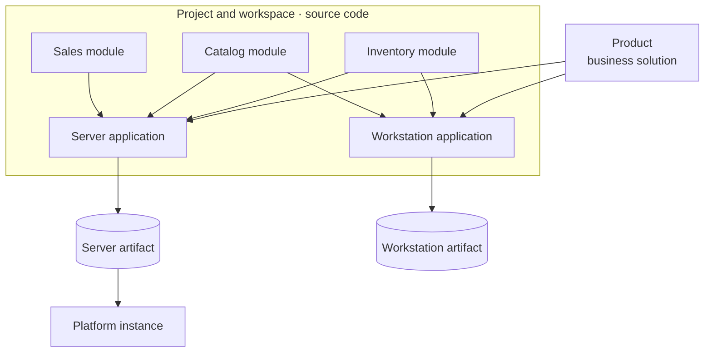

# Taxonomy

These terms describe different boundaries in Feluqa. **Product** names the
solution people use. **Application** names a deployable program. **Module**
names a reusable unit of business capability included in an application.
They are related, but they are not interchangeable.

## Product and runtime boundaries

| Term | Meaning |
|------|---------|
| **Product** | A solution offered to an organization or user, such as a bookstore system. A product may include several applications for different targets and user experiences. It is a business and packaging concept, not a runtime process. |
| **Application** | A Feluqa program composed for a particular execution role, such as a server application or a workstation application. It is built from one or more modules and produces target-specific artifacts. “App” is only an informal shortening of Application; it does not name a separate concept. |
| **Module** | A named unit of business capability, such as sales, inventory, or telemetry. An application includes one or more modules. Modules declare their own capabilities, permissions, configuration, and dependencies. A module is not itself an application or a product. |
| **Feature** | An optional capability within a module or application, enabled according to product configuration, license, or tenant policy. |
| **Target profile** | The constraints and runtime shape for a build, such as server, workstation, mobile, or embedded `no_std`. Separate target profiles may produce separate application artifacts from shared modules. |
| **Interaction surface** | How a person interacts with an application: a command-line interface, a graphical interface, or both. This is independent of the application's target profile. |
| **Host shell** | The runtime window or environment that presents an interaction surface. A workstation host could present a terminal as its primary interface or include a terminal within a graphical application. These host-shell options are product direction and are not implemented yet. |
| **Console application** | An application whose interaction model is based on commands and terminal input/output. It may run in a terminal or, as a future workstation product, inside a desktop host. “Console” describes the interaction model, not the Rust compilation target. |
| **Artifact** | A versioned build output for one application and target profile. Signing, installation, and dynamic module installation are target capabilities; they are not all implemented today. |
| **Application instance** | A running deployment of an application, with its own configuration, data, identity, and lifecycle. Multiple instances may serve different organizations or environments. |
| **Tenant** | An organization or isolated customer scope inside an application instance. A tenant is data and authorization context, not a device or a separate application. |

### Example: one product, two applications

A bookstore product might contain a **server application** and a **workstation
application**. Both can include shared catalog and inventory modules. The
workstation communicates with the server through a defined API when connected;
neither application needs to compile against the other's executable. A
standalone workstation deployment can use its own local storage and defined
synchronization behavior when that capability is implemented.

### Example: console interaction on a workstation

A console application can use a desktop host that opens a terminal-style
window and presents the application's commands there. A different product
could use a graphical desktop interface and include a terminal panel for
console commands. In both cases, workstation is the target profile; terminal,
graphical, or mixed describes the interaction surface. These are design
examples, not current Feluqa features.

## Feluqa components

| Term | Meaning |
|------|---------|
| **Feluqa Platform** | The Feluqa-provided runtime and control plane: identity, access control, audit, configuration, and system administration. Its runtime capabilities vary by target profile. |
| **Platform instance** | One deployed installation of the Feluqa Platform. It administers its own system configuration and hosted application instances. This is the scope of platform-wide administration. |
| **System Control Panel** | The operator interface for administering a Platform instance and its registered applications and modules. It is a platform product, separate from business application panels. |
| **Feluqa SDK** | The public Rust APIs and compile-time tools used to define applications and modules. Application code uses the `feluqa` namespace rather than Feluqa's internal crates. |
| **Feluqa CLI** | The command-line product for creating, developing, building, installing, and operating Feluqa projects and artifacts. Each command's implementation status is documented where that workflow is described. |
| **Project** | The source and configuration used to develop one or more applications and their modules. A project is a developer concept; it is not necessarily one deployable application. |
| **Workspace** | A Cargo or Feluqa-managed set of related projects and packages. A framework workspace contains Feluqa itself; a product workspace contains application source. |
| **Crate** | A Rust compilation unit managed by Cargo. A crate may implement part of an application or framework, but a Rust crate is not automatically a Feluqa module. |
| **Package** | A versioned unit with a manifest and dependency identity. Application packages and module packages have distinct manifests and roles. |
| **Client** | A device or program that accesses an application, such as a browser, workstation, phone, or another service. A client is not a tenant. |

## Application building blocks

| Term | Meaning |
|------|---------|
| **Panel** | A user-facing surface provided by an application, such as an operator or business interface. |
| **Resource** | A typed business entity and its permitted operations, forms, tables, and policies. |
| **Page** | A screen within a panel, generated from a resource or implemented for a specific workflow. |
| **Service** | Application logic that performs business operations. UI visibility does not authorize a service action; the server checks access independently. |

## Access-control terms

Authorization uses separate scopes. **Platform roles** govern administration
of a Platform instance. **Application roles and permissions** govern business
actions. **Policies** apply record-specific rules. A platform-wide rank does
not grant business permissions by itself.

| Term | Meaning |
|------|---------|
| **Platform owner** | The single highest-authority principal for one Platform instance. The target identifier is `platform-owner`; the old `app-owner` name is retired because it incorrectly suggests ownership of a business application. |
| **Privilege level** | A rank used for platform-instance administration, such as `platform-owner`, `super-admin`, `sysadmin`, or `staff`. It does not grant application permissions by itself. |
| **Origin** | Whether an administrative account is internal to the operating organization or external, such as an auditor or contractor. Origin is separate from privilege level. |
| **Permission** | An atomic application capability, such as `sales.refund` or `sales.customers.delete`. |
| **Application role** | A named set of application permissions assignable within the relevant application and tenant scope. |
| **Policy** | A rule that decides whether an otherwise authorized action applies to a particular record. |
| **Gate** | A server-side enforcement point that checks the required identity, privilege, permission, and policy conditions before an action runs. |
| **Clearance** | An exploring classification label that may add data-handling constraints in high-security deployments. |

These are the target names and boundaries. Feluqa does not preserve confusing
legacy names for backward compatibility. Renaming an implemented identifier
requires changing its API, stored data, CLI output, and documentation together;
the target terminology does not claim that migration is already complete.

## How the terms fit together

## Naming rule

Use **Product** for the solution being offered, **Application** for a program
that is built and run, and **Module** for a reusable business capability
included in an application. Use **Platform instance** for the administrative
scope that owns platform-wide privileges. Avoid using `app`, `product`, and
`module` as synonyms in code, manifests, CLI commands, or documentation.

For authorization details, see the
[authorization model](../../03-security/01-authorization-model.en.md) and
[privilege levels](../../03-security/02-privilege-levels.en.md).
