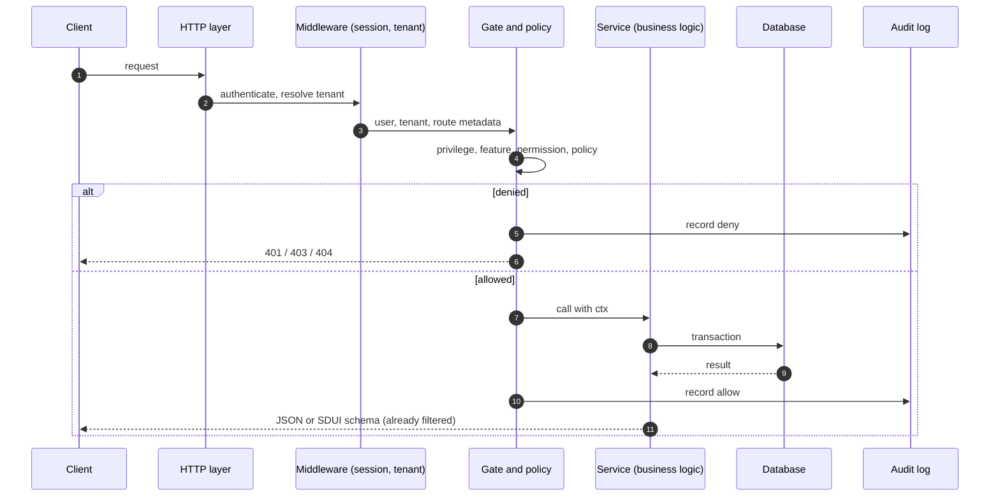

# HTTP Surface and Live Actions

Feluqa serves HTTP through Axum. Routes are **generated** from attributes into a `const` route table; nothing is registered at boot by hand.

> Paths are illustrative defaults. Signed typed dispatch for live actions exists; the remaining items are tracked in F5.

## Route classes

| Class | Example | Source | Protection |
| --- | --- | --- | --- |
| System panel | `/system/...` | Built in | Privilege level + permission |
| Panels | `/admin/customers/{id}/edit` | `#[panel]` + `#[resource]` | Resource capabilities + policy |
| API handlers | `GET /api/orders/{id}` | `#[feluqa::get(...)]` | `#[gate]` mandatory for writes |
| Live actions | `POST /live/dispatch` | Signed typed dispatch | Signature, replay protection, gate |
| Health | `/healthz`, `/readyz` | Built in | Public, no sensitive data |
| Assets | `/assets/...` | `feluqa::asset!` | Static, cacheable |

## Request lifecycle

## Rules

- Every write route carries a `#[gate]`; `public` must be justified.
- Error mapping: 401 unauthenticated, 403 denied, 404 for disabled features or invisible records.
- Sessions use secure cookies and CSRF protection; the management listener can be bound separately from the public one.
- The SDUI schema is filtered **server-side** before serialization.

## Live actions

Live actions let the client trigger typed server actions and receive incremental UI updates.

| Aspect | Status |
| --- | --- |
| Signed typed dispatch | Exists |
| Shared replay protection (multi-node) | To do (F5) |
| Client reconciliation and focus handling | To do (F5) |
| Failure and reconnect tests | To do (F5) |
