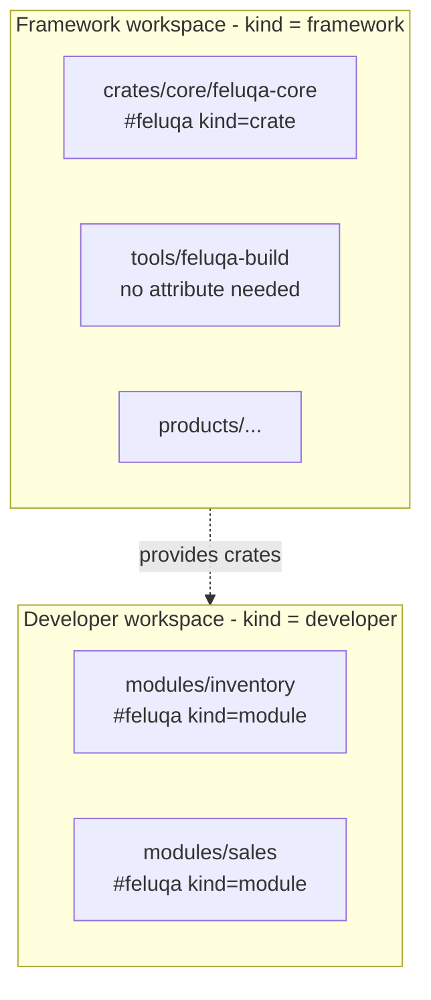

# Workspaces and Packages

## Three levels

1. **Feluqa source workspace**: the repository that develops the framework itself.
2. **Developer workspace**: your repository that uses Feluqa. It manages one or several modules and may be a monorepo, but it is **not** the framework's monorepo.
3. **Feluqa package**: a framework crate or a module built with the framework.

`.feluqa/workspace.toml` declares the role of a workspace. The `#[feluqa(kind = ...)]` attribute identifies the packages that must carry a `feluqa.toml`.



## Framework workspace

At the repository root, in `.feluqa/workspace.toml`:

```toml
[workspace]
kind = "framework"
name = "feluqa"
crates = "crates"
products = "products"
tools = "tools"
git = "https://github.com/emyassine/base-feluka.git"
```

## Developer workspace

At the root of the developer's repository, even if it manages several modules:

```toml
[workspace]
kind = "developer"
modules = ["modules/*"]
```

The repository may contain other folders. It does not have to adopt the `crates/` and `products/` layout of the framework.

## Declaring a package

A package announces its role with the `feluqa` attribute. Its `feluqa.toml` sits next to its `Cargo.toml`.

```rust
// crates/core/feluqa-core/src/lib.rs
#[feluqa(kind = "crate")]
pub struct FeluqaPackage;
```

```rust
// modules/inventory/src/main.rs
#[feluqa(kind = "module")]
fn main() {}
```

`tools/feluqa-build` uses neither kind, so it needs neither the attribute nor a `feluqa.toml`.

## Compile-time validation

The attribute calls a validator at compile time. The validator:

- reads `feluqa.toml` at the package root;
- validates its nested content and the relations between fields;
- uses `syn` to read `kind`, and a dedicated TOML parser plus validation for the file.

Decisions:

- `version` stays in Cargo.
- The workspace `git` field designates the source repository.
- `tree = "1.x.x"` is kept **only** if the exact meaning of `tree` is defined for the split tool.
- Compiling `feluqa-build` alone does not require a `feluqa.toml`. The check applies to packages marked `crate` or `module`.
