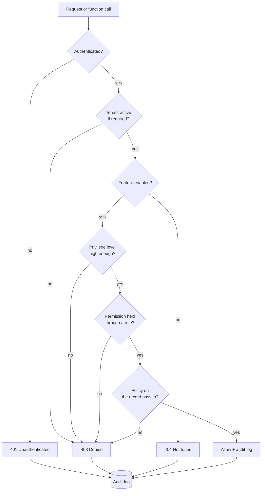

# Authorization Model

Feluqa separates **who may administer a Platform instance**, **what an account may do in an application**, and **what it may do to a specific record**. Each question has its own layer.

Authorization is one part of application security. Rust's memory-safety
guarantees do not automatically secure authentication, permissions, input
handling, or business rules; see [What Rust Does—and Does Not—Protect](04-rust-security-boundaries.en.md).

| Layer | Question | Scope | Defined by |
| --- | --- | --- | --- |
| **Privilege level** | How much platform administration may this account perform? | One Platform instance | Built-in platform policy |
| **Application role** | Which bundle of application permissions does this account hold? | Application and tenant | `#[roles]` and the Access Control resource |
| **Permission** | Is this application capability allowed? | Module, submodule, resource | `#[permissions]` and `#[resource]` |
| **Policy** | Is it allowed on *this* record? | Single record | `#[policy]` |
| **Gate** | Where is all of this enforced? | Function, handler, action | `#[gate]` |

## Decision pipeline

Every protected call goes through the relevant ordered checks. **All required checks must pass (AND).** A platform privilege applies only to System Control Panel operations; application roles and permissions govern business operations. A platform rank does not grant application permissions. Any failure produces a denial and an audit entry.



## Permissions

Permissions are declared by attribute and never hardcoded.

```rust
// src/modules/sales/permissions.rs

/// Permissions of the Sales domain.
/// NOTE: CRUD permissions of resources (`view_any`, `view`, `create`, `update`,
/// `delete`...) are generated automatically by `#[resource]`. Add only business
/// permissions here that match no resource.
#[feluqa::permissions]
pub enum Sales {
    /// Refund a paid order.
    Refund,
    /// Export the accounting ledger.
    ExportLedger,
}
```

- The full name (`sales.refund`) is built at compile time from the current context.
- **The doc comment is mandatory.** It becomes the label shown in the System panel. Without it, compilation fails.
- The System panel reads the generated table. No permission is created by hand or seeded in the database.
- Typed usage: `ctx.user().can(Sales::Refund)`.

## Roles

A **role** is a named set of permissions. Roles can be declared in code or created at runtime by an authorized person.

```rust
// src/modules/sales/roles.rs

/// Finance team: refunds and ledger access.
#[feluqa::roles]
pub enum SalesRoles {
    /// Can refund orders and export the ledger.
    #[role(grants = [Refund, ExportLedger, "customers.view_any"])]
    Finance,
}
```

### Baseline roles generated per module

To avoid writing boilerplate, the scanner generates default roles from the permissions that already exist:

| Role | Composition |
| --- | --- |
| `<module>.viewer` | Every `view_any` and `view` capability of the module's resources |
| `<module>.editor` | `viewer` + `create` + `update` |
| `<module>.manager` | `editor` + `delete` + every custom business permission of the module |

Each is **a single assignable unit** even though it expands to many permissions. Declared roles (`#[roles]`) override a baseline role of the same name.

### The Access Control resource

Every panel automatically receives an **Access Control resource** with three tabs: privileges, roles and permissions. An authorized person can:

- create, clone, rename and delete **custom roles** by composing existing permissions;
- assign roles to users and tenants;
- inspect the effective permissions of a user and why a check passed or failed.

Safeguards, enforced on the server:

- A user can only grant permissions **they hold themselves**.
- A user can only assign privilege levels **strictly below their own**.
- Roles defined in code are read-only in the UI; they can be cloned.
- Every change is audited and applied in a single transaction.

## Policies

A policy handles rules about a single record only.

```rust
/// Per-record rules only.
/// NOTE: do not re-test the permission here. `sales.customers.delete` has
/// already been checked, and the policy is ANDed with it.
#[feluqa::policy(Customer)]
impl CustomerPolicy {
    fn delete(_user: &User, c: &Customer) -> bool { !c.has_open_orders() }
}
```

## The sidebar is access control

The "Customers" entry appears only if the user holds `sales.customers.view_any`. Action buttons follow their capability. The SDUI schema sent to the client is already filtered server-side. Hiding on the client is never protection; the server gate always applies.
