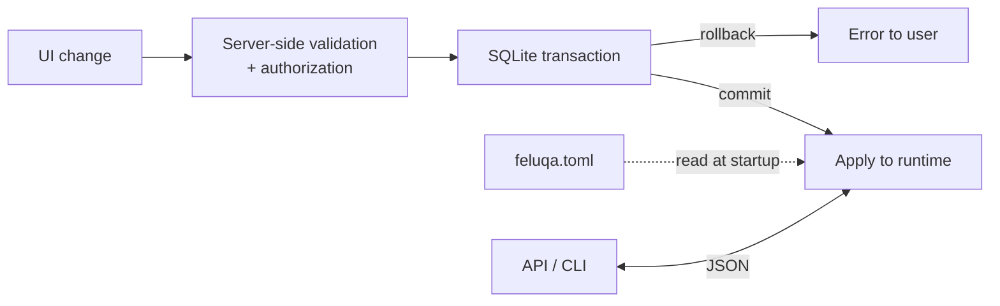

# Data Layers

| Layer | Used for |
| --- | --- |
| **TOML** | Manifest and rarely changed deployment settings, such as `feluqa.toml`. |
| **SQLite** | Settings editable in the UI, persistent module state, and business data that changes at runtime. |
| **JSON** | Exchanges: APIs, structured CLI output, exported documents. |
| **Memory** | Temporary state that does not need to survive a restart. |

## Rule

A value changed in the interface **does not rewrite the TOML file**. The app saves the change in SQLite, commits the transaction, then applies the new value to the runtime.

For structured settings use typed columns or validated JSON, depending on need. Important, frequently searched business data deserves a relational schema.

## Practical rules

- Versioned migrations.
- Transactions for related changes.
- Consistent backups.
- Server-side validation.
- Authorization on every mutation.

Synchronization between several devices is a **separate rule to define**. Local SQLite does not provide it by itself.
