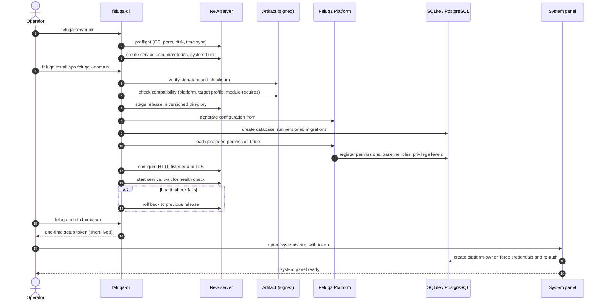

# Installing a Feluqa Application on a New Server with the CLI

> **Target design.** The command names and flags below are the proposed contract for track F6 (CLI and deployment) and F7 (installable module lifecycle). They are not all implemented.

## Overview

The Feluqa CLI turns a blank server into a running Feluqa installation in three phases: **prepare the host**, **install the signed artifact**, **bootstrap access control**.

```bash
# 1. Prepare the host (once per server)
feluqa server init --profile production

# 2. Install the app artifact
feluqa install ./inventory-1.4.0.feluqa --domain erp.example.com

# 3. Bootstrap the first platform owner (prints a one-time setup link)
feluqa admin bootstrap
```

## Sequence



## Step by step

1. **Preflight.** Checks OS and architecture, free disk, open ports, clock synchronization, and that the target profile matches the artifact.
2. **Host preparation.** Creates an unprivileged service user, a directory layout, and a hardened service unit. The app never runs as root.
3. **Verification.** Verifies the artifact signature and checksum against a trusted key. Unsigned artifacts are refused in the `production` profile.
4. **Compatibility.** Confirms the Platform version, target profile and each module's `requires = [...]` are satisfied.
5. **Staging.** Unpacks into a versioned release directory. The previous release stays available for rollback.
6. **Configuration.** Generates the configuration from the typed `#[config]` schema; missing secrets are prompted for or read from the secrets store. Startup validation rejects incomplete configuration.
7. **Database.** Creates the database (SQLite file under the module storage path, or a PostgreSQL connection) and applies versioned migrations in a transaction.
8. **Access-control seeding.** The Platform loads the **generated permission table** and registers permissions, baseline roles and the privilege levels. Nothing is hand-seeded.
9. **HTTP exposure.** Binds the listener, configures TLS, and mounts panels and the System panel. See [HTTP surface](020-http-and-live-actions.en.md).
10. **Health check.** The service must report ready within a timeout, otherwise the CLI rolls back.
11. **Owner bootstrap.** `feluqa admin bootstrap` issues a single-use, short-lived token. There are **no default credentials**.

## Privileges, roles and permissions at install time

| Item | Created by | Result |
| --- | --- | --- |
| Permissions | The scanner (compile time), registered at install | Appear in the System panel, never seeded manually |
| Baseline roles | Generated per module (`viewer`, `editor`, `manager`) | Assignable immediately |
| Declared roles | `#[roles]` in code | Read-only, clonable |
| Privilege levels | Built in | `platform-owner` created once through the bootstrap token |
| Access Control resource | Injected into every panel | Authorized users can create roles |
| System panel | Built in | `/system`, gated by privilege level |

The first account is **always** the `platform-owner` and is internal. The owner then creates `super-admin` and other accounts, marking contractors as **external**.

## Operations after install

```bash
feluqa app status
feluqa app upgrade ./inventory-1.5.0.feluqa
feluqa app rollback
feluqa module disable sales.loyalty          # feature toggle
feluqa module uninstall billing --keep-data  # safe uninstall, data retained
feluqa backup create && feluqa backup verify
feluqa check --installed                     # gates, docs, orphan permissions
```

## Air-gapped installs

For isolated or tactical networks, an **offline bundle** contains the artifact, signatures, the trust root and migrations. `feluqa install --offline ./bundle` performs the same steps with no network access. License activation can use a signed offline challenge/response (track F7).

## Security properties

- Signed, versioned artifacts and verified compatibility.
- Unprivileged service user, least-privilege file permissions, no default credentials.
- Rollback on failed health check.
- Every install action is written to the audit log with the operator identity.
- Domain activation and licensing are explicit steps, not side effects.
