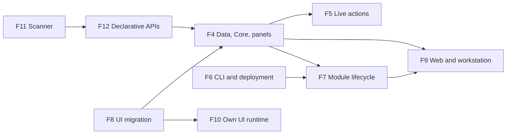

# Delivery Tracks

What we are working on now. Estimates are rough ranges, not commitments.

| Track | Estimate | Scope and current state |
| --- | --- | --- |
| **F4. Data, Core and panels** | 15–25 days | Database, auth and vertical panel slices exist; finish generic resources and actions, tenant lifecycle, PostgreSQL HTTP coverage and restore. |
| **F5. Live actions** | 10–18 days | Signed typed dispatch exists; add shared replay protection, client reconciliation and focus handling, and failure/reconnect tests. |
| **F6. Sites, CLI and deployment** | 8–14 days | Local web scaffold and watcher exist; validate standalone builds, a second independent site, production deployment and rollback. Extend project creation with application-shape selection (CLI, server, workstation, and composed server/workstation products), add an environment preflight/init flow, and document target dependencies. See [installing with the CLI](../060-deployment/010-installing-an-app-with-the-cli.en.md) and the [planned first-application walkthrough](../010-get-started/010-first-projects/010-create-your-first-application.en.md). |
| **F7. Installable module lifecycle** | 12–20 days | Static lifecycle exists; implement artifact compatibility and signatures, licensing, domain activation, staging, recovery, and safe uninstall with data retention. |
| **F8. Feluqa UI and panel migration** | Unestimated, pending build spike | Internalize the component source as first-party Feluqa packages and namespaces, integrate rendering and hydration with Axum, migrate all panel pages and interactions, verify light/dark and responsive behavior, then remove unused legacy assets. |
| **F9. One product, server and workstation applications** | Unestimated, architecture and prototype | Build separate target-specific Applications that share reusable modules and contracts. Applications communicate through explicit APIs or local protocols; they do not depend on each other's executables. Bookstore scenario: a hosted server Application and a local workstation Application share catalog, sales, and stock rules. Then design optional multi-device sessions over a local peer network or a routed connection, with explicit identity, authorization, synchronization, conflict handling, offline behavior, backup and recovery. No desktop framework, sync protocol or database topology is selected yet. |
| **F10. Feluqa-owned UI runtime** | Unestimated | Replace the remaining external rendering-runtime dependency with a first-party runtime under Feluqa namespaces, or implement the required compiler/runtime surface directly. Preserve web SSR/hydration, workstation and mobile outputs, and the `no_std` boundary. The current component-source copy is **not** a complete runtime internalization. |
| **F11. Attribute-driven application scanner** | Unestimated | Foundation exists: conventional source discovery, context from module directories, basic duplicate and reference checks, permission and role docs, write-handler gate checks. Remaining: complete attribute validation, recursive inline-module context, runtime and code generation for routes, permissions and configs, and generated docs and examples. Output stays deterministic under `target/feluqa/`. |
| **F12. Declarative panel, resource and gate APIs** | Unestimated | Add `#[feluqa::main]`, `#[panel]`, `#[resource]`, `#[page]`, `#[permissions]`, `#[roles]`, `#[config]` and `#[gate]` contracts. Generate panel-relative slugs, resource CRUD routes, pages, navigation and permissions, typed permission references, secure-by-default write gates, and shared privilege-management resources. Validate in a generated sample product before removing manual declarations. |

## Dependencies

The dependency graph is indicative. Several tracks can run in parallel.

## Caution on estimates

These tracks have dependencies and some can run in parallel. **Do not sum the ranges as a committed schedule**; re-estimate after each acceptance gate exposes the actual integration work.
