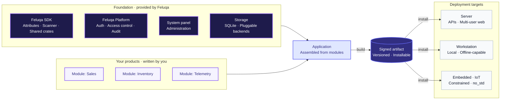

# Introduction to Feluqa

Feluqa is a sovereign, ultra-fast application platform and runtime for building
**enterprise backends, standalone workstations, high-stakes operations, lean
tactical units, and defense-adjacent workloads** *(such as ground-side drone
telemetry, sensor-fusion ingestion, and secure logistics)* with Rust.

The goal is to share one codebase across web, desktop, mobile, and IoT
deployments, while adapting each build to its target environment.

By avoiding heavy runtime overhead and garbage-collection pauses, Feluqa aims
to bring the performance and control of native software to business
applications and field systems.

## A product-first vision

Feluqa is built around one idea: **a module is a product**.

A module is not a folder of code that only makes sense inside one big
application. It is a self-contained piece of business functionality (`sales`,
`inventory`, `fleet-telemetry`) with its own identity, its own version, its own
permissions, and its own switchable features. You build it once on Feluqa, then
ship it on its own or combine it with others into a larger application.

This changes how you think about the work:

- **Build products, not plumbing.** Authentication, access control, audit,
  configuration and administration screens come from the platform. You write
  the part that is specific to your business.
- **Sell or deploy modules independently.** Features inside a module can be
  switched on or off per license or per customer, so one codebase can serve
  several offers.
- **Reuse across contexts.** The same module can run behind a hosted server for
  an organization, or inside a standalone workstation in the field.

## Who uses Feluqa, and what they see

Most people who work with Feluqa will never open the Feluqa source repository.
The documentation is organized around four roles, and each one sees a
different part of the system.

| Role | What they do | What they see |
|------|--------------|---------------|
| **Product builder** | Builds modules and applications on top of Feluqa. | Their own project, created and managed with the Feluqa CLI. This is the most common role. |
| **Operator** | Installs, configures and runs a Feluqa application on a server or device. | The CLI and the built-in System panel. No source code is required. |
| **End user** | Uses the finished application. | The application itself, on a browser, workstation, phone, or ground station. |
| **Framework contributor** | Works on Feluqa itself. | The Feluqa source repository, a multi-package Rust workspace. |

If you are a product builder or an operator, you can safely skip anything that
talks about the framework's own repository. It exists so that Feluqa can be
developed, not so that you have to understand it.

## What you write and what Feluqa provides

When you build on Feluqa, the work is split in two.

**You write the business side:**

- your domain models, rules and workflows;
- your resources (the data you manage and the screens that manage it);
- your permissions, roles and policies, declared with attributes;
- your modules, submodules and features.

**Feluqa provides the foundation:**

- **The Feluqa SDK**, the library you build with: one entry point for
  attributes, panels, resources and authentication, plus the compile-time
  scanner that checks your code;
- **The Feluqa Platform**, the server-side runtime and control plane:
  authentication, schema management, access control, audit, configuration, and
  a built-in System panel to administer all of it;
- **generated plumbing**: routes, permission tables, configuration schemas and
  reference docs are produced at compile time from your declarations, so there
  are no manual registries to maintain;
- **storage**, with embedded SQLite as the proposed default for local use and
  other options for server deployments;
- **the Feluqa CLI**, which creates, validates, builds, installs and operates
  your projects.

## Your development environment

A Feluqa project is a normal Rust project with Feluqa conventions on top. The
working loop is the same whether you build one module or a full product:

1. **Create.** Start a new product, or add a module to an existing one, with
   the CLI (`feluqa new`, `feluqa make:module`).
2. **Declare.** Describe your resources, permissions and policies using
   attributes. Write only the business logic.
3. **Build.** The compile-time scanner generates routes, permissions and
   configuration, and rejects mistakes early (for example, a write handler
   with no access gate does not compile).
4. **Package.** The build produces a signed, versioned artifact.
5. **Install.** The CLI installs the artifact on a server or device
   (`feluqa install`), where the Feluqa Platform runs it alongside your application.

You never edit generated files. They are rebuilt on every compile.

## From module to deployed product

This diagram describes the intended architecture, not a claim that every
component is already available. Not every target receives every capability: a
constrained device might run only the telemetry module with minimal storage.

## How Feluqa works

The same business logic can serve several targets, but not every target needs
the same interface or the same dependencies.

For example, a backend might expose APIs and store data, while a workstation
uses the same module through a local interface. A constrained device might use
only the telemetry components. A target profile selects which capabilities and
dependencies each build includes.

The framework is being designed around four principles:

- **Write the logic once.** Reuse domain models and application logic without
  requiring every target to have the same interface or dependencies.
- **Keep runtime costs visible.** Use native Rust code and avoid unnecessary
  services or processes.
- **Generate the repetitive parts.** Attribute-driven definitions are intended to
  generate routes, schemas, permissions, and configuration at compile time.
- **Control your deployment.** Run on infrastructure you manage, including
  offline and isolated environments.

## Platform components

| Component | Purpose |
|-----------|---------|
| **Feluqa CLI** | Creates, validates, builds, installs and operates projects, modules and applications. |
| **Modules** | Self-contained units of business functionality, each treated as a product with its own version, permissions and features. |
| **Target profiles** | Select dependencies and capabilities for server, workstation, and constrained `no_std` builds. |
| **Feluqa SDK** | The library you build with: attributes, panels, resources and the compile-time scanner, behind a single `feluqa` entry point. |
| **Feluqa Platform** | Planned server-side runtime and control plane, with a System panel for authentication, schema management, and access control. |
| **Authorization** | Defines privileges, roles, permissions, and policies. Compile-time checks are a design goal; runtime enforcement remains necessary. |
| **Storage** | Uses embedded SQLite as the proposed local default, with other storage strategies depending on the deployment. |

## A few examples

**Business software.** Build a `sales` module once. Run it as an API on a server
and reuse the same business rules in a desktop application for local work.

**Field workstations.** Keep data and essential functions available when
connectivity is limited or unavailable.

**IoT and ground systems.** Collect sensor or drone telemetry, process it
locally, and expose relevant information to an operator. Protocol support,
including MAVLink, depends on the integration implemented for the target.

**Several offers, one codebase.** Ship a base product, then enable extra
features, such as a loyalty program, only for the customers who license them.

## Technical targets

The figures and capabilities below are **design targets**, not measured
guarantees. They have not yet been revalidated.

| Area | Target | Why it matters |
|------|--------|----------------|
| Language | Native Rust | Memory safety and control over runtime costs. |
| Hot-path latency | Sub-millisecond p50 | A target for selected operations, not end-to-end or real-time guarantees. |
| Local persistence | SQLite by default | Reduces setup requirements for standalone deployments. |
| Security boundaries | Separate platform, application, and user scopes | Makes ownership and access rules explicit. |
| Access control | Privileges, roles, permissions, and policies | Combines compile-time validation where possible with runtime authorization. |

## Documentation status

Feluqa is under exploration. Each page has a `status` field so you can
distinguish working code from future plans.

| Status | Meaning |
|--------|---------|
| **Implemented** | Available in the current codebase and covered by the documented baseline. |
| **Partial** | Some foundations exist, but the page identifies missing parts. |
| **Target** | An agreed design that is not yet fully implemented. |
| **Exploring** | An idea or working proposal that may change. |

## Continue reading

- [Taxonomy](02-taxonomy.en.md): learn the terms used throughout Feluqa.
- [Architecture overview](03-architecture-overview.en.md): see how the
  components fit together.
- [Workspaces and packages](../02-workspaces-and-contexts/01-workspace-levels.en.md):
  understand how projects and shared code are organized (mostly useful for
  framework contributors).
- [Security model](../03-security/01-authorization-model.en.md): explore
  authorization and isolation.
- [Install an app on a new server](../06-deployment/01-installing-an-app-with-the-cli.en.md):
  follow the deployment workflow.
- [Roadmap](../08-roadmap/01-delivery-tracks.en.md): see planned work and
  delivery priorities.
