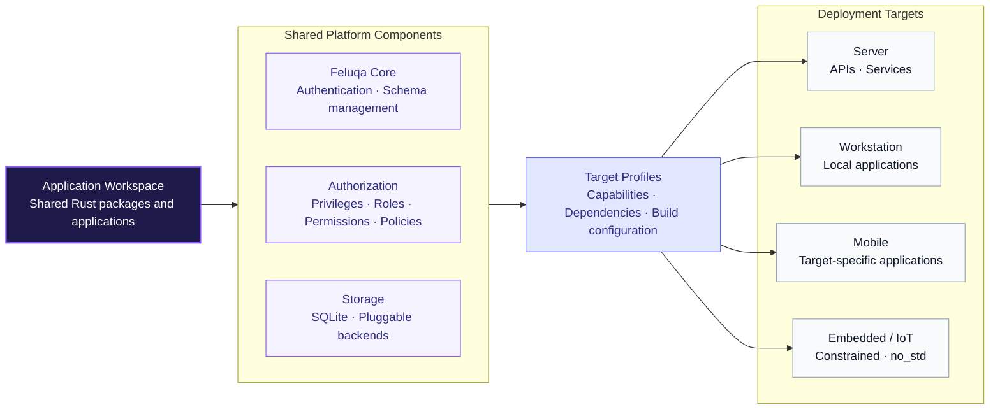

# Introduction to Feluqa

Feluqa is a sovereign, ultra-fast application platform and runtime for building
**enterprise backends, standalone workstations, high-stakes operations, lean
tactical units, and defense-adjacent workloads** *(such as ground-side drone
telemetry, sensor-fusion ingestion, and secure logistics)* with Rust.

The goal is to share one codebase across web, desktop, mobile, and IoT
deployments, while adapting each build to its target environment.

By avoiding heavy runtime overhead and garbage-collection pauses, Feluqa aims
to bring the performance and control of native software to business
applications and field systems.

## How Feluqa works

Rather than treating every deployment as a separate application, Feluqa
organizes shared logic into a Rust workspace. Each target uses the components
it needs.

For example, a backend might expose APIs and store data, while a workstation
uses the same domain logic through a local interface. A constrained device
might use only the telemetry components.

The framework is being designed around four principles:

- **Write the logic once.** Reuse domain models and application logic without
  requiring every target to have the same interface or dependencies.
- **Keep runtime costs visible.** Use native Rust code and avoid unnecessary
  services or processes.
- **Generate the repetitive parts.** Attribute-driven definitions are intended to
  generate routes, schemas, permissions, and configuration at compile time.
- **Control your deployment.** Run on infrastructure you manage, including
  offline and isolated environments.

## Platform components

|Component |Purpose |
|------------|------------|
|**Application workspace**|Organizes shared Rust packages and target-specific applications.|
|**Target profiles**  |Selects dependencies and capabilities for server, workstation, and constrained `no_std` builds.|
|**Feluqa Core**      |Planned system panel for authentication, schema management, and access control.|
|**Authorization**    |Defines privileges, roles, permissions, and policies. Compile-time checks are a design goal; runtime enforcement remains necessary.|
|**Storage**          |Uses embedded SQLite as the proposed local default, with other storage strategies depending on the deployment.|

These describe the intended architecture, not a claim that every component is
already available.

## A few examples

**Business software.** Run an API on a server and reuse the same business rules
in a desktop application for local work.

**Field workstations.** Keep data and essential functions available when
connectivity is limited or unavailable.

**IoT and ground systems.** Collect sensor or drone telemetry, process it
locally, and expose relevant information to an operator. Protocol support,
including MAVLink, depends on the integration implemented for the target.

## Technical targets

The figures and capabilities below are **design targets**, not measured
guarantees. They have not yet been revalidated.

|Area               |Target                                         |Why it matters                                                             |
|-------------------|-----------------------------------------------|---------------------------------------------------------------------------|
|Language           |Native Rust                                    |Memory safety and control over runtime costs.                              |
|Hot-path latency   |Sub-millisecond p50                            |A target for selected operations, not end-to-end or real-time guarantees.  |
|Local persistence  |SQLite by default                              |Reduces setup requirements for standalone deployments.                     |
|Security boundaries|Separate platform, application, and user scopes|Makes ownership and access rules explicit.                                 |
|Access control     |Privileges, roles, permissions, and policies   |Combines compile-time validation where possible with runtime authorization.|

## Documentation status

Feluqa is under exploration. Each page has a `status` field so you can
distinguish working code from future plans.

|Status     |Meaning                                                                  |
|-----------|-------------------------------------------------------------------------|
|**Implemented**|Available in the current codebase and covered by the documented baseline.|
|**Partial**|Some foundations exist, but the page identifies missing parts.           |
|**Target** |An agreed design that is not yet fully implemented.                      |
|**Exploring**|An idea or working proposal that may change.                             |

## Continue reading

- [Taxonomy](02-taxonomy.en.md) — Learn the terms used throughout Feluqa.
- [Architecture overview](03-architecture-overview.en.md) — See how the
  components fit together.
-
  [Workspaces and packages](../02-workspaces-and-contexts/01-workspace-levels.en.md)
  — Understand how applications and shared code are organized.
- [Security model](../03-security/01-authorization-model.en.md) — Explore
  authorization and isolation.
-
  [Install an app on a new server](../06-deployment/01-installing-an-app-with-the-cli.en.md)
  — Follow the deployment workflow.
- [Roadmap](../08-roadmap/01-delivery-tracks.en.md) — See planned work and
  delivery priorities.
