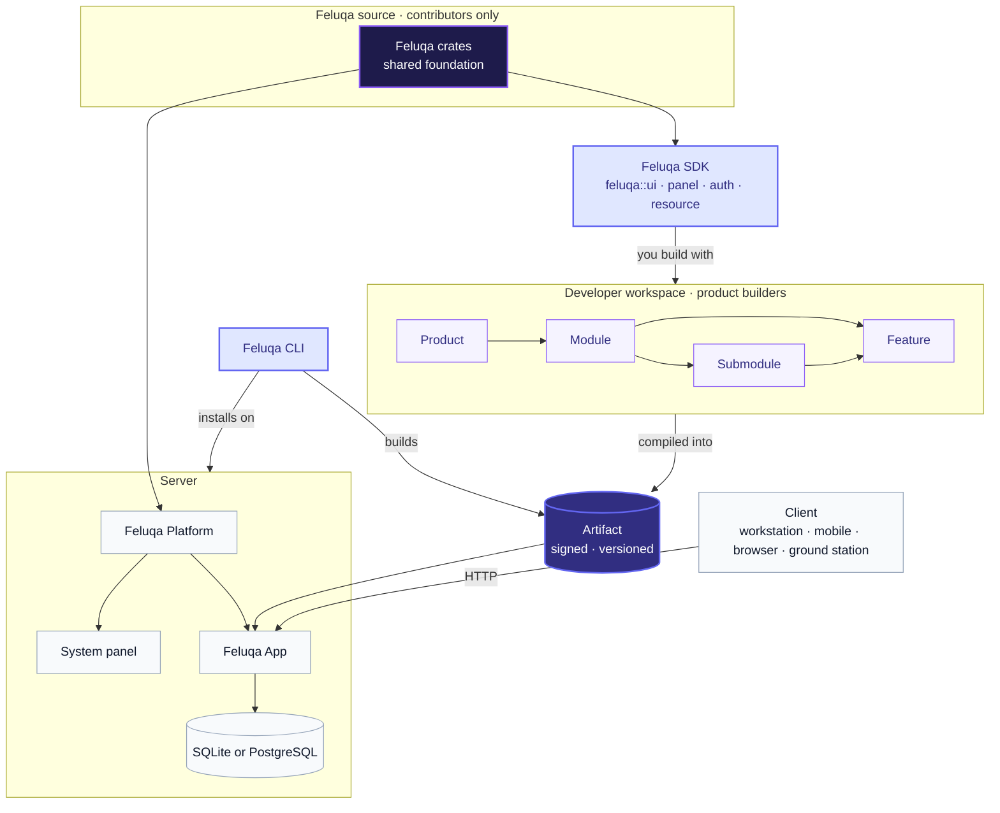

# Taxonomy

This is the first page to read. Each term below has **one meaning, everywhere**
in the Feluqa documentation.

If you only remember one thing: the **SDK** is what you build with, the
**Platform** is what runs on the server, the **App** is what you ship, and the
**CLI** builds, installs and operates all of it.

## Building blocks

| Term | What it is | Where it lives |
|------|------------|----------------|
| **Feluqa SDK** | The library you build with. A single `feluqa` entry point (`feluqa::ui`, `feluqa::panel`, `feluqa::auth`, `feluqa::resource`), the attributes (`#[panel]`, `#[resource]`, `#[gate]`, ...) and the compile-time scanner. Linked into your App at build time. | Developer machine (as a dependency) |
| **Feluqa Platform** | The server-side runtime and control plane: authentication, schema management, access control, audit, configuration and the System panel. The same for everyone. | Server |
| **Feluqa App** | An application built with the SDK. It is installed and run on the client machine (or on a server, in hosted mode). | Client or server |
| **Client** | The machine or device on which a Feluqa App runs or from which it is used: a workstation, a mobile device, a ground station, or a browser connecting to a hosted app. | End-user side |
| **Feluqa CLI** | The command-line tool that creates, validates, builds, installs and operates projects, modules and apps. | Developer machine and servers |
| **Module** | A unit of business functionality developed with Feluqa, for example `sales`. A module is treated as a **product in its own right**: it has its own id (its folder name), version, permissions and features, and can be shipped alone or combined with others. | Developer workspace |
| **Product** | A deployable application assembled from one or more modules. Marked by a `feluqa.toml`. | Developer workspace |
| **Submodule** | A sub-domain nested inside a module, for example `sales/invoicing`. | Inside a module |
| **Feature** | A switchable capability of a module or submodule, for example `loyalty`. Can be enabled per license or tenant. | Inside a module |
| **Target profile** | A deployment shape: `no_std` embedded, workstation, or server. | Build time |
| **Artifact** | The signed, versioned, installable output of a build. | Release channel |

## Internal terms

These matter mostly to people who work on Feluqa itself. If you build products
on Feluqa, you can skip this table.

| Term | What it is | Where it lives |
|------|------------|----------------|
| **Crate** | The standard Rust unit of compilation and distribution, built by Cargo. | Anywhere Rust is built |
| **Feluqa crate** | A crate of the framework itself, for example `feluqa-core`. Internal building blocks shared by the SDK and the Platform. Application code reaches them through the SDK, never directly. | Feluqa source workspace |
| **Package** | Umbrella term for a Feluqa crate or a module. Every package has a `feluqa.toml`. | Both |
| **Workspace** | A repository root identified by `.feluqa/workspace.toml`. Either `framework` (for contributors working on Feluqa itself) or `developer` (for product builders). Most users only ever see a developer workspace. | Repository root |

## Application building blocks

| Term | What it is |
|------|------------|
| **Panel** | A web-served surface of an app (for example `/admin`) with its own branding, login, navigation and middleware. |
| **Resource** | A complete CRUD definition (model, form, table, actions, policy) in a single file. |
| **Page** | A screen of a resource or a custom screen. Resource pages are generated and only overridden when needed. |
| **System panel** | The built-in panel of the Platform: users, privileges, roles, permissions, modules, configuration, audit. |
| **Scanner** | The compile-time component of the SDK that discovers attributes and generates routes, permissions, configuration schemas and docs. |
| **Tenant** | An organization (customer, team, unit) isolated inside one app instance. |

## Access control vocabulary

| Term | What it is |
|------|------------|
| **Privilege level** | The platform-wide rank of a user (`app-owner`, `super-admin`, `sysadmin`, `staff`, plus external variants). Answers "how powerful is this account on the platform?". |
| **Origin** | Whether a user is `internal` or `external` (contractor, auditor, integrator). Separate from rank. |
| **Permission** | An atomic capability, such as `sales.refund` or `sales.customers.delete`. |
| **Role** | A named bundle of permissions, defined per module and assignable to users. |
| **Policy** | A per-record rule, such as "a customer with open orders cannot be deleted". Combined with permissions using AND. |
| **Gate** | The enforcement point. `#[gate]` guards a function, a handler or an action. |
| **Clearance** | *(Exploring)* an optional classification label for high-security deployments. |

## Concept map

## Where each piece lives

| Piece | When it matters | Where it runs |
|-------|-----------------|---------------|
| **SDK** | While you write and compile your app | Developer machine, linked into the App |
| **CLI** | While you create, build, install and operate | Developer machine and servers |
| **Platform** | At runtime | Server |
| **App** | At runtime | Client, or server in hosted mode |

## Common confusions

- **SDK vs Platform.** The SDK is what you compile against. The Platform is
  what runs on the server. They share Feluqa crates, but you never import those
  crates directly: you go through the SDK.
- **Module vs product.** A module is a self-contained piece of functionality that
  can stand as a product on its own. A Product assembles one or more modules
  into something deployable.
- **Crate vs module.** A module is a crate (or a folder inside one) that follows
  Feluqa conventions and carries a `feluqa.toml`. Not every crate is a module;
  `tools/feluqa-build` is neither.
- **Platform vs App.** The Platform is the same for everyone. The App is yours.
  They are installed and versioned separately.
- **Client vs tenant.** A client is a device or a program. A tenant is an
  organization inside the app.
- **Privilege level vs role.** Privilege is platform rank. Roles are module-level
  bundles of permissions. See
  [the authorization model](../03-security/01-authorization-model.en.md).
