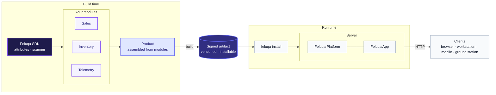
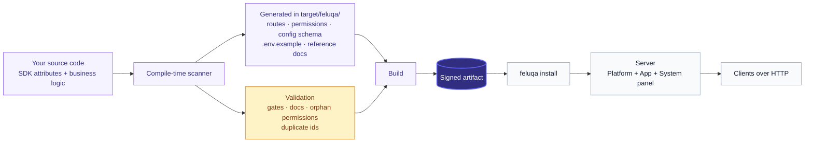
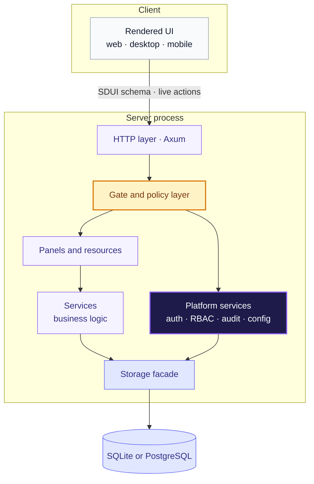

# Architecture Overview

## Principles

1. **Modules are products.** A module is self-contained, versioned and
   shippable on its own or combined with others. Everything below serves that
   idea.
2. **Write only business logic.** Routes, permissions, sidebar, SDUI schemas, manifests and configuration files are generated at compile time.
3. **No manual registry, no magic strings.** Everything is declared with attributes (`#[panel]`, `#[resource]`, `#[permissions]`, `#[gate]`, ...) and collected by the compile-time scanner.
4. **Context is implicit.** The scanner knows the current module, so you write `Refund`, not `sales.refund`. The full path is still accepted.
5. **Secure by default.** A write handler without `#[gate]` does not compile.
6. **One file, one responsibility.** One resource per file. No catch-all `mod.rs` or `admin.rs`.
7. **One entry point.** The Feluqa SDK exposes a single namespace: `feluqa::ui`, `feluqa::panel`, `feluqa::auth`, `feluqa::resource`. Application code never imports internal `feluqa_*` crates.
8. **Server is the source of truth.** Hiding something in the client is never protection.

## The pieces and where they run

| Piece | Role | When it matters | Where it runs |
| --- | --- | --- | --- |
| **Feluqa SDK** | The library you build with: attributes, the compile-time scanner, the single `feluqa` namespace. | While you write and compile | Developer machine, linked into the App |
| **Feluqa CLI** | Creates, validates, builds, installs and operates projects. | Development and operations | Developer machine and servers |
| **Feluqa Platform** | Authentication, access control, audit, configuration, System panel. | Runtime | Server |
| **Feluqa App** | An application made of one or more modules. | Runtime | Client, or server in hosted mode |

Most people only ever deal with these four. The internal Feluqa crates that
implement them are an implementation detail.

## From module to deployed product

A module is the unit of product thinking. A Product assembles modules, the
build turns it into a signed artifact, and the CLI installs that artifact on
the right target.

## End-to-end flow

What happens between writing code and a running system:

## Runtime layers

The SDUI schema sent to the client is **already filtered server-side**: an entry the user may not see is never serialized.

## What is generated and never edited

Generated into `target/feluqa/`, never edited and never committed:

- module manifests and the route table;
- the permission table (consumed by the System panel);
- configuration schemas and `.env.example`;
- reference documentation.

`feluqa.toml` (product) and `module.toml` (module) remain valid contexts but are now simple markers written once by `feluqa new` or `feluqa make:module`. Their content is derived from attributes and `Cargo.toml`.

## Target profiles

| Profile | Typical use | Storage | Status |
| --- | --- | --- | --- |
| `server` | Hosted backend, multi-user web app | PostgreSQL, or SQLite for small single-server installs | Partial |
| `workstation` | Standalone local app on a desktop | SQLite in the user data directory | Target |
| `embedded` (`no_std`) | Telemetry, sensor ingestion | Minimal or none | Exploring |

A module is written once and a target profile decides what each build includes. See [web and workstation modules](../08-roadmap/01-delivery-tracks.en.md) (track F9) for how one module serves both server and workstation products.

## Platform capabilities

| Component | Purpose |
|-----------|---------|
| **Feluqa CLI** | Creates, validates, builds, installs, and operates projects, modules, and applications. |
| **Modules** | Self-contained units of business functionality with their own version, permissions, and features. |
| **Target profiles** | Select dependencies and capabilities for server, workstation, and constrained `no_std` builds. |
| **Feluqa SDK** | Provides attributes, panels, resources, and the compile-time scanner through a single `feluqa` entry point. |
| **Feluqa Platform** | The planned server-side runtime and control plane, including a System panel for authentication, schema management, and access control. |
| **Authorization** | Defines privileges, roles, permissions, and policies. Runtime authorization remains necessary even when compile-time checks are available. |
| **Storage** | Uses embedded SQLite as the proposed local default, with other strategies depending on deployment needs. |

## Design targets

These figures and capabilities are **design targets**, not measured guarantees;
they have not yet been revalidated.

| Area | Target | Why it matters |
|------|--------|----------------|
| Language | Native Rust | Memory safety and control over runtime costs. |
| Hot-path latency | Sub-millisecond p50 | A target for selected operations, not an end-to-end or real-time guarantee. |
| Local persistence | SQLite by default | Reduces setup requirements for standalone deployments. |
| Security boundaries | Separate platform, application, and user scopes | Makes ownership and access rules explicit. |
| Access control | Privileges, roles, permissions, and policies | Combines compile-time validation where possible with runtime authorization. |
