# Rethinking Reliable Multiplatform Software Development

## The Feluqa Interface Standard: one description, many native profiles, one namespace

*Draft 0.1, 1 November 2026. Status: proposal and research record. Nothing described as a target in this document is implemented yet.*

---

## Contents

0. Definitions
1. Introduction
2. What to Do
3. Why: the Reason Behind Each Directive
4. The Original Questions, Answered
5. The Native Reality
6. Fact-Checking the Outside Advice
7. The Interface Tree and the Filament-Style Programming Model
8. The Web Profile: Maud, htmx and Alpine.js
9. The Profile Ladder: KDE, Android, Apple, GNOME, Canvas
10. The Namespace and the Internalization Standard
11. Procedures: How to Internalize and Uniformize
12. Risks, Hard Truths and Kill Conditions
13. Example Panels
14. Road Map
- Appendix A. Complete Rule List
- Appendix B. Acceptance Checklists
- References

---

# Chapter 0 Definitions

**Caveat:** this chapter comes first on purpose. Every abbreviation and every unusual term used later in this document is defined here, once. If you find an abbreviation later that is not in this chapter, that is a defect in the document; please report it.

## 0.1 Key words that make this a standard

The words **MUST**, **MUST NOT**, **SHOULD**, **SHOULD NOT** and **MAY**, when written in capital letters, carry the meaning given by the Internet Engineering Task Force document known as Request for Comments 2119 (see the background references at the end).

- **MUST** and **MUST NOT**: an absolute requirement or prohibition. Breaking it breaks the standard.
- **SHOULD** and **SHOULD NOT**: there may be a valid reason to ignore it, but the reason must be understood and written down.
- **MAY**: truly optional.

## 0.2 Evidence labels

Every factual claim about the outside world in this document carries one of two kinds of marking.

- A reference in square brackets, for example [R6], means the claim comes from a page that was opened and read during this research on 1 November 2026. The numbered list is at the end.
- The word **(Unverified)** means the claim comes from background knowledge or inference. It must be checked before anyone depends on it. Chapter 14 turns each unverified claim into a task.

## 0.3 Abbreviations

| Term | Meaning |
|------|---------|
| ABI | Application Binary Interface: the agreement about how compiled code calls other compiled code (which registers, which memory layout). |
| API | Application Programming Interface: the set of functions and types one piece of software offers to another. |
| CI | Continuous integration: a machine that builds and tests every change automatically. |
| CLI | Command-line interface: a program you drive by typing commands. |
| CSS | Cascading Style Sheets: the language that styles web pages. |
| FFI | Foreign Function Interface: the mechanism by which code in one programming language calls code in another. |
| GNOME | A Linux desktop environment. The name is not an abbreviation in current use. |
| GTK | The toolkit (library of windows and buttons) on which GNOME is built. |
| HTML | HyperText Markup Language: the document format of web pages. |
| HTTP | HyperText Transfer Protocol: how browsers and servers talk. |
| IME | Input method editor: the operating system component that lets people type languages such as Chinese, Japanese or Arabic, and also handles accents and predictive text. |
| JSON | JavaScript Object Notation: a text format for structured data. |
| JVM | Java virtual machine: the managed runtime, with a garbage collector, that Java and Kotlin programs run on. |
| KDE | A Linux desktop environment and software community. Its applications are built with Qt. |
| LGPL | Lesser General Public License: a free-software license that allows linking to a library without publishing your own code, under conditions. |
| MIT | A permissive free-software license (the MIT license). |
| NDK | Native Development Kit: Google's toolchain for compiling native code (such as Rust) for Android. |
| OS | Operating system. |
| QML | Qt Modeling Language: the declarative language used to describe user interfaces in Qt. |
| Qt | A cross-platform toolkit, pronounced "cute". KDE is built on it. |
| SBOM | Software bill of materials: a complete list of the components inside a piece of software, with versions and licenses. |
| SDK | Software development kit: the headers, libraries and tools needed to build for a platform. |
| SwiftPM | Swift Package Manager: Apple's build and dependency tool for Swift code. |
| TSX | TypeScript with embedded markup syntax. It is the main language of the project called nsh (see 0.5). |
| UI | User interface: what a person sees and touches. |
| URL | Uniform Resource Locator: a web address. |
| 0BSD | Zero-clause BSD license: a license that allows almost any use, including with no notice. htmx uses it [R25]. |

## 0.4 Terms of art in this document

| Term | Meaning |
|------|---------|
| **Interface Tree** | The central data structure of the standard. A typed, serializable tree that describes what a screen means (a form, a table, a confirmation) without saying how it looks. Earlier research notes called it the "intermediate representation". |
| **Intent** | What a piece of interface is for (a primary action, a destructive confirmation, a master and detail pair), as opposed to its appearance. |
| **Renderer** | A program or module that turns an Interface Tree into real screen content on one kind of platform. |
| **Profile** | A named, versioned bundle: one renderer, one build recipe, one list of supported node kinds, one conformance level. Examples: Web, KDE, Android, Apple, GNOME, Canvas. |
| **Native** | Drawn by the platform's own widgets (buttons, lists, text fields supplied by the operating system or its official toolkit), so that the application inherits the platform's look, accessibility and behavior. |
| **Canvas** | Drawn by the application itself pixel by pixel. Looks the same everywhere, is not native. |
| **Web** | Rendered as HTML in a browser or web view. Not native in the sense above. |
| **Core** | The Rust part of an application: models, rules, storage, permissions. It owns all business state. |
| **Event** | A message from a renderer to the core: "the person pressed this", "the person typed that". |
| **Action** | A named operation (for example "save mission") that an event can trigger. Referred to by identifier, never by code pointer. |
| **Pull-based data source** | A table gets its rows by asking "give me rows 200 to 260", rather than being handed every row at once. |
| **Headless** | Running without a screen, window or device. A headless test renders a screen to text and compares it with an expected text. |
| **Conformance ladder** | A numbered series of automated tests a profile must pass, level by level (see 9.2). |
| **Internalize** | To bring a dependency under Feluqa's namespace, governance and version control, at one of three depths: adopt, vendor or fork (see Chapter 10). |
| **Adopt** | Use a third-party crate behind a Feluqa facade, pinned to an exact version. No source copied. |
| **Vendor** | Keep an exact, unmodified copy of third-party source inside the Feluqa repository, with its license notice. |
| **Fork** | Keep a modified copy that Feluqa maintains from then on. The most expensive depth. |
| **Facade** | A Feluqa module that re-exports and wraps a third-party component so that users never see the third-party names. |
| **Server-driven interface** | A design in which a server sends a description of the interface, and the client displays it. |

## 0.5 Product and project names

These are names, not abbreviations. They are listed so that nobody has to guess.

| Name | What it is |
|------|------------|
| **Feluqa** | The application platform and runtime this standard belongs to. Built with Rust. |
| **Filament** | A PHP administration-panel framework for Laravel. The developer-experience model Feluqa wants to imitate. |
| **Livewire** | The PHP library underneath Filament that keeps server state and browser display in sync. |
| **Rust** | The programming language Feluqa is written in. |
| **Maud** | A Rust library that writes HTML from Rust code. |
| **maud-ui** | A Rust library of 64 accessible interface components that produce HTML through Maud. |
| **Axum** | A Rust web server framework. |
| **htmx** | A small JavaScript library that lets HTML elements make server requests and replace parts of the page. |
| **Alpine.js** | A small JavaScript library that adds local, in-page behavior (open a menu, toggle a dialog) directly in HTML attributes. |
| **Waydroid** | Software that runs a full Android system in a container on Linux. |
| **xtool** | A Swift tool that builds, signs and installs iOS applications without Xcode, from Linux, Windows or macOS [R1]. |
| **Xcode** | Apple's integrated development environment and SDK. |
| **SwiftUI, UIKit, AppKit** | Apple's three user-interface frameworks. SwiftUI is declarative and Swift-only; UIKit is for iPhone and iPad; AppKit is for Mac. |
| **iOS, macOS** | Apple's operating systems for iPhone and for Mac. |
| **Liquid Glass** | Apple's translucent design material, introduced with the iOS 26 SDK. |
| **Compose** | Android's modern declarative interface toolkit (Jetpack Compose), written in Kotlin. |
| **Kotlin** | The main programming language of Android applications. |
| **Kirigami** | KDE's interface component framework, built on QML (Unverified). |
| **cxx-qt** | A library from the company KDAB that connects Rust and Qt [R22]. |
| **UniFFI** | A Mozilla tool that generates bindings from Rust to Swift, Kotlin, Python and Ruby [R16]. |
| **Crux** | A Rust architecture (by Red Badger) in which a Rust core is shared by thin native shells [R13]. |
| **mobiler** | A Rust tool and library, built on Crux ideas, in which the core returns a widget tree and generic native shells draw it [R14]. |
| **nsh (Native Shell)** | A Rust-based engine by the company Longbridge that runs TSX or Rust modules as native user interface on several platforms [R6][R7]. |
| **Xilem, Masonry, Vello** | Rust interface libraries from the Linebender group. They draw their own widgets [R10][R12]. |
| **Taffy** | A Rust layout engine (flexbox and grid calculations) that does not draw anything. |
| **Slint** | A Rust-friendly interface toolkit that draws its own pixels, aimed at embedded and desktop use (Unverified). |
| **GPUI** | A Rust interface library that draws its own pixels, used by nsh [R7]. |
| **Dioxus** | A Rust framework for web, desktop and mobile applications [R17]. |
| **SQLite** | An embedded database in the form of a library. |
| **Gemini** | The language-model assistant whose proposed architecture is checked in Chapter 6. |
| **Swift, Objective-C** | Apple's programming languages. Swift is the modern one; Objective-C is the older one that Apple's older frameworks are written in. |
| **TypeScript, JavaScript** | Web programming languages. TypeScript adds types to JavaScript. |
| **QuickJS** | A small JavaScript engine that nsh embeds [R7]. |
| **Tailwind** | A web style system based on small utility classes. |
| **shadcn/ui** | A popular set of web interface components and design tokens; maud-ui is styled like it [R9]. |
| **Direct2D** | Windows' drawing interface. Listed among nsh's integrations [R7]. |
| **winit** | A Rust library for opening windows. Masonry uses it [R10]. |
| **libadwaita** | The GNOME library of modern interface components built on GTK (Unverified). |
| **VoiceOver, TalkBack** | The screen readers of Apple platforms and of Android. |
| **Gradle** | Android's build tool. |
| **App Store** | Apple's application store. |
| **Debian, Linux, Plasma** | The operating system and the KDE desktop on which this work is done. |
| **Material** | Google's design language for Android. |
| **Flutter** | Google's cross-platform toolkit, which draws its own widgets. |
| **Tauri** | A framework that wraps a web page in a desktop shell. |

---

# Chapter 1 Introduction

**Caveat:** this document is really three documents in one. The first part (Chapters 2 and 3) is a short standard, with the reasoning behind each rule. The second part (Chapters 4 to 9) is a research record: what we looked at, what we checked, what we found. The third part (Chapters 10 and 11) is a procedure manual for bringing every dependency under one namespace. We have kept them together because the rules are only believable next to the evidence, and the procedures are only usable next to the rules. A reader in a hurry should read Chapters 1, 2 and 10, look at the diagrams, and come back later. Feedback appreciated, and bear with us.

## 1.1 Goals and Scope

Feluqa is an application platform and runtime built with Rust for enterprise backends, standalone workstations, high-stakes operations, tactical units and defense-adjacent workloads, such as ground-side drone telemetry, sensor-fusion ingestion and secure logistics. Its aim is to share one codebase across web, desktop, mobile and embedded deployments, while adapting each build to its target. By avoiding heavy runtime overhead and garbage-collection pauses in its core, Feluqa aims to bring the performance and control of native software to business applications and field systems.

This document concerns one part of that platform: **the interface layer**. Its purpose is to let a developer, or an agent working for a developer, declare resources, forms, tables and actions once, in Rust, and obtain a working application panel on every supported platform, in the style of Filament but with real native interfaces rather than a browser alone.

Our second purpose is organizational. Today a developer who wants to build such a thing must assemble a web server, a template library, a component library, a client-side script library, a bridge generator, a toolkit binding for each platform and a build tool for each operating system. Each is incomplete. Each has its own naming, its own error handling, its own version rhythm. We call this the **scattering problem**. The standard in Chapters 10 and 11 is our answer to it: one namespace, `feluqa::`, under which every capability appears once, in one style, behind one set of guarantees.

The dividing line we try to hold is this. Application developers write what is unique about their application: its business rules, its resources and its workflows. Feluqa provides everything else, and presents it uniformly.

## 1.2 What this standard does not try to do

It does not promise that an application written once looks identical everywhere. A native application should not. It does not promise that nobody ever writes Swift or Kotlin. The framework authors do. It does not promise that no Apple computer is ever needed. It does not replace the platform toolkits; it drives them.

## 1.3 Feluqa in brief

Feluqa treats a **module** as a product: a self-contained unit of business functionality with its own identity, version, permissions and switchable features. An application combines several modules, or a module ships alone. The platform provides shared services such as authentication, access control and audit.

| Role | What they do | What they see |
|------|--------------|---------------|
| Product builder | Shapes and develops modules and applications. | The project and its tools, including the Feluqa command-line interface. |
| Operator | Installs, configures and runs an application on a server or device. | The command-line interface and, as it is completed, the built-in System panel. |
| End user | Uses an application. | Its interface on a browser, workstation, phone or other supported device. |
| Feluqa contributor | Helps improve Feluqa. | The contribution process and, when authorized, the source. |

Feluqa uses four status labels, and so does this document when it describes Feluqa itself.

| Status | Meaning |
|--------|---------|
| Implemented | Available in the current release and covered by the documented baseline. |
| Partial | Some foundations exist; the page says what is missing. |
| Target | An agreed design that is not yet fully implemented. |
| Exploring | An idea or working proposal that may change. |

**Everything in this document about the interface layer is at status Target or Exploring.** Nothing here is implemented.

## 1.4 Road Map of this document

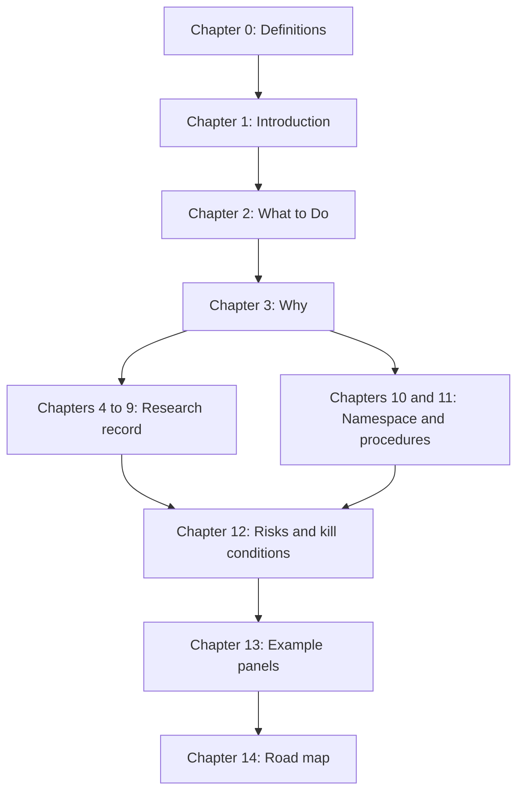

## 1.5 Overall Design Principles

These principles guided the choices that follow. They are most relevant to people changing the standard, but they also help users understand it.

1. **One person plus agents must be able to maintain it.** Every option was judged first on whether the surface stays small enough for one person and automated helpers. A beautiful design that needs thirty maintainers is rejected.
2. **Describe intent, never pixels.** The shared description says what a thing is for. Each platform decides how it looks.
3. **State lives in the core; the screen is a pure function of state.** No code ever edits the screen by hand.
4. **The first renderer is the cheapest one.** Web arrives first, because HTML already exists and because it tests the shared description at the lowest cost.
5. **Say "native" only when it is true.** Web is web. Canvas is canvas.
6. **Prefer the boring tool that is already in the platform.** The browser is a widget toolkit. Swift is the language of Apple's toolkit. We use them.
7. **Document dependencies and make them replaceable.** (This one is borrowed from the operating-system toolkit tradition: if you cannot say what depends on what, you cannot replace anything.)
8. **Where there is already a standard meaning for a name, use it.** A table is a table. A form is a form.
9. **Make unsafe things hard and checked things easy.** Mistakes should be compile errors, not runtime surprises. This matters twice over when the reader is an agent.
10. **Offline first.** The interface description ships with the program. Remote updates are an optional extra, signed and reversible.

## 1.6 The picture in one page

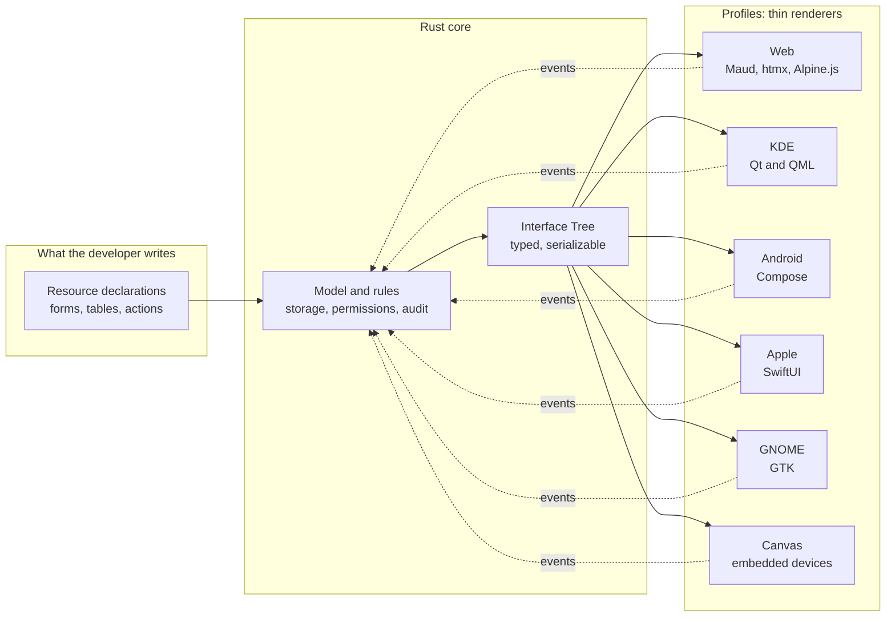

Solid arrows carry descriptions out. Dotted arrows carry events back. Nothing else crosses.

## 1.7 Using this document

If you want to start building, go to Chapter 2 and then to Chapter 14, which turns the rules into a schedule. If you want to know why a rule exists, find the same number in Chapter 3. If you want to understand why the architecture is not as simple as "Rust compiles everywhere", read Chapter 5. If you were handed an architecture by someone else and want to know whether to trust it, read Chapter 6.

---

# Chapter 2 What to Do

**Caveat:** this chapter says what to do and nothing else. The reasons are in Chapter 3, under the same numbers. If a directive looks arbitrary, read its reason before arguing.

## 2.1 The Directives

**Directive 1. Architecture.** Feluqa MUST be built as one Rust core, one Interface Tree, and thin native renderers, one per profile. (This is called Option A throughout.) Feluqa MUST NOT attempt a universal renderer that draws its own widgets on platforms that have a native toolkit.

**Directive 2. Intent, not pixels.** The Interface Tree MUST describe intent. It MUST NOT contain coordinates, colors, fonts or pixel sizes. Each renderer maps intent to its platform's idiom.

**Directive 3. One-way data flow.** Business state MUST live only in the core. Renderers MUST send events and MUST display the tree they are given. A renderer MUST NOT hold business state, and MUST NOT edit its screen by any path other than rendering a tree.

**Directive 4. Profiles as a closed set that grows.** Renderers MUST be selected through one enumeration, `feluqa::ui::render::Profile`. Each profile MUST be enabled by a build feature and MUST publish a conformance level. The first profiles are **Web** and **KDE**. Android, Apple, GNOME and Canvas are added one at a time, in that order, each only after the previous one reaches the agreed conformance level.

**Directive 5. The web profile ships htmx and Alpine.js.** Feluqa MUST ship both libraries inside its own binary, at pinned versions, with no network fetch at run time. htmx MUST be responsible for exchanges with the server. Alpine.js MUST be responsible only for short-lived, local behavior in the page. The server MUST own all other state.

**Directive 6. Android second, tested through Waydroid.** The Android profile MUST use the platform's own toolkit (Compose) and MUST be built and exercised on a Debian machine with Waydroid. It MUST also be tested on at least one physical device before any release claim.

**Directive 7. Apple third, built from Linux when proven.** The Apple profile MUST use SwiftUI through a thin Swift shell. Feluqa SHOULD build it from Linux with xtool, but MUST first prove that the Rust compiler can target Apple platforms from Linux. Feluqa MUST keep one Apple computer, or one Apple continuous-integration runner, for release steps that require it, until proven otherwise.

**Directive 8. Headless first.** Every Interface Tree MUST be renderable to a stable text form without any screen. Every screen in an application SHOULD have at least one headless snapshot test.

**Directive 9. One namespace.** Everything a Feluqa user needs MUST be reachable under `feluqa::`. The interface layer MUST live under `feluqa::ui::`. Public signatures MUST NOT expose types from third-party crates.

**Directive 10. Three depths of internalization.** Every dependency MUST be classified as adopted, vendored or forked. The default MUST be adopted behind a facade, pinned exactly. Forking requires a written justification and a named owner.

**Directive 11. Admission procedure.** No dependency MAY enter Feluqa without passing the admission checklist (Appendix B.1): license, maintenance, security record, size, replaceability and build behavior.

**Directive 12. Offline and signed.** The interface description MUST ship inside the application. Remote interface updates MAY be offered, and if offered MUST be signed, version-pinned and reversible. Renderers MUST treat every Interface Tree as untrusted input and MUST enforce size and depth limits.

**Directive 13. Honest labels.** Feluqa MUST label each profile as native, web or canvas, and MUST NOT call a web or canvas profile native. Documentation MUST use the four status labels from section 1.3.

**Directive 14. Agent-readable.** Feluqa's macros MUST produce compile-time errors that say which field, which type and what to change. A single command, `feluqa check`, MUST validate a project for every enabled profile and give a deterministic pass or fail. Every scaffolded project MUST include a guide file for agents.

**Directive 15. Kill conditions are written down.** Each profile milestone MUST record the conditions under which the work is stopped or rescoped (Chapter 12), and those conditions MUST be reviewed when the milestone ends.

## 2.2 First actions, in order

Do these in this order. Each has a way to fail, listed in Chapter 12.

1. Read the code of mobiler, Crux, nsh and maud-ui (two to three days). Produce a list of the fifteen Interface Tree node kinds Feluqa needs.
2. Write the first Interface Tree definition and the `Mission` example resource of section 7.3.
3. Build the Web profile: Maud, maud-ui, htmx and Alpine.js bundled (two to four weeks). Produce the headless text renderer in the same milestone.
4. Build the KDE profile spike: Rust core, cxx-qt, one QML renderer for a form and a table (three to four weeks).
5. Run the conformance ladder (section 9.2) on Web and KDE and publish the first board.
6. Set up Waydroid on the Debian machine and prove that a Rust library runs inside it (three to five days).
7. Build the Android profile spike with Compose.
8. Run the Apple-from-Linux feasibility test (section 9.5) with a physical iPhone.
9. Read Apple's developer license text about SDK use on non-Apple hardware, and get qualified legal advice if the product will be sold.
10. Only then, build the Apple renderer.

## 2.3 The directives in one diagram

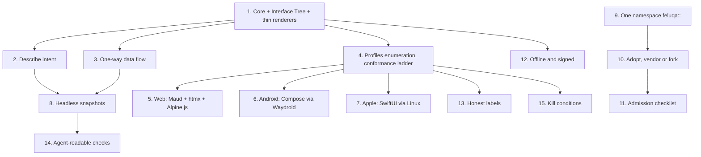

---

# Chapter 3 Why: the Reason Behind Each Directive

**Caveat:** the reasons below are the best we could make from the evidence on 1 November 2026. Where the evidence is thin, we say so. Where we are guessing, we mark it Unverified.

## Why Directive 1: Option A

We considered seven architectures. Judged first on whether one person and agents can maintain it, and second on whether it gives real native interfaces, Option A is the only one that passes both.

| Option | What it is | Pros | Cons | Verdict |
|--------|-----------|------|------|---------|
| **A** | Rust core, Interface Tree, thin native renderers (SwiftUI, Compose, GTK, Qt, HTML) | Real native widgets, so Liquid Glass, screen-reader support, input method editors and system menus come for free. The tree is data, so tests and previews need no device. State sync is one-way and plain. The same tree renders to HTML, so Web arrives first. Proven shapes exist (Crux, mobiler). | We write and maintain several renderers. The tree design is the whole game: a bad tree means rewriting everything. Crossing the language boundary costs time; big tables need pull-based data. Risk of lowest-common-denominator design. | **Chosen** |
| B | Adopt mobiler and extend | Much of A already exists for Android, iOS and web [R14]. Fastest way to learn what hurts. | Mobile and web only as far as we found; tables and filters are not its focus; maintainer count and activity are unknown (Unverified); its own README has moved from "experimental" [R15] to "production-bound" [R14]. | Study, do not depend on |
| C | Adopt Crux directly | Mature pattern, generated types for Swift, Kotlin and TypeScript, static library on iOS [R13]. | Native shells are written by hand for each application, which breaks our promise of no per-application native code. | Borrow the ideas |
| D | Adopt nsh | Real runtime, many platforms, unstyled base components, signed modules, headless test commands [R6][R7]. | About two weeks old at the time of reading, with breaking changes at every minor version [R6]. Its main language is TSX running in an embedded JavaScript engine [R7], which conflicts with our "no heavy runtime" claim. On macOS it appears to use GPUI, which draws its own pixels (Unverified), which would mean no Liquid Glass. | Watch and learn |
| E | Canvas libraries (Xilem, Slint, GPUI, Dioxus Native) | One Rust codebase, identical look everywhere. Right for devices that have no native toolkit. | Not native by definition. Xilem describes itself as experimental [R10]. Vello carries an alpha warning [R12]. Dioxus Native is described as experimental [R17]. No Liquid Glass [R18][R19]. | Second family, for embedded only |
| F | Web view wrapper (Tauri, Dioxus desktop) | Quick. Keeps the Filament experience because HTML stays the output. | Not native. Liquid Glass only imitated. Heavier start-up and memory. | Acceptable fallback tier |
| G | Web only (Axum, Maud, htmx) | Filament-like experience in weeks. | Fails the real requirement: native interfaces, offline workstations. | Phase one of A, not a replacement |

**Why not simply "write it in Rust and compile it everywhere"?** Because compiling gives a binary, not a toolkit. See Chapter 5.

## Why Directive 2: intent, not pixels

If the tree says "button at 20 by 40, blue", every platform must imitate it, and then it is no longer native. If the tree says "primary action, destructive, needs confirmation", the Apple renderer shows a red-role button with a confirmation sheet, the KDE renderer shows a Kirigami-style dialog (Unverified), and the Web renderer shows a styled dialog. Each is right on its platform.

- **Pro:** native look, native accessibility, resilient to platform redesigns. Liquid Glass arrived in 2026 and applications that used standard controls inherited most of it by recompiling [R20].
- **Con:** more design work for the tree. Some layouts cannot be expressed. We accept this, and provide an escape hatch (section 7.6).

## Why Directive 3: one-way data flow

Filament feels simple because Livewire re-renders from server state, and the browser updates the page. The native equivalent is the same idea: the core owns state, the renderer is a pure function from tree to screen. SwiftUI and Compose already compare trees by identity, so a new tree causes minimal changes on screen.

- **Pro:** no hand-written screen updates, no state drift, easy replay and audit.
- **Con:** large trees are expensive to carry across the language boundary. Mitigation: send patches keyed by node identifier, and use pull-based data sources for tables.

## Why Directive 4: profiles, web and KDE first, gamified

**Why an enumeration.** One closed list makes it impossible to ship an unlabeled renderer, and lets the compiler tell us when a new profile is not handled somewhere (the enumeration is marked non-exhaustive for outside users and exhaustive inside Feluqa).

**Why Web and KDE first.** Both run on the Debian machine where the work happens. Web is the cheapest renderer and tests the tree. KDE is the first native test, and the target the maintainer cares about. cxx-qt, the bridge between Rust and Qt, is real: version 0.8.1 appeared in February 2026, it is licensed under MIT or Apache-2.0, supports QML, and its own page warns that it is "in early development" with frequent API changes [R22]. That warning is itself a reason to start now and to isolate it behind our facade.

**Why Android next.** Waydroid runs Android in a container on Linux, which means the Android profile can be developed and tested on the same Debian machine without a phone for every change. It needs the Android binder kernel module and a Wayland session [R26][R27][R28].

**Why Apple after that.** It has the largest unknown (can Rust target Apple from Linux?) and the largest legal question (section 9.5). It should not block the other profiles.

**Why gamify.** A conformance ladder with levels, a board and visible progress turns an enormous, vague goal ("native everywhere") into small, checkable wins. This matters for one maintainer. It also gives agents a precise target: "make level three pass on this profile". (The ladder is in section 9.2.)

- **Pro:** progress is visible; failure is early and cheap; profiles can ship at different maturity without lying.
- **Con:** a ladder can be gamed by writing tests that are too easy. Mitigation: the tests are shared across profiles and reviewed like the standard itself.

## Why Directive 5: htmx and Alpine.js together

htmx replaces parts of a page with HTML the server sends. That is exactly the Livewire idea, and it fits the Maud approach where components are pure functions returning HTML [R9]. But a page also needs small local behaviors (a menu opening, a modal focusing, a field showing a character count) that should not make a server request. Alpine.js does this in HTML attributes.

The two libraries meet at one known problem: when htmx replaces a piece of the page, the Alpine state inside it can be lost. The htmx project publishes an extension, `alpine-morph`, for exactly this, which keeps Alpine state when whole components are swapped [R23]. The next major version of htmx, still under construction, includes an extension called `hx-alpine-compat` that defers Alpine's observer until the swap settles and carries Alpine's data across morphs [R24]. We should pin htmx to the current major version and use `alpine-morph`, and re-evaluate when the new version is stable.

htmx's license is the zero-clause BSD license [R25]. Alpine.js's license is MIT (Unverified; confirm on its repository). Both permit bundling.

- **Pro:** the web experience keeps Filament's feel, with almost no JavaScript written by users; both libraries are small; the pair is widely used.
- **Con:** two moving parts to pin and audit; a rule is needed about who owns what (Directive 5 gives it); strict browser security policies may block Alpine's expression evaluation unless its restricted build is used (Unverified; check before targeting hardened environments).

## Why Directive 6: Android through Waydroid

- **Pro:** development loop on the same machine; the container is real Android, not an emulator of the processor, when the image matches the host's processor family. Our own builds can target the matching Rust target for the host and the physical-device target for release (Unverified: confirm the exact target names during the spike).
- **Con:** Waydroid is not a complete replacement for a physical phone. Graphics, sensors, power behavior and vendor changes differ. It requires kernel support for binder and a Wayland session, and users report installation difficulties on minimal Debian systems [R28]. Hence the rule to test on a physical device before claiming anything.

## Why Directive 7: Apple through Swift, from Linux if proven

Rust cannot call SwiftUI directly. SwiftUI has no stable C interface; it is Swift-only. So a thin Swift shell is unavoidable. The bridge between Rust and Swift is the C interface, and the best generator is UniFFI [R16], used in Firefox, which says it is ready for production use but far from version 1.0 [R16].

xtool is attractive because it builds a Swift Package into an iOS application, signs it, and installs it on a connected device, from Linux, Windows or macOS [R1]. Release 1.20.0 added support for Swift 6.4 and SwiftUI macros, and grew its bundled SDK from about three to about seven gigabytes, with a `--slim` option [R3]. But xtool replaces Xcode, not Swift; it needs an Xcode archive that the user downloads to build its SDK [R2][R3]; and at launch it could not upload to the App Store, with the author suggesting a final build on a Mac [R2]. A technology commentary argued that using Xcode's SDK on non-Apple hardware conflicts with Apple's license [R4]. We are not lawyers; this must be checked.

- **Pro:** a fast, scriptable, agent-friendly loop on Linux; SwiftPM is declarative; sub-second installs were reported [R5].
- **Con:** the Rust-to-Apple compile step from Linux is unproven (Unverified); the simulator, profiling tools and store submission still need a Mac; xtool is an unofficial tool that depends on Apple's services and appears to have few maintainers (Unverified), which is a supply-chain risk to record.

## Why Directive 8: headless first

Because the Interface Tree is data, we can print it as text and compare. nsh offers headless commands for the same reason [R6]. Benefits: agents get an instant, deterministic feedback loop; tests do not need a device; previews are cheap. Cost: snapshots must be reviewed by humans, otherwise they become noise. Rule: snapshot changes appear in review like code changes.

## Why Directive 9: one namespace

The complaint that started this document was "five thousand incomplete tools scattered everywhere". The cure is a single door. If a user can write `use feluqa::ui::form::TextInput;` and never learns which crate lies underneath, then Feluqa can replace that crate without breaking users. If our public signatures expose another crate's types, then that crate's version becomes our users' problem. That is the entire argument, and it is why Directive 9 forbids leaking.

## Why Directive 10: three depths, with adopt as the default

The instinct to copy everything into our own repository is understandable and dangerous. A copy that Feluqa modifies becomes a fork, and a fork is a promise to maintain someone else's code forever. Our principle of one person plus agents cannot sustain many forks.

- **Adopt** (facade plus exact version pin) costs almost nothing and keeps upstream fixes flowing. It is the default.
- **Vendor** (exact unmodified copy, license notice kept) is for things that must build without the network and for small assets such as the htmx and Alpine.js files. It protects against disappearance and tampering, and it costs little because nothing is modified.
- **Fork** (modified and owned) is for the rare case where upstream cannot or will not do what we need and the component is core to our promise.

There is also a fourth category that cannot be internalized at all: **platform toolkits**. We cannot vendor SwiftUI, Compose, Qt or GTK. We wrap them, behind the profile's renderer, and we document the version range we support.

## Why Directive 11: admission checklist

Most of the harm of dependencies arrives silently: a license that forbids our use, a crate with a single abandoned maintainer, a build script that downloads things. A checklist forces the questions before the harm. For defense-adjacent work it is also an evidence trail.

## Why Directive 12: offline and signed

Feluqa is meant for disconnected workstations and tactical use. A server-driven interface that cannot function without a network fails the mission. A remote interface update that is not signed is a way to deliver malicious screens to every device. nsh describes its modules as signed [R7], which is a sign the problem is recognized. Interface Trees from outside the binary must therefore be checked for signature, size and depth before any renderer touches them.

- **Pro:** credible security story; works offline; reproducible builds.
- **Con:** slower to change a deployed interface; key management is real work.

## Why Directive 13: honest labels

Marketing language ("write once, run natively everywhere") is the quickest way to lose the trust of the people this platform is for. Concretely: Flutter's own team has stated that it does not plan to build the iOS 26 look into its Cupertino widgets, because its widgets are not native controls [R19]. The practical lesson: anything that draws its own pixels does not automatically inherit the operating system's new look. We label accordingly.

## Why Directive 14: agent-readable

Agents are fast and literal. They need three things: errors that name the fix, one command that says pass or fail, and a guide file describing conventions. mobiler already scaffolds such a guide file for agents [R14]. Compile-time checks in macros (unknown field, wrong column type, missing permission) are an advantage Filament cannot offer, because PHP discovers such mistakes at run time.

## Why Directive 15: kill conditions

Large ambitions fail slowly. Writing down, in advance, the observations that would make us stop is the cheapest way to fail fast. See Chapter 12.

## Why Filament works, and why native is harder

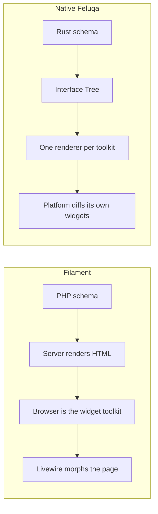

The left column has one target. The right column has several. The extra cost, one renderer per toolkit, is exactly the work Feluqa takes on so that application developers do not have to.

---

# Chapter 4 The Original Questions, Answered

**Caveat:** the questions below began as rambling notes, partly in French. They are restated here in clean form and answered briefly, with pointers. Question 1 to 8 were asked at the start; 9 to 11 were not asked but had to be.

**Question 1. Can Feluqa give a Filament-style developer experience in Rust, where the developer declares resources, forms, tables and actions and obtains a working panel?**
Yes, for the declaration side, through macros and builders (Chapter 7). The part Filament gets for free, rendering, must be built (Chapters 8 and 9). The honest promise is: application developers write no Swift, Kotlin or QML; the framework authors do.

**Question 2. Can the same description render with each platform's own widgets, inheriting the system look, including Liquid Glass?**
Yes, but only if each renderer uses the platform's real toolkit. Anything that draws its own pixels does not inherit the look [R18][R19]. This eliminates canvas libraries as renderers on Apple platforms (Chapter 5, section 5.5).

**Question 3. How much can truly be written once?**
The core, the rules and the description of the interface. Not the renderers (Chapter 5).

**Question 4. How do we keep the screen in sync with data without hand-written updates?**
One-way data flow: events go to the core; the core returns a tree; the renderer shows it (section 5.4). This is the strongest part of the architecture.

**Question 5. Apple: what is the equivalent of xtool for each platform, what can be done from Linux, and can Apple code have bridges?**
Bridges: yes, through the C interface, not through SwiftUI. A thin Swift shell is unavoidable. xtool covers building, signing and installing iPhone applications from Linux, with caveats (Chapter 9, section 9.5). Per-platform tools: Chapter 9.

**Question 6. Is "Rust is compiled, so it is all the same, since we can use SQLite everywhere" true?**
Half true. It holds for logic and storage. It fails for user interface, because the operating system owns the event loop, input, accessibility and look (Chapter 5).

**Question 7. Is the architecture proposed by Gemini sound?**
Partly. The plan to start with Apple through UniFFI is sound; several of the named components are misplaced or oversold (Chapter 6).

**Question 8. Are Maud and maud-ui relevant?**
For the Web profile, yes, strongly. For native profiles, not at all, since they produce HTML (Chapters 6 and 8).

**Question 9. What happens when there is no network, and how do we stop an interface description from being an attack?**
The description ships inside the application; remote updates are optional and signed; renderers treat every tree as untrusted (Directive 12).

**Question 10. What makes an agent reliable at building screens?**
Typed macros with explicit errors, one validation command, headless snapshots and a guide file (Directive 14, Chapter 7).

**Question 11. What is the smallest honest first step?**
The Web profile plus the headless renderer, then the KDE spike (section 2.2).

---

# Chapter 5 The Native Reality

**Caveat:** this chapter corrects a belief that most developers coming from the web hold, including the author. It is the most important chapter for newcomers.

## 5.1 The wrong intuition

The belief runs: "Rust is compiled, so it is the same everywhere, in the way SQLite is the same everywhere."

SQLite works everywhere because it is a library with no opinions. Bytes go in, bytes come out, through a plain C interface; it does not need a window, an event loop, a main thread or a screen. Rust logic is the same: models, validation, storage, protocol parsing, cryptography. All of it is portable. That part of the belief is correct, and it is the reason Feluqa's core can be shared.

User interface is the opposite case. The platform owns the process and the main loop.

| Concern | Who owns it in a native application |
|---------|-------------------------------------|
| Event loop and main thread | The operating system's framework (AppKit and UIKit run loops, Android's looper, GTK's main loop, Qt's event loop) |
| Application lifecycle (suspend, background termination, restore) | The operating system, through Swift or Kotlin callbacks |
| Text input, input method editor, spelling, autofill | The platform's text widget |
| Accessibility (VoiceOver, TalkBack, Linux assistive technology) | The widgets, but only when they are real widgets |
| Look and feel, materials, dark mode, text-size settings | The widgets, plus recompiling against the newest SDK |
| Menus, sheets, share dialogs, file pickers, permissions | Operating-system-provided interface |

These interfaces are object systems tied to a language: Swift and Objective-C for Apple (SwiftUI is Swift-only: it relies on generics, result builders and property wrappers, and has no stable C interface), Kotlin and Java for Android (Compose is Kotlin-only), C for GTK, C++ for Qt, and the Document Object Model for browsers. Compiling Rust gives one binary format per processor family, not one toolkit.

## 5.2 What is shared and what is not

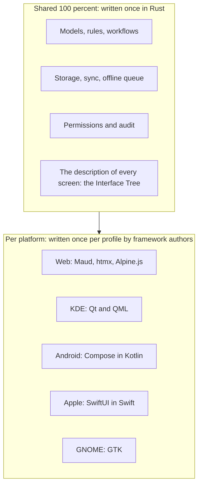

The design question is not "how do we write the interface once". It is "how thin can the renderers be". Thin means: no business logic, no state, no per-application code.

## 5.3 Why Filament looks universal

Filament looks universal because it has one render target (HTML), the browser is a free, mature, accessible widget toolkit, Livewire sends server-rendered HTML and morphs the page, and the developer writes only PHP. Native breaks all four:

| Filament property | Native equivalent in Feluqa |
|-------------------|-----------------------------|
| HTML as output | The Interface Tree (our own typed description) |
| The browser as widget toolkit | One renderer per toolkit, which Feluqa writes and maintains |
| Livewire morphing | The core owns state; the platform's own comparison engine updates widgets |
| "No frontend code" | "No frontend code in applications"; renderers are framework code |

## 5.4 State sync: the part that works well

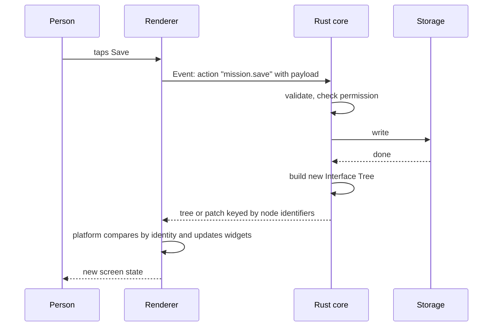

The renderer never decides what the screen should contain. Large tables are not sent whole: the renderer asks the core for "rows 200 to 260" through a pull-based data source.

## 5.5 Which renderers can be native

Evidence that custom-drawn interfaces do not inherit the platform's new look: Liquid Glass arrives with the iOS 26 SDK; standard SwiftUI and UIKit controls pick up most of it by recompiling with Xcode 26 [R20]. Flutter, which draws its own widgets, does not, and its team said it would not build the new look into its Cupertino widgets; packages such as `glassy_ui_ios` get the effect only by embedding real SwiftUI and UIKit views [R18][R19]. Building with Xcode 26 became mandatory for App Store submission on 28 April 2026, according to a Japanese technology article; that date should be checked against Apple's page (Unverified) [R19]. The same reasoning applies to Xilem and Masonry, Slint, GPUI and Dioxus Native: they draw their own pixels.

## 5.6 The lowest-common-denominator trap

Every node in the tree must exist on every profile, or have a declared fallback.

- A button, a text, a text field and a stack are trivial everywhere.
- A table with sorting, filtering, selection, sticky header and resizable columns is very different on each platform.
- A date picker, a combo box, a command palette, a split view and sidebar navigation are idioms, not merely widgets; each platform has its own.

A native application does not look the same on iPhone and on GNOME, by design. If the tree forced identical layouts, it would not be native. So the rule: **the tree describes intent, never pixels** (Directive 2).

## 5.7 Things we stop saying

| Instead of | We say |
|------------|--------|
| "Write once, no rewrite at all." | "Write the logic and the description once; Feluqa ships the renderers." |
| "No garbage collection." | "No garbage collection in the Rust core. Android's interface runs on a managed runtime that has one. Swift uses automatic reference counting." |
| "Server-driven interface" as the default | "Server-updatable, signed, cached interface description" |
| "Native" for anything that is not | "Native", "web" or "canvas", exactly |

---

# Chapter 6 Fact-Checking the Outside Advice

**Caveat:** this chapter is deliberately harsh. A language-model assistant (Gemini) was asked for an architecture, and it replied confidently. Much of the reply was usable; some of it would have led us to the wrong core. Verdicts: **true**, **partly true**, **misleading**, or **could not verify**.

## 6.1 Claim by claim

**Claim: "Xilem is the most crucial framework for your goal; it is backend-agnostic, so you can pipe its output to native platforms." Verdict: oversold.**
The Xilem README calls the project "an experimental Rust architecture for reactive UI" and says it has a web backend and a Masonry backend [R10]. Masonry draws its own widgets with Vello and opens windows with winit [R10]. Linebender's own first-quarter 2026 report talks about Masonry gaining an abstraction over the 2D renderer, new widgets and a new layout system [R11]: progress, but progress inside a self-drawn widget set. Vello's README still carries an alpha-state warning [R12]. Xilem is a view-tree framework; it is not a server-driven interface parser and not a bridge to SwiftUI. Takeaway: borrow the idea of a typed view tree; do not build native fidelity on it.

**Claim: "Taffy lets the core calculate where components sit before telling the native platform how to draw them." Verdict: wrong layer.**
Taffy is real and widely used (Dioxus's renderer, nsh) [R17][R8]. But native toolkits do their own layout, including text-size settings, right-to-left languages and window resizing. Telling SwiftUI where to put things defeats its purpose. Taffy only matters in the Canvas profile.

**Claim: "Native Shell (nsh) is production-grade and binds to UIKit, Android Views, AppKit, GTK and web." Verdict: real project, wrong adjectives.**
What was verified: nsh is real, from Longbridge, licensed under Apache-2.0 [R7]. Version 0.1.0 appeared on 17 October 2026, version 0.1.1 on 18 October, and version 0.3.0 on 26 October [R6]. Reading on 1 November, the project is about two weeks old. The version 0.2.0 notes list renamed components and say apps packaged with 0.1 must be rebuilt; the version 0.3.0 notes include a migration section [R6]. Its main authoring language is TSX, run as bytecode in an embedded JavaScript engine called QuickJS; Rust authoring is supported, including mixed projects [R7]. The listed integrations are GPUI, QuickJS, Taffy, Tailwind, UIKit, GTK 4 and Direct2D [R7]. We found no AppKit, no Compose and no SwiftUI in that list. Whether macOS uses GPUI, which draws its own pixels, is Unverified; if so, nsh gives no Liquid Glass on macOS. It "draws no look of its own" and ships unstyled base components with shadcn-style theme tokens [R6], which resembles our headless components idea. It also describes modules as signed [R8]. Takeaway: the closest existing thing to our goal; worth reading, not worth betting on today.

**Claim: "UniFFI auto-generates typesafe Swift and Kotlin bindings, letting a thin wrapper read the layout tree and map it to SwiftUI.Button." Verdict: half true.**
UniFFI is real, generates bindings for Kotlin, Swift, Python and Ruby, has third-party bindings for more languages, is used in Firefox, and says it is ready for production use but "a long way from a 1.0 release" [R16]. It generates bindings. It does not generate the code that maps a tree to SwiftUI.Button: that renderer is written by hand, once per platform. The claim also lumped in "Robusta"; we could not verify it, and from background knowledge it is a Java and Android helper unrelated to Apple's materials (Unverified).

**Claim: "Slint compiles to native machine code in under 300 kilobytes of memory; its live preview is perfect for remote data binding." Verdict: marketing paraphrase.**
Slint draws its own pixels (Gemini admitted this). The memory figure applies to very small devices (Unverified; check exact number). "Perfect for remote data binding" is filler. Slint is not a server-driven interface engine. It is a candidate for the Canvas profile.

**Claim: "Pure canvas rendering (GPUI, Slint) loses accessibility options and native context menus." Verdict: true, and the most important claim in the reply.** See section 5.5.

**Claim: "Start with Apple through UniFFI and map the core's output to a SwiftUI VStack loop." Verdict: sound plan, understated difficulty.**
A stack of text is the easy 5 percent. The work is lists with ten thousand rows, text input with composition, focus, navigation stacks, sheets, menus, undo, drag and drop, and accessibility.

## 6.2 What the reply missed

| Missed | Why it matters |
|--------|----------------|
| **Crux** | The right pattern: Elm-style core, generated types for Swift, Kotlin and TypeScript, static library on iOS [R13]. |
| **mobiler** | Crux-based. The Rust core returns a widget tree; generic SwiftUI, Compose and web shells draw it; themes are data; there is a command-line tool; it even scaffolds a guide file for agents [R14]. That is our idea at small scale. Its earlier README said "experimental" [R15]; the later one says "production-bound" [R14]. Maintainer count and real applications are Unverified. |
| **Offline** | A server-driven interface does not work in a field unit. |
| **Security** | A server-sent interface description is an attack surface. |
| **KDE** | Native on KDE means Qt. A GTK application on KDE works but does not look native. |
| **Android garbage collector** | "No garbage collection" stops at the language boundary. |

## 6.3 maud and maud-ui

maud-ui version 0.2.1 offers 64 "headless, accessible" components for Rust web applications, built on Maud and htmx, styled like shadcn/ui [R9]. Components are pure functions from properties to markup, with no state [R9]. It ships CSS and JavaScript bundles. It is excellent for the Web profile. It is useless for native profiles, since its output is HTML. Its structure (properties, variants, a render function and a showcase function per component) is a useful template for how Feluqa should structure components.

## 6.4 Score

Of seven large claims: one clearly right (the canvas trade-off), one right with hidden difficulty (start with Apple), four oversold or misplaced (Xilem, Taffy, nsh, Slint), one misleading grouping. Not a collection of inventions, but building from it blindly would have chosen the wrong core.

---

# Chapter 7 The Interface Tree and the Filament-Style Programming Model

**Caveat:** everything in this chapter is a design sketch. The crate does not exist. Names are placeholders. The sketch exists to test whether the programming model feels like Filament, and to give agents something precise to criticize.

## 7.1 What we mean by "Filament-style"

| Filament concept | Feluqa equivalent (sketch) |
|------------------|----------------------------|
| Panel | `feluqa::ui::panel::Panel`: navigation, theme, authentication and modules |
| Resource | A struct bound to a model with `#[derive(Resource)]` |
| Form schema | `fn form(Form) -> Form` with typed fields |
| Table schema | `fn table(Table) -> Table` with columns, filters and actions |
| Action and bulk action | `Action::make(..)`, serialized as an action identifier plus a typed payload |
| Widget | `StatWidget`, `ChartWidget` |
| Livewire state | The Rust core's model plus events |
| Policies | Feluqa permissions, evaluated in the core and never in the renderer |
| Plugins | Feluqa **modules**: product identity, version, permissions and switchable features |

## 7.2 Principles of the programming model

1. The developer declares; the framework decides how to render.
2. Names are checked at compile time: a column named `callsgin` is a compile error.
3. Everything that can happen is an Action with an identifier; there are no anonymous callbacks.
4. Permissions are declared next to the thing they protect and enforced in the core.
5. Anything not yet supported by a profile is reported by `feluqa check` before it reaches a user.

## 7.3 An example resource

```rust
use feluqa::ui::prelude::*;          // one import: the whole interface layer
use feluqa::data::Model;

#[derive(Model, Serialize, Deserialize)]
pub struct Mission {
    pub id: Uuid,
    pub callsign: String,
    pub status: MissionStatus,
    pub window_start: OffsetDateTime,
}

#[derive(Resource)]
#[resource(model = Mission, icon = "map", group = "Operations", permission = "missions")]
pub struct MissionResource;

impl Resource for MissionResource {
    fn form(form: Form) -> Form {
        form.schema([
            TextInput::make("callsign").required().max_length(32),
            Select::make("status").options(MissionStatus::options()),
            DateTimePicker::make("window_start").required(),
        ])
    }

    fn table(table: Table) -> Table {
        table
            .columns([
                TextColumn::make("callsign").searchable().sortable(),
                BadgeColumn::make("status"),
                DateColumn::make("window_start").sortable(),
            ])
            .filters([SelectFilter::make("status")])
            .row_actions([
                Action::edit(),
                Action::delete().confirm("Delete mission?"),
            ])
    }
}

pub fn panel() -> Panel {
    Panel::make("ops")
        .resources([MissionResource])
        .modules([TelemetryModule, LogisticsModule])
}
```

Fewer than forty lines declare a form, a table, two actions, a permission and a navigation entry. That is the standard against which the programming model will be judged (Chapter 12).

## 7.4 The macros we accept to write

| Macro | Job |
|-------|-----|
| `#[derive(Model)]` | Records field names, types and enumeration options so that columns and fields are checked against the real model. |
| `#[derive(Resource)]` | Registers the resource; derives routes, permissions and identifiers; checks that every named field exists. |
| `#[action]` | Turns an ordinary Rust function into a serializable action with a typed payload. |

Every macro error is written so that an agent can act on it: it names the file, the field, the type found, the type expected and the likely fix.

## 7.5 The Interface Tree

```rust
// feluqa::ui::tree
#[non_exhaustive]
pub enum Node {
    // layout, expressed as intent
    Stack { axis: Axis, gap: Gap, children: Vec<Node> },
    MasterDetail { master: Box<Node>, detail: Box<Node> },
    Sections { title: Option<Text>, children: Vec<Node> },

    // content
    Text { value: Text, role: TextRole },      // title, body, caption, code
    Badge { value: Text, tone: Tone },

    // input: values are bound by identifier, never by pointer
    Field { id: FieldId, kind: FieldKind, label: Text, error: Option<Text>, state: FieldState },

    // data
    Table { id: TableId, columns: Vec<Column>, source: DataSourceId, selection: Selection },

    // interaction
    Button { label: Text, role: ActionRole, action: ActionId, enabled: bool },
    Confirm { title: Text, body: Text, confirm: ActionId, cancel: ActionId },

    // navigation
    Nav { items: Vec<NavItem> },
    Route { path: RoutePath, content: Box<Node> },
}
```

Rules the tree obeys:

1. **Intent, not pixels.** No coordinates, no colors, no fonts. Roles and tones only.
2. **Identifiers, not callbacks.** Every interaction is an action identifier plus a typed payload. Serializable, loggable, auditable, replayable.
3. **Big data is pulled.** A table names a data source; the renderer requests row ranges. Trees never contain a hundred thousand rows.
4. **Versioned and extensible.** The enumeration is marked non-exhaustive for outside users. Each renderer declares which node kinds it supports; unknown kinds use a declared fallback.
5. **Compact on the wire.** Between core and renderer we expect a compact binary format; JSON is for debugging only. The final choice is decided by the first spike.
6. **Signed when it travels.** A bundle that arrives separately from the program carries a signature that is verified before use (Directive 12).

## 7.6 The escape hatch

Filament's forms and tables cover most administration screens. The remaining screens need something custom. The tree therefore includes a `Custom` node with a registered kind name and a typed payload. A profile may register a renderer for that kind; profiles that do not register one use the declared fallback. The hook is provided early, even though ugly, because without it users would fork the framework.

## 7.7 Capability negotiation

```rust
pub enum Support { Native, Fallback(FallbackKind), Unsupported }

pub trait Renderer {
    fn profile(&self) -> Profile;
    fn supports(&self, kind: NodeKind) -> Support;
}
```

`feluqa check --profiles web,kde` fails the build if a panel uses a node kind that an enabled profile cannot render, or reports which fallback will apply. Agents get a deterministic answer.

## 7.8 The agent experience

- `feluqa new panel` scaffolds a project with a guide file for agents that explains the macros, the tree and the rules.
- `feluqa check` compiles, validates the tree, shows the capability matrix and lints permissions.
- `feluqa snapshot` renders each screen to a text snapshot and to a static HTML preview without any device.
- `feluqa trace` runs a scripted user flow headless. (nsh offers similar commands for its own modules [R6].)
- `feluqa profile status` prints the conformance board (section 9.2).

## 7.9 Honest limits

- Rich text, maps, charts, drag and drop, and document viewing are each multi-week renderer problems per profile. We start with none of them.
- Web is easy because HTML exists. Every other profile is a build-it-yourself widget library.
- The last ten percent of screens will be custom. The escape hatch is the mitigation, not a cure.

---

# Chapter 8 The Web Profile: Maud, htmx and Alpine.js

**Caveat:** the Web profile is first because it is cheapest and tests the tree. It is also the profile closest to Filament's experience. It is not native; it is labeled "web".

## 8.1 What each piece does

| Piece | Responsibility | Must not do |
|-------|----------------|-------------|
| Rust core | Owns all state, rules, permissions | Render HTML by hand outside the renderer |
| Web renderer (Maud, maud-ui) | Turns an Interface Tree into HTML | Hold business state |
| Axum routes (inside Feluqa) | Receive actions, return HTML fragments | Expose Axum types in the public interface |
| htmx | Sends requests, swaps returned HTML into the page | Decide what the page contains |
| Alpine.js | Short-lived, local page behavior: open a menu, show a dialog, count characters | Store anything the server must know |

The rule of thumb: **if reloading the page would lose it and that would matter, the server owns it. If losing it is harmless, Alpine.js may own it.**

## 8.2 The exchange

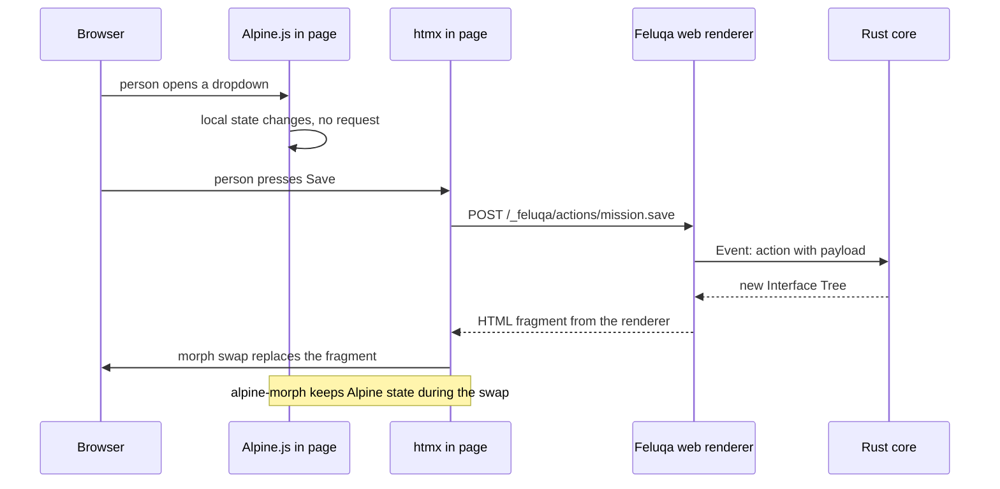

## 8.3 Why two libraries and how they get along

htmx handles server exchanges; Alpine.js handles local behavior. The known friction is that a swap can destroy Alpine's state inside the replaced piece. The htmx project publishes the `alpine-morph` extension, which uses Alpine's morph plugin as the swap mechanism, so that Alpine state survives even when whole components are replaced [R23]. A documented requirement: the server's response must contain the element that is being replaced, and scripts must load in the right order (the morph plugin, then Alpine itself, both deferred) [R23]. The next major version of htmx, still under construction, adds `hx-alpine-compat`, which delays Alpine's observer until the swap has settled and carries Alpine's data across morphs [R24].

**Decision:** pin the current major version of htmx and use `alpine-morph`; plan a migration to `hx-alpine-compat` when the new major version is stable. This is an Adopt-and-Vendor case (section 10.4): we adopt the behavior, we vendor the files.

## 8.4 Out of the box

Feluqa MUST ship the following inside its own binary, with no network fetch at run time:

- the htmx file, at an exact pinned version;
- the `alpine-morph` extension for that htmx version;
- the Alpine.js core and its morph plugin, at exact pinned versions;
- the base stylesheet and the design tokens (colors and sizes as variables);
- the license notices for each, in the generated third-party notice.

They are served from a fixed path under `/_feluqa/assets/`, with a content hash in the file name so that browsers can cache them for a long time, and with integrity hashes in the page. The namespace for this is `feluqa::ui::web::assets`. A user never writes a script tag for them.

```rust
// feluqa::ui::web::assets (sketch)
pub struct Assets;
impl Assets {
    pub const HTMX: &'static [u8]         = include_bytes!("../vendor/htmx/2.x.y/htmx.min.js");
    pub const ALPINE: &'static [u8]       = include_bytes!("../vendor/alpine/3.x.y/alpine.min.js");
    pub const ALPINE_MORPH: &'static [u8] = include_bytes!("../vendor/alpine/3.x.y/morph.min.js");
}
```

## 8.5 A generated page fragment

```html
<div id="mission-form" hx-target="this" hx-ext="alpine-morph" hx-swap="morph">
  <div x-data="{ confirming: false }">
    <form hx-post="/_feluqa/actions/mission.save">
      <label for="callsign">Callsign</label>
      <input id="callsign" name="callsign" required maxlength="32">
      <button type="submit">Save</button>
    </form>
  </div>
</div>
```

The renderer, not the developer, writes this. It follows the pattern in the htmx documentation [R23].

## 8.6 Security notes for hardened environments

- Alpine.js evaluates expressions written in attributes. Strict browser security policies normally forbid that. Alpine publishes a restricted build intended for such policies (Unverified; confirm before targeting hardened environments).
- htmx offers settings that disable evaluation of scripts in responses (Unverified; confirm the exact setting names for the pinned version).
- Every action endpoint SHOULD require an anti-forgery token (protection against cross-site request forgery).
- Responses MUST come only from the renderer; handlers never concatenate user text into HTML.

## 8.7 Where maud-ui fits

The Web renderer is a function `render(node: &Node) -> maud::Markup` that uses maud-ui for buttons, tables, dialogs and fields [R9]. Interactivity beyond local behavior goes through htmx, which keeps Livewire's server round-trip model. Feluqa wraps maud-ui behind `feluqa::ui::web::components` (Chapter 10) so that a future change of component library is invisible to users.

## 8.8 Pros and cons of the Web profile

| Pros | Cons |
|------|------|
| Cheapest renderer; arrives in weeks. | Not native; do not label it so. |
| Almost no JavaScript written by users. | Two libraries to pin and audit. |
| Reuses an existing accessible component set [R9]. | Offline use needs the application to bundle the server, or a web view with a local server. |
| Headless and snapshot testing are easy. | Hardened environments need extra configuration (section 8.6). |

---

# Chapter 9 The Profile Ladder: KDE, Android, Apple, GNOME, Canvas

**Caveat:** this chapter is long because it holds the platform detail. If you only want the order of work, read sections 9.1, 9.2 and 9.8.

## 9.1 The Profile enumeration

All renderers are selected through one enumeration. Adding a profile means adding one variant and one module; nothing else in the framework changes.

```rust
// feluqa::ui::render
#[non_exhaustive]
#[derive(Clone, Copy, Debug, Eq, PartialEq, Hash)]
pub enum Profile {
    Web,       // Maud + htmx + Alpine.js            (label: web)
    Kde,       // Qt and QML through cxx-qt          (label: native)
    Android,   // Compose through generated bindings (label: native)
    Apple,     // SwiftUI through a thin Swift shell (label: native)
    Gnome,     // GTK through Rust bindings          (label: native)
    Canvas,    // Self-drawn, for embedded devices   (label: canvas)
}
```

Each profile is enabled by a build feature, so a project only compiles and tests what it targets.

```toml
[features]
default = ["profile-web"]
profile-web = []
profile-kde = []
profile-android = []
profile-apple = []
profile-gnome = []
profile-canvas = []
```

## 9.2 The conformance ladder (the gamification strategy)

A profile does not simply exist or not exist. It climbs a ladder. Each level is an automated test suite shared by all profiles, so that "level three on KDE" and "level three on Android" mean the same thing. The framework prints a board, and a profile may be released at whatever level it has honestly reached.

| Level | Name | What the profile can do | How it is tested |
|-------|------|-------------------------|------------------|
| 0 | Compiles | The renderer builds and starts. | Build and launch test. |
| 1 | Hello | Text, stack and button; a button press reaches the core. | Scripted flow. |
| 2 | Form | Fields, validation messages, focus order, disabled state. | Scripted flow plus snapshot. |
| 3 | Table | Pull-based rows, sorting, selection, ten thousand rows without stalling. | Scripted flow plus timing. |
| 4 | Navigation | Routes, sidebar, dialogs, confirmations. | Scripted flow. |
| 5 | Accessible | A screen reader can operate the form and the table. | Platform accessibility audit plus manual checklist. |
| 6 | Offline and signed | Interface bundle verified by signature; works with no network. | Scripted flow with network disabled. |
| 7 | Platform polish | Uses the platform's current idioms (for Apple, the glass material; for KDE, Kirigami conventions; for Android, current Material conventions). | Manual checklist, reviewed. |

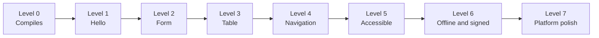

The command `feluqa profile status` prints the board:

```text
Profile   Label    Level  Next goal                         Evidence
Web       web      4/7    Level 5: accessibility audit      profiles/web/BADGE.md
Kde       native   2/7    Level 3: pull-based table         profiles/kde/BADGE.md
Android   native   0/7    Level 0: builds under Waydroid    -
Apple     native   -      Feasibility test not yet passed   -
Gnome     native   -      Not started                       -
Canvas    canvas   -      Not started                       -
```

Why this is good: progress is visible, failure is cheap and early, profiles can ship at different maturity without lying, and an agent has an exact target ("make level three pass on Kde"). Why it can fail: easy tests make fake progress. The rule against that is that the shared suite changes only by reviewed proposal, like the standard itself.

## 9.3 Profile one: Web

See Chapter 8. Target: level 4 within the first milestone, then level 5 and 6.

## 9.4 Profile two: KDE

KDE's applications are built with Qt, whose interface language is QML. Rust reaches Qt through cxx-qt, from the company KDAB, which lets Rust implement Qt objects that QML can use [R22].

What we verified about cxx-qt [R22]:

- It is maintained by KDAB, licensed under MIT or Apache-2.0.
- It supports QML; support for the older widget system (QWidgets) is limited.
- Its page states that it is in early development and that its API changes frequently.
- Version 0.8.1 appeared in February 2026; the repository was active in April 2026.
- It is tested on Linux, Windows, macOS and WebAssembly.

What we have not verified (Unverified): the exact state of Kirigami's Rust story, Qt's license terms for our distribution model (Qt is available under LGPL, GPL and commercial terms; the LGPL requires care when linking), and the packaging story on Debian.

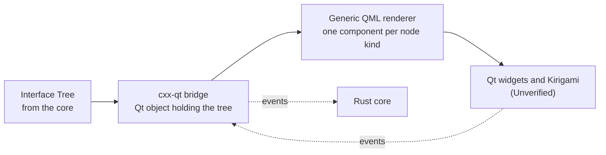

Plan: a Qt object exposes the current tree to QML; a small set of generic QML files renders each node kind with the platform's components; events return through the same object. No QML is written by applications.

| Pros | Cons |
|------|------|
| True native look on the desktop the maintainer uses. | cxx-qt is early; expect breaking changes. Isolate behind `feluqa::ui::render::kde`. |
| Same language for logic and bridge. | A C++ toolchain and Qt packages are required. |
| QML is declarative and suits a tree-driven renderer. | Qt cannot be vendored; it is a platform dependency (Chapter 10). |
| Runs on Linux, Windows and Mac, so the same renderer could serve more than KDE. | Whether the result looks native on the other platforms is a separate question. |

## 9.5 Profile three: Android, developed on Waydroid

**Setting up the machine.** Waydroid runs a full Android system in a container [R26]. On Debian it needs the Android binder kernel module, a Wayland session, and the container tools [R26][R27]. Installation: add the Waydroid repository, install the package, run `waydroid init`, start the container service [R26]. Binder device nodes sometimes need creating by hand [R26]. KDE Plasma supports Wayland sessions [R30]. On a minimal Debian system, users have reported missing dependencies [R28]; budget a day.

**Talking to it.** Android's debug bridge connects over the network (`adb connect <address>:5555`), and applications install through it or through Waydroid's own command [R27].

**Building for it.** The Rust core compiles for an Android target through the NDK; UniFFI's documentation lists `cargo-ndk` and a Gradle plugin for that purpose [R16]. Kotlin bindings are generated by UniFFI [R16]. The renderer is written in Compose: a generic file set that renders each node kind.

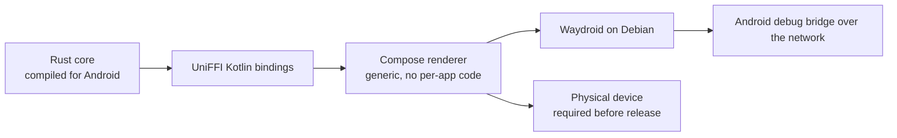

| Pros | Cons |
|------|------|
| Fast loop on the development machine; no phone cable. | Waydroid is not a physical device: graphics, sensors, power and vendor changes differ. |
| Compose is declarative, like SwiftUI, so renderers resemble each other. | Needs kernel and display-session support; installation issues occur [R28]. |
| UniFFI is mature enough to use in Firefox [R16]. | Android's runtime has a garbage collector: "no garbage collection" stops at the boundary. |
| Second platform will test whether the Interface Tree is genuinely cross-platform. | Gradle and NDK are heavier than Swift's package manager. |

**Rule:** before any release claim, the profile runs on at least one physical device (Directive 6).

## 9.6 Profile four: Apple, from Linux

### 9.6.1 Can Apple code have bridges?

Yes, through the C interface, not through SwiftUI.

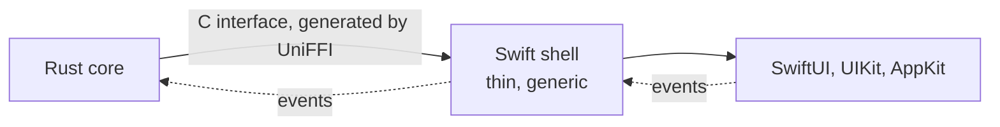

- Swift calls C directly; Rust exports C functions. So the boundary is easy and well trodden. A developer-forum post describes shipping a notarized Mac application that embeds a large Rust library as a static library behind a C header [R29].
- SwiftUI cannot be called from Rust: it has no stable C interface. A Swift layer always exists.
- Bridge generators: UniFFI [R16]; the type generation in Crux, which produces Swift, Kotlin and TypeScript types [R13]; plain C header generation with hand-written wrappers [R29].
- Rust can also call Apple's older Objective-C frameworks (AppKit, UIKit) directly through a Rust crate for the Objective-C runtime (Unverified). That route skips Swift but cannot reach SwiftUI, and it is not suitable for agents to maintain.

### 9.6.2 What xtool is, verified

- "Cross-platform Xcode replacement. Build and deploy iOS apps with SwiftPM on Linux, Windows, and macOS." [R1]
- Commands: `setup`, `auth`, `sdk`, `new`, `dev`, `ds`, `devices`, `install`, `uninstall`, `launch` [R1].
- It builds a Swift package into an iOS application, signs it, and installs it on a connected device; on a Mac, it can also use the iOS simulator [R2][R5].
- It builds its SDK from an Xcode archive that you download [R2][R3]. Release 1.20.0: Swift 6.4 support, SwiftUI macros, SDK size about three to about seven gigabytes, with a `--slim` option [R3].
- It is written in Swift: it replaces Xcode, not Swift [R1].

### 9.6.3 What xtool is not, or not known to be

| Question | Status |
|----------|--------|
| Does it replace Swift? | No. A Swift shell is still written. |
| Does it build Rust? | No. Rust is a separate step. |
| Does it build Mac (desktop) applications? | The documentation we found describes iOS. Unverified. |
| Does it upload to the App Store? | At launch it did not; the author suggested a final build on a Mac [R2]. Current state Unverified. |
| Debugging with a debugger on device? | Not available at launch [R2]. Current state Unverified. |
| Is it legal to use Xcode's SDK on non-Apple hardware? | A commentary argued it conflicts with Apple's license terms [R4]. We must read the license and, for a commercial product, obtain legal advice. |
| Bus factor? | It appears to be mostly one maintainer. Unverified. |

### 9.6.4 The pipeline and the unverified linchpin

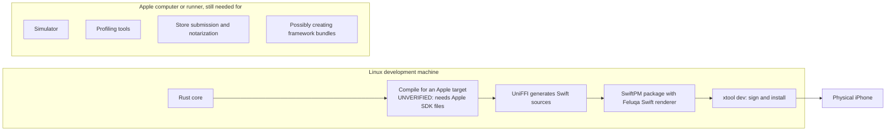

Step B is the linchpin: can the Rust compiler target Apple platforms from Linux, using the SDK that xtool builds? We do not know. It is the first Apple task (Chapter 14), and its outcome decides whether Directive 7's "from Linux" holds. If it fails, the standard becomes: Apple profile built on an Apple runner in continuous integration.

### 9.6.5 Liquid Glass and what "inherit the system look" means

- Liquid Glass comes with the iOS 26 SDK. Standard controls get most of it by recompiling with Xcode 26 [R20].
- Applications can also apply it by hand through SwiftUI's glass effect interfaces, guarded by an availability check for iOS 26, with the old look as fallback for earlier versions [R20][R21].
- Custom-drawn interface does not receive it automatically [R18][R19].
- Therefore the Apple renderer must be SwiftUI or UIKit or AppKit, built with a current SDK.

### 9.6.6 Apple options compared

| Option | Pros | Cons |
|--------|------|------|
| Swift shell with SwiftUI (via UniFFI) | Real Liquid Glass, accessibility, text-size settings, menus; large documentation; the new look arrives by recompiling. | Swift is mandatory on the framework side; some SwiftUI rough edges on Mac (Unverified); two build systems. |
| Swift shell with UIKit or AppKit | More control; mature. | More code; less of the new look for free; two frameworks for two devices. |
| Rust driving Objective-C frameworks directly | No Swift at run time. | Unsafe-heavy; thin documentation; cannot reach SwiftUI; new-look coverage Unverified; hard for agents. |
| Canvas library | One Rust codebase. | No Liquid Glass; weaker accessibility and input; not native. |
| Web view | Reuses the Web profile. | Not native; glass only imitated. |

**Decision:** Swift shell with SwiftUI, one generic renderer package, no per-application Swift.

## 9.7 Profile five: GNOME

GTK has Rust bindings for GTK itself and for GNOME's libadwaita library (Unverified; confirm current versions). The renderer is Rust-only, so it needs no language bridge. This makes it probably the cheapest native renderer after Web. It comes after Apple only because the maintainer's own machine is on KDE, and because the Linux desktop market is small. If a customer needs it sooner, it can move up the ladder.

| Pros | Cons |
|------|------|
| Same language as the core; no bridge. | Not what KDE users expect; looks foreign there. |
| Libadwaita has strong, consistent idioms (sidebar, toasts, dialogs). | The table widget differs from every other platform. |

## 9.8 Profile six: Canvas

For embedded devices, kiosks and tactical machines without a native toolkit, a self-drawing renderer is acceptable. Candidates: Slint, or a minimal renderer on Taffy for layout. It is labeled **canvas**, never native. It exists only when a real device target exists.

## 9.9 The order, in one picture

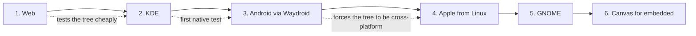

Web before native, because the tree is validated most cheaply by the easiest target. KDE next, because it is native and runs on the maintainer's machine. Android next, because Waydroid lets the same machine host it and because a second native platform exposes tree mistakes. Apple fourth, because its toolchain risk is the largest and must not block earlier progress.

---

# Chapter 10 The Namespace and the Internalization Standard

**Caveat:** this chapter is the part of the standard that answers the complaint "there are five thousand incomplete tools scattered everywhere". It is the part most likely to be misread as "copy everything into our repository". That is not what it says. Read section 10.3 before anything else.

## 10.1 The principle

A Feluqa user MUST be able to build any supported application while importing only from `feluqa::`. Every capability appears once, under one name, in one style, behind one set of guarantees. What lies underneath is Feluqa's business, not the user's.

## 10.2 The namespace map

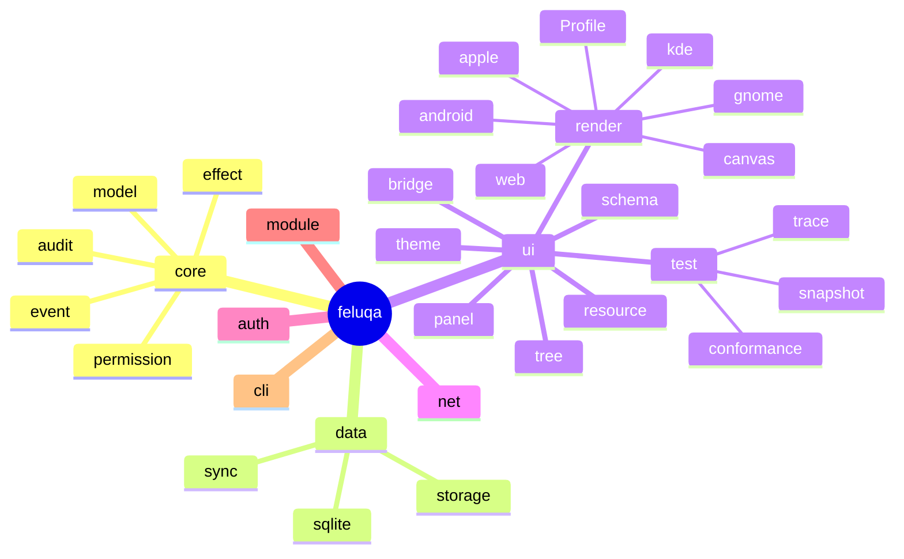

Reading the map: `feluqa::ui::tree::Node` is the Interface Tree; `feluqa::ui::schema::Form` and `Table` are the declarations; `feluqa::ui::render::Profile` is the enumeration of renderers; `feluqa::ui::render::web` is the Web profile; `feluqa::ui::test::conformance` is the shared ladder suite; `feluqa::ui::bridge` holds generated foreign-language glue and is not for direct use. A convenience module, `feluqa::ui::prelude`, re-exports the dozen names most screens need.

## 10.3 Three depths of internalization, and a fourth thing that cannot be internalized

| Depth | What it means | When to use it | Cost |
|-------|---------------|----------------|------|
| **Adopt** | A third-party crate is used behind a Feluqa facade, pinned to an exact version. No source copied. | The default. | Very low. Upstream fixes keep flowing. |
| **Vendor** | An exact, unmodified copy of the source or file is kept inside the Feluqa repository, with its license notice. | Small assets (the htmx and Alpine.js files); anything that must build with no network; anything whose disappearance would hurt. | Low, because nothing is modified. |
| **Fork** | A modified copy that Feluqa maintains from now on. | Upstream cannot or will not do what we need and the component is central to our promise. A named owner and a written reason are required. | High. A fork is a promise to maintain someone else's code. |
| **Wrap only** | A platform toolkit that cannot be copied: SwiftUI, UIKit, AppKit, Compose, Qt, GTK. | Always, for native profiles. | Medium: we document the supported version range and test against it. |

**The common error.** Teams that hate scattered tools often vendor and rename everything. The result is not one coherent platform but five thousand private forks. Our principle of one person plus agents cannot carry that. Hence: **internalize the name, the guarantees and the build; do not internalize the code unless there is a reason you can write down.**

## 10.4 Classification of what we have discussed

| Component | Depth | Facade namespace | Notes |
|-----------|-------|------------------|-------|
| htmx | Vendor | `feluqa::ui::web::assets` | Zero-clause BSD license [R25]. Pin exact version. |
| `alpine-morph` extension | Vendor | `feluqa::ui::web::assets` | Part of the htmx ecosystem [R23]. |
| Alpine.js core and morph plugin | Vendor | `feluqa::ui::web::assets` | MIT license (Unverified; confirm). |
| Maud | Adopt | `feluqa::ui::web` | Hidden behind the renderer. |
| maud-ui | Adopt, with option to vendor | `feluqa::ui::web::components` | Version 0.2.1 at time of reading [R9]. Early; watch. |
| Axum | Adopt | `feluqa::net` | Never exposed in public signatures. |
| cxx-qt | Adopt | `feluqa::ui::render::kde` | Early and fast-moving [R22]; do not vendor yet. |
| Qt | Wrap only | `feluqa::ui::render::kde` | Platform toolkit. |
| UniFFI | Adopt | `feluqa::ui::bridge` | Generated glue [R16]. |
| Compose, SwiftUI | Wrap only | profile renderers | Generic shell files, shipped with Feluqa. |
| GTK, libadwaita bindings | Adopt | `feluqa::ui::render::gnome` | Unverified details. |
| SQLite | Adopt | `feluqa::data::sqlite` | |
| Taffy, Slint | Adopt, only when Canvas starts | `feluqa::ui::render::canvas` | |
| Crux, mobiler, nsh | **Study only** | none | Ideas, not dependencies. |
| Xilem, Masonry, Vello | **Do not use** for native | none | Self-drawn [R10][R12]. |

## 10.5 The uniformity rules

The standard makes everything under `feluqa::` look as if one person wrote it.

**Rule U1. Naming.** Types use the full ordinary word (`TextInput`, not `TxtIn`). Builders start with `make`. Functions that can fail return the common result type. No abbreviations in public names unless they are listed in the definitions chapter of the current standard.

**Rule U2. One error type.** Every public function returns `feluqa::Result<T>`; errors carry a stable code, a human message and a "what to do" hint. Third-party error types never escape.

**Rule U3. No leaked types.** No public signature mentions a type from a third-party crate. A public function that accepts or returns one is a defect.

**Rule U4. One configuration style.** Configuration is a typed struct, loadable from one file format, validated at start-up, with every field documented.

**Rule U5. One way to test.** Every module ships with a headless test using `feluqa::ui::test`. Every screen has a snapshot.

**Rule U6. One way to document.** Every public item has a sentence of purpose, an example, and a status label (Implemented, Partial, Target or Exploring).

**Rule U7. One way to extend.** Extensions register through the module mechanism. Nothing is global and mutable.

**Rule U8. Stable names, replaceable insides.** A public name MUST NOT change meaning without a major version. What is underneath MAY change at any time.

**Rule U9. Feature flags, not forks of the code base.** Profiles and optional capabilities are enabled by features.

**Rule U10. Every dependency has an owner.** A named person, written down.

## 10.6 What "one namespace" costs

- **Pro:** users learn one vocabulary; Feluqa can swap underlying libraries without breaking anyone; the audit surface is one list; agents are far more reliable inside one consistent style.
- **Con:** a facade is work, and a bad facade hides useful features of the library beneath it. Mitigation: each facade documents an escape hatch to the underlying crate, marked as outside the stability promise.

---

# Chapter 11 Procedures: How to Internalize and Uniformize

**Caveat:** these are the procedures. Run them in order. Each has an exit condition. If you cannot meet it, stop and write down why.

## 11.1 Procedure A: admit a dependency

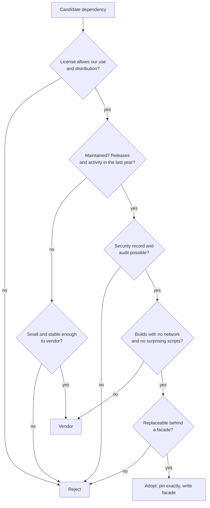

Write the answers in the admission record (Appendix B.1).

## 11.2 Procedure B: adopt behind a facade

1. Create the facade module in the right namespace (section 10.2).
2. Pin the dependency to an exact version in the build file.
3. Re-export only what Feluqa promises, under Feluqa names (Rule U3).
4. Wrap errors into the common error type (Rule U2).
5. Write a headless test for the facade (Rule U5).
6. Document purpose, example, status label (Rule U6).
7. Record owner and review date (Rule U10).
8. Run the interface-check tools to confirm that no third-party type leaks (a public-interface listing tool and a semantic-versioning check tool exist for Rust; confirm current names, Unverified).

Exit condition: a user can use the capability without ever naming the underlying crate.

## 11.3 Procedure C: vendor

1. Copy the exact released files, unmodified, into the vendor directory, in a folder named by version.
2. Keep the license text beside them.
3. Add the component to the generated third-party notice and to the software bill of materials.
4. Record the upstream address, version and checksum.
5. Add a note that says "do not edit; replace by updating the version".
6. Add a scheduled reminder to look for upstream releases and advisories.

For Rust crates, the standard tool for keeping an offline, reproducible copy is the built-in vendoring command of the package manager (Unverified; confirm). For files such as htmx and Alpine.js, copy the release artifact and verify its checksum against the upstream release.

Exit condition: the project builds with the network disabled, and every vendored item has a notice and a checksum.

## 11.4 Procedure D: fork

Forking is allowed only when all of these are true.

1. Upstream was asked and cannot or will not do it, or it is abandoned.
2. The component is central to a Feluqa promise.
3. A named owner exists with time allocated.
4. The change is kept as a small patch set against the vendored upstream wherever possible, so that rebasing remains cheap.
5. A plan exists to return the patches upstream or to retire the fork.

Exit condition: the fork's reason, owner and retirement plan are written in the dependency record.

## 11.5 Procedure E: wrap a platform toolkit

1. State the supported version range of the platform and the toolkit.
2. Write the generic renderer files (Swift, Kotlin, QML or Rust, depending on the profile) inside the profile's folder in the Feluqa repository.
3. Generate the bridge with the chosen generator and keep generated files out of hand-written folders.
4. Run the conformance ladder (section 9.2) and publish the badge.
5. Record in the profile's page what is native, what falls back, and what is unsupported.

Exit condition: the profile can state its label (native, web or canvas) and its conformance level truthfully.

## 11.6 Procedure F: add a new profile

1. Add one variant to the Profile enumeration and one feature flag.
2. Create the profile folder with the renderer skeleton, the build recipe and the conformance configuration.
3. Climb levels 0 to 2 before announcing anything.
4. Open a status page marked Exploring.
5. At level 3, move to Partial. At level 5, request review for Implemented.
6. Record the kill conditions for this profile (Chapter 12).

## 11.7 Procedure G: retire a component

1. Mark the facade as deprecated, with the replacement named.
2. Keep the facade for at least one major version.
3. Remove the dependency and its vendored files; update the notice and bill of materials.
4. Record the retirement in the dependency record.

## 11.8 Procedure H: uniformize existing code

For any existing scattered code or tools, bring them under the standard in this order.

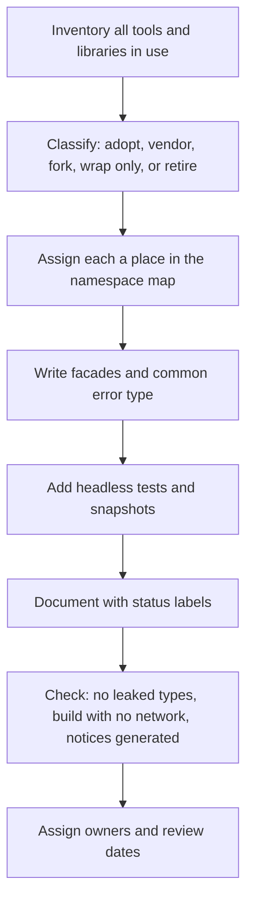

Do the inventory first. Without an inventory nobody knows the size of the scattering problem; with one, most of the "five thousand tools" turn out to be thirty.

## 11.9 Continuous checks

The continuous-integration pipeline MUST run, on every change:

1. a build with the network disabled;
2. a license check against the allowed list;
3. an advisory check for known vulnerabilities;
4. a check that no third-party types appear in public interfaces (Rule U3);
5. headless tests and snapshots for every enabled profile;
6. the conformance ladder for every enabled profile;
7. generation of the third-party notice and software bill of materials, failing if they differ from the committed copies.

Tools for items 2 and 3 and for supply-chain audit recording exist in the Rust ecosystem (a dependency policy checker and an audit recorder; confirm current names and capabilities, Unverified).

---

# Chapter 12 Risks, Hard Truths and Kill Conditions

**Caveat:** this chapter is written to be uncomfortable. A standard that cannot say how it might fail is advertising.

## 12.1 Hard truths

1. **The Interface Tree is the whole game.** If it is wrong, every renderer is wrong. The Web profile can hide this for a long time, because HTML can express almost anything, so the tree can grow "HTML-shaped" without anyone noticing. Mitigation: the KDE profile starts before the Web profile is finished, and every tree change is reviewed against SwiftUI and Compose idioms.
2. **You will write several widget libraries.** Each profile is, in effect, a small component library with accessibility, lists, navigation and forms. Do not pretend otherwise.
3. **Most native work is in tables and text input.** Pushing a stack of labels to the screen is easy. Ten thousand rows with sorting, and text composition for languages that need an input method editor, is where weeks go.
4. **cxx-qt describes itself as early with frequent API changes [R22].** The KDE profile will break on upgrades.
5. **UniFFI is not at version 1.0 [R16].** It is used in production at Mozilla, but advanced uses can break between versions.
6. **nsh is two weeks old [R6].** It must not be a dependency.
7. **xtool is a one-tool bet on a closed ecosystem.** It needs Apple's SDK [R2][R3], it was not able to upload to the store at launch [R2], and its legal standing is disputed [R4]. For a defense-adjacent product, that is a supply-chain risk that must be recorded.
8. **Waydroid is not a phone [R28].** Installation can be painful, and physical testing remains mandatory.
9. **"No garbage collection" is a claim about the core only.**
10. **Offline and server-driven contradict each other.** The interface description ships inside the binary; remote changes are an optional signed extra.
11. **One namespace is easy to say and hard to keep.** The facade tax is real. Rule U3 will be violated in the first month. The continuous check in section 11.9 exists for that reason.
12. **A vendored dependency that is never updated becomes a vulnerability.** The reminder in Procedure C is not decoration.

## 12.2 Kill conditions

Stop and rescope if any of these occurs.

| Milestone | Kill condition | What we do then |
|-----------|----------------|-----------------|
| Web profile | The `Mission` resource of section 7.3 takes more than about forty lines, or its tree snapshot is unstable between runs. | Redesign the declaration macros before building any native profile. |
| KDE profile | A ten-thousand-row table with sorting cannot be made to scroll smoothly, or typing in a field drops characters or loses the caret. | Reduce the node kind set for KDE and mark the table as fallback; reconsider cxx-qt versus a plain Qt and C++ shell. |
| Android profile | The same resource needs more than about ten percent of changes to the Interface Tree to render on Android. | The tree was wrong. Fix it before adding any further profile. |
| Apple feasibility | The Rust compiler cannot target Apple platforms from Linux using xtool's SDK. | Adopt "Apple profile built on an Apple runner in continuous integration", and stop promising Linux-only. |
| Apple legal | The license reading says SDK use on non-Apple hardware is not allowed for our purposes. | Use Apple hardware for Apple builds. No exceptions. |
| Overall | Maintaining renderers costs more than building per-application native shells on Crux. | Fall back to: Rust core, Filament-style Web panel, and hand-written native shells on the same core. Still a good product; not "one description everywhere". |
| Namespace | More than a small number of forks exist, or Rule U3 violations persist for a month. | Stop adding capabilities. Fix the facades. |

## 12.3 Fallback scope

If the dream shrinks, the following still holds value: a Rust core with a Filament-style Web panel, a headless test harness, the namespace and the internalization standard. All of these are independent of native renderers.

---

# Chapter 13 Example Panels

**Caveat:** in the tradition of good toolkits, the best way to understand this standard is to run small examples. These do not exist yet; they define what the first examples must demonstrate. Each is tied to a conformance level so that the examples double as tests.

| Example | What it shows | Ladder level |
|---------|---------------|--------------|
| `hello` | A title, a paragraph, and a button that reaches the core. Absolutely useless, but you must have one. | 1 |
| `form` | The `Mission` form: required fields, maximum length, an enumeration select, a date and time picker, validation messages. | 2 |
| `table` | A table of ten thousand missions: pull-based rows, sorting, a filter, row selection. | 3 |
| `confirm` | A destructive action with a confirmation, in each profile's own idiom. | 4 |
| `nav` | A sidebar with three resources and a detail view. | 4 |
| `a11y` | The same form operated only through a screen reader, with a written checklist. | 5 |
| `offline` | The panel running with the network disabled, loading a signed interface bundle; a tampered bundle is refused. | 6 |
| `custom` | A `Custom` node with a renderer registered for Web and a declared fallback elsewhere. | 2 or higher |
| `snapshot` | Every example above rendered headless to text, compared with committed snapshots. | all |

---

# Chapter 14 Road Map

**Caveat:** durations are estimates by a single person with agents. They are not promises. Each milestone has a kill condition from Chapter 12.

## 14.1 Schedule

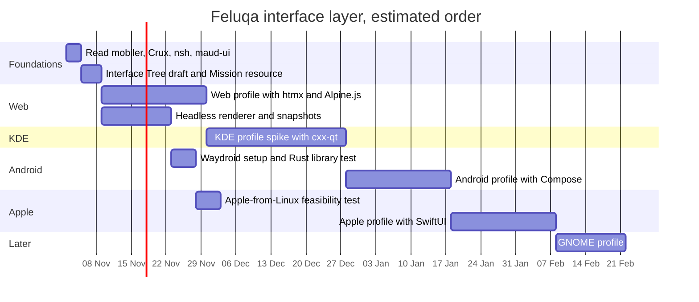

## 14.2 The Unverified list, turned into tasks

Every item marked Unverified in this document appears here. Nothing is to be depended upon until its task is complete.

| Task | Unverified claim | Outcome that matters |
|------|------------------|----------------------|
| T1 | The Rust compiler can target Apple platforms from Linux using xtool's SDK. | Decides whether "Apple from Linux" is true (section 9.6.4). |
| T2 | xtool can build Mac (desktop) applications. | Decides whether macOS needs a Mac from day one. |
| T3 | Current App Store upload and debugging state of xtool. | Decides the release pipeline. |
| T4 | Apple's license text on SDK use on non-Apple hardware. | Legal go or no-go for the pipeline; obtain advice if selling. |
| T5 | nsh uses a self-drawing library on macOS. | Confirms nsh gives no Liquid Glass on Mac. |
| T6 | Alpine.js license and its restricted build for strict browser policies. | Hardened-environment web profile. |
| T7 | htmx setting names that disable script evaluation in responses. | Hardened-environment web profile. |
| T8 | Kirigami usage from Rust through cxx-qt. | KDE renderer's component choice. |
| T9 | Qt license terms for our distribution model. | KDE distribution and packaging. |
| T10 | Rust target names for Android on Waydroid and on devices. | Android build recipe. |
| T11 | Rust bindings for GTK and libadwaita: current versions. | GNOME profile feasibility. |
| T12 | Robusta's real purpose. | Remove or keep from consideration. |
| T13 | Slint's exact memory claim and fit for Canvas. | Canvas profile choice. |
| T14 | mobiler's maintainers, activity and real applications. | Whether to study deeply or merely skim. |
| T15 | App Store requirement date for Xcode 26 builds. | Planning and wording. |
| T16 | Names and capabilities of dependency policy and audit tools. | Continuous checks in section 11.9. |
| T17 | Rust crate for the Objective-C runtime and its current coverage of the newest SDK. | Whether the direct route is worth a second look. |

## 14.3 What to do this week

1. Clone mobiler, Crux, nsh and maud-ui. Read each project's widget or node definitions and one renderer.
2. Write the first Interface Tree (about fifteen nodes) and the `Mission` resource.
3. Begin the Web profile: Maud, maud-ui, vendored htmx and Alpine.js.
4. Start tasks T1 and T4 in parallel, because they can stop Apple work entirely.

---

# Appendix A. Complete Rule List

**Directives (Chapter 2):** 1 Architecture; 2 Intent, not pixels; 3 One-way data flow; 4 Profiles enumeration and ladder; 5 htmx and Alpine.js shipped; 6 Android through Waydroid; 7 Apple through Swift, from Linux when proven; 8 Headless first; 9 One namespace; 10 Three depths; 11 Admission procedure; 12 Offline and signed; 13 Honest labels; 14 Agent-readable; 15 Written kill conditions.

**Uniformity rules (section 10.5):** U1 Naming; U2 One error type; U3 No leaked types; U4 One configuration style; U5 One way to test; U6 One way to document; U7 One way to extend; U8 Stable names, replaceable insides; U9 Feature flags, not forks; U10 Every dependency has an owner.

**Procedures (Chapter 11):** A Admit; B Adopt behind a facade; C Vendor; D Fork; E Wrap a platform toolkit; F Add a profile; G Retire; H Uniformize existing code.

---

# Appendix B. Acceptance Checklists

## B.1 Dependency admission record

- [ ] Name, version, upstream address
- [ ] License, and confirmation that it allows our use and distribution
- [ ] Maintenance: last release date, number of active maintainers
- [ ] Security record: known advisories, ability to audit
- [ ] Size and build cost
- [ ] Builds with no network and no surprising build scripts
- [ ] Replaceable behind a facade
- [ ] Depth chosen (adopt, vendor, fork, wrap only) and the reason
- [ ] Facade location in the namespace
- [ ] Owner and review date

## B.2 Profile release record

- [ ] Label stated truthfully (native, web or canvas)
- [ ] Conformance level reached, with evidence file
- [ ] Supported platform and toolkit version range
- [ ] List of node kinds: native, fallback, unsupported
- [ ] Physical-device test done (for mobile profiles)
- [ ] Kill conditions reviewed
- [ ] Third-party notice and software bill of materials regenerated

## B.3 Screen acceptance (applications)

- [ ] `feluqa check` passes for every enabled profile
- [ ] Headless snapshot exists and is reviewed
- [ ] Permissions declared and tested in the core
- [ ] No hard-coded colors, sizes or fonts

---

# References

References are numbered as they are cited in the text. All were opened and read on 1 November 2026 unless stated otherwise.

**[R1]** xtool: cross-platform Xcode replacement. https://github.com/xtool-org/xtool

**[R2]** Swift Forums: "Xtool: cross-platform Xcode replacement. Build iOS apps on Linux and more!" https://forums.swift.org/t/xtool-cross-platform-xcode-replacement-build-ios-apps-on-linux-and-more/79803

**[R3]** xtool release 1.20.0 notes. https://github.com/xtool-org/xtool/releases/tag/1.20.0

**[R4]** OSNews commentary on xtool and Apple's license terms. https://www.osnews.com/page/45/?not=apple

**[R5]** Thomas Ricouard, "Build an iOS app faster than ever with xtool". https://dimillian.medium.com/build-an-ios-app-faster-than-ever-with-xtool-d6dd7780c5f7

**[R6]** Native Shell (nsh) releases, versions 0.1.0, 0.1.1, 0.2.0 and 0.3.0. https://github.com/longbridge/nsh/releases

**[R7]** Native Shell (nsh) description, features, integrations and platform minimums. https://www.everydev.ai/tools/native-shell-nsh/llms.txt

**[R8]** Native Shell (nsh) architecture summary. https://deepwiki.com/longbridge/nsh

**[R9]** maud-ui, headless accessible components for Maud and htmx. https://docs.rs/crate/maud-ui/latest

**[R10]** Xilem and Masonry README. https://github.com/linebender/xilem/

**[R11]** Raph Levien, "Linebender in 2026 Q1", 19 April 2026. https://linebender.org/blog/tmil-25/

**[R12]** Vello README, alpha-state warning. https://docs.rs/crate/vello/0.7.0/source/README.md

**[R13]** Crux: cross-platform app development in Rust. https://github.com/redbadger/crux (architecture summary read through https://docsearch.algolia.com/mcp/docs/repo/redbadger/crux)

**[R14]** mobiler 0.46.0 README. https://docs.rs/crate/mobiler/0.46.0/source/README.md

**[R15]** mobiler 0.18.0 README, status "experimental". https://docs.rs/crate/mobiler/0.18.0/source/README.md

**[R16]** UniFFI, a multi-language bindings generator for Rust (Mozilla). https://github.com/mozilla/uniffi-rs

**[R17]** Dioxus 0.7 release notes. https://github.com/dioxuslabs/dioxus/releases/tag/v0.7.0-alpha.0

**[R18]** `glassy_ui_ios`, real SwiftUI and UIKit components with Liquid Glass inside Flutter. https://pub.dev/packages/glassy_ui_ios

**[R19]** Article on Flutter and Liquid Glass, August 2026 (in Japanese). https://www.issoh.co.jp/tech/details/16743/

**[R20]** "Migrating SwiftUI Apps to Liquid Glass with Codex CLI", May 2026. https://codex.danielvaughan.com/2026/05/13/codex-cli-liquid-glass-ios26-swiftui-migration-agent-skills-xcodebuildmcp/

**[R21]** Liquid Glass migration use case. https://developers.openai.com/codex/use-cases/ios-liquid-glass

**[R22]** cxx-qt: safe interop between Rust and Qt (KDAB). https://github.com/KDAB/cxx-qt

**[R23]** htmx `alpine-morph` extension. https://v1.htmx.org/extensions/alpine-morph/ and https://www.npmjs.com/package/htmx-ext-alpine-morph

**[R24]** htmx 4.0 (under construction) `hx-alpine-compat` extension. https://four.htmx.org/extensions/hx-alpine-compat

**[R25]** htmx extensions pages, license statement (Zero-Clause BSD). https://docs.w3cub.com/htmx/extensions/ and https://extensions.htmx.org

**[R26]** Installing Waydroid on Debian and Ubuntu. https://computingforgeeks.com/run-android-operating-system-on-linux-using-waydroid/

**[R27]** Waydroid in a container with remote debug bridge access and binder setup. https://hub.docker.com/r/tiwutdev/waydroid

**[R28]** Waydroid documentation issue: running on a minimal Debian installation. https://www.github.com/waydroid/docs/issues/70

**[R29]** Apple developer forums: distributing a Swift application that calls Rust through a static library. https://origin-devforums.apple.com/forums/profile/mwp/replies

**[R30]** Qubes forum thread noting Wayland support in KDE Plasma after version 5.21. https://forum.qubes-os.org/t/waydroid-on-qubes-lineageos-w-gapps/8450

## Background knowledge, not opened during this research

These shaped the text but were not checked on 1 November 2026. Treat every statement that depends on them as Unverified until confirmed.

- Filament (the PHP administration-panel framework) and Livewire: their documentation at their project sites.
- The Elm architecture: the guide on the Elm language site.
- Request for Comments 2119, "Key words for use in RFCs to Indicate Requirement Levels": https://www.rfc-editor.org/rfc/rfc2119
- Alpine.js, Axum, Maud, Kirigami, Taffy, Slint, GTK and libadwaita Rust bindings, and the Rust dependency tools mentioned in Chapter 11: their own project pages.
- The writing style of this document follows the introduction chapter of the OSKit manual from the University of Utah, as supplied by the author of this document. No address was available.
