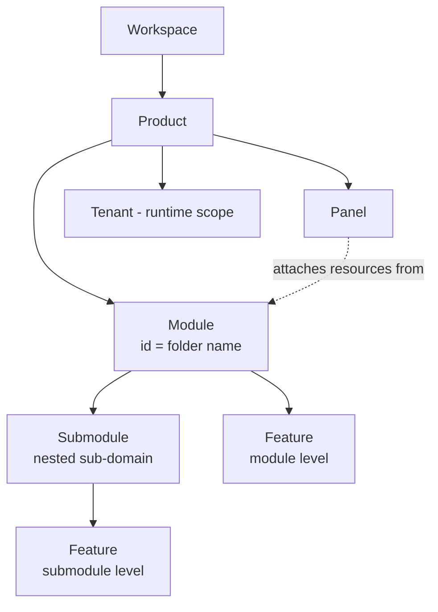

# Contexts: Module, Submodule and Feature

The scanner always knows **where a piece of code lives**. That location is its *context*. Code never repeats its context: inside the `sales` module you write `Refund`, not `sales.refund`.

## The context chain



| Context | Defined by | Scopes | Runtime toggle |
| --- | --- | --- | --- |
| **Product** | `feluqa.toml` marker | Which modules are assembled and deployed | Install / upgrade |
| **Module** | Folder `src/modules/<id>/` | Permissions, roles, storage path, config prefix, migrations | Enable / disable per product |
| **Submodule** | Folder `src/modules/<id>/submodules/<sub>/` | A sub-domain with its own resources and permissions, sharing the module's lifecycle | Follows its module |
| **Feature** | `#[feluqa::feature]` | A capability inside a module or submodule | Per license, per tenant, or per environment |
| **Panel** | `#[feluqa::panel]` | A web surface; resources attach themselves to it | Per product |
| **Tenant** | Runtime | Data and user isolation | Created and archived at runtime |

## Module

A module needs nothing: the folder `modules/sales/` is enough (id = `sales`, version = the one in `Cargo.toml`). A `module.rs` file exists only to declare dependencies.

```rust
feluqa::module! { requires = ["core >= 1"] }
```

Layout:

```text
src/modules/sales/
├── permissions.rs          # custom business permissions only
├── roles.rs                # optional: explicit roles
├── models/customer.rs
├── services/refunds.rs     # business logic + #[gate]
├── resources/customer.rs   # form + table + actions + policy
├── features/loyalty.rs     # optional features
└── submodules/
    └── invoicing/
        ├── permissions.rs
        ├── services/
        └── resources/invoice.rs
```

## Submodule

A submodule is a **sub-domain** that deserves its own permissions and resources but not its own lifecycle. It has the same internal layout as a module and:

- inherits the module's dependencies, storage root and configuration prefix;
- adds one segment to every name: `sales.invoicing.refund`;
- is installed, enabled, disabled and removed **with its module**;
- cannot be depended upon by another module directly; it exposes its API through its parent.

Use a submodule when two areas share data and lifecycle but need separate access control. Use a separate module when they could be installed independently.

## Feature

A feature is a **named, switchable capability** inside a module or submodule. Code is always compiled in; the feature decides whether it is *active*.

```rust
// src/modules/sales/features/loyalty.rs

/// Customer loyalty points and tiers.
/// Enabled only on licenses that include "loyalty".
#[feluqa::feature(id = "loyalty", default = false)]
pub struct Loyalty;
```

Gating by feature:

```rust
/// Grants loyalty points after a paid order.
#[feluqa::gate(require_feature = Loyalty, require_permission = GrantPoints)]
pub async fn grant_points(ctx: &Ctx, order: OrderId) -> Result<()> { /* ... */ }
```

Rules:

- A disabled feature hides its resources, navigation entries and routes (404, not 403), and its permissions disappear from role editors.
- Disabling a feature **never deletes data**. Data stays under the module's storage path until an explicit purge.
- Feature state is stored in SQLite and changed from the System panel or the CLI, never by editing TOML.
- A feature may depend on another feature of the same module: `#[feluqa::feature(id = "tiers", requires = ["loyalty"])]`.

## Name resolution

Names are built at compile time from the context chain.

| Written in code | Context | Full name |
| --- | --- | --- |
| `Refund` | module `sales` | `sales.refund` |
| `Refund` | submodule `sales/invoicing` | `sales.invoicing.refund` |
| `Customer` resource, `delete` | module `sales` | `sales.customers.delete` |
| `billing::Invoice` | any other module | `billing.invoice` |
| `platform::ManageModules` | anywhere | `platform.manage_modules` |

Argument resolution in `#[gate]` follows a fixed order and produces a compile error with a suggestion when nothing matches:

1. a capability of the enclosing resource (`view_any`, `delete`, ...);
2. a permission of the current submodule, then of the current module;
3. a permission of another module, with an explicit path;
4. a platform permission.

## Context-derived resources

The scanner derives the following from the context, so none are written by hand:

- storage directory: `<product-or-platform>/storage/modules/<module-id>[/<submodule>]`;
- configuration prefix and environment variable names: `SALES_...`, `SALES_INVOICING_...`;
- migration namespace;
- audit-log scope.

The platform loader confirms the module id at runtime; the scanner provides it at compile time. **They must match, otherwise the module is rejected.** A crate with no module owner is an error, never a guess.
