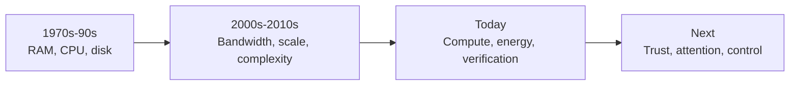
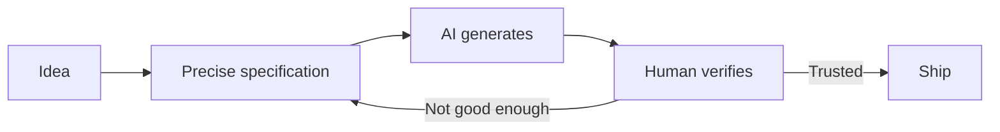

Limitations make innovation when necessity strikes. In the 70s, 80s, 90s ... RAM and even state of the art computers were themselves a huge limitation that generated good programmers that solved real problems (linux, stallman ...etc) even in the 2000 with people like Hotz etc

What are the limitations of our age with AI being here, and what are the limitations to come?

## The premise: constraint forces cleverness

Look at the history. The Apollo guidance computer flew to the Moon with about 4KB of RAM. Woz squeezed color graphics into the Apple II with a handful of chips. The famous fast inverse square root trick in the Quake III source code existed because floating-point math was too slow for real-time 3D. Linux booted on a 386 with 4MB of memory.

When memory is scarce, you have to understand the machine. That understanding is what produced the people and the software we still build on today.

AI does not remove limitations. It **shifts where they live**. The wall moved, and it is worth knowing where it is now, because that is where the next generation of useful work will happen.

## Limitations of now

**Compute and energy.** This is the new RAM. Training frontier models takes GPU clusters that cost billions, and inference at scale is bottlenecked by chips, memory bandwidth and power. Data centers are now constrained by grid capacity, not just money.

Still, the clever work happening here is real: quantization, distillation, mixture-of-experts, speculative decoding, and capable models running on a laptop or a phone. It is the same instinct as squeezing a game into 32KB. Projects like llama.cpp are direct descendants of that culture, and they carry the same hacker spirit as the Hotz generation.

**Context and memory.** Models forget everything between sessions and work within a finite context window. Building agents, retrieval systems and memory architectures is today's version of managing RAM by hand.

**Reliability and verification.** This may be the biggest one. AI can produce code, text and analysis faster than humans can check them. Generation is cheap, and trust is expensive. Whoever solves evaluation, testing and provenance will be doing what the early compiler writers did: building the layer everyone else depends on.

**Data.** High-quality human-written text is largely used up, and the web is increasingly polluted with AI-generated output. Synthetic data and model collapse are still open problems.

**Human skill atrophy.** This is the paradox for the thesis itself. When the machine writes the code, fewer people are forced to understand it. The 80s programmer learned the hardware because there was no choice. Today you can ship without understanding anything beneath you. The limitation becomes self-imposed: you have to *choose* depth.

## Limitations coming

**Energy and physical infrastructure.** Chips, power plants, cooling, rare materials. Progress may increasingly depend on atoms rather than bits.

**Trust and authenticity.** When anything can be faked (voice, video, text, identity), proving that something is real becomes a core problem. I expect real innovation in cryptographic provenance and verification.

**Attention and meaning.** When content is infinite and free, the scarce resources are human attention and the judgment about what is worth making. Taste becomes the bottleneck.

**Alignment and control.** As systems become more autonomous, the limitation is our ability to specify what we want and to confirm that the system actually does it.

**Institutions and law.** Regulation, liability and social adaptation move slower than technology, and they will gate deployment in medicine, finance and education.

## What it means for software

For people who build software, the scarce thing has flipped. Writing code is now cheap. The limitation is **understanding it, trusting it, and keeping it small enough to reason about.**

- **Complexity is the new constraint.** Adding code now costs almost nothing, so bloat accelerates. Being able to say "this should be 300 lines, not 30,000" becomes a rare skill.
- **Architecture pays off twice.** Models and humans both work best on modular code with clear boundaries and precise specifications. Systems designed in pieces small enough to verify are easier to build, review and maintain, whoever wrote them.
- **Verification and security are wide open.** AI-generated code ships bugs at scale, and agents with tool access bring prompt injection, permission sprawl and supply-chain risk. Testing, sandboxing and tools that answer "did this actually do what I asked?" are still underbuilt.
- **Dependency is the quiet limitation.** If a workflow depends on a single API provider, it inherits that provider's pricing, rate limits, policy changes and outages. Local-first software and open-weight models are the counter-movement.
- **Specification becomes the hard part.** Knowing precisely what you want is a skill most people lack, and it is now the main input to the whole process.

The expensive steps in this loop are the two humans steps: specifying and verifying. The generation in the middle is the cheap one.

## Where the thesis points

The next Stallman or Torvalds probably is not the person who builds a bigger model, since that takes capital only a few firms have. More likely, it is someone working on the constrained edges: tiny efficient models running locally, open tooling that keeps users in control, verification systems, or software people can actually understand.

The scarcity of compute for individuals, and the concentration of AI power in a few companies, is itself a limitation. Open-source culture has historically thrived against exactly that kind of limitation.

## What we take from this

A few principles guide how we think about building in this period:

1. **Go one layer deeper than you need to.** Understand how the runtime, the network, the database or the model inference actually works.
2. **Impose constraints on purpose.** A single binary, offline-capable, small enough to run on modest hardware. Artificial limits recreate the old pressure that produced good engineering.
3. **Build with AI, but read everything it writes.** Treat it as a fast junior colleague, not an oracle.
4. **Choose a domain you know better than any model's training data does.** Domain knowledge is the part that does not get commoditized.

The lesson from the 70s still holds: the people who change things are the ones who treat the wall as the starting point.
