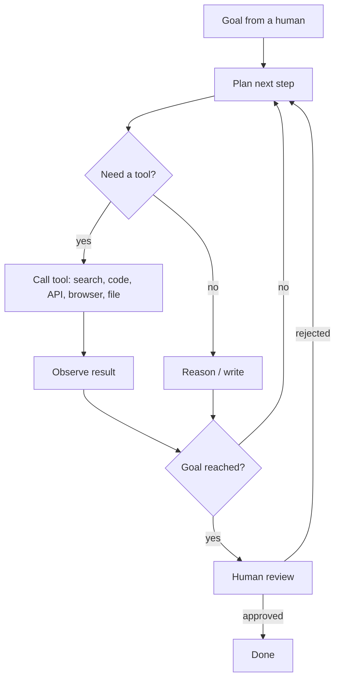
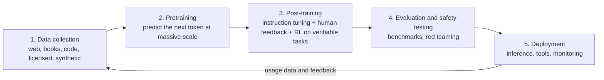
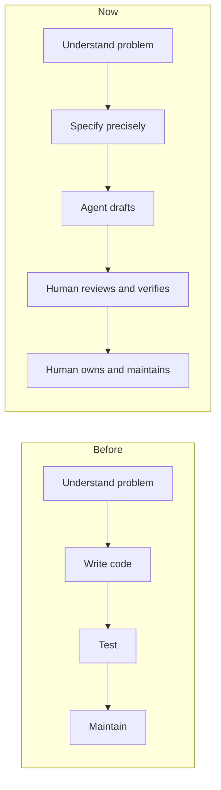
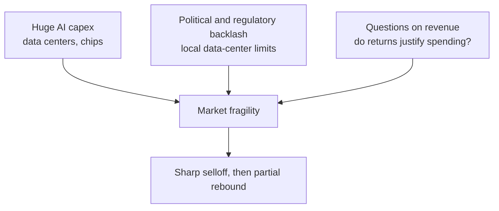
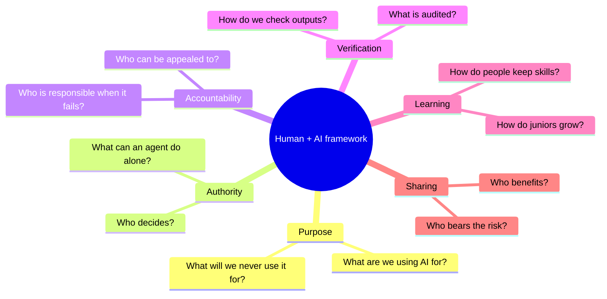
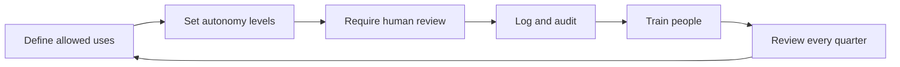

# Superintelligence or Just Generative AI? Agents, Training, and the Human Framework

> **Reading time:** about 20 minutes. **Last updated:** November 7, 2026.
> This article mixes explanation, live data and open questions. Figures about markets change by the hour; the embedded widgets below update on their own, the text does not.

---

## 1. Why this question matters this week

Two things happened at the same time, and they are connected.

First, AI systems got much more capable at doing *work*: writing software, composing music, drafting contracts, browsing the web and operating tools on our behalf. These systems are called **agents**.

Second, the money side shook. On Thursday, November 5, 2026, [Fortune reported](https://fortune.com/2026/11/06/tech-stock-selloff-nov-5-since-covid-nvidia-h200-china-imports/) the biggest tech selloff since Covid: the Nasdaq was down about 5% midday, chip stocks had their worst day since March 2020, and Nvidia fell around 8%. The trigger was not a technical failure. Investors feared that US midterm results, which included voter approval of measures curbing AI data-center construction, would slow the buildout. One analyst quoted by Fortune estimated that at least 10% of the 800 to 1,000 planned US AI data centers could vanish from the roadmap. A relief rally followed the next day ([Reuters via BNN Bloomberg](https://www.bnnbloomberg.ca/markets/dow-jones/2026/11/06/wall-street-stocks-in-relief-rally-after-heavy-ai-related-selloff/)).

So we are holding two ideas that seem to contradict each other:

- AI is doing things that looked impossible five years ago.
- The financial and political foundations under it are visibly unstable.

Both are true. This article tries to explain why, and what it means for people and for a company like Numerimondes.

### Live market snapshot

The widget below pulls real-time data. If your site blocks third-party scripts, replace it with a static screenshot and a date.

<div class="tradingview-widget-container">
  <div class="tradingview-widget-container__widget"></div>
  <script type="text/javascript" src="https://s3.tradingview.com/external-embedding/embed-widget-symbol-overview.js" async>
  {
    "symbols": [
      ["Nvidia", "NASDAQ:NVDA|1M"],
      ["Microsoft", "NASDAQ:MSFT|1M"],
      ["Alphabet", "NASDAQ:GOOGL|1M"],
      ["Nasdaq 100 ETF", "NASDAQ:QQQ|1M"]
    ],
    "chartOnly": false,
    "width": "100%",
    "height": 420,
    "locale": "en",
    "colorTheme": "light",
    "autosize": true,
    "showVolume": false,
    "dateRanges": ["1d|15", "1m|60", "3m|1D", "12m|1D"]
  }
  </script>
</div>

*This is context, not investment advice.*

---

## 2. Is it superintelligence, or "just" generative AI?

Let us first fix the vocabulary, because most debates fail at this step.

| Term | What it means | Where we are |
|---|---|---|
| **Narrow AI** | Excellent at one task (chess, spam filtering, translation) | Solved long ago |
| **Generative AI** | Produces new text, code, images, audio or video from learned patterns | Mainstream |
| **Agentic AI** | Generative models wrapped in a loop that plans, calls tools and acts | Early but real |
| **AGI** | Matches a skilled human across most cognitive tasks, reliably | Contested, not demonstrated |
| **Superintelligence** | Far exceeds the best humans in nearly all domains | Hypothetical |


### The honest answer: "jagged" intelligence

Current models can pass professional exams and write working code, yet fail at tasks a child finds easy, such as keeping a long plan consistent or knowing when they are wrong. Researchers describe this as *jagged* capability: very high peaks, surprising holes.

That makes both slogans misleading:

- **"It's just autocomplete"** undersells it. Training on enormous data plus reinforcement learning produces genuine problem-solving behavior, not only text prediction.
- **"It's superintelligent"** oversells it. Without a human setting goals, checking results and carrying responsibility, today's systems still break in ways that matter.

A useful working definition for decisions: **treat current AI as an extremely fast, tireless, uneven junior colleague with encyclopedic memory and no accountability.** That framing is practical, and it is what the rest of this article builds on.

> **Editor's note:** if you want a more provocative angle, add a short interview or quote from a practitioner here.

---

## 3. What exactly is an agent?

An **AI agent** is a language model placed inside a program that lets it *do* things, not just answer. The model is the reasoning engine. The agent is the model plus its environment.

### The core loop



### The parts

1. **Model**: the language model that reasons.
2. **Tools**: functions the model may call (web search, code execution, database queries, email, payments). Standards such as the Model Context Protocol (MCP) exist so tools can be plugged in consistently.
3. **Memory**: short-term (the context window) and long-term (files, databases, notes).
4. **Harness / orchestration**: the code that runs the loop, enforces limits, retries and logs.
5. **Guardrails and permissions**: what the agent may read, write, spend or send.
6. **Evaluation**: tests that tell you if it actually worked.

### Why agents impress

Agents can read a codebase, change many files, run tests, fix failures and open a pull request. They can chain research, drafting and formatting. For software and content, this is a real change in the cost of producing a first version.

### The limits that matter

| Limit | What it means in practice |
|---|---|
| **Compounding errors** | If each step is 95% reliable, a 20-step task succeeds only about 36% of the time (0.95²⁰). At 99% per step it is about 82%. Long tasks need checkpoints. |
| **Limited context** | Agents forget or confuse details in long sessions; memory systems help but add their own failure modes. |
| **Weak self-verification** | Models can confidently report success when the work is wrong. Independent tests are essential. |
| **Prompt injection** | Text in a web page, email or document can hijack an agent that treats all text as instructions. This is a security problem, not a bug that will disappear by itself. |
| **Cost and latency** | Many tool calls and long reasoning mean real compute bills. |
| **Real-world friction** | Logins, CAPTCHAs, ambiguous interfaces, missing permissions. |
| **No accountability** | The agent cannot be held responsible. A person or company must be. |

A concrete signal from this week: [Fortune reports](https://fortune.com/2026/11/06/tech-stock-selloff-nov-5-since-covid-nvidia-h200-china-imports/) that Visa sent 22 AI agents shopping for products like TVs and laptops, and they completed purchases only about half the time, at best two out of three. Buying things is, it turns out, a surprisingly human skill.

**Rule of thumb:** the more *reversible*, *checkable* and *low-stakes* a task is, the safer it is to delegate to an agent.

---

## 4. How models are created and trained

You do not need to be a researcher to understand the pipeline. It has five stages.



### Stage by stage

1. **Data.** Text, code, images, audio, and increasingly synthetic data generated by earlier models. Quality, licensing and filtering matter as much as volume. This is also where copyright and privacy disputes originate.
2. **Pretraining.** The model learns to predict the next piece of text (a *token*) across trillions of tokens. This takes thousands of specialized chips (GPUs or similar) for weeks or months, costing very large sums. It produces broad knowledge but not good behavior.
3. **Post-training.** The raw model is shaped into a useful assistant:
   - *Supervised fine-tuning* on examples of good answers.
   - *Reinforcement learning from human feedback (RLHF)*, where human preferences guide the model.
   - *Reinforcement learning on verifiable tasks* (math, code that passes tests), which teaches multi-step reasoning and is a major driver of recent agent progress.
4. **Evaluation and safety.** Benchmarks, adversarial testing, and checks for misuse. Benchmarks are imperfect: models can be tuned to them, and real work differs from tests.
5. **Deployment.** Serving the model (*inference*) is a large ongoing cost, often bigger over time than training. Models are then wrapped in products, tools and agents.

### Three economic facts that explain the news

- **Training and inference both need enormous compute**, which is why chipmakers and data-center builders are valued so highly.
- **Data centers need land, power and water**, which is why local politics now matters. Voters have started to say no.
- **Smaller, cheaper models are improving fast** through techniques like distillation, which pressures the pricing of the biggest ones.

---

## 5. Software, music, everything: what is left for humans?

Agents can generate software, songs, images and documents. So why would anyone still learn to program?

### What is changing

The bottleneck is moving from **producing** code to **specifying, reviewing and owning** it.



### Why learning to program still matters

1. **You cannot review what you cannot read.** If an agent writes 2,000 lines, someone must judge whether they are correct, secure and maintainable. That requires understanding.
2. **Specification is the hard part.** Most software failures come from unclear requirements, not typing errors. Programming trains precise thinking about edge cases, state and failure.
3. **Debugging when the AI is stuck.** Agents loop, hallucinate APIs and misdiagnose. People who understand the system get unstuck; others cannot even describe the problem.
4. **Security and accountability.** Injected prompts, leaked secrets and licensing risks are on the human who shipped it.
5. **Taste.** Architecture, naming, simplicity, tradeoffs. These are judgment skills built through practice.

### The uncomfortable problem: the missing apprenticeship

Junior tasks (small fixes, boilerplate, first drafts) are exactly what agents do best. These were also how beginners learned. If companies stop hiring juniors, where do future seniors come from?

Possible answers, none proven:

- Teach **reading and reviewing code first**, writing second.
- Use AI as a **tutor that asks questions** rather than a machine that gives answers.
- Build **deliberate practice without AI** (like athletes training without equipment) before using it as a multiplier.
- Create **apprenticeship roles** that pair juniors with agents and mentors, paid for the learning, not only the output.

### Same logic for music, design, writing

Generation is cheap; **direction, curation and meaning** are scarce. A song made in seconds still needs someone who knows why it should exist, for whom, and whether it is good. The value shifts toward taste, originality, trust and lived experience.

---

## 6. What the recent fall in AI stocks actually signals

Headlines say "bubble". The reality is more specific. Based on the reporting above, three separate pressures collided:



- **Capex vs. returns.** Investors keep asking whether AI revenue will justify the hundreds of billions spent on infrastructure.
- **Politics.** Data centers are physical, local and visible. Power prices, water use and zoning decisions turn AI into a voting issue. A Meta executive told an industry conference that hyperscalers are now considering building outside the United States to hedge, as [Fortune quoted](https://fortune.com/2026/11/06/tech-stock-selloff-nov-5-since-covid-nvidia-h200-china-imports/).
- **Supply chain and geopolitics.** Fortune also reports around 600,000 Nvidia H200 chips waiting in Hong Kong while Beijing withholds large-scale import approval.
- **Private valuations.** Per [Coingape](https://coingape.com/anthropic-ipo-valuation-talks-fall-to-1-2t-after-ai-stock-selloff/), investors discussing a possible Anthropic IPO were talking about valuations as low as $1.2 trillion after the selloff. Treat this as market talk, not confirmed fact.

### Important distinction

**A market correction is not proof that the technology failed.** The dot-com crash in 2000 destroyed many valuations, yet the internet became more important afterward. Equally, a rebound is not proof the technology is safe or well governed. Stock prices measure expectations, not truth.

> **Editor's note:** Nvidia reports earnings on November 17, according to one market blog. Verify the date before publishing and consider adding an update note afterward.

---

## 7. "A framework for AI and humans": what does that actually mean?

The phrase is used constantly and defined rarely. Here is a concrete version.

A **framework for humans and AI** is a set of explicit, written answers to six questions:



### Autonomy levels (a practical scale)

| Level | Description | Example | Human role |
|---|---|---|---|
| **0** | No AI | Manual work | Does everything |
| **1** | Suggests | Autocomplete, drafting | Decides and edits |
| **2** | Acts on request, step by step | "Refactor this file" | Reviews each output |
| **3** | Acts autonomously within limits | Agent opens a pull request | Reviews before it ships |
| **4** | Acts autonomously, reports after | Agent handles routine tickets | Audits samples, handles exceptions |
| **5** | Acts with no oversight | Self-directed systems | Absent |

Most companies should operate at **levels 2 to 3** for important work and **level 4** only for reversible, low-stakes tasks. Level 5 should be rare and heavily justified.

### Why "now" is the time

Frameworks are easiest to build **before** habits, contracts and dependencies harden. Right now:

- Tools are good enough to matter and imperfect enough to need rules.
- Regulation is moving (and, as the midterms showed, public opinion is moving faster than regulators).
- Markets are reminding everyone that the story can change quickly.

Waiting means the framework gets written by accident, by whoever shipped first.

---

## 8. The questions everyone forgets to answer

### For society

1. **Who owns the gains?** If AI raises productivity, how are the gains shared among workers, owners, creators whose work trained the models, and the public?
2. **Who pays for the infrastructure?** Data centers consume power and water. Who bears the cost on local grids and communities?
3. **What happens to the entry-level job?** If the first rung of the career ladder disappears, how do people enter professions?
4. **Who is accountable when an agent causes harm?** The user, the developer, the model provider, the deployer?
5. **How do we protect truth and trust?** What happens to evidence when anything can be fabricated convincingly?
6. **What about creators?** How are artists, writers, musicians and developers credited and compensated?
7. **Who has access?** Will AI reduce inequality between countries and regions, or widen it? What does it mean for Morocco, Africa and the Arabic-speaking world, where languages and contexts are underrepresented in training data?
8. **How concentrated is power?** A few firms control chips, models and platforms. What are the dependency risks?
9. **What do we deliberately refuse to automate?** Some decisions (justice, care, grief, education of children) may deserve a human by principle, not by technical limitation.
10. **What is our plan if the bubble deflates?** Public budgets, pensions and local economies are increasingly tied to AI valuations.

### For a company like Numerimondes

1. **Where do we use AI, and at what autonomy level?** Is it written down?
2. **What is our data policy?** What may enter a third-party model? What stays local?
3. **How do we verify AI output** before a client sees it? Who signs off?
4. **How do we train our juniors** so they become seniors, not prompt operators?
5. **What do we promise clients** about AI use, and do we disclose it?
6. **What is our dependency risk?** If a provider changes price, terms or availability, what breaks?
7. **How do we measure real value** (time saved, quality, errors, rework) instead of hype?
8. **What is our incident plan?** If an agent leaks data or ships a bug, who responds in the first hour?
9. **What are our red lines?** Tasks we will not automate, content we will not generate, clients we will not serve.
10. **How do we handle language and culture?** Arabic, Darija, Amazigh and French contexts need testing, not assumptions.
11. **How do our policies on cookies, privacy and browser storage fit in?** Trust is built through concrete practices. See our guide on [managing cookies and browser storage](/policies/manage-cookies).

---

## 9. A starter charter for Numerimondes (to adapt)



**First 30 days**
- Inventory every AI tool already used (including unofficial ones).
- Classify data: public, internal, client-confidential, regulated.
- Publish a one-page internal rule: what is allowed, what needs approval, what is forbidden.

**Days 30 to 60**
- Choose two or three workflows for agent pilots at level 2 or 3.
- Define success metrics and a rollback plan before starting.
- Start a "review first" training track for junior staff.

**Days 60 to 90**
- Review incidents, costs and quality.
- Publish a short public statement on how Numerimondes uses AI.
- Schedule a quarterly review, because the technology and the regulation will both change.

---

## 10. What to watch next

- Nvidia's next earnings and whether data-center spending guidance changes.
- How states and local governments implement the new limits on data-center construction.
- Whether agent reliability improves enough for level 4 autonomy in more domains.
- Whether junior hiring recovers or continues to shrink.
- Real revenue growth at AI providers versus infrastructure spending.

### Voices to embed

Replace the placeholders below with real, current posts (open the post on X, click "Embed post", paste the generated code). Keep the `<script>` once at the end.

```html
<!-- EXAMPLE TEMPLATE: replace USERNAME and STATUS_ID -->
<blockquote class="twitter-tweet" data-dnt="true" data-lang="en">
  <p lang="en" dir="ltr">Post text appears here</p>
  &mdash; Name (@USERNAME)
  <a href="https://twitter.com/USERNAME/status/STATUS_ID">Date</a>
</blockquote>
```

<!-- TWEET 1: an AI researcher on agent reliability -->
<!-- TWEET 2: a developer on learning to code with AI -->
<!-- TWEET 3: an analyst on the data-center backlash -->

<script async src="https://platform.twitter.com/widgets.js" charset="utf-8"></script>

---

## Conclusion

AI today is neither a magic superintelligence nor a harmless toy. It is a powerful, uneven, expensive technology moving faster than our institutions, and, as this week showed, faster than the economics and politics that support it.

The practical question is no longer "will AI replace humans?" but:

> **Who decides, who checks, who is accountable, and who benefits?**

Companies and societies that answer those four questions explicitly, in writing, before the next crisis, will be in a much better position than those who answer them by accident.

---

## Sources and further reading

- Fortune Tech, ["Why tech stocks suffered their biggest selloff in years"](https://fortune.com/2026/11/06/tech-stock-selloff-nov-5-since-covid-nvidia-h200-china-imports/), November 6, 2026.
- Reuters via BNN Bloomberg, ["Wall Street stocks in relief rally after heavy AI-related selloff"](https://www.bnnbloomberg.ca/markets/dow-jones/2026/11/06/wall-street-stocks-in-relief-rally-after-heavy-ai-related-selloff/), November 6, 2026.
- The Guardian via AOL, ["US tech stocks recover after selloff spooks investors over AI spending"](https://www.aol.co.uk/articles/us-tech-stocks-recover-selloff-221845000.html), November 3, 2026.
- Coingape, ["Anthropic IPO valuation talks fall to $1.2T after AI stock selloff"](https://coingape.com/anthropic-ipo-valuation-talks-fall-to-1-2t-after-ai-stock-selloff/), November 2026 (market talk, unconfirmed).

*Some market blogs surfaced during research gave figures that differ from each other (for example, the size of the Nasdaq's one-day drop). Verify every number against a primary source or a financial data terminal before publishing.*
