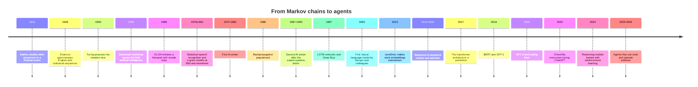
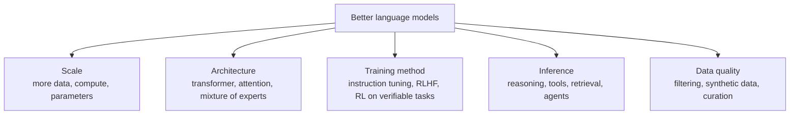
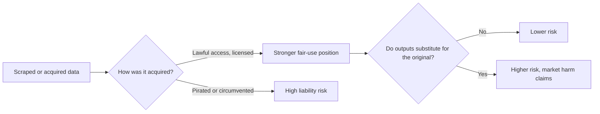
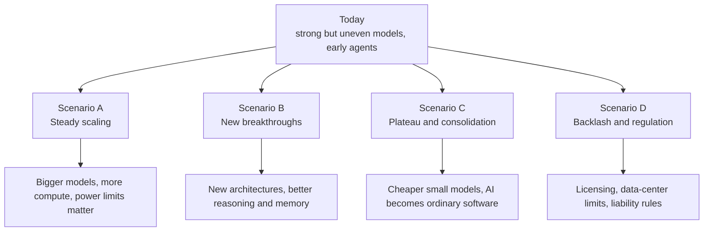

# A History of Language Models and AI, and Where They Go Next

> **Reading time:** about 15 minutes. **Last updated:** November 7, 2026.

## 1. The claim that started this article

A commenter recently said, roughly, that language models have existed since the 1970s, that companies like OpenAI are rewriting history to flatter themselves, that LLMs do not really "get better" but only "get more data", that the fundamental technology has barely changed, and that the industry is built on breaking laws to assemble training sets.

It is a strong claim, and it mixes four different statements. Some are right, some are wrong, and some are still being decided in court. Let us separate them.

| Statement | Verdict |
|---|---|
| Language models are much older than OpenAI | **True.** |
| One company should not own the story of the field | **Largely fair.** Many labs and decades of research are behind it. |
| LLMs only improve by adding data, and the technology has not changed | **Misleading.** Data and scale matter a lot, but architecture and training methods changed too. |
| The industry rests on law-breaking | **Contested.** Some conduct has been punished or settled; the main legal question is still open. |

The rest of this article explains why.

---

## 2. What is a language model?

A **language model** assigns probabilities to sequences of words. Given "the cat sat on the", it estimates how likely "mat" is compared with "moon". Everything from autocomplete to ChatGPT is a descendant of that simple idea.

Two ideas are worth keeping in mind:

- A language model is a **method**, not a brand. It can be counted, statistical, neural, small or enormous.
- "Getting better" can come from **more data**, **more compute**, **better architecture**, **better training objectives**, or **better use at inference time**. These are different levers.

---

## 3. A timeline



### Era 1: Rules and symbols (1950s to 1980s)

Early AI tried to write intelligence by hand: logic, grammar rules, expert systems. ELIZA (1966) looked conversational but was a pattern matcher. These systems were brittle. When funding disappointed, the field entered its first "winter".

### Era 2: Statistics (1970s to 2000s)

Here the commenter is right. Statistical language models, especially **n-gram models**, were used in speech recognition and translation from the 1970s and 1980s onward, and Claude Shannon had already approximated English statistically in 1948. These models counted how often word sequences appeared and predicted the next word. They worked, but they could only look a few words back and had no understanding of meaning.

### Era 3: Neural networks and embeddings (2000s to 2016)

Neural language models (Bengio and colleagues, 2003) represented words as vectors, so "king" and "queen" could be close together. Word2vec (2013) popularized this. Recurrent networks and LSTMs could remember longer sequences, but they were slow to train and struggled with long context. This is a genuine change of method, not just more data.

### Era 4: Attention and transformers (2017 to 2021)

In 2017, researchers at Google published the transformer. It replaced step-by-step recurrence with **attention**, which lets every word look at every other word at once. This made training massively parallel and scalable on GPUs. BERT and GPT followed in 2018, and GPT-3 (2020) showed that a very large model could perform new tasks from a few examples. OpenAI was an important player here, but the transformer itself came from Google researchers and rested on decades of work from many labs and universities.

### Era 5: Assistants and reasoning (2022 to 2024)

A raw model trained to predict text is not a helpful assistant. The leap to ChatGPT in late 2022 came largely from **post-training**: instruction tuning and reinforcement learning from human feedback. In 2024, labs added **reinforcement learning on verifiable tasks** such as math and code, producing models that "think" through steps before answering.

### Era 6: Agents (2025 onward)

Models were wrapped in loops that call tools, browse, write and run code. By early 2026, announcements of agent products were already moving stock prices; one market report linked a heavy selloff in software stocks to the release of Anthropic's Cowork agent platform. Whether that reaction was rational is debatable, but it shows how seriously markets take the shift.

---

## 4. Does "only more data" explain progress?

Scale is real. Researchers documented **scaling laws**: loss falls predictably as you add parameters, data and compute. The Chinchilla result (2022) showed that many models had been too large for their data, which means the *balance* matters, not just size.

But "the technology has not changed" ignores several breakthroughs:



A fair way to put it: **the core idea (predict the next token from past context) is old; the machinery around it changed enormously.** Compare it to the car. Four wheels and an engine are old ideas, yet nobody would say a modern car is "just a horse cart with more horsepower".

There is also a legitimate criticism hiding in the commenter's point. Much of the recent jump came from scale and capital, which concentrates the field in a handful of rich companies. That is a real structural issue, even though it is not the whole story.

---

## 5. The legal fight over training data

This is the part where careful wording matters.

**What is established**
- There are many lawsuits. A May 2026 legal-news summary counted [over 50 AI copyright cases pending in US courts](https://www.pulse.bot/legal/news/ai-copyright-litigation-continues-as-nvidia-training-data-case-moves-forward-b32399c2-6004-4051-9846-c9643c180257/), and a [Lawfare piece](https://www.lawfaremedia.org/article/don-t-count-on-courts-to-rein-in-unregulated-ai) cited a count of 105 copyright suits against AI companies.
- In 2025, two US rulings (involving Meta and Anthropic) suggested that **training on copyrighted works can be fair use**, but with important caveats.
- How the data was **acquired** matters. Legal commentators note that [liability may arise from how data is obtained and stored, such as pirated copies, even if training itself is lawful](https://www.pymnts.com/?p=3613558). Anthropic settled the *Bartz* authors' case for a reported $1.5 billion, the largest AI copyright settlement so far.
- Some music disputes ended in deals: Warner Music resolved its suits against Suno and Udio and planned joint platforms, as [Reuters reported](https://www.pymnts.com/cpi-posts/us-courts-poised-to-shape-the-future-of-ai-copyright-battles-in-2026/).

**What is not established**
- No court has delivered a sweeping, final answer on whether training LLMs on copyrighted material is lawful. One legal review says [no sweeping final rulings had emerged and key decisions are expected in 2026 or later on appeal](https://wiki.ubc.ca/AI_Copyright_Lawsuits).
- Courts are split, and rules differ between the US, the EU and other regions.

So "criminal enterprise" is a moral and rhetorical verdict, not a legal finding about the whole industry. But "nothing to see here" is equally wrong: several companies have paid or settled, and the sourcing of data is now a central issue.



**Questions the public debate often skips**
- Do creators get paid, and how, if their work shaped the model?
- Should there be an opt-out, an opt-in, or a collective licence?
- What about countries where the law is unclear, such as Morocco, and where local languages are barely represented in the data?

---

## 6. Where might it go next?

Nobody knows. Honest futurism offers scenarios, not predictions.



- **A. Steady scaling.** Capabilities keep rising with investment. The limits become electricity, chips and money. Recent market turbulence tied to data-center politics shows these limits are no longer theoretical.
- **B. New breakthroughs.** Progress comes from ideas rather than size: better memory, planning, learning from fewer examples, models that update continuously.
- **C. Plateau and commoditization.** Frontier gains slow; small, cheap, local models become good enough for most uses, much like databases or web servers.
- **D. Backlash and regulation.** Courts, parliaments and voters reshape the field through copyright rules, energy rules and liability.

The most probable future is a **mixture**: some capabilities jump, some stall, and law and politics matter as much as research.

### Questions that will matter

1. Can models learn efficiently, or will they always need most of the world's text?
2. Can agents be made reliable enough to trust with long tasks?
3. Who will own the data, the compute and the distribution?
4. Will smaller, open and local models keep the field open?
5. How will we verify what is real in a world of cheap synthetic content?
6. What human skills should education protect on purpose?

---

## 7. What this means for Numerimondes

- **Be precise about history.** Avoid the "AI was born in 2022" story. It is inaccurate and weakens credibility.
- **Know the lineage of your tools.** Understand whether a model is statistical, neural, or agentic, and what that implies for reliability.
- **Ask about data provenance** when choosing vendors, especially for client work.
- **Plan for several futures.** Do not build a business on one provider or one scenario.
- **Write down your position** on AI use, copyright and transparency. See also our article on the human and AI framework.

---

## 8. Voices to embed

Replace these placeholders with real posts from researchers, authors, and analysts (on X, choose "Embed post" and paste the code).

<!-- TWEET 1: a researcher on the history of language models -->
<!-- TWEET 2: an author or artist on training data and consent -->
<!-- TWEET 3: an engineer on what changed technically since 2017 -->

```html
<blockquote class="twitter-tweet" data-dnt="true" data-lang="en">
  <p lang="en" dir="ltr">Post text appears here</p>
  &mdash; Name (@USERNAME)
  <a href="https://twitter.com/USERNAME/status/STATUS_ID">Date</a>
</blockquote>
<script async src="https://platform.twitter.com/widgets.js" charset="utf-8"></script>
```

---

## Conclusion

Language models did not begin with ChatGPT, and anyone who says so is telling a marketing story. But "nothing fundamental has changed" is also a story: attention, scale, reinforcement learning and agents are real changes layered on a very old idea. And the question of whether the data behind them was fairly obtained is serious, unresolved, and too important to settle with slogans in either direction.

The best response is neither worship nor contempt. It is to know the history, follow the evidence and ask who benefits.

---

## Sources and further reading

- Legal overview, ["AI Copyright Lawsuits"](https://wiki.ubc.ca/AI_Copyright_Lawsuits) (University of British Columbia wiki).
- JD Supra, ["AI Copyright Litigation Continues as NVIDIA Training Data Case Moves Forward"](https://www.pulse.bot/legal/news/ai-copyright-litigation-continues-as-nvidia-training-data-case-moves-forward-b32399c2-6004-4051-9846-c9643c180257/), May 2026.
- Lawfare, ["Don't Count on Courts to Rein in Unregulated AI"](https://www.lawfaremedia.org/article/don-t-count-on-courts-to-rein-in-unregulated-ai).
- PYMNTS, ["US Courts Poised to Shape the Future of AI Copyright Battles in 2026"](https://www.pymnts.com/cpi-posts/us-courts-poised-to-shape-the-future-of-ai-copyright-battles-in-2026/), January 2026.
- Historical milestones (Shannon 1948, Dartmouth 1956, Bengio et al. 2003, Vaswani et al. 2017, Hoffmann et al. 2022): add primary-paper links before publishing.

*Legal status changes quickly. Verify every case against court records or a reputable legal tracker before publication, and consider asking a lawyer to review the section on copyright. Several low-quality aggregator sites found during research contradicted each other on case outcomes, so they were not used.*
