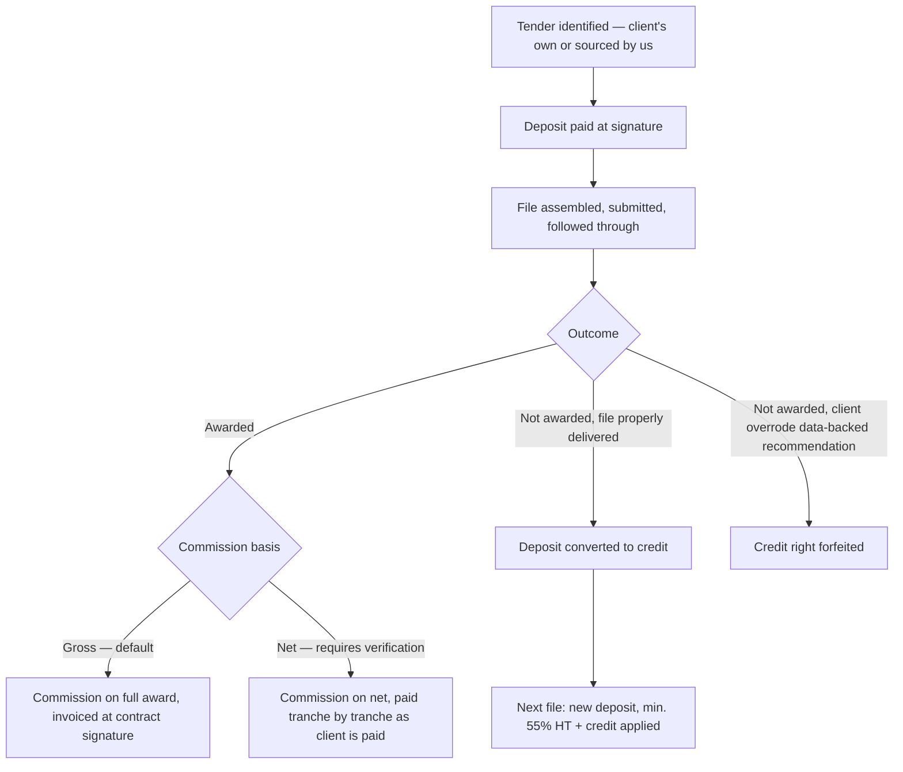

    
    Tender Support · Deal Structuring
    <h1 class="nm-headline">We become part of the tender the same way you do.</h1>
    

        When you win a tender, you become a supplier to whoever awarded it — and they will ask you
        for a guarantee (caution) before they trust you with the contract. We ask for the same kind
        of commitment before we put our own work into your file: a fixed deposit, then a commission
        tied to whether you actually win.
    

## Where this service starts and stops

    

        <NmCard compact="true" icon="heroicon-o-check-circle" color="success">
            <template #heading>Deal Structuring includes</template>
            <template #description>
                Sourcing a tender if you don't already have one, file assembly (administrative, financial, technical coordination), submission, and follow-up through award notification.
            </template>
        </NmCard>
    

    

        <NmCard compact="true" icon="heroicon-o-x-circle" color="danger">
            <template #heading>Deal Structuring does not include</template>
            <template #description>
                Producing the technical narrative or dossier itself — that is <a href="/services/tender-support/narrative-assembly">Narrative & Assembly</a>, scoped and priced separately when a file needs it. Delivering the awarded contract itself.
            </template>
        </NmCard>
    

## How a mission starts

    

        <NmCard compact="true" icon="heroicon-o-document-magnifying-glass" color="primary">
            <template #heading>You already have a tender</template>
            <template #description>
                Share the tender documents. We assess fit, confirm the deposit, and start work once the mission letter is signed.
            </template>
        </NmCard>
    

    

        <NmCard compact="true" icon="heroicon-o-light-bulb" color="info">
            <template #heading>You don't have one yet</template>
            <template #description>
                We source relevant opportunities and bring you an executive summary of each one. You decide which, if any, is worth pursuing before any deposit is due.
            </template>
        </NmCard>
    

Sourcing itself carries no cost until you choose to move forward on a specific opportunity — you are never billed for a tender you decide to pass on.

## The deposit — fixed, and non-negotiable by design

The deposit is not a discount lever. It is the fixed cost of assembling a serious file, and it works the same way a bid bond or performance guarantee works for you with your own client: you don't get to negotiate away the guarantee your buyer asks for, and we don't discount the deposit that lets us commit real work to your file before knowing the outcome.

    

        <NmCard compact="true" icon="heroicon-o-lock-closed" color="primary">
            <template #heading>Fixed at signature</template>
            <template #description>
                Sized to the scale and complexity of the tender — a small purchase order costs less to assemble than a multi-year infrastructure contract. Confirmed in writing before work starts, never renegotiated mid-file.
            </template>
        </NmCard>
    

    

        <NmCard compact="true" icon="heroicon-o-cube" color="warning">
            <template #heading>Extras priced separately</template>
            <template #description>
                Anything beyond the standard administrative and financial assembly — 3D representation, CAD drawings, specialist technical drafting — is quoted as an addition, not folded silently into the base deposit.
            </template>
        </NmCard>
    

## The commission — net or gross, agreed before signature

Once a tender is won, our commission is calculated one of two ways. Which one applies is stated explicitly in your mission letter — never assumed, never switched after the fact.

    

        <NmCard compact="true" icon="heroicon-o-banknotes" color="success">
            <template #heading>Gross — the default</template>
            <template #description>
                Commission calculated on the full awarded amount, invoiced once the contract is signed. Simple to verify on both sides — this is the standard basis whenever there is no ongoing payment-tracking arrangement in place.
            </template>
        </NmCard>
    

    

        <NmCard compact="true" icon="heroicon-o-arrows-right-left" color="info">
            <template #heading>Net — payment on payment</template>
            <template #description>
                Commission calculated on the net amount, paid in step with your own payments from the buyer — as you get paid, so do we, tranche by tranche. This basis requires a verification mechanism, typically the contract-management tool described below, so both sides can see the same payment record.
            </template>
        </NmCard>
    

Net billing exists because it can be fairer on a long-running contract — but it only works if both sides can verify what has actually been paid. Without that visibility, gross is the basis that protects the relationship; it is not a penalty, it is what keeps the arrangement trustworthy without either side having to take the other's word for it.

## Contract management, if you want it

Once a tender is won, some clients want ongoing visibility into the contract itself — payment milestones, deliverable tracking, correspondence. We can provide a management tool for that, scoped and capped so it does not become an open-ended cost on top of the commission. This is also what makes net-basis billing verifiable in practice.

## Pricing

The deposit and commission both scale with the size of the opportunity — a small purchase order and a multi-million-dirham infrastructure tender do not cost the same to assemble. Real ranges below, not a placeholder.

    

        
            

                
                    Most common
                
                

                
 <small></small>

                

                
Commission: 

            

        
    

    

        <table class="nm-pricing-table">
            <thead>
                <tr>
                    <th>Tier</th>
                    <th>Tender value</th>
                    <th>Deposit (MAD HT)</th>
                    <th>Commission</th>
                </tr>
            </thead>
            <tbody>
                
                    <tr>
                        <td class="nm-strong"></td>
                        <td></td>
                        <td></td>
                        <td></td>
                    </tr>
                
            </tbody>
        </table>
    

Deposits are excluding tax (HT); VAT applies where applicable. The exact deposit and commission rate for your specific file are confirmed in the mission letter once we've reviewed the tender documents — the ranges above are what to expect, not what to negotiate down from.

## Currency & invoicing

- **Swiss clients** are invoiced in CHF.
- **European clients** are invoiced in MAD, converted at the Bank Al-Maghrib reference rate from the prior business day.
- **Moroccan clients** are invoiced in MAD directly.

## Not awarded: the credit mechanism

If the tender is not awarded despite the file being properly and seriously delivered, the deposit is not lost — it converts into a credit toward your next tender file with us.

    

        <NmCard compact="true" icon="heroicon-o-arrow-path" color="success">
            <template #heading>Credit applies when...</template>
            <template #description>
                The file was assembled and submitted properly, and the outcome was simply not in your favour. A new file still requires a fresh payment of at least 55% of the standard deposit, excluding tax (plus VAT where applicable), since third-party specialists are often engaged per file.
            </template>
        </NmCard>
    

    

        <NmCard compact="true" icon="heroicon-o-exclamation-triangle" color="danger">
            <template #heading>Credit is forfeited when...</template>
            <template #description>
                The client overrides a data-backed recommendation without real justification, and the file loses as a result. This protects the model for clients who do follow the process — it is not a penalty for good-faith disagreement.
            </template>
        </NmCard>
    

## Value for the client

- **Aligned incentive** — the largest part of what you pay is tied to actually winning, not to hours spent.
- **No hidden basis** — net or gross is stated in writing before the mission starts, never decided after the fact.
- **Administrative peace of mind** — coordination with qualified local accountants and experts in Morocco, cross-border eligibility checks in Europe.
- **Currency clarity** — CHF for Swiss clients, MAD at the official Bank Al-Maghrib rate for European clients, no ambiguity at invoicing time.

---

## Go further

    

        <NmCard compact="true" icon="heroicon-o-cube-transparent" color="info">
            <template #heading><a href="/services/tender-support/narrative-assembly" style="text-decoration:none;">Narrative & Assembly — when the file needs a story built from what you have</a></template>
            <template #description>
                Turning existing brochures, specs, and data into a coherent dossier for a tender, a bank, or an investor.
            </template>
        </NmCard>
    

---

## Next step

    
        Discuss a tender file
    
    ← Tender Support
    Services

:::md justified
Deposits, commission bases, and credit terms described here are indicative and confirmed per file in a written mission letter before work begins. Numerimondes coordinates with, but does not replace, independent accountants, legal counsel, or local advisors required for a given jurisdiction.

**Numerimondes SARL AU** — RC 152844 · ICE 003396233000077 · Casablanca, Morocco · [contact@numerimondes.com](mailto:contact@numerimondes.com) · +212 6 20 99 06 92
:::
