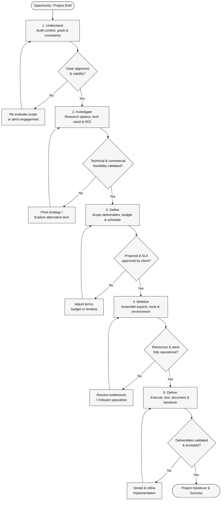

<NmEffectHero
  effect="silk"
  :hero-style="{ minHeight: '90vh' }"
  eyebrow="Insight. Innovation. Strategy. Execution."
  title="Ideas and operations that move businesses forward."
  :description="'Across business operations, technology and new ventures, our work is guided by the ambition to <strong>help organizations improve performance, gain control and create lasting value.</strong>.'"
  :title-style-light="{ color: '#ffffff' }"
  :title-style-dark="{ color: '#ffffff' }"
  :description-style-light="{ color: '#e2e8f0' }"
  :description-style-dark="{ color: '#e2e8f0' }"
  :buttons="[
    { label: 'Discuss a project', href: 'https://wa.me/212620990692?text=Hello%20Numerimondes%2C%20I%27d%20like%20to%20discuss%20a%20project.', external: true, icon: 'whatsapp' },
    { label: 'Explore our capabilities', href: '/services/', style: 'secondary' }
  ]"
/>

<Acomponent
  title="Numerimondes is an independent consulting and solutions company."
  introduction="We explore opportunities, develop ideas, design practical solutions and bring together the expertise needed to make projects happen."
  :gallery="[
    {
      src: 'https://bookface-static.ycombinator.com/assets/ycdc/about/strip-picture-2-compressed-a5f4c41c8c039e0bb0b38bb9d316b79ea9f8211d9e4fa19cf80a1377e74b3036.jpg',
      alt: 'Founder'
    },
    {
      src: 'https://bookface-static.ycombinator.com/assets/ycdc/about/strip-picture-4-compressed-077596611ae3be172d6407ab7a9423f205939fbcfeef24fd54ca8da4f1370b27.jpg',
      alt: 'Founders in San Francisco'
    },
    {
      src: 'https://bookface-static.ycombinator.com/assets/ycdc/about/strip-picture-6-compressed-cd04f86654c60d7c2642aeb14a7c7cd42719036be4e7764fd58a386383671fb6.jpg',
      alt: 'Founders gathering'
    },
    {
      src: 'https://bookface-static.ycombinator.com/assets/ycdc/about/strip-picture-1-compressed-569ab168698179832828d33e2cec6a76f2180fe19425d688788badc68a676d34.jpg',
      alt: 'Founder presentation'
    },
    {
      src: 'https://bookface-static.ycombinator.com/assets/ycdc/about/strip-picture-7-compressed-7f5971e8a87c7c6925fb2f68db87e098033291969eba2a5cabb46398978193e5.jpg',
      alt: 'Founders speaking'
    }
  ]"
  section-title="Possibility becomes valuable through execution."
  :paragraphs="[
    {
      before: 'Every organization has opportunities waiting to be explored:',
      image: {
        thumb: 'https://images.unsplash.com/photo-1552664730-d307ca884978?auto=format&fit=crop&w=96&h=72&q=80',
        src: 'https://images.unsplash.com/photo-1552664730-d307ca884978?auto=format&fit=crop&w=640&h=420&q=85',
        alt: 'A team collaborating around a table',
        caption: 'People working through opportunities together'
      },
      after: 'processes that could run better, information that could support faster decisions, new services worth developing, and ways to connect people, systems and markets.'
    },
    {
      before: 'We combine research, commercial thinking and engineering',
      image: {
        thumb: 'https://images.unsplash.com/photo-1524758631624-e2822e304c36?auto=format&fit=crop&w=96&h=72&q=80',
        src: 'https://images.unsplash.com/photo-1524758631624-e2822e304c36?auto=format&fit=crop&w=640&h=420&q=85',
        alt: 'A workspace set up for focused research and planning',
        caption: 'Research and planning workspace'
      },
      after: 'to examine these possibilities, shape viable approaches and move selected projects into action.'
    },
    {
      before: 'Our contribution can begin with an idea, a question, an operational challenge',
      image: {
        thumb: 'https://images.unsplash.com/photo-1556761175-b413da4baf72?auto=format&fit=crop&w=96&h=72&q=80',
        src: 'https://images.unsplash.com/photo-1556761175-b413da4baf72?auto=format&fit=crop&w=640&h=420&q=85',
        alt: 'Colleagues discussing a project together',
        caption: 'Project discussion and planning'
      },
      after: 'or a clear project brief.'
    }
  ]"
/>

:::: info What this can mean for your business
::: details Better decisions
Clearer priorities, options and investment choices.
:::
::: details More efficient operations
Less duplicated work, fewer avoidable errors and better coordination.
:::
::: details Greater visibility and control
Accessible information, traceable processes and systems you can manage.
:::
::: details New opportunities
Business concepts, partnerships, products and services evaluated for real-world potential.
:::
::: details A clearer route to delivery
Defined scope, accountable coordination and expertise matched to the assignment.
:::
Expected benefits are assessed for each engagement; specific results depend on the project and its implementation.
::::

 <NmShowcase
	 title="What we do"
	 footnote="Our work connects consulting, innovation and delivery. Each engagement is defined around the organization's priorities and the capabilities required."
	 citation="El Moumen Yassine"
	 footnote-marker="*"
		:stories='[
	  {
	    name: "Business Consulting and Development",
	    description: "Opportunity research, commercial strategy, operational diagnosis, project structuring and business development support. We help turn analysis and ideas into decisions, plans and actionable initiatives.",
      color: "#E9A23B",
	    beforeImage: "/images/home/showcase-capabilities/business-before.jpg",
	    afterImage: "/images/home/showcase-capabilities/business-after.jpg",
	    beforeText: "Uncertain strategic direction, fragmented market research, and unaligned commercial priorities.",
	    afterText: "Structured business roadmap, clear decision-making frameworks, and accelerated commercial expansion.",
	    linkText: "Explore consulting",
	    linkUrl: "/services/consulting"
	  },
	  {
	    name: "Digital Systems and Software",
	    description: "Business applications, internal tools, integrations, automation and information systems designed around the people and processes using them. Our engineering work includes custom development and Rust-based initiatives where appropriate.",
      color: "#3B82F6",
	    beforeImage: "/images/home/showcase-capabilities/digital-before.jpg",
	    afterImage: "/images/home/showcase-capabilities/digital-after.jpg",
	    beforeText: "Siloed legacy tools, manual data entry, and slow execution speeds bottlenecking daily operations.",
	    afterText: "High-performance custom software and Rust-powered automation delivering sub-millisecond execution and total data control.",
	    linkText: "Explore software and systems",
	    linkUrl: "/services/software"
	  },
	  {
	    name: "Infrastructure, Equipment and Security",
	    description: "Infrastructure planning, hosting and deployment, self-hosted environments, equipment integration, operational continuity and scoped security assessments. We help organizations make informed infrastructure decisions and manage their technical environments.",
      color: "#8B5CF6",
	    beforeImage: "/images/home/showcase-capabilities/infrastructure-before.jpg",
	    afterImage: "/images/home/showcase-capabilities/infrastructure-after.jpg",
	    beforeText: "Vulnerable, opaque server setup with recurring vendor lock-in fees and unmonitored security gaps.",
	    afterText: "Sovereign, self-hosted infrastructure built for operational continuity, full privacy, and hardened security controls.",
	    linkText: "Explore infrastructure",
	    linkUrl: "/services/infrastructure"
	  },
	  {
	    name: "Operations, People and Capabilities",
	    description: "Organizational workflows, reporting, service operations, training and people-related solutions. Engagements are offered according to available expertise, project scope and operational readiness.",
      color: "#14B8A6",
	    beforeImage: "/images/home/showcase-capabilities/operations-before.jpg",
	    afterImage: "/images/home/showcase-capabilities/operations-after.jpg",
	    beforeText: "Duplicated work, communication friction, and uncoordinated operational workflows across teams.",
	    afterText: "Streamlined operational workflows, clear reporting lines, and upskilled teams executing with full accountability.",
	    linkText: "Explore operations",
	    linkUrl: "/services/operations"
	  },
	  {
	    name: "Innovation and New Ventures",
	    description: "Research, validate and shape opportunities that may lead to new services, products, partnerships or specialized systems. We connect the creative and commercial sides of an idea with a practical development path.",
      color: "#F43F5E",
	    beforeImage: "/images/home/showcase-capabilities/innovation-before.jpg",
	    afterImage: "/images/home/showcase-capabilities/innovation-after.jpg",
	    beforeText: "Untapped commercial concepts and high-potential ideas stalled without a practical path to execution.",
	    afterText: "Validated product-market strategy, robust system architecture, and new venture models deployed for growth.",
	    linkText: "Explore innovation",
	    linkUrl: "/innovation"
	  }
		]'
   :labels="{
     region: 'Our capabilities',
     before: 'Starting point',
     beforeColor: '#e5484d',
     after: 'Possible outcome',
     afterColor: 'var(--vp-c-brand-1)',
     timelineStart: 'Starting point',
     timelineEnd: 'Possible outcome',
     companies: 'Capabilities',
     stories: 'Capability examples',
     compare: 'Compare the starting point and possible outcome for {name}',
     altBefore: '{name}: starting point',
     altAfter: '{name}: possible outcome',
   }"
 />

# One space with many possibilities.

**An interactive showcase of ideas, systems and solutions.**

Discover the areas we explore and the kinds of value that can be created. Browse by business challenge, sector or capability, and open individual stories, prototypes or demonstrations for further detail.

    

        
        
Card Text

    

| Category | Scope |
| :--- | :--- |
| **Business performance** | Operational diagnostics · Commercial workflows · Dashboards and process improvement |
| **Software and automation** | Tailored applications · Integrations · Document workflows and AI-assisted tasks |
| **Infrastructure and connected operations** | Self-hosted systems · Monitoring · Equipment and field applications |
| **People and organizations** | Training · Coordination · Emerging talent solutions |
| **Research and ventures** | Internal standards · Experimental platforms · New business concepts |

<FeluqaButton tag="a" href="/showcase" label="Explore the showcase"/>

<!-- Showcase implementation:
Present each item with an accurate status: Concept / Research / In development / Demo / Delivered.
Use "Delivered" only for verifiable completed work. Separate client references (with permission)
from Numerimondes experiments and illustrative solution concepts.
Suggested interaction: one large visual canvas with switchable categories, layered examples,
and a clear click-through to the relevant project or service page.
-->

## Built around the mission.

Numerimondes operates **on a project-by-project basis**. Every assignment begins with an agreed objective and a clear scope. We assemble the combination of developers, consultants, operators and specialist partners suited to the work.

Our founder acts as the central point of contact for project qualification, solution direction and delivery coordination. Numerimondes remains accountable to the client for the work it undertakes, including work performed by specialists engaged for the mission.

### How an engagement works

<FeluqaButton tag="a" href="/about#delivery-model"
	label="How we work"/>

## Independent by design. Curious by nature.

Numerimondes was founded by **Yassine El Moumen**, its founder and managing director.

His background brings together operational management, project delivery, training, consulting and software engineering. An ongoing interest in research, technology, markets and how organizations work informs the ideas and initiatives explored at Numerimondes.

This combination of field experience and technical inquiry shapes an approach grounded in business realities, creative problem-solving and practical execution.

Numerimondes SARL AU is an independent Moroccan company headquartered in Casablanca. Its registered activities span management and business development consulting, information systems, technology, digital marketing, security, training, contact-centre operations, recruitment and IT-related products and equipment. Individual offerings are introduced as they become ready for delivery.

<FeluqaButton tag="a" href="/about"
	label="More about us"/>

## Initiatives in development

Our internal initiatives are part of the way we research, experiment and build future capabilities.

<MegaCards
  :items="[
    {
      title: 'Feluqa',
      description: 'Coming soon. A Rust-based, cross-platform application framework for efficient systems across deployment environments.',
      href: '/initiatives/feluqa',
      image: 'https://images.unsplash.com/photo-1518770660439-4636190af475?auto=format&fit=crop&w=900&q=80',
      icon: '/images/home/initiatives/feluqa.svg'
    },
    {
      title: 'The Best Recruit',
      description: 'Coming soon. A recruitment initiative to help employers discover and evaluate relevant profiles.',
      href: '/initiatives/the-best-recruit',
      image: 'https://images.unsplash.com/photo-1521737711867-e3b97375f902?auto=format&fit=crop&w=900&q=80',
      icon: '/images/home/initiatives/the-best-recruit.svg'
    },
    {
      title: 'SPMPST',
      description: 'Specification in development. A proposed standard for portable, structured Markdown content and site-building workflows.',
      href: '/initiatives/spmpst',
      image: 'https://images.unsplash.com/photo-1455390582262-044c3d27791c?auto=format&fit=crop&w=900&q=80',
      icon: '/images/home/initiatives/spmpst.svg'
    }
  ]"
  :composition="[
    { items: [0, 1] },
    { items: [2] }
  ]"
  :more="{
    title: 'Discover all our 3 initiatives',
    description: 'Explore our current and upcoming projects',
    href: '/initiatives/',
    image: 'https://images.unsplash.com/photo-1497366754035-f200968a6e72?auto=format&fit=crop&w=900&q=80'
  }"
  :card-height="220"
/>

<!-- Webkernel was an earlier, discontinued project. Keep it in the engineering history if useful;
do not place it among current offerings. -->

## Grow with us

We collaborate with independent professionals and organizations that identify opportunities, contribute specialist expertise or open access to new markets.

### Accounting and advisory firms

Introduce clients who could benefit from operational, organizational or technical support. You retain your trusted advisory relationship; introductions occur with the client's consent and each assignment is scoped individually.

### Business development and referral partners

Identify qualified opportunities, introduce prospective clients and collaborate on selected commercial activities. Commission and referral terms are agreed in writing for eligible assignments.

### Freelancers and specialist partners

Join project teams when your expertise fits an assignment — across software engineering, including Rust, infrastructure, business consulting and other relevant specialties.

<FeluqaButton tag="a" href="/partners" label="Explore partnerships"/>
<FeluqaButton tag="a" href="/contact?topic=partnership" label="Propose a collaboration"/>

## Clear scope. Clear commercial terms.

Our proposals are structured around the type of work, the complexity of the mission and the responsibilities involved. Consulting, feasibility studies, implementation and ongoing services may follow different pricing models.

Explore how we scope engagements and prepare commercial proposals.

<FeluqaButton tag="a" href="/pricing" label="Our pricing approach"/>

<!-- Pricing page: explain discovery, fixed-fee vs milestone vs recurring support,
what affects a quote, and written agreements. Do not publish invented rates or blanket guarantees.
-->

## What could your next opportunity become?

Share a challenge, an idea, a business objective or a project you want to explore. We can discuss its potential, the decisions involved and a practical next step.

**Primary action:** Start a conversation → `/contact`
**Secondary action:** Become a partner → `/partners`

<!-- INTERNAL PUBLISHING NOTES — DO NOT RENDER
1. Website position: consulting + innovation + solutions + execution. Do not reduce Numerimondes to software.
2. State benefits as aims or project-dependent outcomes; do not fabricate case studies, metrics or success claims.
3. Project-by-project operating model: a single accountable counterpart, adaptable mission teams.
4. Founder visibility is intentional; avoid implying a large permanent employee base.
5. Feluqa and The Best Recruit: Coming soon. SPMPST: specification in development.
6. The Best Recruit must not advertise live placements or an active candidate service before launch.
7. Showcases must distinguish real delivered work from concepts and RandD.
8. Partner compensation is subject to specific written terms; avoid generic promised commission percentages.
9. Pricing page explains methodology and commercial models, not an unverified price list.
10. Main navigation suggestion: Services / Solutions and Showcase / Innovation / Partners / About / Contact.
11. Utility links: Pricing / Feluqa / The Best Recruit / SPMPST.
-->

