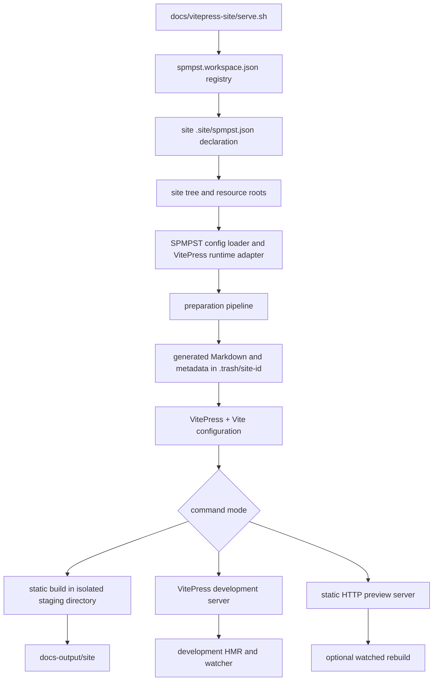

# VitePress Site Host: Complete Mechanism and Lifecycle

This document describes the current implementation in `docs/vitepress-site/`: how a command selects a site, how the host prepares and renders it, how resources and locales resolve, and what the build, development server, and static preview each do. It describes observed behavior, including implementation limits; it is not a specification of future SPMPST behavior.

## 1. What this host is

`docs/vitepress-site/` is the shared Node/VitePress host. It owns the CLI wrappers, preparation pipeline, VitePress adapter, Vite configuration, renderer theme, shared icon/flag catalogues, dependencies, caches, and third-party notices. It does not own the authored pages for a site.

Each site owns its `.site/`, `src/`, and `resources/` tree. The host reads the selected tree, prepares a generated VitePress source tree and metadata in `.trash/<site-id>/`, and asks VitePress to either render static HTML or serve the generated source in development. Production output is written outside the site tree, normally under `docs-output/`.

The data path is:



## 2. Entry points and command modes

There is no `docs/vitepress-site/server.sh` in the current tree. The top-level entry point is [serve.sh](serve.sh). It derives its own directory from the script path, so it can be called from another working directory. The smaller scripts under `app/bin/` delegate directly to `app/scripts/site.mjs`.

The host also exposes npm commands in `package.json`: `docs:prepare`, `docs:build`, `docs:serve`, `docs:preview`, `docs:clean`, `docs:check`, `docs:new`, and `docs:verify`. These call `node app/scripts/site.mjs <command>`. They select a single site with `--site <id>` or `VITEPRESS_SITE_ID`; if there are multiple sites and neither is set, the command prompts interactively or fails in a non-interactive process.

### `./serve.sh --list`

Reads the registry and declarations, then prints each site's ID, name, source directory, and output directory. It does not start VitePress.

### `./serve.sh --sites=site-1 --build`

The shell wrapper resolves `site-1` to its registered declaration, verifies that the host's VitePress executable exists, then invokes `node app/scripts/site.mjs build --site <id>`. It builds each selected site in sequence and exits.

### `./serve.sh --sites=site-1` (default server mode)

For each selected site, starts `site.mjs serve --site <id>`. That command prepares generated sources, starts `vitepress dev`, and starts a separate preparation watcher. It is the authoring/development path: VitePress serves the generated Markdown and Vite handles client HMR.

### `./serve.sh --sites=site-1 --preview`

This shell mode first builds every selected site. It then starts a static preview server for each built output and starts a watcher in rebuild mode. Edits rebuild only the changed site's output; the static server continues to serve the output directory after its atomic replacement.

This mode is distinct from `node app/scripts/site.mjs preview --site <id>` (also exposed by `npm run docs:preview`). The latter builds once and launches a static preview server; it does not start the shell wrapper's rebuild watcher.

The shell wrapper assigns separate available ports, starting at `PORT` (default `4173`), and defaults to `HOST=127.0.0.1`. Without `--sites`, it prompts in an interactive terminal; without a terminal it selects all registered sites. `--list` cannot combine with other modes; `--build` and `--preview` cannot be combined. `SIGINT`/`SIGTERM` stop child processes.

## 3. How the registry connects host and sites

The host-level registry is [spmpst.workspace.json](spmpst.workspace.json):

```json
{
  "sitesPaths": [
    "../site-1/.site/spmpst.json",
    "../site-2/.site/spmpst.json"
  ]
}
```

Each entry is a path to a site declaration. Relative registry entries are resolved from the directory containing the registry. `VITEPRESS_SITE_MANIFEST` can point both the shell wrapper and Node site registry at another registry file.

The site declaration is a separate JSON object stored with its owner, for example `docs/site-1/.site/spmpst.json`:

```json
{
  "id": "feluqa-docs",
  "name": "Feluqa documentation",
  "sourcePath": "..",
  "resourcesPath": "../../vitepress-site/resources",
  "siteResourcesPath": "../resources",
  "outputPath": "../../../docs-output/site-1"
}
```

Paths in the declaration are resolved relative to the directory containing that declaration, not relative to the host or process current directory:

| Field | Meaning | Feluqa docs example |
|---|---|---|
| `id` | Stable selector used by internal commands and trash/cache names | `feluqa-docs` |
| `name` | Human-readable label | `Feluqa documentation` |
| `sourcePath` | Site root containing `.site/`, `src/`, and site `resources/` | `docs/site-1/` |
| `resourcesPath` | Shared adapter catalogues (icons and flags) | `docs/vitepress-site/resources/` |
| `siteResourcesPath` | Site-owned components, hooks, diagrams, and assets | `docs/site-1/resources/` |
| `outputPath` | Final rendered static site directory | `docs-output/site-1/` |

`resourcesPath` and `siteResourcesPath` are optional in the registry reader: they default to host `resources/` and site-root `resources/`, respectively. The shell's lightweight registry reader uses the ID, name, source, and output fields to choose sites; `site-registry.mjs` validates all fields and resolves all resource roots before running preparation.

The current aliases accepted by `serve.sh --sites` include site ID, name, source directory basename (so `site-1` works although the ID is `feluqa-docs`), and one-based selection numbers. Internal app commands use the resolved site ID.

The site's separate `.site/targets/vitepress.target.config.json` also contains an `outputDir`, but normal host commands set `DOCS_OUTPUT_DIR` from the site declaration. During a production build that environment value is temporarily replaced with a staging output path. The declaration is therefore authoritative for the normal final destination.

## 4. Site tree and configuration data types

The current site trees use these SPMPST-owned metadata filenames:

```text
site-root/
├── .site/
│   ├── spmpst.<concern>.json
│   ├── locales/*.locale.json
│   ├── public/*
│   └── targets/*.target.config.json
├── src/
│   ├── guides/
│   └── collections/
└── resources/
    ├── components/
    ├── hooks/
    ├── diagrams/
    └── assets/
```

### Concern files and ownership

`config/discover.mjs` finds concern files, locale bundles, public files, and target configs. `config/assemble.mjs` reads and combines the core model. `config/registry.mjs` assigns keys to concern owners:

| Concern file | Owned keys in the current loader |
|---|---|
| `spmpst.definitions.json` | `site`, `guidesPath`, `indexPath`, `project`, `subguides`, `iconFallback` |
| `spmpst.lang.json` | `languages`, `fallbackLanguage`, `selector` |
| `spmpst.topbar.json` | `items`, `theme` |
| `spmpst.collections.json` | `collections` |
| `spmpst.appearance.json` | `fonts`, `logo`, `ogImages`, `mermaid` |
| `spmpst.links.json` | `socialLinks` |
| `spmpst.seo.json` | `siteUrl`, `path`, `icon` |

The loader recognizes only the `spmpst.<concern>.json` naming convention; previous unprefixed names are not accepted. It rejects unknown concerns, keys in the wrong file, duplicate ownership, malformed JSON, missing required definitions/language files, missing locale bundles, and invalid language/default-language relationships. It can emit localization warnings; strict i18n can turn missing translations into errors. A target config is loaded under its target name (`vitepress`) and remains opaque to the shared config model until `toVitepressRuntime` consumes it.

`<language>.locale.json` supplies localized UI strings, search labels, outline labels, footer/notices, and optional SEO content. `public/*` files are loaded as text and passed through as public text files. `targets/vitepress.target.config.json` supplies VitePress-specific output, project directories, styles, theme slots, Markdown, search, and outline settings. Guide-local `spmpst.guide.json` supplies a guide's title/favicon and optional colors, logo, fonts, Open Graph images, URI, and theme slots. `spmpst.sidebar.json` provides localized labels and an icon for a source directory.

The composed `SiteConfig` is the renderer-facing shape in `app/.vitepress/types/site-config.d.ts`: site identity, guides, locales, topbar, collections, styles, fonts, theme/project paths, search/outline/footer, SEO, public files, and Mermaid options. The Node config-source adapter supplies file reads; the VitePress composition root injects that source plus navigation and head-transform functions.

## 5. Process environment and path ownership

Before invoking `site.mjs`, `serve.sh` passes an explicit site ID. `site.mjs` resolves the declaration and constructs the environment consumed by the pipeline:

| Variable | Value / purpose |
|---|---|
| `SPMPST_ROOT` | Selected site root; anchors `.site`, `src/guides`, `src/collections`, and site resources |
| `DOCS_OUTPUT_DIR` | Selected final output, or isolated build staging output |
| `VITEPRESS_SITE_ID` | Site identity for scratch/cache namespace and config |
| `VITEPRESS_SITE_DECLARATION` | Resolved declaration file path |
| `VITEPRESS_SITE_ROOT` | Selected site root (legacy/consumer context) |
| `VITEPRESS_TRASH_DIR` | Per-site generated files/cache root; build mode uses a separate `build/` subdirectory |
| `VITEPRESS_RESOURCES_DIR` | Shared host catalogue root |
| `VITEPRESS_SITE_RESOURCES_DIR` | Selected site's resource root |
| `HOST`, `PORT` | Local dev or preview bind values |

`resolveLayout()` and `resolveSitePaths()` turn these into resolved roots. The implementation keeps three resource concepts separate:

1. **Site source:** Markdown, config, source-relative images, and `site-root/resources/`.
2. **Tool resources:** host `resources/icons/` and `resources/flags/`, owned and indexed by the conforming tool.
3. **Site media:** selected site `resources/media/`, owned by that site and never configured through a host-relative path.
3. **Generated/cache data:** `.trash/<site-id>/generated-guides/`, `vitepress-generated/`, Mermaid cache, and VitePress cache.

The generated Markdown directory is VitePress `srcDir`; the output directory is VitePress `outDir`. The site source tree is not rewritten into the generated tree in place.

### Build dependencies and delegation

Dependencies are installed for the shared host (`npm install` from `docs/vitepress-site/`); the current wrapper does not automatically install them. The shell checks for the VitePress executable and stops with an install hint if it is absent.

| Dependency/tool | Delegated work |
|---|---|
| Node.js | Executes the shell's registry helper, app CLI, config loader, preparation pipeline, and watcher processes. |
| VitePress | `dev`, `build`, and static `serve`; Markdown-to-HTML rendering, client/server bundles, route rendering, local search integration. |
| Vite and Vue toolchain (through VitePress) | Dev server/HMR, Vue SFC compilation, package resolution, CSS pipeline, JS/CSS/assets bundling and chunk warnings. |
| `@mermaid-js/mermaid-cli` (`mmdc`) and Mermaid config | Converts authored Mermaid fences to cached SVGs during preparation. |
| Shiki and selected `@shikijs` languages/themes | Code highlighting used by the Feluqa docs homepage components. |
| Tailwind CSS and PostCSS | Builds configured component/theme styles. |
| `ogl` | WebGL-based effects in site-owned homepage components. |

The package manifest and lockfile in this host define these versions. `serve.sh --preview` delegates HTTP serving to VitePress's static `serve()` API; it does not run a separate custom Express server.

## 6. Resource references: tool icons and flags, site media

### Grammar and parser

`app/scripts/spmpst/resources.mjs` recognizes whole-string references:

```text
@spmpst::icon::<name>
@spmpst::icon::<family>/<name>
@spmpst::flag::<code>
@spmpst::media::<name>
```

Names are logical IDs, not family paths or generated filenames. The parser validates the identifier, rejects empty, `.` and `..` path segments, and normalizes Unicode to NFC. `resolveResourceReferences(value, resolver)` walks arrays and objects and sends each parsed reference to the VitePress adapter.

### Tool catalogues and site media

The conforming tool provides standard icon and flag catalogues. Sites reference them by logical name and do not configure catalogue paths. Family-qualified icon names select a tool family when needed; otherwise the adapter searches its documented family order.

Site-owned images and SVGs live under that site's `resources/media/` directory and use `@spmpst::media::<name>`, for example `@spmpst::media::icons/prologue-book`. This keeps every site self-contained while allowing custom visuals beside components, styles, and brand assets. The resolver confines media to this directory.


### Where resolution happens

- Site model configuration is recursively resolved when `toVitepressRuntime()` converts the shared model. Topbar icon paths are converted to embedded SVG data URLs; social-link icon paths become inline SVGs.
- Markdown page `icon` frontmatter and `spmpst.sidebar.json` icons are resolved through the tool catalogue or selected-site media root and copied into generated assets. Missing page icons still use the configured fallback with a warning; a missing fallback is fatal.
- If language flags are enabled, source preparation creates `@spmpst::flag::<locale>` for each configured language and copies it to `generated-guides/public/flags/language/<locale>.svg`.
- Local Markdown image links and frontmatter `src:` values resolve separately, relative to their source page. The parser does not rewrite arbitrary `@spmpst` text inside Markdown prose. Sites do not use `.site/spmpst.resources.json` and MUST NOT point at sibling tool directories.

`copyAsset()` confines source files to allowed roots, names them by SHA-256 plus extension under `__docs-assets/`, and writes only when bytes change. This content hash is an internal output detail; authors use readable logical names.

## 7. Lifecycle A: static build

The following is what `./serve.sh --sites=site-1 --build` currently delegates to:

1. **Parse shell options.** `serve.sh` validates combinations and resolves registry entries. It allocates no server port in build mode.
2. **Check host dependencies.** The wrapper requires `docs/vitepress-site/node_modules/.bin/vitepress`; if missing it prints the `npm install` command and exits. `site.mjs` prefers the app-local VitePress binary, then the host-level binary. Mermaid rendering also expects the host-level `mmdc` binary.
3. **Select site again in the app.** The shell invokes `node app/scripts/site.mjs build --site <id>`. The app registry resolves the declaration and validates required fields.
4. **Construct paths/environment.** The app derives site, shared-resource, site-resource, output, and per-site trash roots. It fixes the working directory to the host app directory, not the user's shell directory.
5. **Create isolated staging paths.** The final output's parent contains `tmp/<output-basename>.stage-<pid>` and a corresponding backup. Build preparation receives the stage as `DOCS_OUTPUT_DIR` and `<site-trash>/build` as `VITEPRESS_TRASH_DIR`. VitePress runs from a per-build project root under that build trash directory; dev uses a separate project root. Each therefore owns its internally fixed `.temp` directory as well as its generated tree and cache.
6. **Prepare source (`prepareSources`).** Load/validate config; validate VitePress target settings, languages, guide/collection paths, project component/hook/icon directories and theme slots; scan guides and collections; normalize ordered directory/file prefixes; infer locale suffixes; map source paths to routes; collect frontmatter/sidebar records; verify required sidebar labels and icons; copy ordinary assets; stage public files and optional flags.
7. **Prepare content (`prepareContent`).** Resolve/copy logos, fonts and Open Graph images; read each guide config; derive localized collection indexes and article metadata; register discovered Vue SFCs; validate configured theme slots against discovered component names; emit generated JSON/TS modules for colors, fonts, collections, components, theme, hooks, styles, site content, navigation/sidebar metadata, and SEO helpers.
8. **Run ordered preparation stages.** The pipeline transforms Markdown and local links/assets and renders Mermaid; creates missing locale fallback pages from the default-language page; generates configured SEO/FAQ pages; generates missing directory indexes/aliases; computes previous/next page frontmatter; removes stale generated files. Each stage writes through helpers that preserve unchanged bytes and preserve the pager-owned frontmatter block.
9. **Load VitePress/Vite configuration.** VitePress reads `app/.vitepress/config.ts`, which re-exports the config composition root. It loads the generated site model and metadata, constructs navigation/sidebars/locales and head transforms, then uses `app/config/vite.config.ts`. Vite aliases `@docs` to the generated tree and `@generated` to generated metadata; the plugin resolves imports from site components using host dependencies, serves selected generated public assets, and provides generated-Markdown HMR behavior in dev. A configured `project.viteConfig` or host-root Vite config is merged if present.
10. **Render static pages.** `vitepress build` compiles the client and server bundles, renders all routes, and writes static HTML/assets to the staging directory. Vite's chunk-size warning is reported; the warning is not suppressed by the current site Vite config.
11. **Stamp and validate stage.** The command adds `.spmpst/build-timestamp` to staging and runs `check-file-links.mjs` against the staging tree. VitePress's HTML transform inserts a generated timestamp comment when each page is rendered.
12. **Publish atomically.** Existing final output is renamed to a backup, stage is renamed to final output, then backup is removed. If any earlier step fails, the stage is deleted and the backup is restored. The user sees a final path such as `docs-output/site-1/`.

The publication directory contains rendered static files. The app, Node, VitePress, and dependency installation are build/preview concerns; the static host only needs to serve the produced files.

## 8. Lifecycle B: interactive development server

The default `./serve.sh --sites=site-1` path runs `site.mjs serve`:

1. Run a full (non-incremental) SPMPST preparation for the selected site. The ordinary generated Markdown root is cleaned and recreated.
2. Spawn `vitepress dev --host <host> --port <port> --strictPort` from `app/` with the selected site's environment.
3. Spawn `scripts/dev/watch.mjs` as a separate child process.
4. VitePress serves the generated Markdown tree; Vite bundles client code and custom components. The app theme extends `vitepress/theme`, registers generated project Vue components, applies route-specific theme/color/font/logo settings, and installs page enhancements.
5. On edits, the watcher debounces filesystem events for 60 ms, batches changed paths, and runs incremental preparation (`DOCS_PREPARE_INCREMENTAL=1`). Unchanged staged files retain their contents/mtime; stale files are removed at cleanup.
6. Page body edits remain on the generated-Markdown HMR path. The Vite post-HMR hook maps a changed generated Markdown path to its public URL and returns the corresponding Vite module so the active route receives a module update without document navigation. MiniSearch's existing entry is discarded before re-add, avoiding duplicate-ID errors when VitePress reindexes an edited page.
7. Structural changes (directory/file structure, route-affecting metadata such as `sidebarTitle`, or `.site` configuration) change the watcher's structural signature. It touches the VitePress config file to request a config restart. Ordinary body edits do not trigger that restart.
8. Resource/source events also trigger preparation. Vite serves copied generated assets. If preparation fails, the watcher logs the failure and stays alive for the next edit.

The structural-signature logic hashes source paths/directories and sidebar titles, all `.site` config file contents, and source-file metadata; page bodies and asset bytes are excluded from that signature so they do not force a config restart. `.site` changes do force one. The watcher covers `src/`, `.site/`, shared resources, and site resources.

On termination the app sends SIGTERM to both VitePress and the watcher. The top-level shell also terminates and waits for its child processes.

## 9. Lifecycle C: build-then-static-preview with watched rebuilds

`./serve.sh --sites=site-1 --preview` does not use the VitePress dev server:

1. Build each selected site with the same isolated, checked, atomically published static-build pipeline described above.
2. Find distinct available ports starting from `PORT` and print a URL per site.
3. Start `site.mjs serve-build`, which runs `preview-server.mjs`; VitePress `serve()` serves the already-built output over HTTP.
4. Start `site.mjs watch`, setting `DOCS_WATCH_BUILD=1`. The same source/config/resource watcher now invokes `site.mjs build` after each debounced batch instead of incremental preparation.
5. The static server serves the configured final output path. Build publication swaps that directory atomically. Reload the browser after a rebuild so its HTML and hashed client chunks come from the same build; keeping old chunks available to already-open pages remains a limitation.

This gives a production-like static preview and rebuild loop. It does not provide Vite client HMR; each rebuild changes the generated files, and the browser should be refreshed to load the matching HTML and client assets.

## 10. Preparation pipeline, data flow, and stage outputs

`app/scripts/preparation/pipeline.mjs` owns orchestration. It obtains a per-site lock (`prepare.lock`, with stale-lock detection and a 30-second wait limit), then calls these operations in order:

| Order | Operation | Input → output / reason |
|---|---|---|
| 1 | `prepareSources` | Site tree/config → staged source records, route map, ordered navigation metadata, copied static inputs. Validates ownership and path contracts before rendering. |
| 2 | `prepareContent` | Source records plus configs/resources → derived collection pages/data, styles imports, component registry, hook modules, colors/fonts/SEO/sidebar/theme metadata. |
| 3 | `runTransformMarkdown` | Staged page Markdown → normalized links, staged local assets, rendered Mermaid image references, collection frontmatter. |
| 4 | `runLanguageFallbacks` | Default-language pages → localized copies when a translation is absent; marks requested/content languages and fallback notice. |
| 5 | `runSeoPages` | Locale SEO quick links/FAQ config → generated localized SEO pages and structured page icons. |
| 6 | `runDirectoryIndexes` | Directory tree → missing index pages/no-slash aliases based on the first real child page; generated aliases are excluded from search. |
| 7 | `runPager` | Generated reading order → explicit `prev`/`next` frontmatter, avoiding self-links through generated aliases. |
| 8 | `runCleanup` | Generated file set → remove stale files only in incremental mode; print page and Mermaid cache/render counts. |

`DOCS_PREPARE_TIMING=1` prints per-stage and total preparation timings. `DOCS_PREPARE_NO_LOCK=1` disables the lock for controlled tooling. The lock serializes prep within one site trash namespace; separate site IDs have separate namespaces.

Key path/data types passed between stages include:

- **Site config model:** merged core JSON values, locale bundles, public text files, and opaque named target objects.
- **VitePress runtime config:** typed renderer-facing object (see `SiteConfig`) with resolved local paths, locale labels, guide/collection config, resolved resources, and target settings.
- **Page record:** `{ from, to, sourceRoot, icon, iconAsset }` for source Markdown mapped to staged Markdown plus resolved page icon.
- **Route map:** absolute source file path → absolute staged file path.
- **Sidebar record:** output-directory-relative path → localized labels and resolved icon.
- **Generated files:** set of absolute staged paths used to remove stale incremental output safely.
- **Generated metadata:** JSON/TS modules under `.trash/<id>/vitepress-generated/` imported at VitePress config or browser-build time.

The important distinction is that SPMPST handles site structure, source validation, routes, localization, logical resources, and preparation. VitePress/Vite handle Markdown rendering, Vue component compilation, browser bundle generation, static HTML rendering, dev HMR, and static HTTP serving.

## 11. Route and language mechanics

The current source convention supports language variants as co-located filenames, for example `page.en.md` and `page.fr.md`. The final language suffix is removed from the staged basename. A file without a language suffix belongs to the configured fallback language. Numeric prefixes such as `010-` or `020.` affect navigation order and are removed from output paths. Dot-prefixed files, `README.md`, `spmpst.sidebar.json`, `spmpst.guide.json`, and collection category metadata are not published as pages.

Locale list, fallback locale, default-prefix policy, labels, flag visibility, search/footer/notice copy, and fallback notice templates are configured separately. When a non-default translation is absent, the fallback stage copies the default page into that locale's route, sets `requestedLanguage`, `contentLanguage`, and `languageFallbackNotice`, rewrites the `lang` value, adjusts known local route links to the locale where appropriate, and copies relative imported assets beside the generated page.

Guide routes come from `spmpst.definitions.json` subguide path and `uri.base`/`uri.entry`/`uri.index`. Collections are rooted under `src/collections`, configured with IDs and layout, and receive generated localized indexes. For example, Feluqa's `feluqa.rs` source guide is mapped to the site root while other guides use `/sdui/`, `/internals/`, `/agents/`, and `/learn/`. Route/path ownership stays in each site declaration/config, not in the shared host registry.

## 12. Components, hooks, styles, and browser theme

The current preparation code recursively discovers `.vue` files below the configured `project.components` directory, derives a PascalCase component name from each filename, rejects name collisions, and emits imports/registrations in the generated `components.ts`. The VitePress theme registers these components globally, so they can be used by generated Markdown. Theme slots in the target config and guide `spmpst.guide.json` are checked against these component names and are rendered at the configured VitePress slots.

This is the current adapter mechanism: automatic registration is for Vue SFCs. It does **not** itself install arbitrary React/Svelte toolchains or provide a universal mixed-framework component runtime. A host Vite config can add plugins, but each framework's compiler/registration remains the site's build setup.

The host recognizes site hooks by conventional names under `project.hooks`:

- `documentation-hooks` plus optional `documentation-hooks.css` exports `DocumentationNotice` and `DocumentationLastModified`; when absent, generated no-op Vue components are emitted.
- `documentation-seo` exports `transformDocumentationHead`; when absent, a no-op transform is emitted. `head.ts` calls the hook with page/title/description/site/language/OG image inputs.

Configured styles are emitted as imports in a generated TypeScript module. Vite compiles them along with the host theme CSS and any hook CSS. The browser theme extends the VitePress default theme and adds route-specific color/font/logo/favicon application, configured theme slots, page action controls, Mermaid diagram zoom/theme handling, image zoom, notices/last-modified slots, and pager/sidebar icon integration.

## 13. Vite and VitePress configuration ownership

`app/.vitepress/config.ts` is only the conventional VitePress entry point; it exports `app/.vitepress/config/site.ts`. The composition root:

1. Loads the selected site config through `node-config-source.ts`.
2. Reads the generated navigation/sidebar/collection/theme/SEO metadata from the per-site scratch tree.
3. Calls the navigation factory to build VitePress nav, sidebars, localized config and route helpers.
4. Calls the head factory for per-page favicon, canonical/SEO metadata, Open Graph data, structured FAQ JSON-LD, guide colors, logo settings and fonts.
5. Calls `defineConfig()` with the generated Markdown as `srcDir`, output path as `outDir`, `cleanUrls`, client routing (`mpa: false`), Markdown options, local search, locale navigation/sidebar/footer, and custom Vite config.

`app/config/vite.config.ts` owns host-level Vite behavior: workspace filesystem allowlist; cache and PostCSS path; aliases for Vue/VitePress/generated config; resolution of package imports from site component files via the host package resolver; middleware for generated favicon/text/Mermaid/content-addressed assets; and a generated-Markdown HMR hook. It loads an optional configured project Vite config (or conventional host-root Vite config) and merges it with the host config.

VitePress owns the renderer lifecycle. Vite owns dev transforms, Vue compilation, bundling, asset hashing and chunking. The adapter does not currently replace Vite's client chunking with a general custom bundler.

## 14. Failure boundaries and operational choices

- Invalid JSON, missing required config/locale/site declaration fields, duplicate config ownership, invalid paths, missing page icons/fallbacks, bad collection metadata, route conflicts detected by specific generators, or bad Mermaid config stop preparation/build with an error.
- Missing/unknown icons can use `iconFallback`; the resolver warns once per missing name. Missing configured fallback is fatal.
- Local asset paths are confined to allowed source/resource roots. Logical resources are confined to shared catalogues. Output cleanup is scoped to selected site staging/output and selected site cache roots.
- Production builds use an isolated stage, cache namespace, and VitePress project root, so a concurrent dev server does not lose its generated Markdown or VitePress temporary modules. Output replacement is rename-based and restores a previous output on failure. Static-preview sessions still need a reload after replacement because old hashed assets are not retained.
- Incremental preparation writes only changed bytes, retains the pager block owned by the last stage, and removes files no longer in the generated set.
- VitePress dev and static preview are different products: dev has Vite module HMR; static preview serves rendered HTML and relies on rebuilds.
- `check-file-links.mjs` validates local generated HTML links after the build. It is not a full external link check or browser interaction test.

## 15. Important current limits

- The installed CLI still requires Node, host `node_modules`, VitePress, and (for uncached Mermaid rendering) Mermaid CLI. This is not yet the self-contained future `spmpst` binary described in `docs/SSG.md`.
- The current shared host is VitePress/Vue-specific. Site-owned Vue SFC registration is implemented; automatic multi-framework compilation is not.
- `@spmpst::resources` resolves logical icon/flag resources at explicit configuration/icon sites. It is not a general Markdown expression system.
- The normal build produces static files; it does not deploy/publish them to GitHub Pages or another host. Deployment is a separate operation.
- A 900-page/5 ms figure is not measured or claimed by this implementation. Preparation can print stage timings, but renderer build and asset processing are separate costs.
- `docs/vitepress-site/` remains a neighboring host implementation today. The future all-in-one SPMPST workflow aims to hide that internal location from users; the current repo script is still physically located here.

## 16. Key code map

| Responsibility | Implementation |
|---|---|
| Multi-site shell, mode selection, port allocation, child process lifecycle | `docs/vitepress-site/serve.sh` |
| Host registry lookup, site selection, environment construction, command dispatch, atomic build, serve/watch/clean | `app/scripts/site-registry.mjs`, `app/scripts/site.mjs` |
| Root and per-site path resolution | `app/scripts/paths.mjs`, `app/scripts/spmpst/layout.mjs` |
| Config file discovery, ownership, validation, typed resource references | `app/scripts/spmpst/config/`, `app/scripts/spmpst/resources.mjs` |
| Site config conversion and resource lookup | `app/scripts/preparation/runtime.mjs`, `resolve-resource.mjs` |
| Source scan, routes, source icons, flags, ordinary asset staging | `app/scripts/preparation/source-stage.mjs` |
| Collections, generated config modules, components and hook discovery | `app/scripts/preparation/content-stage.mjs` |
| Pipeline ordering, lock, timing | `app/scripts/preparation/pipeline.mjs` |
| Markdown link/assets/Mermaid transform | `app/scripts/preparation/stages/transform-markdown.mjs` |
| Locale fallback, SEO pages, directory indexes, pager, cleanup | `app/scripts/preparation/stages/` |
| VitePress config composition and route/sidebar/head transforms | `app/.vitepress/config/` |
| Browser theme and site component registration | `app/.vitepress/theme/index.ts` |
| Vite aliases, site dependency resolution, generated asset serving and Markdown HMR | `app/config/vite.config.ts` |
| Dev and static preview watchers/servers | `app/scripts/dev/watch.mjs`, `preview-server.mjs` |

